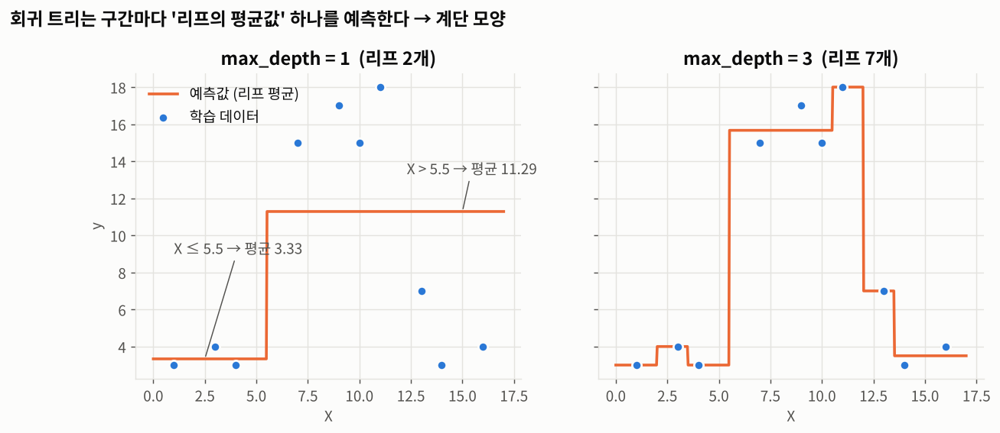
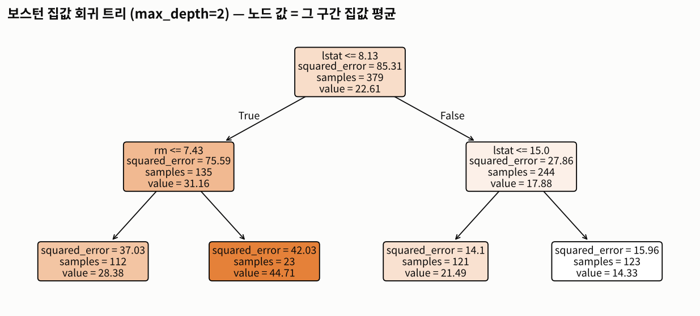
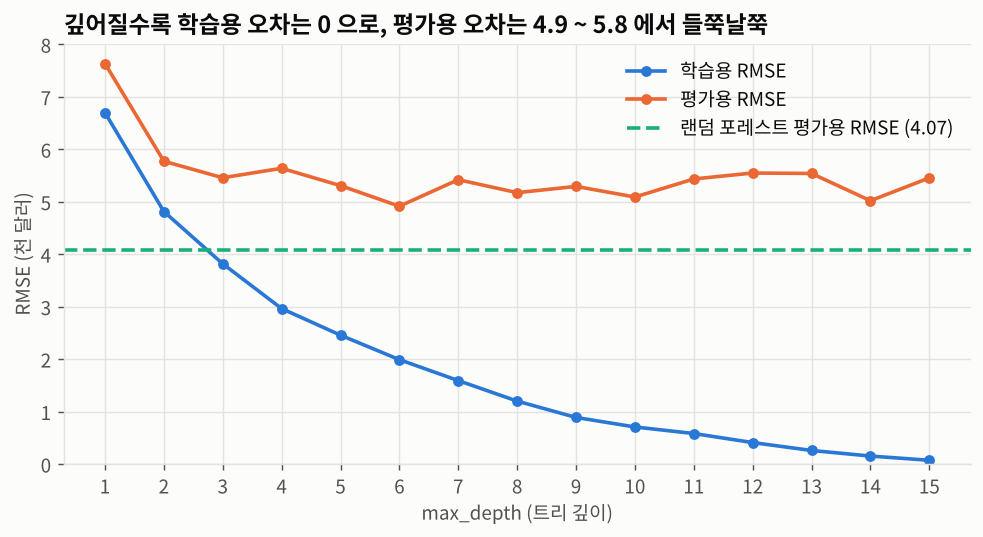
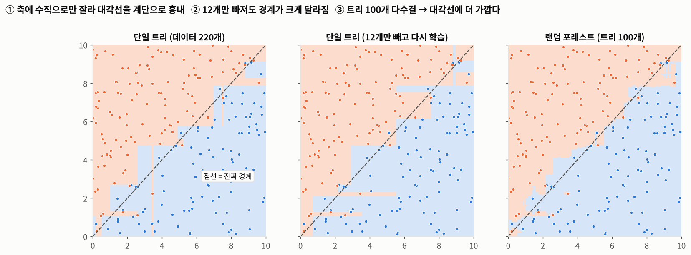
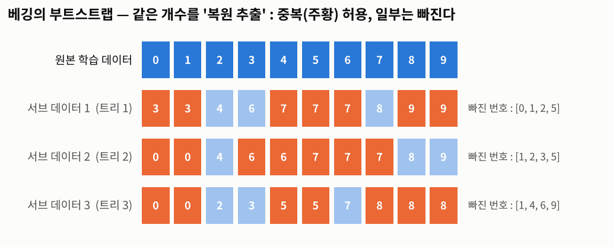
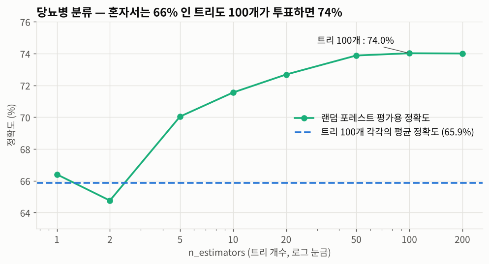
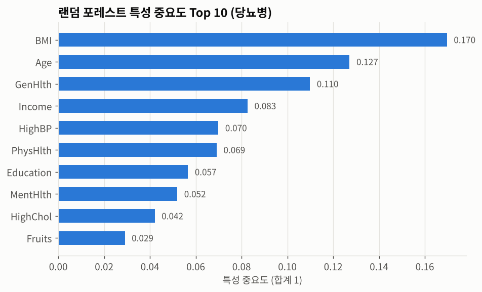
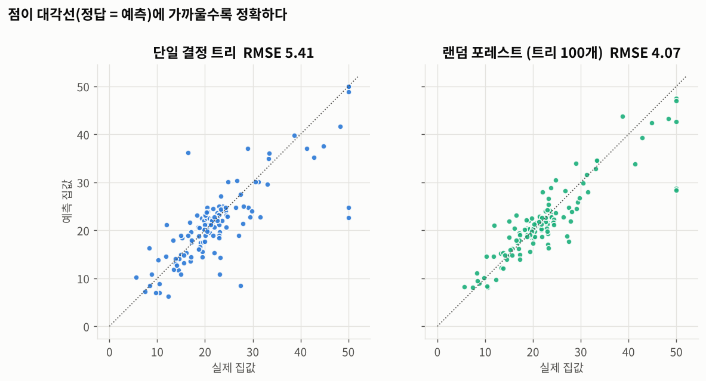

# Day 024 · 2026-10-13 (화)

`데이터 분석과 머신러닝/딥러닝` · 7주차

> **한 줄 요약** — 결정 트리로 **숫자(집값)** 를 예측하면 리프마다 **평균값** 하나를 내놓아 **계단 모양**이 되고, 단일 트리는 **데이터가 조금만 바뀌어도 흔들린다**. 그래서 트리 여러 개를 **부트스트랩 샘플로 따로 학습해 투표 · 평균** 내는 **랜덤 포레스트**로 묶었더니, 당뇨병 정확도 65.5% → **74.0%**, 보스턴 RMSE 5.41 → **4.07** 로 좋아졌다.

📂 실습 노트북
- [`lecture/tree_regression.ipynb`](./lecture/tree_regression.ipynb) — 트리 회귀 원리 · 보스턴 집값 · 규제 매개변수 · 불안정성 (필기 `결정트리회귀실습01`)
- [`lecture/random_forest.ipynb`](./lecture/random_forest.ipynb) — 앙상블 · 투표 · 배깅 · 랜덤 포레스트 분류 / 회귀 (필기 `앙상블분류실습` · `앙상불회귀실습01`)

📊 실습 데이터 → [`house_price.csv`](./lecture/house_price.csv) (506행) · [`diabetes_binary_5050split_health_indicators_BRFSS2015.csv`](./lecture/diabetes_binary_5050split_health_indicators_BRFSS2015.csv) (70,692행)
🖼️ 그림 → [`lecture/images/`](./lecture/images/) (노트북 코드로 직접 그린 그림 8장)
📖 교재 `머신러닝` p.83~101 (필기 `결정트리분류실습` 은 [Day 023](../2026-10-12/) 에서 정리한 것과 같은 내용이라 생략)

---

## 1. 트리 기반 회귀 — 리프의 평균값을 예측

분류 트리와 **똑같이 나누고**, 리프에서 내놓는 값만 다르다.

| | 분류 트리 | 회귀 트리 |
|---|---|---|
| 예측 | 리프에서 가장 많은 **클래스** | 리프에 속한 학습 데이터의 **평균** |
| 분할 기준 | 불순도(지니 · 엔트로피) 최소 | **MSE** 최소 |
| 노드 정보 | `gini` · `value = [개수들]` | `squared_error` · `value = 평균` |

리프마다 평균 하나만 내놓기 때문에 예측선이 **계단 모양**이 된다. 교재 p.86 의 데이터 10개를 그대로 넣어 보니 `X ≤ 5.5` · `squared_error = 37.89` · 왼쪽 평균 3.333 · 오른쪽 평균 11.286 으로 교재 그림과 똑같이 나왔다.



### 보스턴 집값 — `DecisionTreeRegressor`

```python
from sklearn.tree import DecisionTreeRegressor
from sklearn.metrics import root_mean_squared_error as rmse

dt = DecisionTreeRegressor(random_state=0)       # 트리는 표준화 불필요
dt.fit(X_train, y_train)
rmse(y_test, dt.predict(X_test))                 # 5.41
```



맨 위 질문은 저소득층 비율 **`lstat <= 8.13`**, 그다음은 방 개수 **`rm <= 7.43`** — Day 021 에서 집값과 가장 강하게 움직였던 두 특성이다.

| | 학습용 RMSE | 평가용 RMSE |
|---|---|---|
| 끝까지 자란 트리 (깊이 18, 리프 362) | **0.00** | 5.41 |

학습용 집값을 **전부 외웠다** — 과대적합.

---

## 2. 과대적합 방지 — 규제 매개변수

| 매개변수 | 뜻 | 규제 ↑ |
|---------|-----|--------|
| `max_depth` · `max_leaf_nodes` · `max_features` | 최대 깊이 · 리프 수 · 분할 때 볼 특성 수 | **줄이기** |
| `min_samples_split` · `min_samples_leaf` | 분할 · 리프의 최소 샘플 수 | **늘리기** |



깊어질수록 학습용 오차는 0 으로 내려가지만 평가용은 **4.9 ~ 5.8 사이에서 들쭉날쭉**하다. 깊이 하나만 바꿔도 결과가 흔들린다.

---

## 3. 결정 트리의 불안정성

| 한계 | 내용 |
|------|------|
| **축 수직 분할** | 축에 수직으로만 잘라서, 대각선 · 곡선 경계를 **계단**으로 흉내 낸다 |
| **높은 분산** | 학습 데이터가 조금만 바뀌어도 트리 구조 전체가 바뀐다 |



진짜 경계가 대각선인 데이터 220개에서 **12개만 빼고** 다시 학습했더니 루트 질문부터 `x1 <= 5.76` → `x0 <= 5.55` 로 바뀌었다. 보스턴 데이터도 분할을 10번 바꿔 보니:

| 평가용 RMSE (10번) | 평균 | 표준편차 |
|---|---|---|
| 결정 트리 | 5.19 | **0.86** |
| 랜덤 포레스트 | **3.44** | **0.37** |

→ 해결 방안은 여러 트리를 묶는 **앙상블**.

---

## 4. 앙상블 — 투표 · 평균

**여러 개의 단일 결정 트리를 연결해서 더 강력한 모델을 만드는 기법.** 종류는 배깅 · 부스팅 · 스태킹.

| 문제 | 모으는 방법 |
|------|-----------|
| 분류 | **직접 투표**(레이블 다수결) / **소프트 투표**(확률 평균 → 확신도 반영, 보통 더 좋음) |
| 회귀 | 예측값의 **평균** |

트리 3개의 확률이 `[0.45, 0.55]` · `[0.40, 0.60]` · `[0.95, 0.05]` 이면 직접 투표는 **1**(2표), 소프트 투표는 평균 `[0.60, 0.40]` 이라 **0** — 트리 3 의 강한 확신이 이긴다.

### 배깅 — 복원 추출(부트스트랩)



| 방식 | 행(샘플) | 열(특성) |
|------|---------|---------|
| **배깅** | 복원 추출 (중복 허용) | 전체 |
| **페이스팅** | 비복원 추출 | 전체 |
| **랜덤 패치** | 무작위 | 무작위 (`bootstrap=True`, `max_features < 1.0`) |
| **랜덤 서브스페이스** | 전체 | 무작위 (`bootstrap=False`, `max_features < 1.0`) |

같은 개수를 복원 추출하면 한 번도 안 뽑히는 데이터가 약 **37%** 다. 트리마다 다른 데이터로 학습하니 **서로 다른 실수**를 하고, 모으면 상쇄된다.

**랜덤 포레스트** = 결정 트리 + 랜덤 패치 배깅. 노드를 나눌 때도 특성 **일부**(분류는 $\sqrt{n}$ 개)만 보고 고른다.

---

## 5. 랜덤 포레스트 실습

### 분류 — 당뇨병 여부

```python
from sklearn.ensemble import RandomForestClassifier

rf = RandomForestClassifier(random_state=0)       # 트리 100개가 기본값
rf.fit(X_train, y_train)
accuracy_score(y_test, rf.predict(X_test))        # 0.7402
```



| 모델 | 평가용 정확도 |
|------|-------------|
| 트리 100개 **각각**의 평균 | 65.9% |
| 단일 결정 트리 (Day 023) | 65.5% |
| **랜덤 포레스트** (트리 100개) | **74.0%** |
| 랜덤 포레스트 + `max_depth=10` | **75.3%** |

혼자서는 66% 인 트리들이 모여서 투표하면 74% 가 된다. 트리는 100개 근처에서 포화된다(200개도 74.0%).



단일 트리는 `HighBP` 하나에 중요도 0.45 가 몰렸지만, 랜덤 포레스트는 BMI · Age · GenHlth … 로 **고르게** 나뉜다. 노드마다 특성을 무작위로 골라야 해서 강한 특성 하나에 편향되지 않는다.

### 회귀 — 보스턴 집값



| 모델 (같은 분할) | 평가용 RMSE |
|------|------|
| **RandomForestRegressor** | **4.07** |
| SVR C=100 (Day 023, 표준화 필요) | 4.19 |
| DecisionTreeRegressor | 5.41 |
| LinearRegression (Day 021) | 5.46 |

---

## 🔁 복습

**필기에서 고친 부분**
- [x] `앙상불회귀실습01` 의 `train_test_split` 에 **`random_state` 가 없어서** 실행마다 결과가 달랐다 — 필기의 RMSE **2.85** 는 다시 만들 수 없는 값. `random_state=0` 으로 고정하면 **4.07**
- [x] 회귀 문제에 `accuracy_score` 임포트 → 정확도는 **분류** 지표, 회귀는 RMSE
- [x] 출력 문구 `"예상 값:"` · `"예측 값:"` 으로 RMSE · 정확도를 찍던 것 → 무엇을 출력하는지 맞게
- [x] 주석 "평가용 데이터를 이용한 예측 — **정답을 줘서**" → `predict()` 에는 **문제(X_test)만** 넣는다
- [x] 주석 "`accuracy_score` 1. 정답과 2. **평가용 데이터**" → (정답, **예측값**)
- [x] `print("평가용 데이터:", y_train.index)` → `y_train` 은 **학습용** 정답
- [x] `결정트리회귀실습01` 의 `y_tset` · `rmes` 오타, 출력 문구와 저장된 출력이 다르던 셀
- [x] `max_depth = dt.get_depth()` → `max_depth` 는 **설정값** 이름과 겹쳐 헷갈림
- [x] "트리 회귀 : 표준화, **데이터 전처리** 할 필요가 없다" → **표준화만** 필요 없다. 결측치 · 인코딩은 여전히 필요
- [x] 쓰지 않던 `ratio_train`, 주석 처리된 `stratify`, 학습용 전체 `print` 정리
- [x] 경로 `C:\Users\Jinho\work\…` → `./`, `warnings.filterwarnings('ignore')` 제거

**직접 해본 것**
- 교재 p.86 그림의 데이터 10개로 회귀 트리를 만들어 노드 값(37.89 · 3.333 · 11.286)이 똑같이 나오는지 확인
- 보스턴 회귀 트리 `max_depth` 1~15, `min_samples_leaf` 1~20 비교
- 대각선 경계 데이터에서 12개를 빼고 다시 학습 → 루트 질문이 바뀌는 것 확인
- 데이터 분할을 10번 바꿔 결정 트리 / 랜덤 포레스트의 RMSE 흔들림 비교
- 직접 투표 vs 소프트 투표 결과가 갈리는 예시 만들기
- 부트스트랩을 직접 해서 빠지는 비율(약 37%) 확인
- 숲 안의 트리 100개를 하나씩 꺼내 정확도 측정 → 평균 65.9% vs 숲 74.0%
- 트리 개수(1 ~ 200)에 따른 정확도 변화

**막혔던 부분 / 질문**
- [ ] 부트스트랩에서 빠진 37% (OOB 데이터)로 평가용 없이 성능을 재는 `oob_score=True`
- [ ] **부스팅**(GradientBoosting, XGBoost, LightGBM)은 배깅과 무엇이 다른지 — 다음 시간
- [ ] 랜덤 포레스트에서 `max_features` 를 줄이면 트리끼리 더 달라져서 좋아지는지
- [ ] 특성 중요도가 "원인" 을 뜻하는 건 아닐 텐데, 어떻게 해석해야 하는지
- [ ] `n_estimators` · `max_depth` 를 평가용이 아니라 교차 검증으로 고르는 방법

📂 [수업 자료 폴더](./lecture/) · [복습 자료 폴더](./review/)

---

## 🔗 참고 링크

- [scikit-learn — Decision Trees: Regression](https://scikit-learn.org/stable/modules/tree.html#regression)
- [`DecisionTreeRegressor` 문서](https://scikit-learn.org/stable/modules/generated/sklearn.tree.DecisionTreeRegressor.html)
- [scikit-learn — Ensembles: Bagging · Random Forests](https://scikit-learn.org/stable/modules/ensemble.html)
- [`RandomForestClassifier` 문서](https://scikit-learn.org/stable/modules/generated/sklearn.ensemble.RandomForestClassifier.html) · [`RandomForestRegressor` 문서](https://scikit-learn.org/stable/modules/generated/sklearn.ensemble.RandomForestRegressor.html)
- [`BaggingClassifier` 문서 — `bootstrap` · `max_features`](https://scikit-learn.org/stable/modules/generated/sklearn.ensemble.BaggingClassifier.html)
