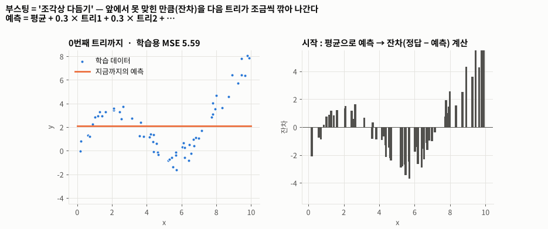
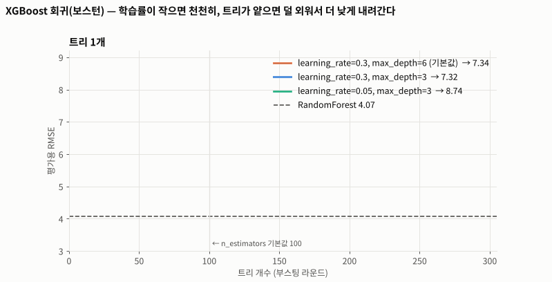
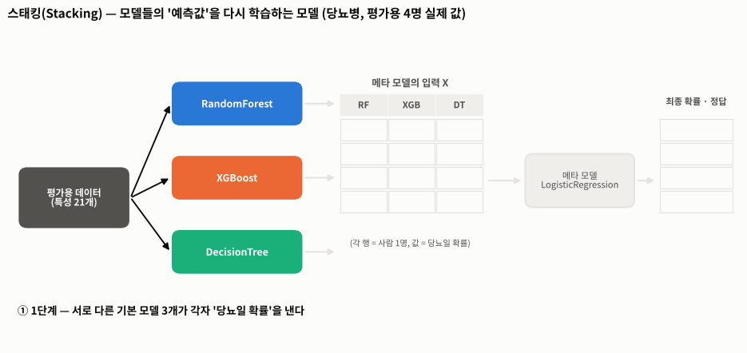
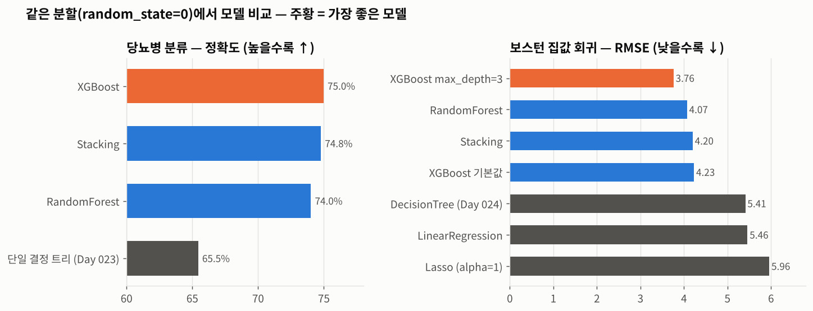
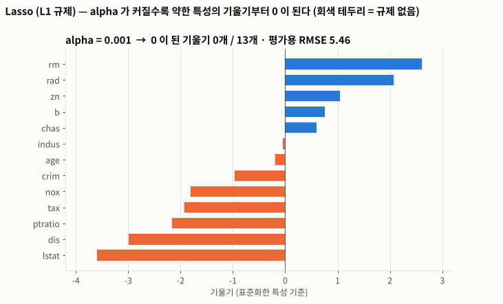

# Day 025 · 2026-10-14 (수)

`데이터 분석과 머신러닝/딥러닝` · 7주차

> **한 줄 요약** — 어제의 배깅(랜덤 포레스트)에 이어, **앞 트리가 못 맞힌 만큼(잔차)을 다음 트리가 조금씩 깎아 나가는 부스팅(XGBoost)** 과 **여러 모델의 예측값을 메타 모델이 한 번 더 학습하는 스태킹**을 배웠다. 당뇨병 정확도는 RF 74.0% → XGBoost **75.0%** · 스태킹 74.8%, 보스턴 RMSE 는 RF 4.07 · 스태킹 4.20 · XGBoost 4.23 이었는데, XGBoost 트리 깊이를 3 으로 줄이자 **3.76** 으로 가장 좋아졌다. **스태킹이 항상 1등은 아니었다.**

📂 실습 노트북
- [`lecture/boosting_xgboost.ipynb`](./lecture/boosting_xgboost.ipynb) — 부스팅 원리 · 잔차 시뮬레이션 · XGBoost 분류 / 회귀 · 학습률 · 깊이 비교 (필기 `앙상블분류실습` · `앙상불회귀실습01`)
- [`lecture/stacking.ipynb`](./lecture/stacking.ipynb) — 스태킹 원리 · `cross_val_predict` 로 직접 구현 · Stacking 분류 / 회귀 · 모델 선택 기준 (같은 필기)
- [`lecture/concat_linear_regression_review.ipynb`](./lecture/concat_linear_regression_review.ipynb) — `pd.concat` · 선형 회귀 · Lasso 다시 보기 (필기 `선형회귀실습` 2개 통합)

📊 실습 데이터 → [`house_price.csv`](./lecture/house_price.csv) (506행) · [`diabetes_binary_5050split_health_indicators_BRFSS2015.csv`](./lecture/diabetes_binary_5050split_health_indicators_BRFSS2015.csv) (70,692행)
🖼️ 그림 → [`lecture/images/`](./lecture/images/) — 🎬 **시뮬레이션 애니메이션(GIF) 4개** + 비교 그림 1장 (모두 노트북 코드로 직접 만든 것)
📖 교재 `머신러닝` v5 p.26~41 (concat · 선형 회귀 다시 보기) · p.92~113 (앙상블 · 부스팅 · 스태킹)

---

## 1. 앙상블 세 가지

| 방식 | 학습 | 대표 모델 |
|------|------|----------|
| **배깅** | 복원 추출한 서브 데이터로 트리를 **따로따로(병렬)** → 투표 / 평균 | RandomForest ([Day 024](../2026-10-13/)) |
| **부스팅** | 앞 모델이 **틀린 만큼(잔차)** 을 다음 모델이 보완 — **순서대로(순차)** | **XGBoost** |
| **스태킹** | 여러 모델의 **예측값**을 새 특성으로 → **메타 모델**이 최종 예측 | **Stacking** |

---

## 2. 부스팅 — 잔차를 깎아 나가는 '조각상 다듬기'

| 단계 | 하는 일 |
|------|---------|
| 초기값 | **평균**으로 예측 → 잔차(정답 − 예측) 계산 |
| 1단계 | 다음 트리가 **잔차를 예측** → 그 값의 **학습률**만큼만 더한다 |
| 반복 | 덜 깎인 미세한 오차를 또 깎는다 — 수백 번 |

교재 p.102 몸무게 예시를 그대로 계산하면 평균 **64.2** → 1차 잔차 `88 − 64.2 = 23.8` → 학습률 0.1 만큼 반영 → 2차 잔차 `88 − (64.2 + 0.1 × 23.8) = 21.42`. 잔차가 조금씩 0 으로 다가간다.



🎬 깊이 2 짜리 **약한 트리**가 왼쪽의 예측이 못 맞힌 만큼(오른쪽 막대 = 잔차)을 학습하고, 그 0.3 배만큼만 더해진다. 트리가 쌓일수록 잔차 막대가 0 으로 줄어들고 학습용 MSE 가 3.21 → **0.04** 로 떨어진다.

### XGBoost 분류 · 회귀

```python
from xgboost import XGBClassifier, XGBRegressor   # 교재의 XGBClassifer 는 오타

xgb = XGBClassifier(random_state=0)
xgb.fit(X_train, y_train)
accuracy_score(y_test, xgb.predict(X_test))      # 0.7498
```

| 데이터 | 결과 | 비교 |
|--------|------|------|
| 당뇨병 정확도 | **75.0%** (학습용 78.6%) | RandomForest 74.0% (학습용 99.5%) |
| 보스턴 RMSE | 4.23 (학습용 **0.01** → 외움) | RandomForest 4.07 |
| 보스턴 RMSE, `max_depth=3` | **3.76** | 가장 좋음 |



🎬 트리를 1 → 300 개로 쌓으며 평가용 RMSE 를 그렸다. 기본값(깊이 6)은 빨리 내려가다 **4.23 에서 멈추고**, 깊이 3 은 덜 외워서 **3.7 대까지** 내려간다. 학습률 0.05 는 훨씬 **천천히** 내려가 트리가 더 많이 필요하다.

---

## 3. 스태킹 — 예측값을 다시 학습하는 메타 모델

| | 1단계 (Base Models) | 2단계 (Meta Model) |
|---|---|---|
| **학습** | 서로 다른 알고리즘으로 각각 학습 | 1단계 **예측값 + 정답**으로 메타 모델 학습 |
| **예측** | 평가용 데이터를 각각 예측 | 1단계 **예측값을 입력(X)** 으로 최종 예측 |



🎬 평가용 4명의 **실제 값**으로 그렸다. RF · XGB · DT 가 낸 '당뇨일 확률' 3개가 메타 모델(LogisticRegression)의 입력이 되고, 메타 모델은 가중치 **RF 1.63 · XGB 3.27 · DT −0.01** 을 배웠다 — 단일 트리는 **믿지 않기로** 한 것이다.

```python
stack = StackingClassifier(
    estimators=[('rf', RandomForestClassifier(random_state=0)),
                ('xgb', XGBClassifier(random_state=0)),
                ('dt', DecisionTreeClassifier(random_state=0))],
    final_estimator=LogisticRegression(max_iter=1000, random_state=0),   # 회귀는 LinearRegression
    cv=5)
```

**왜 `cv=5`?** 1단계 모델이 **학습에 쓴 데이터를 그대로 예측**하면 외운 답이라 거의 정답과 같다. 메타 모델이 그걸 보고 배우면 착각하므로, 학습용을 5조각으로 나눠 **자기가 안 본 조각만** 예측하게 한다. `cross_val_predict` 로 이 과정을 직접 만들어 보니 `StackingRegressor` 와 예측이 **완전히 똑같았다**.

---

## 4. 결과 비교 · 모델 선택 기준



| 당뇨병 (정확도 ↑) | 정확도 | F1 |
|---|---|---|
| **XGBoost** | **75.0%** | **0.757** |
| Stacking | 74.8% | 0.754 |
| RandomForest | 74.0% | 0.748 |
| 단일 결정 트리 | 65.5% | 0.650 |

| 보스턴 (RMSE ↓) | RMSE |
|---|---|
| **XGBoost `max_depth=3`** | **3.76** |
| RandomForest | 4.07 |
| Stacking (DT + RF + XGB → LinearRegression) | 4.20 |
| XGBoost 기본값 | 4.23 |
| LinearRegression / Lasso(`alpha=1`) | 5.46 / 5.96 |

회귀 스태킹의 메타 모델은 **xgb 0.854** · rf 0.098 · dt 0.079 로 XGBoost 를 가장 믿었지만, XGBoost 기본값은 학습용을 외우는 버릇이 있어 결과는 단일 랜덤 포레스트보다 조금 나빴다. 스태킹은 **기본 모델들이 서로 다른 실수를 할 때** 효과가 크다.

| 교재 p.113 모델 선택 기준 | |
|---|---|
| 1단계 비즈니스 제약 확인 | 설명 가능성이 필수인가? 추세 예측인가? |
| 2단계 후보 모델 일괄 실험 | 선형 / 로지스틱, SVM, 단일 트리, 랜덤 포레스트, 부스팅, 스태킹 |
| 3단계 정량 지표 평가 & 선택 | 분류 **F1-score** · 회귀 **RMSE** |

---

## 5. 다시 보기 — concat · 선형 회귀 · Lasso

| `pd.concat` | 동작 |
|---|---|
| `axis=0` (기본) | 공통 컬럼 기준 **아래로** |
| `axis=1` | 공통 행 인덱스 기준 **옆으로** (인덱스 다르면 `NaN`) |
| `ignore_index=True` / `join='inner'` | 인덱스 새로 매김 / 공통 컬럼만 |

보스턴 LinearRegression **RMSE 5.46** ([Day 021](../2026-10-07/) 과 같은 값). Lasso 는 `alpha` 가 커질수록 약한 특성의 기울기부터 0 이 된다.



🎬 회색 테두리는 규제 없는 선형 회귀의 기울기다. `alpha=1` 이면 13개 중 **8개**가 0 이 되고 RMSE 는 오히려 5.96 으로 나빠진다 — 이 데이터에는 규제가 너무 셌다.

---

## 🔁 복습

**필기에서 고친 부분**
- [x] `앙상불회귀실습01` 의 부스팅 모델이 **`XGBRFRegressor`** → 이건 XGBoost 로 만든 **랜덤 포레스트(배깅)** 라 부스팅 실습이 아니다. 교재대로 **`XGBRegressor`** 로 교체
- [x] 같은 노트북 `train_test_split` 에 `random_state` 가 없어 필기의 RMSE 2.68 · 2.72 는 다시 만들 수 없는 값 → `random_state=0` 고정
- [x] 회귀 문제에 `accuracy_score` 임포트, `"예상 값:"` · `"예측 값:"` 으로 RMSE · 정확도 출력 → 회귀는 RMSE, 문구는 무엇을 출력하는지 맞게
- [x] 변수 이름 오타 `final_mate_learmer` → `final_meta_learner`
- [x] `print("평가용 데이터:", y_train.index)` → `y_train` 은 **학습용** 정답
- [x] `print(acc_rf)` `print(acc_xgb)` … 숫자만 나열 → 모델별 비교표(정확도 + F1)
- [x] `선형회귀실습` 노트북 2개(경로만 다름) + Lasso 버전을 하나로 통합
- [x] 교재 `XGBClassifer` 오타 → `XGBClassifier`, p.102 표의 2차 잔차 식 `0.1 × 7.8` → 각각 `0.1 × 3.8`, `0.1 × 11.8`
- [x] 경로 `C:\Users\…` → `./`, `warnings.filterwarnings('ignore')` 제거

**직접 해본 것**
- 교재 p.102 몸무게 예시의 1차 · 2차 잔차를 직접 계산 (교재 표의 식 오타 발견)
- `DecisionTreeRegressor(max_depth=2)` 로 **잔차를 학습하는 트리**를 50개 쌓아 부스팅을 직접 구현
- XGBoost 학습률(0.3 · 0.05) × 깊이(6 · 3)별로 트리 300개까지 평가용 RMSE 곡선 비교
- `cross_val_predict` 로 스태킹을 손으로 만들고 `StackingRegressor` 결과와 같은지 확인
- 스태킹 메타 모델의 가중치로 어떤 기본 모델을 믿었는지 확인
- Lasso `alpha` 0.01 ~ 2 비교
- `FuncAnimation` 으로 부스팅 · XGBoost · 스태킹 · Lasso 과정을 애니메이션으로 만들기

**막혔던 부분 / 질문**
- [ ] XGBoost 의 `learning_rate` · `max_depth` · `n_estimators` 를 평가용이 아니라 교차 검증(`GridSearchCV`)으로 고르는 방법
- [ ] `early_stopping_rounds` 로 평가 성능이 더 안 좋아지면 자동으로 멈추게 하기
- [ ] 스태킹에 `passthrough=True`(원본 특성도 메타 모델에 같이 넣기)를 쓰면 좋아지는지
- [ ] 트리 앙상블끼리가 아니라 SVM · 로지스틱처럼 **성격이 다른 모델**을 섞으면 스태킹이 더 좋아지는지
- [ ] LightGBM · CatBoost 는 XGBoost 와 무엇이 다른지

📂 [수업 자료 폴더](./lecture/) · [복습 자료 폴더](./review/)

---

## 🔗 참고 링크

- [XGBoost — Introduction to Boosted Trees](https://xgboost.readthedocs.io/en/stable/tutorials/model.html)
- [XGBoost — Python API (`XGBClassifier` · `XGBRegressor`)](https://xgboost.readthedocs.io/en/stable/python/python_api.html)
- [scikit-learn — Ensembles: Gradient boosting](https://scikit-learn.org/stable/modules/ensemble.html#gradient-boosted-trees)
- [scikit-learn — Ensembles: Stacked generalization](https://scikit-learn.org/stable/modules/ensemble.html#stacked-generalization)
- [`StackingClassifier` 문서](https://scikit-learn.org/stable/modules/generated/sklearn.ensemble.StackingClassifier.html) · [`StackingRegressor` 문서](https://scikit-learn.org/stable/modules/generated/sklearn.ensemble.StackingRegressor.html)
- [`cross_val_predict` 문서](https://scikit-learn.org/stable/modules/generated/sklearn.model_selection.cross_val_predict.html)
- [pandas — `concat` 문서](https://pandas.pydata.org/docs/reference/api/pandas.concat.html)
