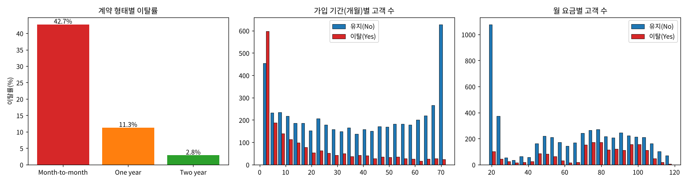
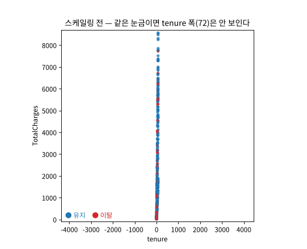
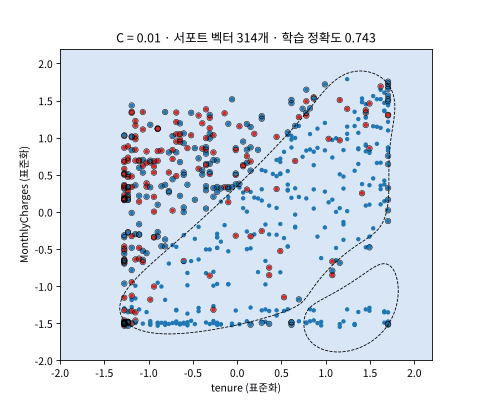
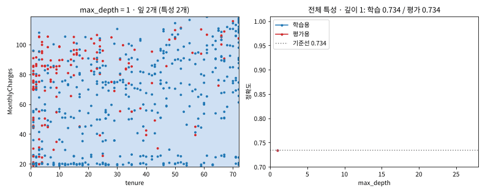
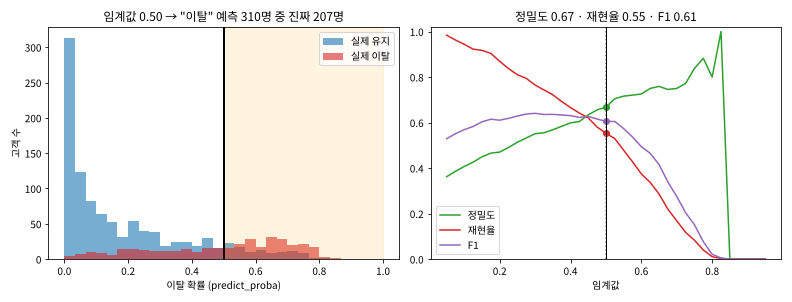
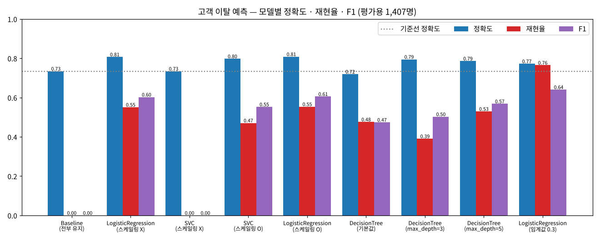

# Day 026 · 2026-10-15 (목)

`데이터 분석과 머신러닝/딥러닝` · 7주차

> **한 줄 요약** — 통신사 고객 7,032명의 데이터로 **누가 떠날지(Churn)** 를 예측했다. 로지스틱 회귀가 정확도 **80.8%** 로 가장 좋았고, 필기의 SVM 정확도 73.4% 는 알고 보니 **전부 "유지"라고 찍은 것**(스케일링 안 함 → 스케일링 후 79.7%), 결정 트리 71.9% 는 학습 데이터를 **외운 것**(깊이 제한 → 79.5%)이었다. 이탈 고객이 26.6% 뿐인 **불균형 데이터**라 정확도보다 **재현율**을 봐야 하고, 임계값을 0.5 → 0.3 으로 내리면 이탈 고객을 55% → **76%** 잡는다.

📂 실습 노트북
- [`lecture/churn_classification.ipynb`](./lecture/churn_classification.ipynb) — 전처리 · EDA · 인코딩 · 로지스틱 회귀 · SVM(스케일링 전/후, `C`) · 결정 트리(깊이) · 임계값 · 모델 비교 (필기 `고객이탈예측`)

📊 실습 데이터 → [`Telco-Customer-Churn.csv`](./lecture/Telco-Customer-Churn.csv) (7,043행 × 21열) · 배포 자료 `Telco 고객 이탈 데이터 설명서.pdf`
🖼️ 그림 → [`lecture/images/`](./lecture/images/) — 🎬 **시뮬레이션 애니메이션(GIF) 4개** + EDA · 비교 그림 2장 (모두 노트북 코드로 직접 만든 것)

---

## 1. 데이터와 전처리

| 구분 | 컬럼 |
|---|---|
| 고객 인구통계 | `gender`, `SeniorCitizen`, `Partner`, `Dependents` (`customerID` 는 학습 제외) |
| 가입 서비스 | `PhoneService`, `MultipleLines`, `InternetService`, `OnlineSecurity` … `StreamingMovies` |
| 계약 · 결제 | `tenure`(가입 개월), `Contract`, `PaperlessBilling`, `PaymentMethod`, `MonthlyCharges`, `TotalCharges` |
| **정답** | `Churn` — Yes / No |

`TotalCharges` 가 숫자인데 **문자열**로 읽혔다 → 공백 `' '` 11건. 찾아보니 모두 **`tenure = 0`(아직 첫 요금 청구 전) 신규 고객**이었다.

```python
df['TotalCharges'] = pd.to_numeric(df['TotalCharges'], errors='coerce')  # ' ' -> NaN
df1 = df.dropna(ignore_index=True)                                       # 7,043 -> 7,032행
```

---

## 2. EDA — 어떤 고객이 떠나는가



| 관찰 | |
|---|---|
| 이탈 비율 | 유지 73.4% : **이탈 26.6%** → 불균형. 전부 "유지"라고 찍어도 정확도 **0.734** (= 기준선) |
| 계약 형태 | **월 단위 42.7%** ≫ 1년 11.3% ≫ 2년 2.8% |
| 가입 기간 | 가입 **초기(0~10개월)** 에 이탈이 몰림 |
| 월 요금 | **70~105** 구간에서 이탈이 많음 |

`TotalCharges ≈ tenure × MonthlyCharges` 라 `tenure` 와 상관계수 **0.83** — 필기에 적은 **다중공선성**. 선형 모델 계수를 "원인"으로 해석할 때 주의.

---

## 3. 인코딩 → 분리

```python
df2['Churn'] = df2['Churn'].map({'No': 0, 'Yes': 1})                       # 라벨 인코딩
cols = df2.select_dtypes(include=['object', 'string']).columns.tolist()     # 문자열 15개
df_onehot = pd.get_dummies(df2, columns=cols, dtype=int)                    # 20 -> 46 컬럼
train_test_split(X_data, y_data, test_size=0.2, random_state=0, stratify=y_data)
```

---

## 4. SVM — 스케일링 하나로 0.734 → 0.797

필기의 SVC 정확도 **0.7342** 는 기준선과 소수 넷째 자리까지 같다. 예측값을 찍어 보니 **1,407명 전부 0** — 이탈 고객을 한 명도 못 잡았다.



🎬 같은 고객 400명을 `tenure` · `TotalCharges` **같은 눈금**으로 그렸다. 스케일링 전엔 가로 폭 72, 세로 폭 8,600 이라 점들이 **세로 한 줄**로 붙는다 — SVM 의 거리 계산에서 `tenure` 와 0/1 원-핫 컬럼은 거의 무시된다. `StandardScaler` 로 평균 0 · 표준편차 1 로 맞추면 모든 특성이 같은 무게가 된다.

```python
scaler = StandardScaler()
X_train_scaled = scaler.fit_transform(X_train)   # 학습용으로만 fit
X_test_scaled  = scaler.transform(X_test)        # 평가용은 transform 만
```

로지스틱 회귀도 스케일링 전에는 숨겨져 있던 **`ConvergenceWarning`**(100번 안에 수렴 실패)이 나고 있었다 — 스케일링 후 해결.



🎬 특성 2개로 `rbf` SVM 경계를 그리고 `C` 를 0.01 → 1000 으로 키웠다. 검은 테두리가 **서포트 벡터**. `C` 가 작으면 오분류를 봐주는 **부드러운 경계**, 크면 학습 데이터를 다 맞히려는 **구불구불한 경계**.

---

## 5. 결정 트리 — 외운 트리는 기준선보다 못하다

기본값 트리는 깊이 **27**, 잎 **1,105개**. 학습용 정확도 **0.998**, 평가용 **0.719** — 기준선(0.734)보다 낮다.



🎬 깊이가 깊어질수록 경계가 잘게 쪼개지고 학습용(파랑)은 1 로 가지만, 평가용(빨강)은 **깊이 3 (0.795)** 에서 최고를 찍고 내려간다. 트리는 기준값으로 나누기만 하므로 **스케일링이 필요 없다**. 깊이 5 트리의 특성 중요도 1위는 **월 단위 계약(0.51)**.

---

## 6. 임계값 — 정확도 vs 이탈 고객 잡기

`predict()` 는 이탈 확률 **≥ 0.5** 이면 1. 이탈 방어가 목적이면 기준을 낮춘다.



| 임계값 | 정확도 | 정밀도 | 재현율 | F1 |
|---|---|---|---|---|
| 0.5 (기본) | **0.808** | 0.668 | 0.554 | 0.605 |
| 0.4 | 0.793 | 0.599 | 0.666 | 0.630 |
| **0.3** | 0.772 | 0.551 | **0.765** | **0.641** |
| 0.2 | 0.705 | 0.470 | 0.869 | 0.610 |

---

## 7. 결과 비교



| 모델 | 정확도 | 재현율 | F1 |
|---|---|---|---|
| 기준선 (전부 유지) | 0.734 | 0 | 0 |
| **LogisticRegression** | **0.808** | 0.554 | 0.605 |
| SVC (스케일링 X) | 0.734 | 0 | 0 |
| SVC (스케일링 O) | 0.797 | 0.471 | 0.553 |
| DecisionTree (기본값) | 0.719 | 0.476 | 0.474 |
| DecisionTree (`max_depth=3`) | 0.795 | 0.390 | 0.503 |
| LogisticRegression (임계값 0.3) | 0.772 | **0.765** | **0.641** |

**스케일링이 필요한 모델**: SVM(거리) · 로지스틱 회귀(경사 하강) · KNN — **필요 없는 모델**: 결정 트리 · 랜덤 포레스트 · XGBoost

---

## 🔁 복습

**필기에서 고친 부분**
- [x] SVC: `scaler = StandardScaler()` 만 만들고 `fit_transform` 줄이 주석 → **스케일링 없이 학습**해서 전부 "유지" 예측 (0.7342 = 기준선)
- [x] 로지스틱 회귀 `ConvergenceWarning` 이 `warnings.filterwarnings('ignore')` 에 가려져 있었음 → 스케일링으로 해결
- [x] 결정 트리 기본값 = 과대적합 (학습 0.998 / 평가 0.719) → 깊이별 비교 추가
- [x] 계약 형태 막대 그래프가 `'''` 로 주석 처리 + `x='contract'`(소문자) · `y='Count'`(없는 컬럼) → `groupby(...).size()` 로 다시 그림
- [x] 원 그래프(`px.pie`) 빠짐 → 복구
- [x] 주석 `M.Class` · `total.charges` · `ternure` → `MonthlyCharges` · `TotalCharges` · `tenure`, 그래프 제목 `"총 누적과 요금과…"` 오타
- [x] 변수 이름 `df_onehost` · `colos_to_list` → `df_onehot` · `categorical_cols_list`
- [x] `select_dtypes(include=[str])` → pandas 2 · 3 모두 되도록 `['object', 'string']`
- [x] `print(acc_lr)` · `print(acc_svc)` 숫자 나열 → 정확도 · 정밀도 · 재현율 · F1 · 혼동 행렬 비교표
- [x] 필기의 모델 정리 "회귀: SVC (양쪽)" → 회귀는 **`SVR`**, `SVC` 는 분류

**직접 해본 것**
- 공백 11건이 모두 `tenure = 0` 신규 고객인지 확인
- SVC 스케일링 전 / 후 비교, 예측값이 전부 0 인 것 확인
- 결정 트리 깊이 1~27 학습 / 평가 정확도 곡선
- `predict_proba` 로 임계값 0.05~0.95 를 바꾸며 정밀도 · 재현율 · F1 비교
- `FuncAnimation` 으로 스케일링 · SVM `C` · 트리 깊이 · 임계값을 애니메이션으로 만들기

**막혔던 부분 / 질문**
- [ ] `class_weight='balanced'` 로 이탈 클래스에 가중치를 주는 것과 임계값을 낮추는 것은 무엇이 다른지 (LR balanced: 정확도 0.753 · 재현율 0.794)
- [ ] SVM 의 `C` · `gamma` 와 트리 `max_depth` 를 평가용이 아니라 **교차 검증(`GridSearchCV`)** 으로 고르기
- [ ] 오늘 기준으로는 F1 · 재현율을 봐야 하는데, 임계값은 어떤 기준으로 정해야 하는지 (비용 = 놓친 고객 vs 쿠폰 비용)
- [ ] 랜덤 포레스트 · XGBoost · 스태킹([Day 025](../2026-10-14/))으로 같은 데이터를 돌리면 로지스틱 회귀를 이길지

📂 [수업 자료 폴더](./lecture/) · [복습 자료 폴더](./review/)

---

## 🔗 참고 링크

- [Kaggle — Telco Customer Churn](https://www.kaggle.com/datasets/blastchar/telco-customer-churn)
- [scikit-learn — Support Vector Machines](https://scikit-learn.org/stable/modules/svm.html)
- [scikit-learn — Importance of Feature Scaling](https://scikit-learn.org/stable/auto_examples/preprocessing/plot_scaling_importance.html)
- [scikit-learn — Decision Trees](https://scikit-learn.org/stable/modules/tree.html)
- [scikit-learn — Tuning the decision threshold](https://scikit-learn.org/stable/modules/classification_threshold.html)
- [`LogisticRegression` 문서](https://scikit-learn.org/stable/modules/generated/sklearn.linear_model.LogisticRegression.html) · [`SVC` 문서](https://scikit-learn.org/stable/modules/generated/sklearn.svm.SVC.html) · [`StandardScaler` 문서](https://scikit-learn.org/stable/modules/generated/sklearn.preprocessing.StandardScaler.html)
- [pandas — `get_dummies` 문서](https://pandas.pydata.org/docs/reference/api/pandas.get_dummies.html)
