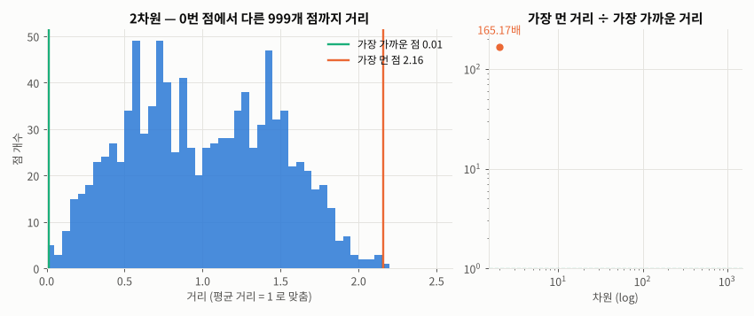
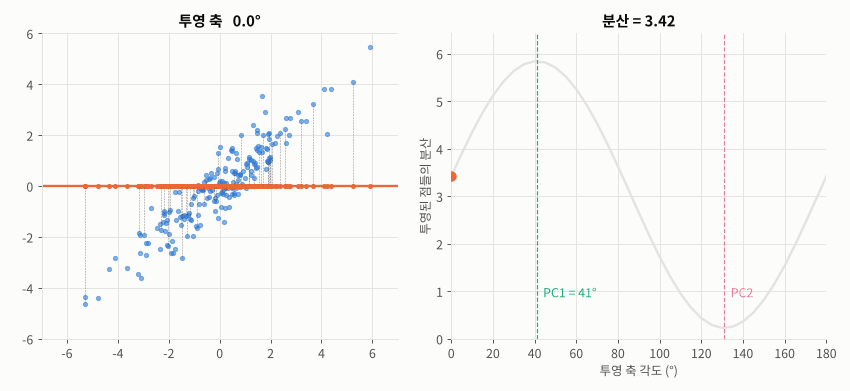
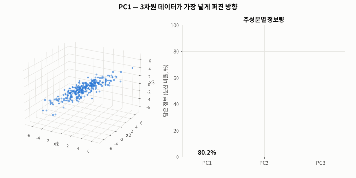
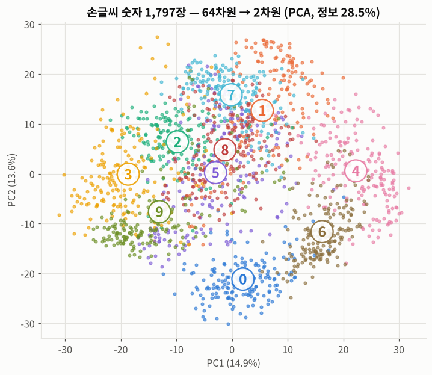
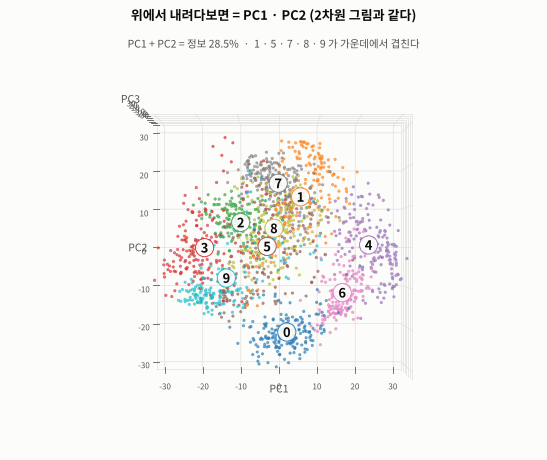
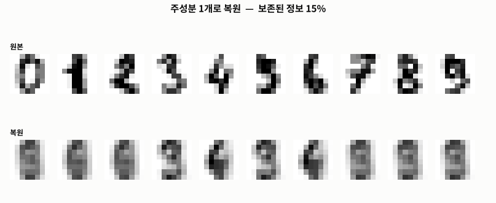
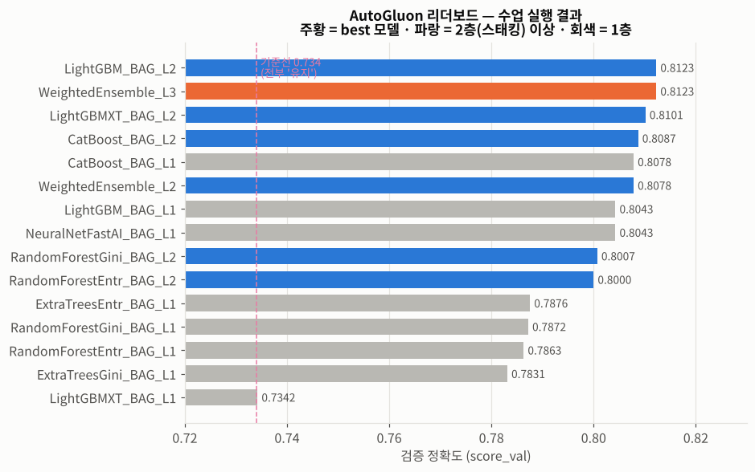
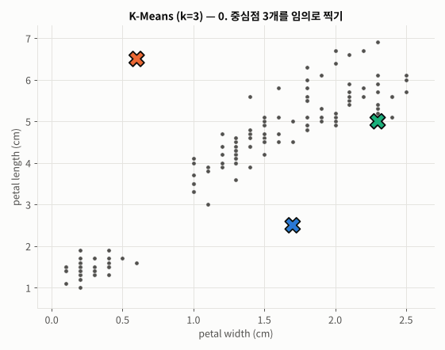
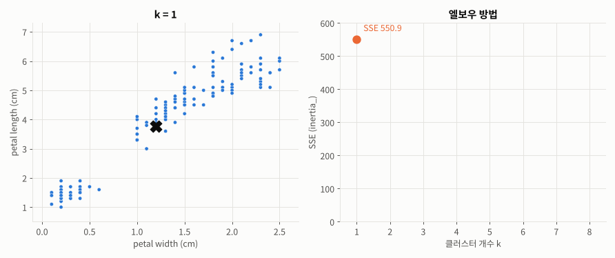

# Day 027 · 2026-10-16 (금)

`데이터 분석과 머신러닝/딥러닝` · 7주차

> **한 줄 요약** — 특성이 많을수록 데이터가 텅 빈 공간에 흩어져 **거리가 무의미해지는 차원의 저주**를, 데이터가 가장 넓게 퍼진 방향으로 투영하는 **PCA** 로 풀었다(손글씨 64차원 → **29차원으로 정보 95%**, 정확도 0.978 → 0.975). 어제 직접 만든 고객 이탈 모델을 **AutoGluon** 에 맡겼더니 5분 만에 30개 모델 + 스태킹으로 **0.803 ~ 0.814** — 잘 만든 로지스틱 회귀(0.808)와 비슷했다. 마지막으로 정답 없이 묶는 **K-Means** 로 붓꽃을 3개 그룹으로 나눴더니 품종과 **96%** 일치했다.

📂 실습 노트북
- [`lecture/pca_dimensionality_reduction.ipynb`](./lecture/pca_dimensionality_reduction.ipynb) — 차원의 저주 · PCA 원리(투영 · 분산) · **3차원 PC1 · PC2 · PC3** · 손글씨 64→2 · 3차원 · 정보 95% · 복원 · PCA+KNN (필기 `PCA실습`)
- [`lecture/automl_autogluon.ipynb`](./lecture/automl_autogluon.ipynb) — AutoML 개념 · `TabularPredictor` → `fit` → `leaderboard` → `evaluate` · 저장 모델 불러오기 · 어제 모델과 비교 (필기 `AutoGluon`)
- [`lecture/kmeans_clustering.ipynb`](./lecture/kmeans_clustering.ipynb) — 비지도 학습 · K-Means 직접 구현 · `KMeans` k=2 / 3 · 정답과 비교 · 엘보우 (필기 `비지도학습_K_Means`)

📊 실습 데이터 → [`iris_dataset.csv`](./lecture/iris_dataset.csv) (150행) · [`Telco-Customer-Churn.csv`](./lecture/Telco-Customer-Churn.csv) (7,043행 × 21열) · 손글씨 숫자는 `load_digits()` 내장
🖼️ 그림 → [`lecture/images/`](./lecture/images/) — 🎬 **시뮬레이션 애니메이션(GIF) 7개** + 그림 2장
📖 교재 → `머신러닝` v6 **p.115~133** (14. 차원 축소 · 15. AutoML · 16. 비지도 학습)

---

## 1. 차원의 저주 — 특성이 많으면 왜 문제인가

**차원 = 특성(컬럼) 수.** 키 하나면 1차원, 키 · 몸무게면 2차원, 8×8 손글씨 이미지는 픽셀 64개라 64차원.

차원이 늘면 공간 부피가 기하급수적으로 커져서, 같은 데이터가 **희박(sparse)** 해진다.

1. **과대적합** — 샘플에 비해 특성이 많으면 잡음까지 외운다
2. **거리의 무의미화** — 모든 점이 비슷하게 멀어져서 유클리드 거리 기반 알고리즘(**SVM · KNN · K-Means**)이 약해진다



🎬 점 1,000개를 차원만 바꿔 뿌리고, 한 점에서 나머지까지의 거리 분포를 그렸다. 2차원에서는 넓게 퍼져 있던 거리가 **1000차원에서는 한 곳에 몰린다** — 가장 먼 점이 가장 가까운 점의 **1.1배**뿐.

---

## 2. PCA — 가장 넓게 퍼진 방향으로 투영

| | |
|---|---|
| **PC1** | 데이터의 **분산이 가장 큰** 방향 |
| **PC2** | PC1 과 **직교**하면서 남은 분산이 가장 큰 방향 |
| **PC3** | PC1 · PC2 **둘 다와 직교**하는 방향 (3차원에서는 남은 방향이 하나뿐 → 분산 가장 작음) |
| 차원 축소 | 앞쪽 주성분 몇 개만 남기고 나머지(노이즈에 가까운 축)를 버린다 |



🎬 투영 축을 0° → 180° 로 돌리면, 투영된 점들의 **분산이 최대가 되는 각도(41°)가 PC1** — sklearn 이 계산한 값과 같다. 축이 데이터와 엇갈릴수록 점선(잃는 정보)이 길어진다.

### 3차원이면? — PC3 (세 번째 주성분)

특성이 3개면 주성분도 3개. PC1 · PC2 · PC3 는 서로 90° 인 **새 좌표축 3개**(원래 x1 · x2 · x3 축을 데이터에 맞게 돌린 것)이고, **PC3 를 버린다 = PC1–PC2 평면으로 수직 투영 = 3차원 → 2차원**.



🎬 납작한 접시 모양의 3차원 데이터에서 **PC1 → PC2 → PC3** 를 차례로 찾고, PC3 를 버려 점들을 평면으로 **납작하게** 만든 뒤 PC3 방향에서 내려다봤다 — 그게 2차원 PCA 그림이다.

| | PC1 | PC2 | PC3 |
|---|---|---|---|
| 정보(분산) 비율 | **80.2%** | 18.4% | 1.4% |
| 누적 | 80.2% | **98.6%** | 100% |

```python
pca_3 = PCA(n_components=3).fit(X_3d)
pca_3.components_ @ pca_3.components_.T   # 단위 행렬 → 주성분끼리 내적 0 = 서로 직교
```

PC3 는 접시의 **두께** 방향(1.4%)이라 버려도 모양은 그대로 남는다. 주성분끼리 직교하므로 PC 좌표끼리는 상관관계가 0 — 같은 정보를 두 번 담지 않는다.

### 손글씨 숫자 64차원 → 2차원

```python
from sklearn.decomposition import PCA
pca_2d = PCA(n_components=2, random_state=0)     # 정수 → 주성분 개수
X_data_2d = pca_2d.fit_transform(X_data)          # (1797, 64) -> (1797, 2)

pca_95 = PCA(n_components=0.95, random_state=0)   # 실수 → 보존할 정보 비율
X_data_95 = pca_95.fit_transform(X_data)          # (1797, 64) -> (1797, 29)
```



2차원은 정보의 **28.5%** 뿐이라 0 · 4 · 6 은 갈라지지만 가운데는 겹친다 — **시각화용**.

### PC3 를 하나 더 — 64차원 → 3차원



🎬 3차원 PCA 결과를 **위에서 내려다보면 2차원 그림과 똑같고**(PC1 · PC2), 옆으로 눕히면 높이 = PC3 가 드러나 **2 · 6 은 아래(PC3 평균 −15.8 · −13.7), 7 · 4 · 9 는 위(+12.0 · +7.9 · +7.8)** 로 갈라진다.

`components_` 를 8×8 로 접어 보면 PC3 는 **오른쪽 세로줄이 + , 아래 가로줄이 −** 인 픽셀 패턴 → 오른쪽 세로획이 있는 7 · 4 · 9 는 위, 아래 획이 굵은 2 · 6 은 아래. 주성분은 원래 픽셀들을 **가중합한 새 특성**이다.

| 남긴 주성분 | 보존 정보 | KNN 정확도 |
|---|---|---|
| PC1 · PC2 | 28.5% | 0.617 |
| PC1 · PC2 · **PC3** | **40.3%** (+11.8%p) | **0.747** (+0.13) |

PC3 를 더하면 숫자 **7 재현율 0.58 → 0.92 · 6 0.67 → 0.94 · 5 0.27 → 0.57** — 2차원에서 겹치던 숫자들이 갈라졌다.



🎬 주성분 k 개만 남겼다가 `inverse_transform` 으로 되돌린 이미지. **10개(74%)** 면 숫자가 보이고 **29개(95%)** 면 원본과 거의 같다.

| 남긴 특성 수 | 보존 정보 | KNN 정확도 |
|---|---|---|
| 64 (원본) | 100% | **0.978** |
| 29 | 95% | **0.975** |
| 10 | 74% | 0.961 |
| 3 | 40.3% | 0.747 |
| 2 | 28.5% | 0.617 |

특성을 **절반 이하**로 줄여도 정확도는 거의 그대로. PCA 도 스케일러처럼 **학습용으로만 `fit`** (`make_pipeline`).

---

## 3. AutoML — AutoGluon 에게 맡기면

전처리 → 모델 선택 → 하이퍼파라미터 → 앙상블을 **자동화**. 3-Step : `TabularPredictor` → `fit` → `evaluate`.

```python
train_df, test_df = train_test_split(df2, test_size=0.2, random_state=0, stratify=df2['Churn'])  # X, y 로 안 나눈다

predictor = TabularPredictor(label='Churn', eval_metric='accuracy', path='AutoGluon_Model')
predictor.fit(train_data=train_df, presets='best_quality', num_gpus=0,
              dynamic_stacking=False, num_stack_levels=1, time_limit=300)
performance = predictor.evaluate(test_df)          # 예측 + 평가 한 번에
```



`_BAG_L1`(배깅한 1층 모델) → `_BAG_L2`(1층 예측값까지 특성으로 쓰는 **스태킹**) → `WeightedEnsemble_L3`(가중 평균). [Day 024](../2026-10-13/) 배깅 · [Day 025](../2026-10-14/) 스태킹이 **자동으로** 쌓인다.

### 어제(사람) vs 오늘(AutoML) — 같은 평가용 1,407명

| 모델 | 정확도 | 재현율(이탈) | F1 |
|---|---|---|---|
| 기준선 (전부 "유지") | 0.734 | 0 | 0 |
| LogisticRegression — [Day 026](../2026-10-15/) | 0.808 | **0.554** | **0.605** |
| AutoGluon (수업 실행) | 0.803 | 0.457 | 0.553 |
| AutoGluon (다시 실행) | **0.814** | 0.479 | 0.577 |

- 코드 몇 줄로 직접 튜닝한 모델과 **같은 수준**. 하지만 로지스틱 회귀와 ±0.6%p 라 이 데이터에서는 큰 이득이 없었다(학습 5분 · 모델 폴더 약 600MB).
- 실행할 때마다 · 컴퓨터마다 결과가 달라진다(시간 제한 안에 학습되는 모델 수가 다름).
- `eval_metric='accuracy'` 로 골라서 재현율이 낮다 → 이탈 고객을 잡으려면 `'f1'` · `'balanced_accuracy'` 로.
- `balanced_accuracy` = 정답별 정확도의 평균. 전부 "유지"라고 찍으면 accuracy 0.734 / balanced **0.5**.
- 특성 중요도 1 · 2위 : `tenure` · `Contract` (어제 결정 트리와 같은 결론).

---

## 4. 비지도 학습 — K-Means 군집화

| | 분류 (지도) | 군집화 (비지도) |
|---|---|---|
| 정답 | 있음 | **없음** |
| 하는 일 | 범주 예측 | 비슷한 것끼리 **스스로 그룹** |

좋은 군집 = **군집 간 분산 최대**(서로 멀리) + **군집 내 분산 최소**(안은 촘촘히).



🎬 일부러 엉뚱한 곳에 중심점 3개를 찍고 시작. **① 가장 가까운 중심점에 할당 → ② 중심점을 그 점들의 좌표 평균으로 이동** 을 반복하다가 중심점이 멈추면 종료(9회차에서 더 이상 움직이지 않음).

```python
from sklearn.cluster import KMeans
model3 = KMeans(n_clusters=3, random_state=0)
output3 = model3.fit_predict(wl_data)   # 꽃잎 길이 · 너비 (정답 label 은 넣지 않는다)
```

| | k=2 (필기) | k=3 |
|---|---|---|
| 결과 | setosa 50 vs 나머지 100 (versicolor 1송이가 setosa 쪽) | 50 / 52 / 48 |
| 정답과 일치 | — | **96%** (144 / 150) |



🎬 k 를 늘리면 SSE(`inertia_`)는 항상 줄지만 550.9 → 86.4 → **31.4** 이후로는 완만 → **팔꿈치 k = 3** (실제 품종 수와 같다).

- 클러스터 **번호에는 의미가 없다** (1 = setosa 가 아니라 그냥 1번 그룹)
- 거리 기반 → 단위가 다르면 **스케일링** 먼저. 특성을 4개 다 넣으면 일치율이 89% 로 오히려 떨어졌다.

---

## 🔁 복습

**필기에서 고친 부분**
- [x] PCA 메모 "(경계선과 마진)" · "엔트로픽 느낌" → 마진은 **SVM**, 엔트로피는 **결정 트리**. PCA 는 정답 없이 **분산**으로 축을 찾는다
- [x] "데이터를 X (PC1), Y (PC2) 로 내리면서" → PC1 · PC2 는 원래 x · y 축이 아니라 **데이터가 가장 넓게 퍼진 새 축**
- [x] `PCA실습` 주석 `MAX(검정):255 , MIN(흰색):0` → `load_digits` 픽셀은 **0 ~ 16** (4×4 칸의 검은 픽셀 수)
- [x] 95% 결과 DataFrame 컬럼 `0, 1, 2 …` → `PC1 … PC29`, 막혀 있던 `print(shape)` · 숫자별 개수 출력 복구
- [x] `AutoGluon` 변수 `predicter` → `predictor`, `train_df_ratin`(오타 · 출력 안 함) → 학습용 / 평가용 이탈 비율 비교표
- [x] `display(df1)` (customerID 남은 표) → 실제 학습에 쓰는 `df2` 확인
- [x] `warnings.filterwarnings('ignore')` 가 `evaluate()` **뒤**에 있어 효과 없음 → 맨 앞으로
- [x] `balanced_accuracy` 주석 "평균 1 + 0 / 2" → **(1 + 0) / 2 = 0.5**
- [x] 데이터 · 모델 경로 `C:\Users\...` → 노트북 기준 상대 경로 (`./iris_dataset.csv`, `'AutoGluon_Model'`)
- [x] 군집화 메모 "X축과 Y축과 **엔트로픽**이 가까운 것끼리" → **유클리드 거리**가 가까운 것끼리
- [x] "가까운 데이터 간 **거리의 평균**을 계산 → 중심점 다시 지정" → 새 중심점은 클러스터 데이터들의 **좌표 평균** (그래서 K-**Means**)
- [x] plotly 그림은 GitHub 에서 안 보임 → matplotlib 로 다시 그림, 쓰지 않는 `#from sklearn.cluster import k_means` 정리

**직접 해본 것**
- 차원 2 → 1000 에서 가장 먼 / 가까운 거리 비율 계산 (67배 → 1.11배)
- 2차원 데이터에서 투영 축 각도를 돌려 분산이 최대인 각도 = PC1 확인
- 3차원 데이터로 PC1 · PC2 · PC3 와 직교 확인(내적 = 단위 행렬), PC3 를 버리면 98.6% 유지
- 손글씨 PC3 추가 : 정보 28.5% → 40.3%, KNN 0.617 → 0.747, 숫자별 재현율 비교 · `components_` 를 8×8 로 그려 PC3 해석
- 주성분 개수별 누적 정보 비율(50% 5개 · 80% 13개 · 90% 21개 · 95% 29개 · 99% 41개)과 `inverse_transform` 복원
- PCA 차원별 KNN 정확도 비교 (`make_pipeline` 으로 학습용에만 fit)
- AutoGluon 을 수업과 같은 설정으로 다시 실행 (30개 모델, 평가용 0.814) · 특성 중요도
- K-Means 를 numpy 로 직접 구현 (SSE 31.41 vs sklearn 31.37) · k=2/3 교차표 · 엘보우
- `FuncAnimation` 으로 차원의 저주 · PCA 투영 · 복원 · K-Means 반복 · 엘보우 애니메이션

**막혔던 부분 / 질문**
- [x] PCA 로 줄인 주성분(PC1, PC2 …)은 원래 컬럼이 섞인 값인데, 어떤 픽셀이 얼마나 섞였는지(`components_`) 해석하는 방법 → `components_[i]` 를 8×8 로 접어 그리면 된다 (PC3 = 오른쪽 세로획)
- [ ] AutoGluon `eval_metric='f1'` 로 다시 학습하면 재현율이 얼마나 오르는지, 임계값 조정([Day 026](../2026-10-15/))과 비교
- [ ] 엘보우가 뚜렷하지 않을 때 k 를 고르는 다른 방법 (실루엣 계수 — k=2 가 0.765 로 더 높게 나옴)
- [ ] 다음 시간 GMM 은 K-Means 와 무엇이 다른지 (동그란 군집 vs 타원 · 확률)

📂 [수업 자료 폴더](./lecture/) · [복습 자료 폴더](./review/)

---

## 🔗 참고 링크

- [scikit-learn — Decomposing signals in components (PCA)](https://scikit-learn.org/stable/modules/decomposition.html#pca)
- [scikit-learn — Clustering (K-means)](https://scikit-learn.org/stable/modules/clustering.html#k-means)
- [`PCA` 문서](https://scikit-learn.org/stable/modules/generated/sklearn.decomposition.PCA.html) · [`KMeans` 문서](https://scikit-learn.org/stable/modules/generated/sklearn.cluster.KMeans.html) · [`load_digits` 문서](https://scikit-learn.org/stable/modules/generated/sklearn.datasets.load_digits.html)
- [AutoGluon — Tabular Quick Start](https://auto.gluon.ai/stable/tutorials/tabular/tabular-quick-start.html)
- [AutoGluon — `TabularPredictor` 문서](https://auto.gluon.ai/stable/api/autogluon.tabular.TabularPredictor.html)
- [Wikipedia — Curse of dimensionality](https://en.wikipedia.org/wiki/Curse_of_dimensionality)
