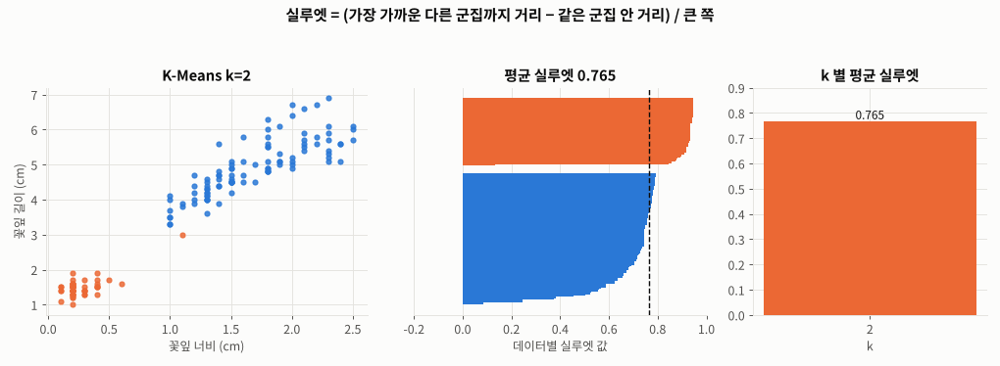
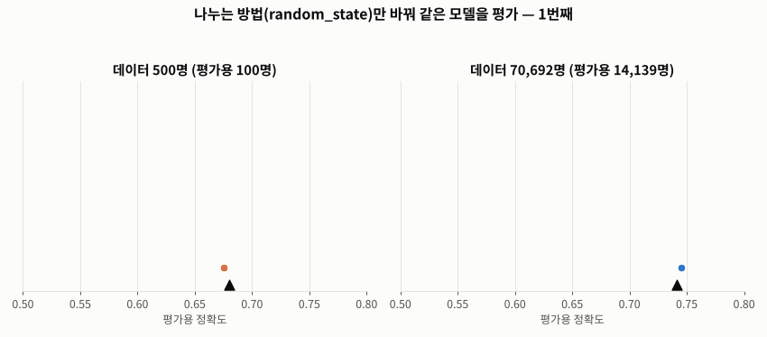
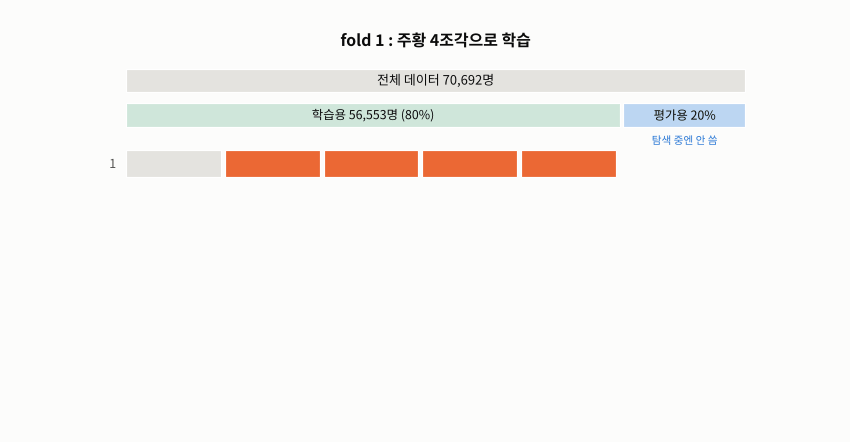
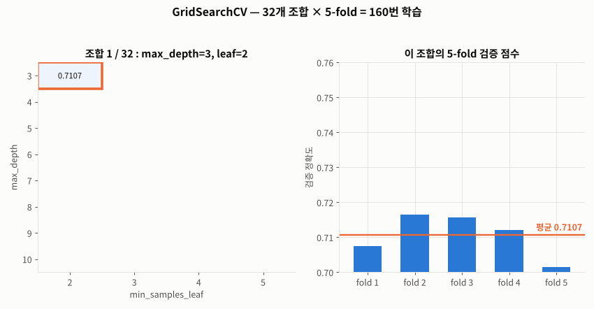
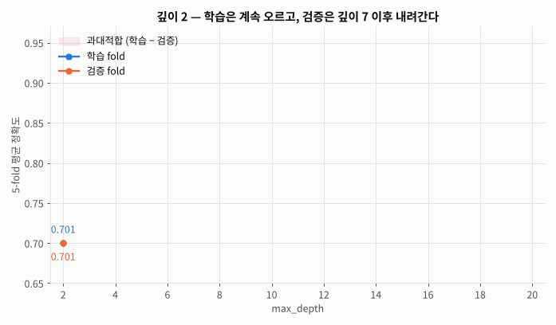
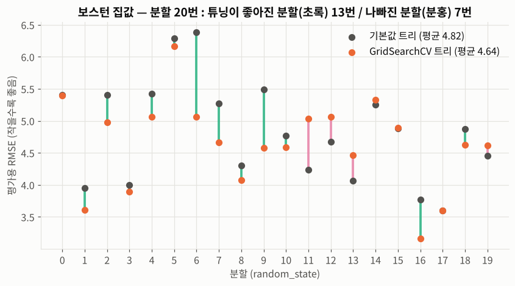

# Day 028 · 2026-10-19 (월)

`데이터 분석과 머신러닝/딥러닝` · 8주차

> **한 줄 요약** — K-Means 결과를 정답과 맞춰 보니 붓꽃 150송이 중 **144송이(96%)** 가 품종대로 묶였고, 엘보우는 **k=3**, 실루엣은 **k=2** 를 가리켰다. 오후에는 "한 번 나눠 한 번 평가"가 **운**에 좌우된다는 걸 확인하고(500명이면 정확도 0.54 ~ 0.76), **5-fold 교차 검증**과 **`GridSearchCV`** 로 결정 트리의 `max_depth=7` 을 골랐다 — 당뇨병 정확도 기본값 **0.655 → 0.741**, 검증 평균(0.742)과 평가용 점수가 거의 같아 **믿을 수 있는 점수**가 됐다.

📂 실습 노트북
- [`lecture/kmeans_cluster_evaluation.ipynb`](./lecture/kmeans_cluster_evaluation.ipynb) — 군집별 데이터 수(`np.unique`) · 교차표 · k=2/3 · SSE = `inertia_` 직접 계산 · 엘보우 · 실루엣 (필기 `비지도학습_K_Means` 2일차)
- [`lecture/cross_validation_gridsearch.ipynb`](./lecture/cross_validation_gridsearch.ipynb) — hold-out 의 운 · 학습/검증/평가 분할 · K-fold 직접 구현 · `cross_val_score` · `GridSearchCV` · `cv_results_` · 깊이 곡선 (필기 `분류모델고도화실습`)
- [`lecture/gridsearch_regression.ipynb`](./lecture/gridsearch_regression.ipynb) — 회귀 `GridSearchCV` (`neg_root_mean_squared_error`) · 분할 20번 비교 (교재 p.141, 새로 작성)

📊 실습 데이터 → [`iris_dataset.csv`](./lecture/iris_dataset.csv) (150행) · [`diabetes_binary_5050split_health_indicators_BRFSS2015.csv`](./lecture/diabetes_binary_5050split_health_indicators_BRFSS2015.csv) (70,692행 × 22열) · [`house_price.csv`](./lecture/house_price.csv) (506행 × 14열)
🖼️ 그림 → [`lecture/images/`](./lecture/images/) — 🎬 **시뮬레이션 애니메이션(GIF) 5개** + 그림 1장 (모두 노트북 코드로 직접 만든 것)
📖 교재 → `머신러닝` v7 **p.128~141** (16. 비지도 학습 · 17. 모델 성능 개선)

---

## 1. K-Means 2일차 — 군집 결과 확인

군집화에는 정답을 쓰지 않지만 **확인할 때는** 정답과 맞춰 본다. `np.unique(배열, return_counts=True)` → (항목, 개수).

```python
output2 = KMeans(n_clusters=3, random_state=0).fit_predict(wl_data)   # 꽃잎 길이 · 너비
np.unique(output2, return_counts=True)                                 # (array([0, 1, 2]), array([52, 50, 48]))
pd.crosstab(df['label'], output2)                                      # 정답 품종 × 군집 번호
```

| 정답 품종 | 군집 1 | 군집 0 | 군집 2 |
|---|---|---|---|
| setosa | **50** | 0 | 0 |
| versicolor | 0 | **48** | 2 |
| virginica | 0 | 4 | **46** |

versicolor · virginica 경계의 **6송이**만 어긋났다 → **96%**. 필기처럼 `output2[0:50]` 인덱스 구간으로 세는 방법은 데이터가 **품종별로 정렬돼 있을 때만** 맞아서, 정답별로 묶어 세는 방법(`groupby` · `crosstab`)으로 바꿨다.

### SSE = `inertia_` → 엘보우

**SSE** = 각 데이터 ↔ **자기 군집 중심점** 거리의 제곱 합. 직접 계산한 값(31.3714)과 `inertia_` 가 같다.

| k | 1 | 2 | 3 | 4 | 5 |
|---|---|---|---|---|---|
| SSE | 550.90 | 86.39 | **31.37** | 19.48 | 14.13 |
| 감소율 | — | 84% | 64% | 38% | 27% |

크게 줄다가 **완만해지기 시작하는 k = 3** 이 엘보우. ("가장 크게 감소하는 구간"은 항상 1 → 2 라서 그 기준으로는 고를 수 없다.)

### 엘보우가 애매할 때 — 실루엣



🎬 k 를 2 → 6 으로 바꾸며 데이터별 **실루엣 = (가장 가까운 다른 군집까지 거리 − 같은 군집 안 거리) / 큰 쪽**. 1 에 가까울수록 잘 묶임. **k = 2 (0.765)** 가 가장 높고 k = 3 은 0.660 — setosa 와 나머지는 아주 확실히 갈라지지만 versicolor · virginica 는 맞닿아 있기 때문.

→ 엘보우(k=3)와 실루엣(k=2)이 **다른 답**을 줄 수 있다. 지표는 참고, 최종 결정은 **도메인 지식**(붓꽃은 3품종)과 **쓰임새**로.

---

## 2. 지양해야 할 평가 방법 — 한 번 나눠 한 번 평가 (교재 p.135)



🎬 같은 모델(깊이 7 트리)을 **나누는 방법만 바꿔 30번** 평가했다. 데이터 **500명**이면 정확도가 **0.54 ~ 0.76** 으로 출렁이고, **70,692명**이면 0.733 ~ 0.748 로 거의 안 흔들린다. 한 번 평가한 점수는 "운 좋게 맞춘 것"일 수 있다.

그리고 **평가용 점수를 보고 설정을 고르면** 평가용이 학습에 참여한 셈이 된다 → 설정은 **검증용**으로 고르고, 평가용은 **마지막에 한 번만**.

| 데이터 | 비율 | 용도 |
|---|---|---|
| 학습용 | 60% | 모델 학습 |
| **검증용** | 20% | `max_depth` 같은 설정 고르기 |
| 평가용 | 20% | 최종 성능 — 한 번만 |

검증용 한 묶음으로 고르면 깊이 **6**, 아래 교차 검증으로 고르면 깊이 **7** — 떼어 낸 방법에 따라 뒤집힐 만큼 차이가 작다.

---

## 3. K-fold 교차 검증 (교재 p.136~137)

**학습용**을 k 조각으로 나눠 → k−1 조각으로 학습, 1 조각으로 검증 → 검증 조각을 바꿔 **k 번** → 점수 **평균**.



🎬 학습용 56,553명을 5조각으로 나누고 초록(검증) 칸을 한 칸씩 옮겼다. 0.7418 · 0.7467 · 0.7426 · 0.7405 · 0.7377 → 평균 **0.7419 ± 0.003**. 평가용(파랑)은 **한 번도 쓰지 않는다**.

```python
from sklearn.model_selection import cross_val_score
scores = cross_val_score(model, X_train, y_train, cv=5, scoring='accuracy')  # 분류면 자동으로 StratifiedKFold
scores.mean()
```

| 실무 (교재 p.137) | 검증 방식 | 이유 |
|---|---|---|
| 일반 머신러닝 (표 데이터 · sklearn) | **K-fold 교차 검증** | 학습이 빨라 k 번 해도 부담 없음 |
| 딥러닝 (이미지 · 자연어 · LLM) | **Hold-out** (학습 / 검증 / 평가 한 번) | 학습 한 번이 비싸고, 데이터가 커서 한 번 나눠도 충분 |

---

## 4. `GridSearchCV` — 하이퍼파라미터 탐색 + 교차 검증 (교재 p.138~140)

```python
from sklearn.model_selection import GridSearchCV

params = {'max_depth': [3, 4, 5, 6, 7, 8, 9, 10],      # 8개
          'min_samples_leaf': [2, 3, 4, 5]}            # × 4개 = 32개 조합

grid_dt = GridSearchCV(estimator=DecisionTreeClassifier(random_state=0),
                       param_grid=params, scoring='accuracy', cv=5)   # 32 × 5 = 160번 학습
grid_dt.fit(X_train, y_train)                # 평가용은 넣지 않는다

grid_dt.best_params_       # {'max_depth': 7, 'min_samples_leaf': 5}
grid_dt.best_score_        # 0.7419  ← 검증 fold 평균
best_dt = grid_dt.best_estimator_            # 최적 조합 + 학습용 전체로 다시 학습(refit)
accuracy_score(y_test, best_dt.predict(X_test))   # 0.7411  ← 평가용은 마지막에 한 번
```



🎬 32개 조합을 하나씩 5-fold 로 평가하며 표를 채운다(오른쪽 = 그 조합의 fold 별 점수). best = **`max_depth=7`, `min_samples_leaf=5`**.

- 점수를 가르는 건 거의 **`max_depth`**. 깊이 7 트리의 리프 126개는 절반이 약 200명 이상이라 `min_samples_leaf` 2 ~ 5 제한은 리프 **2개**에만 걸린다. 범위를 넓히면 `min_samples_leaf=100` 이 0.7427 로 조금 더 좋다 → GridSearchCV 는 **준 후보 안에서만** 고른다.



🎬 깊이 2 → 20 : 학습 fold(파랑)는 0.948 까지 오르지만 검증 fold(주황)는 **깊이 7 (0.742)** 에서 꺾여 0.667 까지 떨어진다. 벌어진 틈이 **과대적합**.

| 당뇨병 데이터 | 고른 방법 | 평가용 정확도 |
|---|---|---|
| 결정 트리 기본값 (깊이 37) | — | 0.6545 |
| 결정 트리 `max_depth=7, min_samples_leaf=5` | **GridSearchCV** | **0.7411** |
| 랜덤 포레스트 기본값 ([Day 024](../2026-10-13/)) | — | 0.7402 |
| XGBoost ([Day 025](../2026-10-14/)) | — | 0.7498 |

트리 하나를 교차 검증으로 **잘 고르기만 해도** 기본값 랜덤 포레스트 수준.

---

## 5. 회귀 모델 고도화 — 보스턴 집값 (교재 p.141)

`GridSearchCV` 는 **클수록 좋은** 점수를 고르므로 RMSE 는 부호를 뒤집은 **`scoring='neg_root_mean_squared_error'`** (읽을 때 `-best_score_`).

| 보스턴 (학습용 379개) | 값 |
|---|---|
| best | `max_depth=8`, `min_samples_leaf=5` |
| 검증 평균 RMSE | 3.85 |
| 평가용 RMSE | 5.40 (기본값 트리 5.41 과 거의 같다 — 왜?) |



한 번의 평가로는 판단이 안 돼서 **분할을 20번** 바꿔 비교했다 — 평균 RMSE **4.82 → 4.64**, 20번 중 **13번** 좋아졌다. 고른 `max_depth` 도 분할마다 4 ~ 10 으로 바뀐다.

| 분류 (당뇨병 56,553명) | 회귀 (보스턴 379개) |
|---|---|
| 검증 0.7419 ≈ 평가 0.7411 → **믿을 만함** | 검증 3.85 vs 평가 5.40 → **차이 큼** |

**데이터가 작으면** 검증 점수도, 평가 점수도 흔들린다 — 교재가 말하는 "지양해야 할 평가 방법"의 진짜 의미.

---

## 🔁 복습

**필기에서 고친 부분**
- [x] 제목 `군집화(n_clusters='3',PC3)` → `n_clusters` 는 정수 **`3`**, **PC3 는 PCA 의 주성분**이라 K-Means 와 무관 ("군집 3개")
- [x] 출력 이름 `pc2.군집화` · `pc2-3.군집화` → 각 구간은 **품종**. 저장된 출력(`pc3.군집화`)과 코드 문자열이 달랐다 — 고친 뒤 재실행 안 함
- [x] `output2[0:50]` 인덱스 구간으로 세기 → 정렬돼 있을 때만 맞음, **`groupby` · `crosstab`** 으로
- [x] "거리 기반 평균으로 경계선(기준선)을 만든다" → 중심점(좌표 평균)을 정하면 경계는 결과적으로 **중심점 사이 수직 이등분선**
- [x] "SSE : 중심점 데이터, 주변에 있는 오차 거리차 제곱 합계" → **각 데이터 ↔ 자기 군집 중심점** 거리 제곱 합
- [x] 주석 "SSE 보다 MSE(RMSE)를 더 자주 사용" → 회귀 평가 이야기. K-Means 는 SSE 를 최소화하는 알고리즘이고, 같은 데이터로 k 만 바꾸면 SSE 든 SSE/n 이든 곡선 모양이 같다
- [x] "군집화 끝나면 → **군집별** SSE 를 제공" → `inertia_` 는 **전체 합** 하나. 군집별은 직접 계산(13.06 · 2.02 · 16.29)
- [x] 엘보우 그래프 plotly → GitHub 에서 안 보여 matplotlib 로
- [x] "교차 검증 : 평가가 좋게 나오기 위한 과정" → 점수를 **올리는** 게 아니라 **믿을 수 있게 재는** 방법
- [x] "검증 데이터 : 학습 60~80% (학습, 검증) 후 평가 20~40%" → 검증용은 **학습용에서 떼어 낸 것**
- [x] "K 나눌수록 정밀해진다" → 평균은 안정되지만 학습을 k 번 해야 해서 느려짐. 보통 5 또는 10
- [x] "GridSearchCV : **평가용** 데이터에 대해 성능이 가장 좋은 학습 방법" → **학습용 안의 검증 fold** 로만 고른다. 평가용은 끝까지 안 봐서 마지막 점수가 공정하다
- [x] `print("검증:", best_dt)` → 출력되는 건 검증 점수가 아니라 **모델**. 검증 점수는 `best_score_`
- [x] "Max_depth 최대 : 데이터 수 / leaf 최소 : 데이터 수 / 최대 × 최소" → 후보 **8 × 4 = 32개 조합**, 5-fold 라 **160번** 학습
- [x] 오타 `beat` → best, `parm_grid` → `param_grid`, `GridSerchCV` → `GridSearchCV` (교재 제목도), `print(y_data)` 7만 줄 출력 → 비율만

**직접 해본 것**
- SSE 를 직접 계산해 `inertia_` 와 비교, 군집별 SSE · k 별 감소율
- 실루엣 계수 k = 2 ~ 6 비교, 데이터별 실루엣 막대
- 데이터 500명 vs 70,692명으로 hold-out 30번 반복 → 운의 크기 비교
- 학습 / 검증 / 평가 60 : 20 : 20 분할로 깊이 고르기 (깊이 6) vs 교차 검증 (깊이 7)
- `StratifiedKFold` 로 5-fold 를 직접 돌려 `cross_val_score` 와 같은 값인지 확인
- `cv_results_` 로 32개 조합 히트맵, 깊이 2 ~ 20 학습 / 검증 곡선, `min_samples_leaf` 2 ~ 500 넓게 탐색
- 회귀 `GridSearchCV` (교재 p.141) + 분할 20번 반복으로 튜닝 효과 확인
- `FuncAnimation` 으로 hold-out 운 · K-fold · GridSearchCV · 깊이 곡선 · 실루엣 애니메이션

**막혔던 부분 / 질문**
- [ ] 후보가 많을 때 `RandomizedSearchCV` 는 몇 개만 뽑아도 GridSearchCV 와 비슷한 결과가 나오는지
- [ ] 랜덤 포레스트 · XGBoost 도 GridSearchCV 로 튜닝하면 당뇨병 정확도가 얼마나 오르는지 ([Day 024](../2026-10-13/) · [Day 025](../2026-10-14/) 질문과 연결)
- [ ] 데이터가 작을 때(보스턴) 튜닝 결과를 믿으려면 — 반복 교차 검증(`RepeatedKFold`) · 중첩 교차 검증(nested CV)
- [ ] 군집 개수를 미리 정하지 않는 군집화 알고리즘 (DBSCAN · 계층적 군집)

📂 [수업 자료 폴더](./lecture/) · [복습 자료 폴더](./review/)

---

## 🔗 참고 링크

- [scikit-learn — Cross-validation: evaluating estimator performance](https://scikit-learn.org/stable/modules/cross_validation.html)
- [scikit-learn — Tuning the hyper-parameters of an estimator (GridSearchCV)](https://scikit-learn.org/stable/modules/grid_search.html)
- [`GridSearchCV` 문서](https://scikit-learn.org/stable/modules/generated/sklearn.model_selection.GridSearchCV.html) · [`cross_val_score` 문서](https://scikit-learn.org/stable/modules/generated/sklearn.model_selection.cross_val_score.html) · [`StratifiedKFold` 문서](https://scikit-learn.org/stable/modules/generated/sklearn.model_selection.StratifiedKFold.html)
- [scikit-learn — scoring 이름 목록 (`neg_root_mean_squared_error` 등)](https://scikit-learn.org/stable/modules/model_evaluation.html#scoring-parameter)
- [scikit-learn — Selecting the number of clusters with silhouette analysis](https://scikit-learn.org/stable/auto_examples/cluster/plot_kmeans_silhouette_analysis.html)
- [`KMeans` 문서](https://scikit-learn.org/stable/modules/generated/sklearn.cluster.KMeans.html) · [`silhouette_score` 문서](https://scikit-learn.org/stable/modules/generated/sklearn.metrics.silhouette_score.html)
