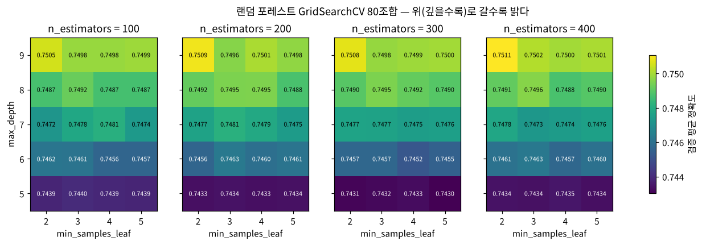
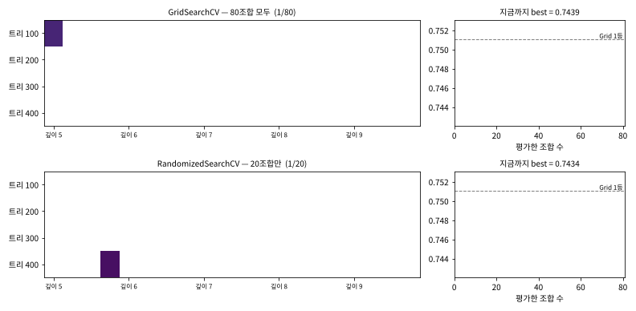
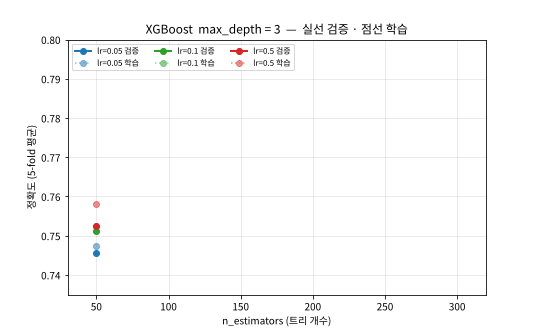
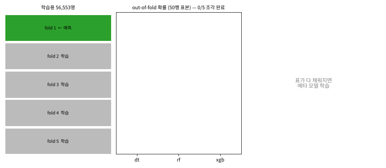
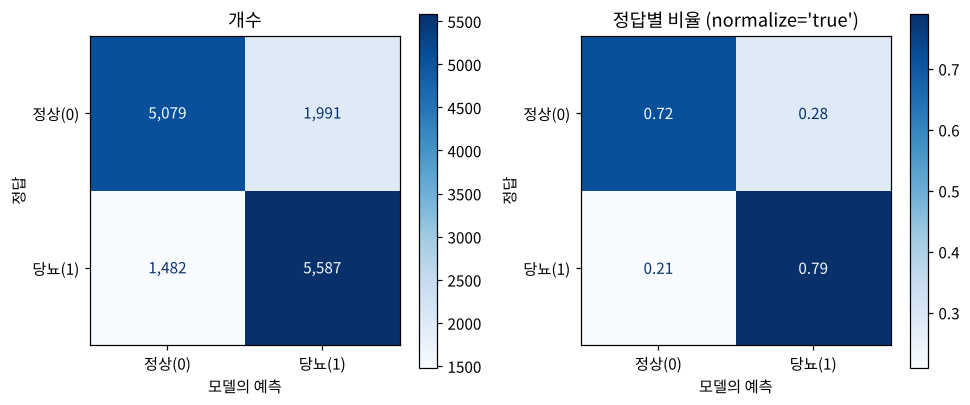
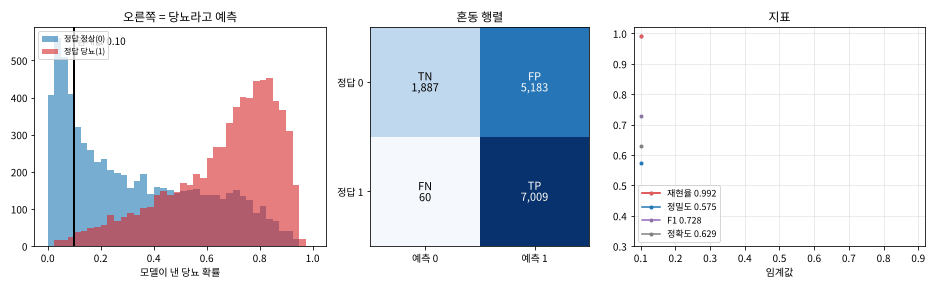
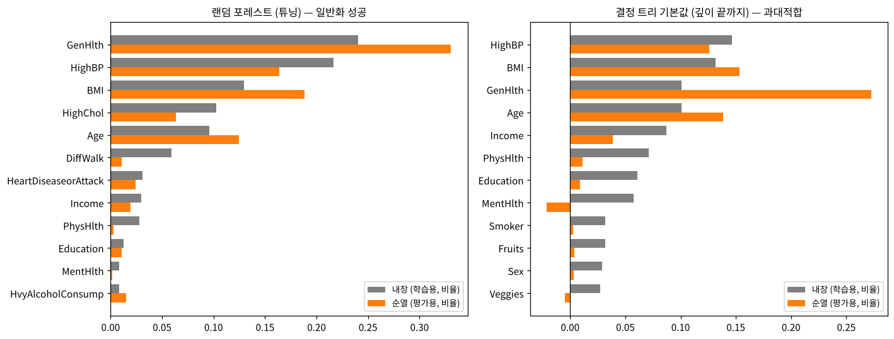
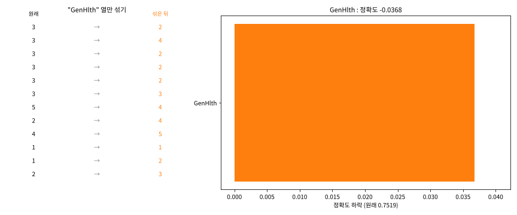

# Day 029 · 2026-10-20 (화)

`데이터 분석과 머신러닝/딥러닝` · 8주차

> **한 줄 요약** — 어제 결정 트리에 쓴 `GridSearchCV` 를 **랜덤 포레스트 · XGBoost** 에 적용했다. 당뇨병 평가 정확도 랜덤 포레스트 **0.7402 → 0.7519**, XGBoost **0.7498 → 0.7544**. 후보가 240조합이면 **`RandomizedSearchCV`** 로 30개만 뽑아도 1등과 거의 같은 점수가 나온다. 튜닝한 셋을 **스태킹**해도 0.7548 로 XGBoost 혼자와 비슷 — 세 모델이 서로 **비슷한 말**을 해서다. 마지막으로 `classification_report` 의 **정밀도 · 재현율 · F1** 과 **특성 중요도**로 모델을 검증했다.

📂 실습 노트북
- [`lecture/hyperparameter_search_rf_xgb.ipynb`](./lecture/hyperparameter_search_rf_xgb.ipynb) — 랜덤 포레스트 `GridSearchCV` · `RandomizedSearchCV` · Grid vs Random · XGBoost `GridSearchCV` · `joblib` (필기 `분류 모델 성능 고도화 실습 1`)
- [`lecture/stacking_classifier.ipynb`](./lecture/stacking_classifier.ipynb) — `StackingClassifier` · out-of-fold 직접 구현 · 메타 모델 계수 · 교재 p.111 버전 (필기 같은 노트 마지막 부분)
- [`lecture/classification_evaluation.ipynb`](./lecture/classification_evaluation.ipynb) — 혼동 행렬 · 정밀도 · 재현율 · F1 · 불균형 · 임계값 · 내장 vs 순열 특성 중요도 (교재 18장, 새로 작성)

📊 실습 데이터 → [`diabetes_binary_5050split_health_indicators_BRFSS2015.csv`](./lecture/diabetes_binary_5050split_health_indicators_BRFSS2015.csv) (70,692행 × 22열)
🖼️ 그림 → [`lecture/images/`](./lecture/images/) — 🎬 **시뮬레이션 애니메이션(GIF) 5개** + 그림 3장 (모두 노트북 코드로 직접 만든 것)
📖 교재 → `머신러닝` v7 **p.138~144** (17. 모델 성능 개선) · **p.109~114** (스태킹 · 모델 선택 기준) · `모델검증및평가` (18. 모델 검증 및 평가)

---

## 1. 랜덤 포레스트 튜닝 — `GridSearchCV` (교재 p.138~140)

```python
params = {'n_estimators': [100, 200, 300, 400],      # 4
          'max_depth': [5, 6, 7, 8, 9],               # × 5
          'min_samples_leaf': [2, 3, 4, 5]}           # × 4 = 80조합 → 5-fold 400번 학습
grid_rf = GridSearchCV(RandomForestClassifier(random_state=0), param_grid=params,
                       scoring='accuracy', cv=5, n_jobs=-1)     # n_jobs=-1 : CPU 코어 모두 사용
grid_rf.fit(X_train, y_train)
grid_rf.best_params_    # {'max_depth': 9, 'min_samples_leaf': 2, 'n_estimators': 400}
grid_rf.best_score_     # 0.7511 (검증) → 평가 0.7519
```



| 하이퍼파라미터 | 값을 바꿀 때 검증 점수의 폭 |
|---|---|
| `max_depth` 5 → 9 | **0.0067** (깊을수록 좋음, 후보 끝 9 에서 best) |
| `n_estimators` 100 → 400 | 0.0002 (그런데 학습 시간은 **4배**) |
| `min_samples_leaf` 2 → 5 | 0.0002 |

→ 점수를 가르는 건 거의 `max_depth` 하나. 트리 100개(1.7초)와 400개(6.8초)는 점수 차 0.0006.

---

## 2. `RandomizedSearchCV` — 후보가 많을 때 (교재 p.142~144)

| | `GridSearchCV` | `RandomizedSearchCV` |
|---|---|---|
| 후보 | `param_grid` | `param_distributions` (리스트 · `range` · 확률분포) |
| 평가 수 | **모든** 조합 | **`n_iter`** 개 무작위 (`random_state` 로 고정) |

```python
params = {'n_estimators': [100, 200, ..., 1000],   # 10
          'max_depth': [5, 6, 7, 8, 9, 10],          # × 6
          'min_samples_leaf': [2, 3, 4, 5]}          # × 4 = 240조합
random_rf = RandomizedSearchCV(rf, param_distributions=params, n_iter=30,   # 30개만 → 150번 학습
                               scoring='f1', cv=5, random_state=0)
random_rf.best_params_   # {'n_estimators': 800, 'min_samples_leaf': 4, 'max_depth': 10}
random_rf.best_score_    # 0.7617  ← F1 !  (같은 조합의 정확도는 0.7512)
```

⚠️ 수업에서 Random 만 `scoring='f1'` 이었다 → 0.7617 이 Grid 의 0.7511 보다 높아 보이는 건 **지표가 달라서**. 같은 정확도로 보면 0.7512 vs 0.7511 로 같다.



🎬 같은 80칸을 Grid 는 전부, Random 은 20칸만 찍는다. Grid 의 80조합 점수를 이미 알기 때문에 "n 개만 뽑았다면?" 을 **학습 없이 1,000번** 흉내 냈다.

| n_iter | 1 | 5 | 10 | 20 | 30 | 60 |
|---|---|---|---|---|---|---|
| 1등과 평균 차이 | 0.0038 | 0.0013 | 0.0008 | **0.0005** | 0.0003 | 0.0001 |
| 상위 5% 를 건질 확률 | 5% | 26% | 43% | 69% | **84%** | 99.5% |

→ 어제의 질문 "몇 개만 뽑아도 비슷한가?" 의 답 : 좋은 조합이 **넓게 퍼져 있으면** 4분의 1만 봐도 충분. 실무에서는 **넓게 Random → 좋은 근처를 Grid 로 좁히기**.

---

## 3. XGBoost 튜닝 — `min_samples_leaf` 는 XGBoost 에 없다

```python
XGBClassifier(min_samples_leaf=2)   # WARNING: Parameters: { "min_samples_leaf" } are not used.
# min_samples_leaf=2 와 50 의 예측이 완전히 같다 → 수업 코드 144조합 중 108개는 중복 학습
```

`min_samples_leaf` 는 sklearn 트리의 매개변수. XGBoost 의 비슷한 역할은 **`min_child_weight`**. 빼고 36조합으로 돌려도 **같은 결과**(1.1분) : best `learning_rate=0.05, max_depth=4, n_estimators=200` — 검증 0.7537 · 평가 **0.7544**.



🎬 깊이별로 트리를 50 → 300 개로 늘렸다. **lr=0.5** 는 학습(점선)만 오르고 검증(실선)은 떨어지는 과대적합, **lr=0.05** 는 트리가 늘수록 꾸준히 오른다. `learning_rate` 와 `n_estimators` 는 **짝** — 작은 보폭 × 많은 걸음 ≈ 큰 보폭 × 적은 걸음 → 함께 탐색.

| 당뇨병 (평가용 14,139명) | 고른 방법 | 검증 정확도 | 평가 정확도 | 평가 F1 |
|---|---|---|---|---|
| 결정 트리 ([Day 028](../2026-10-19/)) | GridSearchCV 32조합 | 0.7419 | 0.7411 | 0.7447 |
| 랜덤 포레스트 | GridSearchCV 80조합 (13.5분) | 0.7511 | 0.7519 | 0.7597 |
| 랜덤 포레스트 | RandomizedSearchCV 30/240 (12.3분) | 0.7512 | 0.7520 | 0.7601 |
| **XGBoost** | GridSearchCV 36조합 (1.1분) | **0.7537** | **0.7544** | **0.7629** |

튜닝 효과는 결정 트리가 가장 크고(+0.087), 랜덤 포레스트(+0.012) · XGBoost(+0.005)는 기본값도 이미 좋아서 작다. 모든 모델에서 **검증 ≈ 평가** (차이 0.001 안팎).

---

## 4. 스태킹 — 튜닝한 셋을 하나로 (교재 p.109~114)

```python
stack = StackingClassifier(estimators=[('dt', best_dt), ('rf', best_rf), ('xgb', best_xgb)],
                           final_estimator=LogisticRegression(max_iter=1000))   # cv=5 기본
stack.fit(X_train, y_train)          # 평가 정확도 0.7548 · F1 0.7605
```

`fit` 한 줄 안에서 : ① 기본 모델마다 **5-fold 로 "안 보고 낸" 확률**(out-of-fold, `cross_val_predict`)을 만들고 ② 그 3열로 메타 모델을 학습하고 ③ 기본 모델은 학습용 전체로 다시 학습한다 — 기본 모델마다 **6번** 학습.



🎬 초록 조각을 예측할 때 기본 모델은 나머지 4조각으로만 학습 → 표가 다 채워지면 메타 모델 학습. 메타 계수 **xgb 3.90 · rf 1.61 · dt −0.15** = 누구 말을 얼마나 믿나. 직접 구현한 것과 `StackingClassifier` 의 계수 · 예측이 **100% 같다**.

| out-of-fold 를 안 하면? (기본값 트리 + XGBoost) | 트리 계수 | 평가 정확도 |
|---|---|---|
| (X) 이미 본 학습용 예측으로 메타 학습 | **13.9** (트리가 다 맞혀 보여서) | **0.652** — XGBoost 혼자(0.754)보다 나쁨 |
| (O) out-of-fold 로 메타 학습 | 0.07 | 0.754 |

왜 별로 안 올랐나 → 세 모델 확률의 상관이 **0.95 ~ 0.98**, 예측이 갈리는 사람은 **9.9%** 뿐. 모두 트리 계열이라 실수도 비슷하다. 교재 기본값 3개 스태킹은 0.7478.

모델 선택 (교재 p.114) : 정확도는 스태킹 0.7548 ≈ XGBoost 0.7544, **F1 은 XGBoost 0.7629 > 스태킹 0.7605**. 학습 6배 + 설명 어려움을 생각하면 **XGBoost 하나**.

### 모델 저장 — `joblib`

```python
joblib.dump(best_rf_random, './models/best_rf_random.pkl')            # 74.8 MB (트리 800그루 · 깊이 10)
joblib.dump(best_rf_random, './models/best_rf_random_c3.pkl', compress=3)   # 23.1 MB
loaded = joblib.load('./models/best_rf_random.pkl')                   # 예측이 저장 전과 같다
```

GitHub 는 파일 하나 100 MB 제한 → `.pkl` 은 올리지 않았다. `pickle` · `joblib` 은 불러오는 순간 코드가 실행될 수 있어 **내가 만든 파일만** 불러온다.

---

## 5. 모델 검증 및 평가 — 혼동 행렬 · 정밀도 · 재현율 · F1 (교재 18장)



| XGBoost (양성 = 당뇨 1) | 식 | 값 |
|---|---|---|
| 정확도 | (TP + TN) / 전체 = (5,587 + 5,079) / 14,139 | 0.7544 |
| **재현율** | TP / (TP + FN) — 실제 당뇨 중 찾아낸 비율 | 0.7904 |
| **정밀도** | TP / (TP + FP) — 당뇨라고 한 사람 중 진짜 | 0.7373 |
| **F1** | 2PR / (P + R) — 조화평균 | 0.7629 |

직접 계산한 값과 `classification_report` 의 `당뇨(1)` 행이 같다. `정상(0)` 행은 0 을 양성으로 놓고 다시 계산한 것, `macro avg` 는 단순 평균, `weighted avg` 는 support 가중 평균.

**정확도의 한계** — 당뇨를 5%만 남긴 불균형 평가용(7,442명) : "전부 정상" 이라고 찍으면 정확도 **0.950** 인데 재현율 · F1 **0**. XGBoost 는 정확도 0.725 지만 당뇨의 **85%** 를 찾는다. **조화평균** : 정밀도 1.0 · 재현율 0.0 → 산술평균 0.5, F1 **0**.



🎬 `predict` = "확률 ≥ **0.5** 면 당뇨". 임계값을 0.1 → 0.9 로 옮기면 정밀도 0.575 → 0.888 ↑, 재현율 0.992 → 0.070 ↓. F1 최고는 **0.4 (0.778)**. 놓치면 안 되는 1차 선별이면 낮추고, 헛경보가 비싸면 올린다.

### 특성 중요도 — 내장(학습용) vs 순열(평가용)



| | 내장 `feature_importances_` | 순열 `permutation_importance` |
|---|---|---|
| 데이터 | 학습용 | 평가용 |
| 방법 | 그 특성으로 나눌 때 불순도가 평균 얼마나 줄었나 | 그 열만 섞으면 성능이 얼마나 떨어지나 |

- 튜닝한 랜덤 포레스트 : 상위 5개(GenHlth · HighBP · BMI · HighChol · Age)가 **5개 모두 겹친다** → 일반화 성공.
- 기본값 결정 트리(끝까지 자람) : Income · PhysHlth · Education · MentHlth · Smoker 등에 나눠 준 내장 중요도가 순열에서는 거의 0, **MentHlth · Veggies 는 음수** → 잡음을 외운 과대적합.



🎬 평가용에서 특성 한 열만 섞을 때마다 정확도가 얼마나 떨어지는지 쌓아 간다. GenHlth 를 섞으면 −0.037, 뒤쪽 특성은 섞어도 거의 그대로.

---

## 🔁 복습

**필기에서 고친 부분**
- [x] `RandomizedSearchCV` 만 `scoring='f1'` → `best_score_` 0.7617 은 **F1**. Grid(정확도 0.7511)와 비교하려면 같은 지표로 — 같은 조합의 정확도는 0.7512
- [x] XGBoost `params` 의 `'min_samples_leaf'` → XGBoost 에 없는 매개변수라 **무시**(경고만), 144조합 중 108개가 중복 학습. 리프 크기 제한은 `min_child_weight`
- [x] `print(best_xgb)` → XGBoost 기본값 `None` 수십 개가 찍힘, 고른 값은 **`best_params_`** 로
- [x] 스태킹 메타 모델 "1단계 모델들의 예측값을 받아" → 정확히는 **out-of-fold 확률**. 학습용 예측을 그대로 쓰면 이미 본 데이터라 과하게 믿는다 (교재 p.109 설명도 같음)
- [x] `base_models` 에 학습된 `best_dt` 등을 넣어도 `StackingClassifier` 는 **복제해서 다시 학습**한다 (기본 모델마다 6번)
- [x] `joblib.dump('best_rf_random.pkl')` (상대) ↔ `joblib.load('C:/Users/playdata2/work/...')` (절대) → 둘 다 같은 **상대 경로**로
- [x] `classification_report` "4가지 성능" → 클래스별 정밀도 · 재현율 · F1 + 정확도 + support, macro · weighted 평균. 기본 `digits=2` 라 모델끼리 0.75 vs 0.75 로 안 보임 → `digits=4`
- [x] 탐색에 `n_jobs=-1` 추가 (2코어에서 랜덤 포레스트 80조합 13.5분)
- [x] 오타 `변견` → 변경, `데이터 대한` → 데이터에 대한, `print("검증 완료")` → fit 은 탐색 + 재학습까지. 교재 p.112 `stack.predict(X_test))` 괄호 하나 더 → `SyntaxError`

**직접 해본 것**
- 랜덤 포레스트 80조합 `cv_results_` 히트맵, 하이퍼파라미터별 점수 폭 · 학습 시간 비교
- `RandomizedSearchCV` 에 `scoring={'accuracy', 'f1'}` + `refit='f1'` 로 두 지표 함께 기록
- Grid 80조합 결과로 "n_iter 개만 뽑았다면" 1,000번 시뮬레이션
- XGBoost `min_samples_leaf=2` vs `50` 예측 비교로 매개변수 무시 확인
- `cross_val_predict` 로 스태킹 out-of-fold 를 직접 구현해 `StackingClassifier` 와 비교, out-of-fold 없는 메타 학습 실험
- 혼동 행렬에서 4가지 지표 직접 계산, 불균형(5%) 데이터 · `DummyClassifier`, 임계값 0.1 ~ 0.9
- 내장 vs 순열 특성 중요도 (튜닝 랜덤 포레스트 vs 기본값 결정 트리)
- `FuncAnimation` 으로 Grid vs Random · XGBoost learning_rate · 스태킹 out-of-fold · 임계값 · 순열 중요도 애니메이션

**막혔던 부분 / 질문**
- [ ] `max_depth` 후보 끝(9 · 10)에서 best 가 나왔다 — 범위를 12 ~ 15 까지 넓히면 더 오를까, 아니면 과대적합이 시작될까
- [ ] `param_distributions` 에 리스트 대신 `scipy.stats.randint` · `loguniform` 같은 **확률분포**를 주면 무엇이 달라지는지 (특히 `learning_rate`)
- [ ] XGBoost `early_stopping_rounds` 로 `n_estimators` 를 탐색 없이 정하는 방법
- [ ] 스태킹에 **다른 계열**(로지스틱 회귀 · KNN · SVM)을 섞으면 오를까 — 예측이 갈리는 9.9% 가 늘어나는지
- [ ] 임계값을 평가용이 아니라 **검증용**으로 정하는 방법 (`TunedThresholdClassifierCV`)
- [ ] 순열 중요도가 **서로 겹치는 특성**(GenHlth ↔ PhysHlth · DiffWalk)을 낮게 재는 문제 — SHAP 은 어떻게 다른지

📂 [수업 자료 폴더](./lecture/) · [복습 자료 폴더](./review/)

---

## 🔗 참고 링크

- [scikit-learn — Tuning the hyper-parameters of an estimator (Grid · Randomized)](https://scikit-learn.org/stable/modules/grid_search.html)
- [`RandomizedSearchCV` 문서](https://scikit-learn.org/stable/modules/generated/sklearn.model_selection.RandomizedSearchCV.html) · [`GridSearchCV` 문서](https://scikit-learn.org/stable/modules/generated/sklearn.model_selection.GridSearchCV.html)
- [XGBoost — Parameters (`min_child_weight`, `learning_rate` …)](https://xgboost.readthedocs.io/en/stable/parameter.html)
- [scikit-learn — Stacked generalization](https://scikit-learn.org/stable/modules/ensemble.html#stacked-generalization) · [`StackingClassifier` 문서](https://scikit-learn.org/stable/modules/generated/sklearn.ensemble.StackingClassifier.html)
- [scikit-learn — Model persistence (joblib · pickle 보안 주의)](https://scikit-learn.org/stable/model_persistence.html)
- [scikit-learn — Classification metrics (혼동 행렬 · 정밀도 · 재현율 · F1)](https://scikit-learn.org/stable/modules/model_evaluation.html#classification-metrics)
- [scikit-learn — Permutation feature importance](https://scikit-learn.org/stable/modules/permutation_importance.html)
