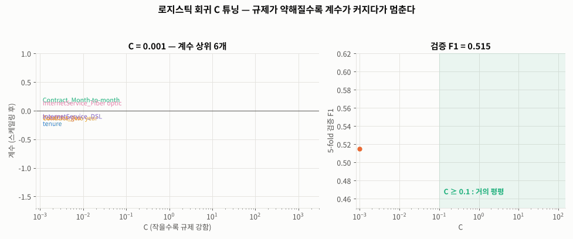
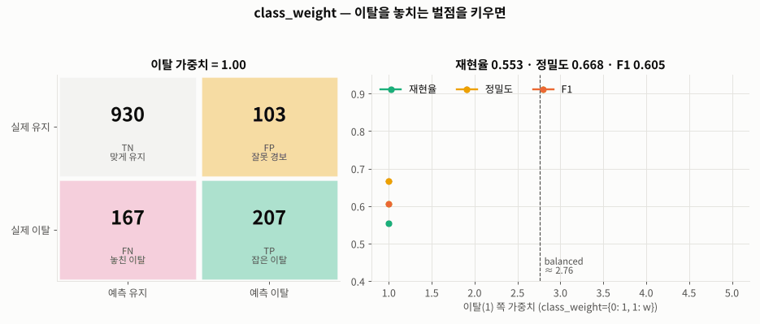
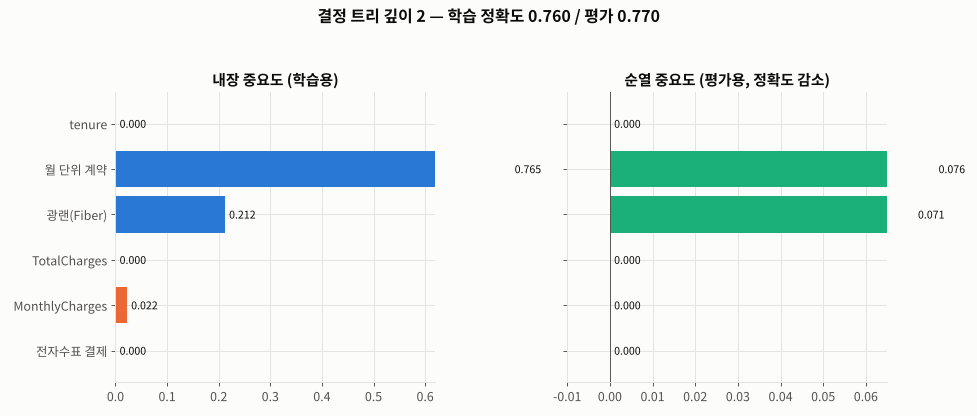
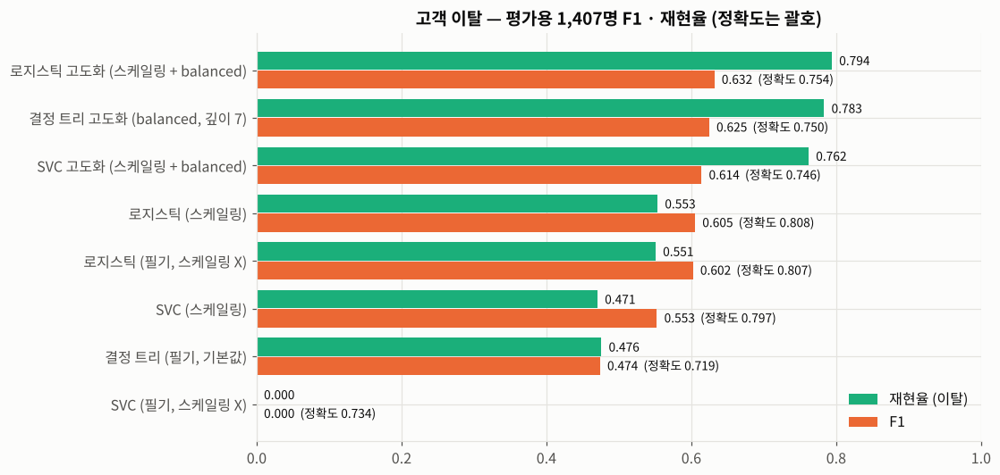
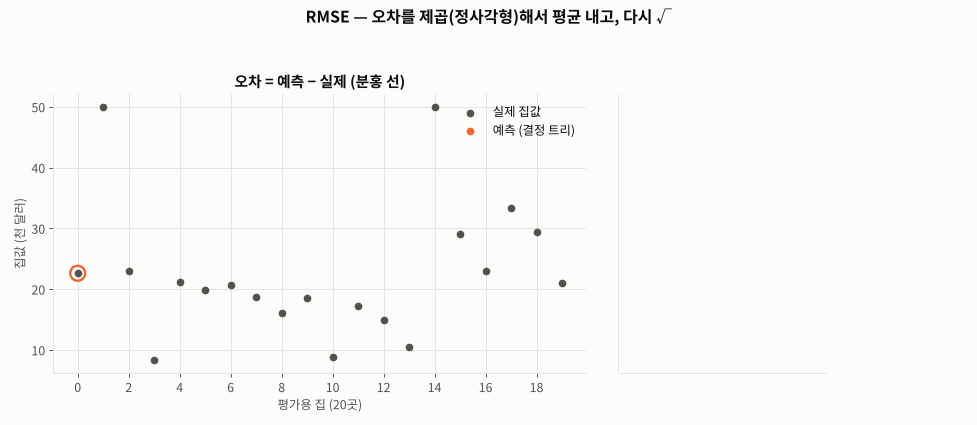
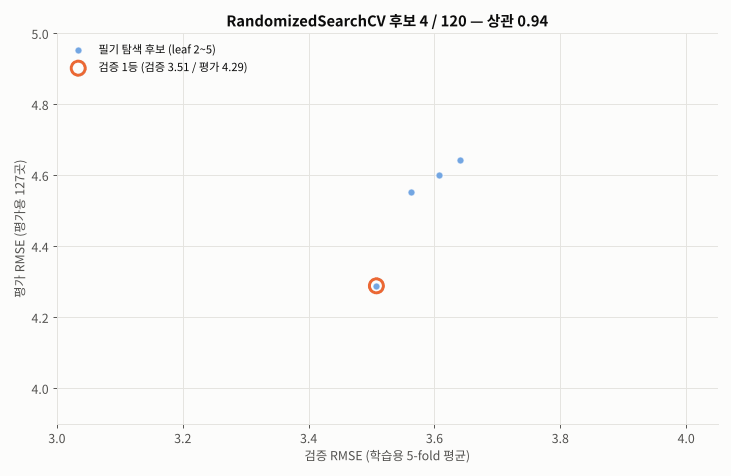

# Day 030 · 2026-10-21 (수)

`데이터 분석과 머신러닝/딥러닝` · 8주차

> **한 줄 요약** — 튜닝 → 평가 → **특성 중요도로 검증**까지 분류 · 회귀를 한 번씩 끝까지 해 봤다. 고객 이탈은 `GridSearchCV` 로 `C` · `max_iter` 를 바꿔도 F1 0.60 그대로였고, **스케일링 + `class_weight='balanced'`** 가 재현율을 0.55 → **0.79**, F1 을 **0.632** 로 올렸다. 스케일링 없이 본 계수 "중요도"에서는 35위였던 **`tenure` 가 실제로는 1위**였다. 보스턴 집값은 필기의 `RandomizedSearchCV` 결과(RMSE 4.31)가 **기본값(4.07)보다 나빴는데**, 탐색 범위에 기본값 `min_samples_leaf=1` 이 빠져 있었기 때문이다.

📂 실습 노트북
- [`lecture/churn_model_evaluation.ipynb`](./lecture/churn_model_evaluation.ipynb) — 전처리 · EDA · 인코딩 · 로지스틱 회귀(수렴 경고 · 계수 해석) · `GridSearchCV` (필기 / 스케일링 + `class_weight`) · 혼동 행렬 · 내장 vs 순열 중요도 · **SVM 고도화** · **결정 트리 고도화** · 모델 비교 (필기 `고객이탈예측_1`) — 모델마다 **생성 → 학습 → 예측 → 평가 → 고도화(탐색 → best → 예측 → 평가 → 특성 중요도)** 를 단계별 코드 · 주석으로
- [`lecture/regression_model_evaluation.ipynb`](./lecture/regression_model_evaluation.ipynb) — RMSE · 결정 트리 `GridSearchCV` · `RandomizedSearchCV` (교재 p.143) · 랜덤 포레스트 `RandomizedSearchCV` (필기 / 기본값 포함) · 반복 교차 검증 · 특성 중요도 검증 (필기 `회귀 모델 성능 고도화 실습`)

📊 실습 데이터 → [`Telco-Customer-Churn.csv`](./lecture/Telco-Customer-Churn.csv) (7,043행 × 21열, [데이터 설명서](../2026-10-15/lecture/)) · [`house_price.csv`](./lecture/house_price.csv) (506행 × 14열)
🖼️ 그림 → [`lecture/images/`](./lecture/images/) — 🎬 **시뮬레이션 애니메이션(GIF) 5개** + 그림 1장 (모두 노트북 코드로 직접 만든 것)
📖 교재 → `머신러닝` v7 **p.138~146** (17. 모델 성능 개선 — GridSearchCV · RandomizedSearchCV 분류 / 회귀 실습) · `모델검증및평가` (18. 혼동 행렬 · 정확도 · 재현율 · 정밀도 · F1 · 특성 중요도 · RMSE · 분류 / 회귀 종합 실습)

---

## 1. 고객 이탈 — 전처리 · EDA

[Day 026](../2026-10-15/) 과 같은 데이터. `TotalCharges` 의 공백 11건은 모두 **`tenure = 0`(신규 가입)** 고객이라 제거(7,043 → 7,032명), `select_dtypes(include=['object', 'string'])` 로 범주형 15개를 골라 원-핫 → 특성 45개.

| 관찰 | |
|---|---|
| 이탈 비율 | **26.6%** → 불균형 (전부 "유지"라고 찍어도 정확도 0.734) |
| 계약 형태 | 월 단위 **42.7%** 이탈 ≫ 1년 11.3% ≫ 2년 2.8% |
| 가입 기간 · 월 요금 | 가입 초기 · 월 70 ~ 105 구간에 이탈이 몰림 |

---

## 2. 로지스틱 회귀 — 숨어 있던 `ConvergenceWarning`

필기는 맨 앞에서 `warnings.filterwarnings('ignore')` 로 경고를 껐다. 켜 보면 **`ConvergenceWarning`** — 100번 계산하고도 수렴하지 못했다(`n_iter_ = 100`). `TotalCharges`(0 ~ 8,684)와 0/1 컬럼의 **단위 차이** 때문이고, 스케일링하면 **28번**에 수렴한다.

### 스케일링 안 한 계수는 "특성 중요도"가 아니다

| | 필기 (`np.abs(lr.coef_)`, 스케일링 X) | 스케일링 O |
|---|---|---|
| 1위 | `Contract_Month-to-month` | **`tenure`** (−1.48) |
| `tenure` | 45개 중 **35위** | **1위** |
| `TotalCharges` | 45개 중 **45위** | **2위** (+0.78) |

계수는 "특성이 **1 단위** 늘 때"의 영향이라, 단위가 큰 특성(1개월 · 1달러)은 작게 보였을 뿐이다. 부호도 의미가 있다 — `tenure` **−**(오래 쓸수록 덜 떠남), `TotalCharges` **+**(같은 기간이면 많이 낸 고객이 더 떠남).

---

## 3. 로지스틱 회귀 고도화 — `GridSearchCV`

필기 : `C` 5개 × `max_iter` 4개 = 20가지, `scoring='f1'` → best `C=100, max_iter=500`, 검증 F1 **0.598**.

- `max_iter` 는 "몇 번까지 계산하다 멈출지"일 뿐이라, 수렴하면 아무 차이가 없다. 표에서 0.586 ~ 0.598 로 오르내린 건 **수렴 못 하고 멈춘 위치**의 잡음.
- `best_estimator_` 는 이미 best 조합으로 **학습용 전체에 다시 학습(refit)** 된 모델 → 필기처럼 `C=1, max_iter=500` 으로 새로 만들면 그건 best 가 아니다.

개선 : **스케일링(파이프라인) + `C` + `class_weight`**

```python
pipe = make_pipeline(StandardScaler(), LogisticRegression(max_iter=1000))   # fold 마다 학습용으로만 스케일러 fit
params2 = {'logisticregression__C': [0.01, 0.1, 1, 10, 100],
           'logisticregression__class_weight': [None, 'balanced']}           # 단계이름__매개변수
grid_lr2 = GridSearchCV(pipe, params2, scoring='f1', cv=5).fit(X_train, y_train)
# best : C=100, class_weight='balanced' → 검증 F1 0.628
```



🎬 `C` 0.001 → 100 : 작을수록(규제 강함) 계수가 0 쪽으로 눌리고 F1 도 낮다. **`C ≥ 0.1` 부터는 계수도 F1 도 거의 안 변한다** → `C` 튜닝 효과가 작았던 이유. 차이를 만든 건 `class_weight` (F1 0.596 → 0.628).

| 평가용 1,407명 | 정확도 | 재현율(이탈) | 정밀도 | F1 | 놓친 이탈 |
|---|---|---|---|---|---|
| 스케일링 + 기본값 | **0.808** | 0.553 | **0.668** | 0.605 | 167명 |
| 스케일링 + `balanced` | 0.754 | **0.794** | 0.525 | **0.632** | **77명** |



🎬 이탈 쪽 가중치 1 → 5 : **놓친 이탈(FN) 167 → 35**, **잘못 경보(FP) 103 → 400**. 재현율은 계속 오르고 정밀도는 내려가며, F1 은 2 ~ 3 사이(`balanced` ≈ 2.76)에서 가장 높다. 어느 쪽을 고를지는 이탈 방지 혜택 비용 vs 고객을 잃는 손해로 정한다.

---

## 4. 특성 중요도로 모델 검증 (교재 `모델검증및평가`)

| | 내장 중요도 | 순열 중요도 |
|---|---|---|
| 기준 | **학습용** (계수 · 불순도 감소) | **평가용** (컬럼 하나를 섞었을 때 성능 하락) |

두 중요도의 **상위권이 비슷하면 → 일반화 성공**, 학습용에서 높던 특성이 순열에서 **폭락 · 음수면 → 과대적합**.

- 로지스틱 회귀 고도화 : 학습용 1 ~ 4위 `tenure` · `TotalCharges` · `MonthlyCharges` · `Fiber optic` 이 순열에서도 1 ~ 4위 → **안정적**. 단 `Contract_Month-to-month` 는 순열 44위 — 과대적합이 아니라 계약 형태가 원-핫 3개 컬럼으로 **중복**돼서 하나만 섞어도 나머지로 알 수 있기 때문(순열 중요도의 한계)
- 결정 트리 기본값(깊이 27, 학습 정확도 0.998) : 내장 2위 `MonthlyCharges`(0.184)가 순열에서는 **0.005**, 전자수표 결제는 **−0.005** → **과대적합된 불량 모델**
- 결정 트리 고도화(깊이 7) : 상위 3개(계약 · `tenure` · Fiber)는 순열에서도 상위지만, 요금 컬럼 2개는 순열이 **음수** → 요금으로 한 분할은 아직 잡음



🎬 결정 트리 깊이 2 → 20 : 왼쪽(학습용)에서는 `TotalCharges` · `MonthlyCharges`(주황)가 점점 커지는데 오른쪽(평가용)은 따라오지 않는다 — 두 그래프가 **어긋나기 시작하는 곳이 과대적합의 신호**.

---

## 5. SVM · 결정 트리 — 실행 + 고도화 (로지스틱 회귀와 같은 순서로)

필기에는 SVM · 결정 트리 셀만 있고 실행 결과가 없었다. 로지스틱 회귀와 똑같이 **모델 생성 → 학습 → 예측 → 평가**, 이어서 **고도화(탐색 도구 생성 · 실행 → best 모델 → 검증 성능 → 평가용 예측 → 평가 → 특성 중요도)** 를 단계마다 코드 · 주석으로 채웠다.

```python
# SVM 고도화 : 스케일러 + SVC, 3 × 3 × 2 = 18가지
grid_svc = GridSearchCV(make_pipeline(StandardScaler(), SVC()),
                        {'svc__C': [0.1, 1, 10], 'svc__gamma': ['scale', 0.01, 0.1],
                         'svc__class_weight': [None, 'balanced']},
                        scoring='f1', cv=5, n_jobs=-1)              # best : C=1, gamma='scale', balanced

# 결정 트리 고도화 : 스케일링 불필요, 9 × 5 × 2 = 90가지
grid_dt = GridSearchCV(DecisionTreeClassifier(random_state=0),
                       {'max_depth': range(2, 11), 'min_samples_leaf': [1, 5, 10, 20, 50],
                        'class_weight': [None, 'balanced']},
                       scoring='f1', cv=5)                          # best : 깊이 7, 리프 50, balanced
```

- **SVC (필기, 스케일링 X)** : 1,407명 **전부 "유지"** — 정확도 0.734 = 기준선, 재현율 0. 거리 계산을 `TotalCharges` 가 독차지. 스케일링하면 0.797
- SVC 고도화 : 모든 조합에서 `balanced` > None, `gamma=0.1` 은 경계가 구불구불해져 점수 ↓. `rbf` SVM 은 계수가 없어 **순열 중요도만** — 계약 형태 · `tenure` · 인터넷 서비스가 상위(로지스틱과 같은 근거)
- 결정 트리 기본값 : 깊이 27, 학습 0.998 → 평가 0.719 (과대적합). 고도화하면 학습 0.769 · 평가 0.750 으로 차이가 줄었다

| 평가용 1,407명 | 정확도 | 재현율(이탈) | 정밀도 | F1 |
|---|---|---|---|---|
| **로지스틱 회귀 고도화** (스케일링 + `balanced`) | 0.754 | **0.794** | 0.525 | **0.632** |
| 결정 트리 고도화 (`balanced`, 깊이 7, 리프 50) | 0.750 | 0.783 | 0.520 | 0.625 |
| SVC 고도화 (스케일링 + `balanced`, `C=1`) | 0.746 | 0.762 | 0.514 | 0.614 |
| 로지스틱 회귀 (스케일링, 기본값) | **0.808** | 0.553 | **0.668** | 0.605 |
| 결정 트리 (필기, 기본값) | 0.719 | 0.476 | 0.472 | 0.474 |
| SVC (필기, 스케일링 X) | 0.734 | 0 | 0 | 0 |

세 모델 모두 고도화의 핵심은 **스케일링 + `class_weight='balanced'`** 였고, 고도화 후 F1 이 0.61 ~ 0.63 으로 비슷해서 가장 단순하고 설명하기 쉬운 **로지스틱 회귀**를 고른다.



---

## 6. 보스턴 집값 — RMSE

| 지표 | 계산 | 단위 |
|---|---|---|
| MSE | (예측 − 정답)² 의 평균 | 천 달러² |
| **RMSE** | √MSE | 천 달러 (집값과 같은 단위) |



🎬 오차(분홍 선)를 정사각형(오차²)으로 바꿔 쌓으면, 평균 넓이가 MSE 이고 그 한 변이 RMSE. 집값 **50**(데이터 상한)인 집을 20 으로 예측한 오차 하나가 20곳 MSE 의 **약 80%** — 제곱이라 **크게 틀린 예측**에 벌점이 몰린다.

---

## 7. 회귀 모델 고도화 — `GridSearchCV` · `RandomizedSearchCV`

| 보스턴 집값 | 탐색 | best | 검증 RMSE | 평가 RMSE |
|---|---|---|---|---|
| 결정 트리 | `GridSearchCV` 72가지 | `max_depth=8, leaf=5` | 3.85 | 5.40 |
| 결정 트리 | `RandomizedSearchCV` 20 / 162 (교재 p.143) | `max_depth=10, leaf=5` | 3.86 | 5.41 |
| 랜덤 포레스트 | **기본값** (`leaf=1`) | — | 3.46 | **4.07** |
| 랜덤 포레스트 | `RandomizedSearchCV` 120 / 560 (필기) | `100, 10, leaf=2` | 3.49 | 4.31 |
| 랜덤 포레스트 | `RandomizedSearchCV` 40개, **기본값 포함** | `300, None, leaf=1, max_features=0.33` | **3.16** | 4.57 |

**필기의 튜닝 결과가 검증 점수부터 기본값보다 나빴다.** 탐색 범위 `min_samples_leaf: [2, 3, 4, 5]` 에 기본값 **1** 이 없었기 때문 — 랜덤 포레스트는 트리 여러 개를 평균 내므로 리프가 작아도 괜찮고, 이 데이터에서는 1 이 가장 좋았다. 또 `max_depth: range(3, 31)` 의 20 이상은 다 같은 트리라(379곳이면 깊이 20 안에서 멈춤) 후보가 중복이었다.

기본값을 포함하자 검증 RMSE 는 **3.16** 으로 좋아졌는데 평가용은 4.57 로 나빠졌다. 그래서 **전체 506곳으로 5-fold × 3번(15번)** 반복 평가했다.

| 랜덤 포레스트 | 반복 교차 검증 평균 RMSE | 평가용 한 번 |
|---|---|---|
| 기본값 | 3.44 | **4.07** |
| 필기 best | 3.55 | 4.31 |
| 기본값 포함 best | **3.26** | 4.57 |



🎬 필기 탐색의 후보 120개 : 가로 = 검증, 세로 = 평가 RMSE. 대체로 같이 움직이지만(상관 0.75) **검증 1등 ≠ 평가 1등**이고, 기본값(★)은 모든 후보보다 왼쪽 아래 — **탐색 범위 밖에 더 좋은 답**이 있었다.

특성 중요도 검증 : 내장 1 · 2위 **`rm`(방 개수) · `lstat`(저소득층 비율)** 이 순열에서도 1 · 2위(`lstat` 을 섞으면 RMSE +3.1) → 안정적.

---

## 🔁 복습

**필기에서 고친 부분**
- [x] `warnings.filterwarnings('ignore')` 로 **`ConvergenceWarning` 까지 숨겨짐** → 로지스틱 회귀가 수렴하지 못한 걸 몰랐다. 경고는 끄지 말고 원인(스케일링)을 고친다
- [x] `np.abs(lr.coef_[0])` 를 스케일링 없이 특성 중요도로 사용 → 단위가 큰 `tenure` · `TotalCharges` 가 하위권으로 보였다(실제 1 · 2위)
- [x] 주석 "최적의 **직선** 기울기" → 로지스틱 회귀 계수는 결정 경계(초평면)의 방향, 하나는 그 특성이 1 늘 때 **log-odds** 의 변화
- [x] `max_iter` 를 하이퍼파라미터로 탐색 → 계산 반복 상한일 뿐, 수렴하면 차이 없음. 대신 **스케일링 · `class_weight`**
- [x] best 를 찾고 `C=1, max_iter=500` 으로 **새 모델을 다시 만듦** → `best_estimator_` 가 이미 refit 된 best
- [x] `GridSearchCV` 에 스케일링 없는 `X_train` → `make_pipeline(StandardScaler(), 모델)` 로 fold 마다 학습용만 fit (`logisticregression__C` 이름 규칙)
- [x] 학습용 정답 비율을 출력하면서 제목은 "**평가용** 데이터의 정답 비율"
- [x] `select_dtypes(include=['object'])` → `['object', 'string']` (pandas 3 대비, [Day 020](../2026-10-06/) 예시)
- [x] SVM · 결정 트리 셀이 실행되지 않은 채 저장 → 실행하니 SVC (스케일링 X) 는 전부 "유지"(재현율 0). 로지스틱 회귀처럼 **고도화 단계(탐색 → best → 예측 → 평가 → 특성 중요도)** 까지 추가
- [x] 회귀 `print(grid_dt.best_score_)` 의 **−3.85** → `-best_score_` 로 RMSE 3.85 (`neg_` 는 "클수록 좋음"에 맞춘 부호)
- [x] 랜덤 포레스트 탐색 범위에 **기본값(`min_samples_leaf=1`)이 빠짐** → 튜닝 결과가 기본값보다 나쁨. `max_depth` 20 이상은 같은 트리라 중복 후보
- [x] 경로 `C:/Users/playdata2/work/...` → `./`, 오타 `LogisticRegession` · `LogisticReression` · `performace` · `변환활`, 7천 행 · 예측값 127개 전체 `print` → 모양 · 지표로 요약
- [x] plotly 그래프 5개 → GitHub 에서도 보이게 matplotlib 한 장으로

**직접 해본 것**
- 경고를 기록해서 `ConvergenceWarning` · `n_iter_` 확인, 스케일링 전/후 계수 순위 비교
- `class_weight` (`None` / `'balanced'` / 1 ~ 5) 에 따른 혼동 행렬 · 재현율 · 정밀도 · F1
- 로지스틱 회귀 · 결정 트리(기본값 / 고도화)의 **내장 vs 순열 특성 중요도** 교차 검증, SVC 는 순열 중요도만
- SVC `C` × `gamma` × `class_weight` 18가지 · 결정 트리 `max_depth` × `min_samples_leaf` × `class_weight` 90가지 `GridSearchCV`
- 교재 p.143 `RandomizedSearchCV` (`range` 분포, `n_iter=20`) 를 회귀 트리에 적용
- 기본값을 포함한 탐색 범위(`max_features` 추가)와 `RepeatedKFold` 반복 교차 검증
- 랜덤 포레스트 후보 120개의 검증 RMSE vs 평가 RMSE 산점도
- `FuncAnimation` 으로 `C` 경로 · 중요도 교차 검증 · RMSE 정사각형 · 검증 vs 평가 · `class_weight` 애니메이션

**막혔던 부분 / 질문**
- [ ] 이탈 예측에서 `class_weight` 와 **임계값 조정**([Day 026](../2026-10-15/) · [Day 029](../2026-10-20/))은 같은 효과인지, 둘을 같이 쓰면?
- [ ] 랜덤 포레스트 · XGBoost 로 이탈을 예측하면 로지스틱 회귀(F1 0.632)보다 좋아질까
- [ ] 원-핫을 `drop_first=True` 로 만들면 로지스틱 회귀 계수 해석이 쉬워지는지
- [ ] 데이터가 작을 때 튜닝 + 평가를 함께 공정하게 하는 **중첩 교차 검증(nested CV)**

📂 [수업 자료 폴더](./lecture/) · [복습 자료 폴더](./review/)

---

## 🔗 참고 링크

- [scikit-learn — Permutation feature importance](https://scikit-learn.org/stable/modules/permutation_importance.html)
- [scikit-learn — Tuning the hyper-parameters (GridSearchCV · RandomizedSearchCV)](https://scikit-learn.org/stable/modules/grid_search.html)
- [`LogisticRegression` 문서 (`C` · `class_weight` · `max_iter`)](https://scikit-learn.org/stable/modules/generated/sklearn.linear_model.LogisticRegression.html)
- [`make_pipeline` 문서](https://scikit-learn.org/stable/modules/generated/sklearn.pipeline.make_pipeline.html) · [`RepeatedKFold` 문서](https://scikit-learn.org/stable/modules/generated/sklearn.model_selection.RepeatedKFold.html)
- [scikit-learn — Metrics: classification report · RMSE](https://scikit-learn.org/stable/modules/model_evaluation.html)
- [`RandomForestRegressor` 문서 (`max_features` · `min_samples_leaf`)](https://scikit-learn.org/stable/modules/generated/sklearn.ensemble.RandomForestRegressor.html)
