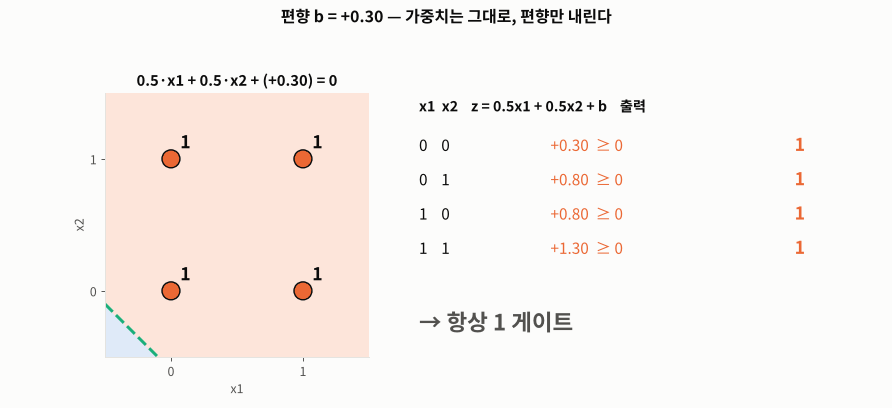
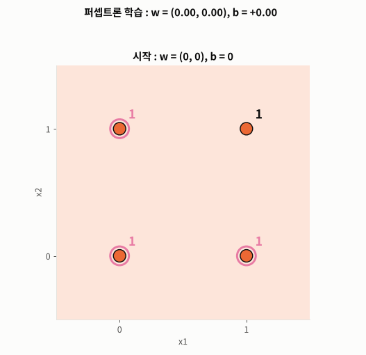
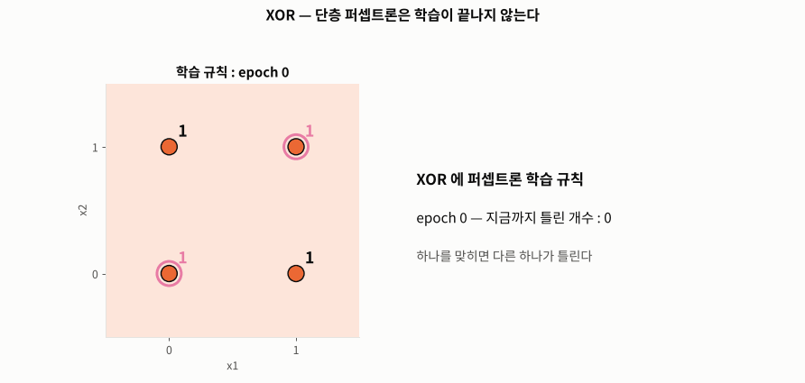
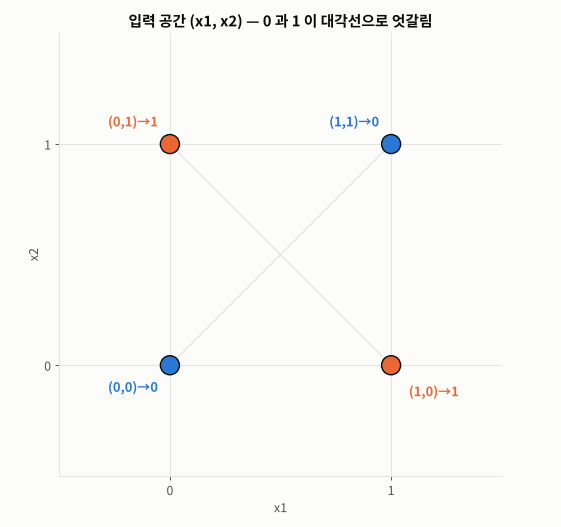
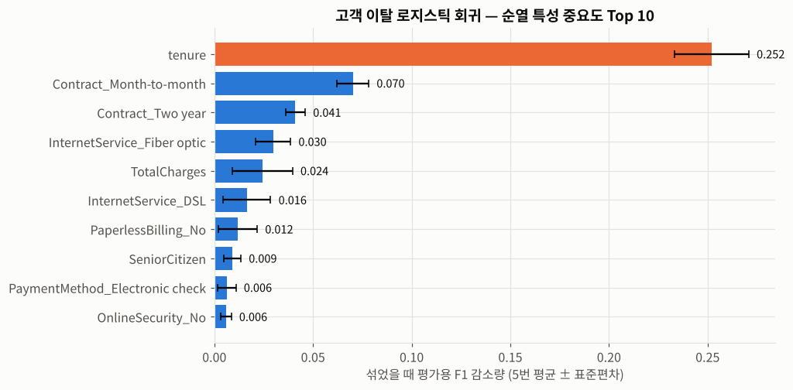
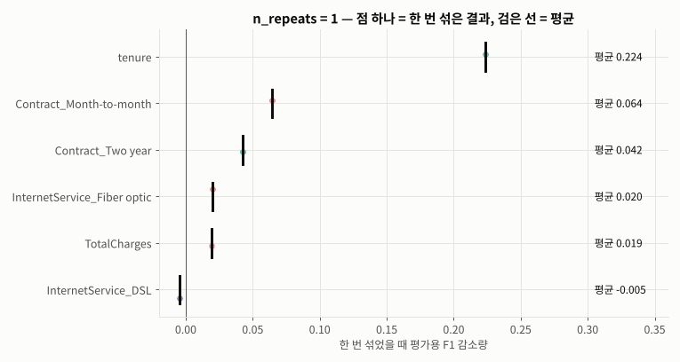

# Day 031 · 2026-10-22 (목)

`데이터 분석과 머신러닝/딥러닝` · 8주차

> **한 줄 요약** — 딥러닝의 벽돌 한 장, **퍼셉트론**을 numpy 로 직접 만들었다. 가중합 + 편향 → 계단 함수 하나로 **AND · OR · NAND** 가 되고(편향만 바꿔도 OR ↔ AND), 가중치는 **학습 규칙**으로 6 epoch 만에 스스로 찾았다. 하지만 **XOR** 은 9,261가지 직선을 다 그어도 4개 중 3개까지 — 직선 하나로는 못 나눈다. 은닉층에 NAND · OR 를 두고 AND 로 합친 **다층 퍼셉트론**이 데이터를 새 공간으로 옮겨 XOR 을 풀었다. 오전에는 고객 이탈 모델의 **순열 특성 중요도**를 자세히 봤다 — `tenure` 를 섞으면 F1 이 0.25 떨어진다.

📂 실습 노트북
- [`lecture/perceptron_logic_gates.ipynb`](./lecture/perceptron_logic_gates.ipynb) — 딥러닝 개요 · 퍼셉트론 수식 · 계단 함수 · AND / OR / NAND 게이트 · 퍼셉트론 학습 규칙 · XOR 실패 · MLP 로 XOR · sklearn `Perceptron` / `MLPClassifier` 미리 보기 (메모 `딥러닝_1일`)
- [`lecture/churn_permutation_importance.ipynb`](./lecture/churn_permutation_importance.ipynb) — `permutation_importance` 매개변수 · `Bunch` 키 2가지 · `n_repeats` · 학습용 vs 평가용 비교 (필기 `고객이탈예측 2`)

📊 실습 데이터 → [`Telco-Customer-Churn.csv`](./lecture/Telco-Customer-Churn.csv) (7,043행 × 21열) · 논리 게이트는 입력 4개 `(0,0) (0,1) (1,0) (1,1)` 를 직접 만든다
🖼️ 그림 → [`lecture/images/`](./lecture/images/) — 🎬 **시뮬레이션 애니메이션(GIF) 5개** + 그림 1장 (모두 노트북 코드로 직접 만든 것)
📖 교재 → `딥러닝` 교재8 **p.1~20** (19. 딥러닝 개요 · 퍼셉트론 · 논리 게이트 · 단층 퍼셉트론의 한계와 MLP) · `모델검증및평가` (특성 중요도)
📝 메모 → [`딥러닝_1일.txt`](./lecture/딥러닝_1일.txt) — 틀린 내용을 고쳐서 올림 (고친 줄 끝에 `[수정]`)

---

## 1. 딥러닝 개요

```
인공지능 (규칙 기반 · 전문가 시스템)
 └─ 머신러닝 (결정 트리 · 선형 회귀 · 퍼셉트론)
     └─ 딥러닝 (깊은 인공신경망 — CNN · RNN · 심층 강화학습)
```

| 비교 | 머신러닝 | 딥러닝 |
|---|---|---|
| 특징 추출 | 사람이 직접 (특성 공학) | 모델이 **스스로** |
| 데이터 | **적어도** 괜찮다 | **많아야** 좋다 |
| 시간 · 자원 | 수 초 ~ 수 시간 · CPU | 수 일 ~ 수 주 · GPU / TPU |
| 잘 맞는 데이터 | 표(정형) | 이미지 · 소리 · 문장(비정형) |

| 알고리즘 | 핵심 | 용도 |
|---|---|---|
| **CNN** | 필터로 이미지의 **공간 구조**를 유지하며 특징 추출 | 이미지 분류 · 객체 탐지 · 세그멘테이션 |
| **RNN / LSTM** | 은닉층 출력을 다시 입력으로 **순환** → 순서 기억 | 시계열 · 초기 자연어 처리 |
| **Transformer / BERT** | 단어 관계를 **동시에** 보는 Self-Attention | LLM · 문장 유사도 |

프레임워크 : **TensorFlow & Keras**(구글, 입문 · 프로토타이핑) · **PyTorch**(메타, 표준).

---

## 2. 퍼셉트론 — 인공 뉴런 하나

$$z = w_1x_1 + w_2x_2 + b, \qquad y = \begin{cases} 1 & (z \ge 0) \\ 0 & (z < 0) \end{cases}$$

| | |
|---|---|
| **가중치** w | 입력에 곱하는 계수 (중요도) |
| **편향** b | 얼마나 쉽게 1 을 내는지 (임계값 θ 를 옮긴 것, b = −θ) |
| 출력 | **계단 함수** — 0 또는 1 |

$z = 0$ 은 **직선** → 퍼셉트론은 평면을 직선 하나로 나누는 **선형 이진 분류기**.

```python
def perceptron(x, w, b):
    return (np.dot(x, w) + b >= 0).astype(int)

perceptron(X, np.array([0.5, 0.5]), -0.7)    # AND  → [0 0 0 1]
perceptron(X, np.array([0.5, 0.5]), -0.2)    # OR   → [0 1 1 1]
perceptron(X, np.array([-0.5, -0.5]), 0.7)   # NAND → [1 1 1 0]
```



🎬 가중치 0.5, 0.5 는 그대로 두고 **편향만** +0.3 → −1.3 으로 내리면 결정 경계가 밀려나면서 **항상 1 → OR(b = −0.2) → AND(b = −0.7) → 항상 0**. 편향 = 뉴런이 얼마나 쉽게 켜지는가.

### 가중치는 학습으로 — 퍼셉트론 학습 규칙

$$w \leftarrow w + η\,(y - \hat y)\,x, \qquad b \leftarrow b + η\,(y - \hat y)$$

틀렸을 때만 오차 방향으로 조금씩 고친다(η = 학습률 0.25).



🎬 가중치 0 에서 시작해 AND 데이터를 하나씩 보며 경계를 옮긴다 → **6 epoch** 만에 4개 모두 정답(`w = (0.5, 0.25), b = −0.75`). OR 은 4 epoch, NAND 는 6 epoch.

---

## 3. XOR — 직선 하나로는 안 된다

0 은 (0,0) · (1,1), 1 은 (0,1) · (1,0) — **대각선으로 엇갈려** 있다(선형 분리 불가능).



🎬 학습 규칙을 돌려도 하나를 맞히면 다른 하나가 틀려서 **틀린 개수가 0 이 되지 않는다**. 직선 방향을 0° → 180° 로 돌리며 가장 좋은 편향을 찾아도 **최고 3 / 4**(가중치 · 편향 9,261가지 조합 전수 조사도 같은 결과).

→ 1969년 민스키 《Perceptrons》 의 증명 → **첫 번째 AI 겨울**(약 20년) → 1986년 **오차역전파**로 다층 신경망을 학습시키면서 "Deep" 이 시작됐다.

---

## 4. 다층 퍼셉트론(MLP) — 층을 쌓으면 풀린다

$$\text{Input}(x_1, x_2) \rightarrow \{\text{NAND} \rightarrow s_1,\ \text{OR} \rightarrow s_2\} \rightarrow \text{AND}(s_1, s_2) \rightarrow y$$

| x1 | x2 | 은닉층 s1 (NAND) | 은닉층 s2 (OR) | 출력층 y (AND) | XOR |
|---|---|---|---|---|---|
| 0 | 0 | 1 | 0 | 0 | 0 |
| 0 | 1 | 1 | 1 | **1** | 1 |
| 1 | 0 | 1 | 1 | **1** | 1 |
| 1 | 1 | 0 | 1 | 0 | 0 |



🎬 은닉층이 점들을 **새 좌표 (s1, s2)** 로 옮긴다. 엇갈려 있던 (0,1) · (1,0) 이 둘 다 (1,1) 로 모이고, 이제 **직선 하나(AND)** 로 나뉜다. 층을 쌓는다 = 데이터를 **풀기 쉬운 공간으로 바꾸는 것** — 딥러닝이 "특징을 스스로 학습한다"는 말의 뜻.

sklearn 미리 보기 : 단층 `Perceptron` 은 XOR 정확도 0.5, `MLPClassifier(hidden_layer_sizes=(4,))` 는 **1.0** — 사람이 NAND · OR 를 정해 주지 않아도 은닉층 가중치를 스스로 찾았다. 은닉 뉴런 2개면 이론상 충분하지만 시작 가중치에 따라 5번 중 2번만 성공.

---

## 5. 고객 이탈 — 순열 특성 중요도 자세히

```python
from sklearn.inspection import permutation_importance

lr_perm_result = permutation_importance(estimator=best_lr, X=X_test, y=y_test,
                                        scoring='f1', n_repeats=5, random_state=0)
lr_perm_result['importances_mean']     # 방법 1 : 딕셔너리처럼
lr_perm_result.importances_mean        # 방법 2 : Bunch 속성처럼
lr_perm_result.importances.shape       # (45, 5) — 특성 45개 × 5번 섞기
```



`tenure` 를 섞으면 평가용 F1 이 **0.25** 떨어진다 — 2위 월 단위 계약(0.07)의 3배 이상.



🎬 상위 6개 특성을 한 번씩 더 섞을 때마다 점이 쌓이고 평균(검은 선)이 자리를 잡는다. 1번만 섞으면 운에 따라 출렁이고 5 ~ 10번이면 안정. 시간 ≈ 특성 수 × `n_repeats` (1번 0.25초 → 30번 6.6초).

### 학습용 vs 평가용 — 같은 방법끼리 비교해야

| 특성 | 학습용 \|계수\| (필기) | 학습용 순열 | 평가용 순열 |
|---|---|---|---|
| `tenure` | **37위** | **1위** | **1위** |
| `Contract_Month-to-month` | 2위 | 2위 | 2위 |
| `TotalCharges` | **45위** | 5위 | 5위 |

필기처럼 "학습용 = 계수, 평가용 = 순열" 로 보면 `tenure` 가 어긋나 보이지만, 이건 과대적합이 아니라 **스케일링 안 한 계수**의 착시([Day 030](../2026-10-21/)). 같은 순열 방식으로 보면 상위권이 같다 → **일반화 성공**.

---

## 🔁 복습

**필기 · 메모 · 교재에서 고친 부분**
- [x] 메모 "학습용 데이터와 평가용 데이터가 **다르면 과대적합**" → 반대. 둘은 **반드시 달라야** 하고, 과대적합은 학습용에서만 잘 맞는 것
- [x] 메모 "평가용 데이터에 대한 best 모델의 성능 → f1 최대" → best 는 **검증 fold** F1 최대 (GridSearchCV 는 평가용을 안 본다)
- [x] 메모 "머신러닝은 데이터가 **적어야**" → 적어**도** 된다
- [x] 메모 "신경망 : 스스로 **정답과 문제를 구분**" → 정답은 사람이 주고, 신경망은 **특징**을 스스로 학습
- [x] 메모 "가중치 : 임계값 넘어야 …" · "가중치 **전부 곱해야**" → 가중치는 입력에 곱하는 계수, 임계값과 비교하는 건 **가중합**(입력 × 가중치의 합 + 편향)
- [x] 메모 "0 : wx + wx < 0" → **편향 b** 누락
- [x] 메모 "부정 연산자 : NAND, XOR" → XOR 은 부정이 아니라 **배타적 논리합**, "등록된 데이터만 전기가 흐른다" → **조건을 만족할 때만**
- [x] 메모 "0.5\*1 + 0.5\***2** − 0.7", "b = 0.7" → 입력은 **0 또는 1** 뿐, AND 의 편향은 **−0.7**
- [x] 메모 NAND "**같으면 1, 다르면 0**"(= XNOR) · 교재 p.18 NAND "**같으면 0, 다르면 1**"(= XOR) → NAND 는 **모두 1 일 때만 0** (교재 p.20 진리표가 맞다)
- [x] 필기 `feature_names = X_train.columns,` — 끝의 **쉼표**로 튜플이 됨, `'importances': feature_importances` 는 **학습용 계수** 변수 → `X_test.columns` · `importances_mean`
- [x] 필기 같은 셀에서 `permutation_importance` **두 번** 계산 → 한 번, 주석 "**SHAP 분석**" → 순열 중요도(SHAP 은 다른 방법)
- [x] 오타 `평각용` · `은닉측` · `게그맨테이션` · `Teansformer` · `베타적` · `LogisticRegession`

**직접 해본 것**
- numpy 로 계단 함수 · 퍼셉트론 · AND / OR / NAND 진리표와 결정 경계
- 편향만 바꿔 OR ↔ AND, 로젠블랫 학습 규칙으로 AND · OR · NAND 가중치 학습
- XOR : 학습 규칙 실패 + 가중치 · 편향 9,261가지 전수 조사(최고 3 / 4)
- NAND · OR → AND 2층 퍼셉트론으로 XOR, 은닉층 공간 시각화
- sklearn `Perceptron` vs `MLPClassifier` (은닉 뉴런 2개 / 4개, `random_state` 별 성공 여부)
- `permutation_importance` 의 `Bunch` · `importances` 배열 · `n_repeats` 별 시간과 안정성 · 학습용 순열 vs 평가용 순열
- `FuncAnimation` 으로 편향 · 학습 · XOR 실패 · MLP 공간 변환 · `n_repeats` 애니메이션

**막혔던 부분 / 질문**
- [ ] 계단 함수는 미분이 안 되는데(기울기 0), 오차역전파는 어떻게 가중치를 고치나 → 시그모이드 · ReLU (다음 시간 p.21~)
- [ ] 은닉층 뉴런 수 · 층 수는 어떻게 정하나 (MLP 2개는 실패하기도, 4개는 성공)
- [ ] 표 데이터(고객 이탈)에 MLP 를 쓰면 로지스틱 회귀(F1 0.63)보다 나을까

📂 [수업 자료 폴더](./lecture/) · [복습 자료 폴더](./review/)

---

## 🔗 참고 링크

- [scikit-learn — Neural network models (supervised) : MLP](https://scikit-learn.org/stable/modules/neural_networks_supervised.html)
- [`Perceptron` 문서](https://scikit-learn.org/stable/modules/generated/sklearn.linear_model.Perceptron.html) · [`MLPClassifier` 문서](https://scikit-learn.org/stable/modules/generated/sklearn.neural_network.MLPClassifier.html)
- [scikit-learn — Permutation feature importance](https://scikit-learn.org/stable/modules/permutation_importance.html)
- [Wikipedia — Perceptron](https://en.wikipedia.org/wiki/Perceptron) · [Perceptrons (book, 1969)](https://en.wikipedia.org/wiki/Perceptrons_(book)) · [AI winter](https://en.wikipedia.org/wiki/AI_winter)
- [TensorFlow Playground — 브라우저에서 신경망 직접 돌려 보기](https://playground.tensorflow.org/)
