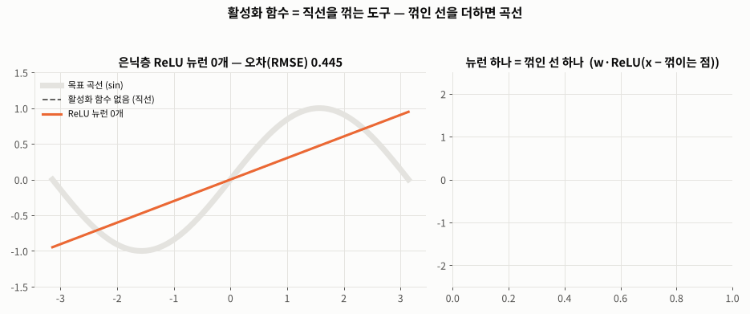
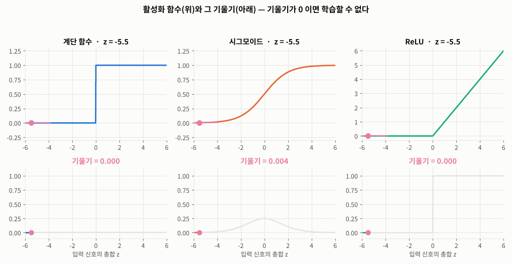
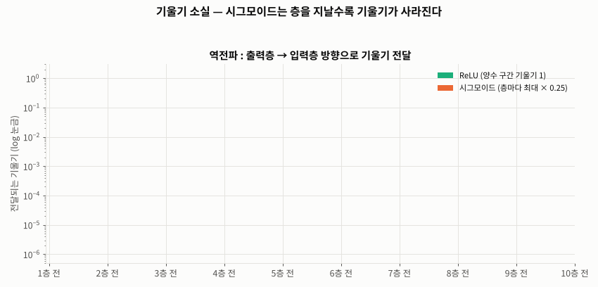
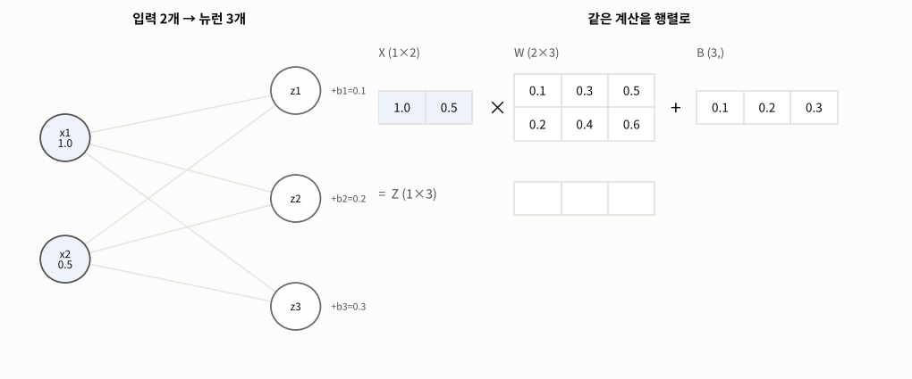
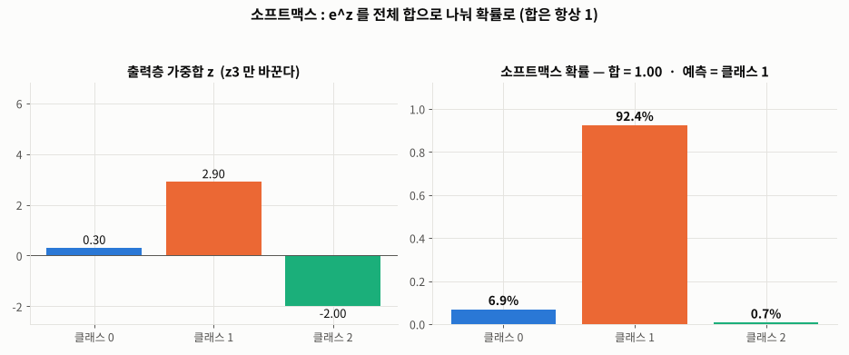

# Day 032 · 2026-10-23 (금)

`데이터 분석과 머신러닝/딥러닝` · 8주차

> **한 줄 요약** — 어제 `if` 문으로 0/1 을 정하던 부분이 **계단 함수**라는 **활성화 함수**였다. 활성화 함수가 없으면 층을 몇 개 쌓아도 **직선 하나**와 같아서, 직선을 **꺾는(ReLU)** · **구부리는(시그모이드)** 함수가 필요하다. 계단 함수는 기울기가 0 이라 학습할 수 없고, 시그모이드는 10층이면 기울기가 **0.000001 배**로 사라져서, 은닉층은 **ReLU** 가 표준이다. 층 하나는 **행렬 곱 한 번**($Y = X \cdot W + B$)이고, 출력층은 회귀 = 항등 · 이진 분류 = 시그모이드 · 다중 분류 = **소프트맥스(합 = 1)**. sklearn MLP 의 가중치로 순전파를 직접 계산했더니 `predict_proba` 와 **똑같았다**.

📂 실습 노트북
- [`lecture/activation_functions.ipynb`](./lecture/activation_functions.ipynb) — numpy 기초 · 논리 게이트(계단 함수) · 활성화 함수가 필요한 이유 · 계단 / 시그모이드 / ReLU 와 기울기 · 기울기 소실 (필기 `퍼셉트론` · `퍼셉트론_2`)
- [`lecture/neural_network_forward.ipynb`](./lecture/neural_network_forward.ipynb) — 행렬 곱 · 층 = $X \cdot W + B$ · 3층 순전파 · 항등 / 시그모이드 / 소프트맥스(오버플로 방지) · 출력 뉴런 수 · sklearn MLP 순전파 직접 계산 (필기 `퍼셉트론` 소프트맥스 부분)

📊 실습 데이터 → [`iris_dataset.csv`](./lecture/iris_dataset.csv) (다중 · 이진 분류 출력층) · [`house_price.csv`](./lecture/house_price.csv) (회귀 출력층)
🖼️ 그림 → [`lecture/images/`](./lecture/images/) — 🎬 **시뮬레이션 애니메이션(GIF) 5개** (모두 노트북 코드로 직접 만든 것)
📖 교재 → `딥러닝` 교재8 **p.21~40** (퍼셉트론 실습 · 활성화 함수 · 다차원 배열의 계산 · 출력층 설계)
📝 메모 → [`딥러닝_1일_수정본.txt`](./lecture/딥러닝_1일_수정본.txt) (1 · 2일차 메모 정리본)

---

## 1. 퍼셉트론 실습 — `if` 문이 곧 계단 함수

```python
def step_function(z):
    return np.where(np.asarray(z) >= 0, 1, 0)        # 값을 '반환'해야 다음 계산에 쓸 수 있다

def perceptron(x1, x2, w, b):
    z = np.sum(np.array([x1, x2]) * w) + b            # 입력 신호의 총합
    return int(step_function(z))                      # 활성화 함수

AND  = lambda x1, x2: perceptron(x1, x2, np.array([0.5, 0.5]), -0.7)
NAND = lambda x1, x2: perceptron(x1, x2, np.array([-0.5, -0.5]), 0.7)
OR   = lambda x1, x2: perceptron(x1, x2, np.array([0.5, 0.5]), -0.2)
XOR  = lambda x1, x2: AND(NAND(x1, x2), OR(x1, x2))    # 은닉층 NAND · OR → 출력층 AND
```

| 입력 | (0,0) | (1,0) | (0,1) | (1,1) |
|---|---|---|---|---|
| AND | 0 | 0 | 0 | 1 |
| NAND | 1 | 1 | 1 | 0 |
| OR | 0 | 1 | 1 | 1 |
| **XOR** | 0 | **1** | **1** | 0 |

---

## 2. 활성화 함수 — 왜 필요한가

활성화 함수 = 입력 신호의 총합 $z$ 를 **다음 뉴런으로 보낼 신호 모양으로 바꾸는 함수**. 없으면

$$y = w_2(w_1x + b_1) + b_2 = (w_2w_1)\,x + (w_2b_1 + b_2) = Wx + B$$

수백 층을 쌓아도 **직선 하나**다(노트북에서 2층 결과 = 직선 1개 결과를 숫자로 확인).



🎬 은닉층 ReLU 뉴런을 1 → 12개로 늘리며 사인 곡선을 따라가게 했다. 뉴런 하나 = **꺾인 선** 하나, 꺾인 선을 더하면 곡선(오차 0.443 → **0.006**). 활성화 함수가 없으면(회색 점선) 뉴런을 늘려도 직선.

---

## 3. 계단 · 시그모이드 · ReLU

| 함수 | 식 | 출력 | 기울기(미분) | 쓰임 |
|---|---|---|---|---|
| 계단 | $z \ge 0$ → 1 | 0 / 1 | **0** | 퍼셉트론 |
| 시그모이드 | $\dfrac{1}{1 + e^{-z}}$ | 0 ~ 1 (확률) | $\sigma(1-\sigma)$, 최대 **0.25** | 이진 분류 출력층 |
| **ReLU** | $\max(0, z)$ | 0 ~ ∞ | 양수면 **1** | **은닉층 표준** |



🎬 z 를 −6 → 6 으로 옮기며 접선(기울기)을 그렸다. 계단 함수는 어디서나 평평(기울기 0) → "가중치를 조금 바꾸면 오차가 얼마나 줄까?" 를 알 수 없어 **경사하강법으로 학습 불가**. 시그모이드는 양 끝에서 평평해진다(**포화**).



🎬 역전파는 층을 지날 때마다 활성화 함수의 기울기를 **곱한다**. 시그모이드는 층마다 최대 × 0.25 → 10층이면 **10⁻⁶** 배(**기울기 소실**), ReLU 는 양수 구간에서 × 1.

시그모이드 출력 p = **1 일 확률** → 0 일 확률은 **1 − p** (z = 0.85 → 0.701 / 0.299).

---

## 4. 행렬 곱 — 층 하나 = $Y = X \cdot W + B$

$(m, k) \times (k, n) = (m, n)$ — 앞의 **열 수 = 뒤의 행 수**. 교재 p.31 예시 $\begin{pmatrix}1&0\\2&3\end{pmatrix}\begin{pmatrix}2&1\\3&1\end{pmatrix} = \begin{pmatrix}2&1\\13&5\end{pmatrix}$.



🎬 입력 2개 → 뉴런 3개. 뉴런 하나의 가중합 = **X · (W 의 열 하나) + 편향**. 열 3개를 한꺼번에 = 행렬 곱 한 번에 층 전체 계산 ($(1,2) \times (2,3) + (3,) = (1,3)$). 입력이 여러 개(배치)여도 코드는 그대로.

```python
def forward(network, x):
    a1 = sigmoid(x @ network['W1'] + network['b1'])            # 은닉층 1 (2 → 3)
    a2 = sigmoid(a1 @ network['W2'] + network['b2'])           # 은닉층 2 (3 → 2)
    return identity_function(a2 @ network['W3'] + network['b3'])  # 출력층 (2 → 2)
```

---

## 5. 출력층 — 문제 유형별 설계

| 문제 | 예 | 출력층 함수 | 출력 뉴런 수 |
|---|---|---|---|
| 회귀 | 집값 | **항등 함수** | 1 |
| 이진 분류 | 스팸 / 정상 | **시그모이드** | 1 |
| 다중 분류 | 붓꽃 3품종 · 숫자 0~9 | **소프트맥스** | 클래스 수 (3 · 10) |

$$\text{softmax}(z)_k = \frac{e^{z_k}}{\sum_i e^{z_i}} \qquad (0 < y_k < 1,\ \sum y_k = 1)$$

```python
def softmax(z):
    exp_z = np.exp(z - np.max(z))     # 최댓값을 빼고 계산 → 오버플로 방지 (결과는 같다)
    return exp_z / np.sum(exp_z)

softmax([0.3, 2.9, 4.0])              # [0.018, 0.245, 0.737], 합 1
```



🎬 세 번째 뉴런의 z 만 −2 → 6 으로 키우면 그 확률이 0.7% → 95.4% 로 오르고 나머지는 **같은 비율로** 줄어든다. 확률의 합은 항상 1, 순서(argmax)는 z 와 같다.

**sklearn 로 확인** : `MLPClassifier` · `MLPRegressor` 는 정답을 보고 출력층을 자동 설계한다.

| 문제 | 은닉층 | 출력층 (`out_activation_`) | 출력 뉴런 수 |
|---|---|---|---|
| 붓꽃 3품종 | relu | **softmax** | **3** |
| setosa 인가? | relu | **logistic** (시그모이드) | **1** |
| 보스턴 집값 | relu | **identity** (항등) | **1** |

학습된 가중치로 `행렬 곱 → ReLU → 행렬 곱 → 소프트맥스` 를 numpy 로 직접 계산하면 `predict_proba` 와 **완전히 같다**(`np.allclose = True`).

---

## 🔁 복습

**필기 · 교재에서 고친 부분**
- [x] `퍼셉트론` 첫 셀 : `w = np.array([0, 1])  # 가중치` · `x = np.array([0.5, 0.5])` — **이름이 서로 바뀜**(0/1 이 입력, 0.5 가 가중치), `print(output + b)` 는 합계가 아니라 원소별 곱에 편향을 더해 배열이 나옴
- [x] `AND` · `NAND` · `OR` 가 `step_func(output)` 을 **`return` 하지 않아** 결과 `None`, `step_func` 도 `print` 만 하고 반환 안 함 → `return np.where(...)`
- [x] `step_func` 를 정의 셀보다 **위**에서 사용 → 위에서부터 실행하면 `NameError`
- [x] "AND" 라고 출력한 반복문이 편향 **+0.7** 짜리 `perceptron()` 을 써서 **전부 1** — AND(−0.7)가 아님
- [x] 주석 처리된 반복문 `s1 = x[0]` — 반복 변수는 `j` → 같은 입력만 반복
- [x] 이름 `sigmold` → **sigmoid**, `ReLu` → **ReLU**, `perceptron_ouput` · `퍼셉트로노` · `은닉충` · `가각` · `뉴련` 오타, `퍼셉트론_2` 의 `구형` · `처러`
- [x] 소프트맥스 `np.exp(arr)` 그대로 → z 가 크면 **오버플로**(`nan`) → 최댓값을 빼고 계산
- [x] 교재 p.24 계단 함수 "0 을 **넘으면** 1, 0 **이하**면 0" vs 1일차 · 수업 코드 "z **≥** 0 이면 1" → 수업 코드 기준으로 통일
- [x] 교재 p.25 "기울기(w)와 **편차**(b)" → 가중치(w)와 **편향**(b)
- [x] 교재 p.29 ReLU "경사 소실의 **완벽한** 해결" → 양수 구간에서만. 음수 입력만 받는 뉴런은 기울기 0 으로 꺼지는 **dying ReLU** 문제가 있다(Leaky ReLU · GELU)

**직접 해본 것**
- 활성화 함수 없는 2층 = 직선 1개를 숫자로 확인, ReLU 뉴런을 더해 곡선 근사
- 계단 · 시그모이드 · ReLU 와 각각의 기울기 그래프, 층 수별 기울기 소실 계산
- 교재 p.31 행렬 곱 · 모양 규칙 · 모양이 안 맞을 때 에러
- 3층 신경망 순전파(1개 · 배치 4개), 소프트맥스 오버플로 재현 · 해결
- sklearn MLP 3가지 문제의 `out_activation_` · `n_outputs_` · 가중치 모양, 순전파 직접 계산 = `predict_proba`
- `FuncAnimation` 으로 ReLU 곡선 근사 · 활성화 함수 기울기 · 기울기 소실 · 행렬 곱 · 소프트맥스 애니메이션

**막혔던 부분 / 질문**
- [ ] 가중치 W 는 어떻게 찾나 → **손실 함수 · 경사하강법 · 오차역전파** (교재 p.41~)
- [ ] 은닉층에도 시그모이드 대신 ReLU 를 쓰면 출력층 시그모이드의 기울기 소실은 괜찮은가
- [ ] 소프트맥스 대신 시그모이드를 클래스마다 쓰면? (다중 레이블 분류)

📂 [수업 자료 폴더](./lecture/) · [복습 자료 폴더](./review/)

---

## 🔗 참고 링크

- [NumPy — `numpy.dot` / `matmul`](https://numpy.org/doc/stable/reference/generated/numpy.matmul.html)
- [scikit-learn — Neural network models (MLP)](https://scikit-learn.org/stable/modules/neural_networks_supervised.html) · [`MLPClassifier`](https://scikit-learn.org/stable/modules/generated/sklearn.neural_network.MLPClassifier.html)
- [Wikipedia — Activation function](https://en.wikipedia.org/wiki/Activation_function) · [Vanishing gradient problem](https://en.wikipedia.org/wiki/Vanishing_gradient_problem) · [Softmax function](https://en.wikipedia.org/wiki/Softmax_function)
- [TensorFlow Playground — 활성화 함수를 바꿔 가며 신경망 돌려 보기](https://playground.tensorflow.org/)
