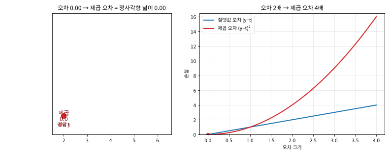
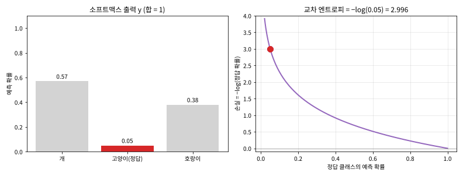
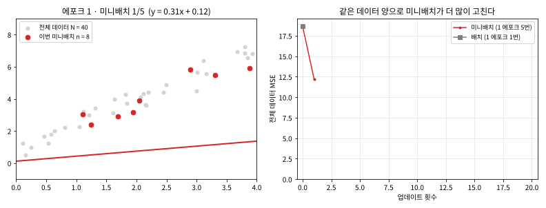
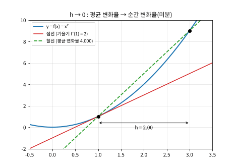
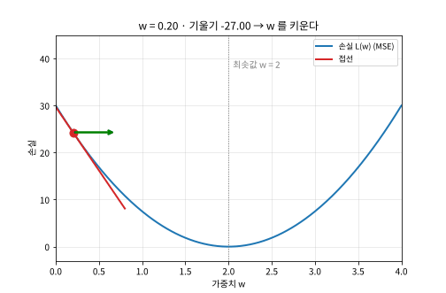

# Day 033 · 2026-10-26 (월)

`데이터 분석과 머신러닝/딥러닝` · 9주차

> **한 줄 요약** — 모델이 얼마나 **틀렸는지**를 숫자 하나로 만드는 것이 **손실 함수**다. 회귀는 오차를 **제곱해 평균**(MSE, 큰 오차일수록 크게 벌점), 분류는 정답 클래스 확률에 **−log** 를 씌운다(교차 엔트로피, 0.7 → 0.357). 학습 = 이 숫자를 줄이는 가중치 찾기이고, 데이터를 **미니배치**로 나눠 자주 고치면 같은 30 에포크에서 손실 1.299 → **0.035**. 가중치를 **어느 쪽으로** 바꿀지는 손실 곡선의 **접선의 기울기(미분)** 가 알려 준다 — 양수면 줄이고 음수면 키운다. 컴퓨터는 아주 작은 h 로 **수치 미분**($\frac{f(x+h) - f(x-h)}{2h}$)해서 공식 없이도 기울기 6 을 구했다.

📂 실습 노트북
- [`lecture/loss_functions.ipynb`](./lecture/loss_functions.ipynb) — 손실이란 · MSE 와 '제곱' 의 의미 · log 의 특징 · 교차 엔트로피 · 이진 교차 엔트로피 · 배치 vs 미니배치 · 손글씨 숫자 신경망 손실 실습 (메모 `딥러닝_노트_수정본` 손실 부분)
- [`lecture/numerical_differentiation.ipynb`](./lecture/numerical_differentiation.ipynb) — 평균 변화율 → 접선의 기울기 · 손실 곡선의 기울기와 가중치 방향 · 해석적 vs 수치 미분 · 전방 / 중앙 차분 · h 의 크기 (필기 `수치미분`)

🖼️ 그림 → [`lecture/images/`](./lecture/images/) — 🎬 **시뮬레이션 애니메이션(GIF) 5개** (모두 노트북 코드로 직접 만든 것)
📖 교재 → `딥러닝` 교재8 **p.41~52** (손실 함수 · 평균 제곱 오차 · 교차 엔트로피 오차 · 배치 vs 미니배치 · 손실 함수 실습 · 미분의 개념 · 수치 미분)
📝 메모 → [`딥러닝_노트_수정본.txt`](./lecture/딥러닝_노트_수정본.txt) (1 ~ 3일차 메모 정리본) · 필기 → [`수치미분.ipynb`](./lecture/수치미분.ipynb)

---

## 1. 손실 함수 — 모델이 얼마나 나쁜가

**손실** = 예측값 $y$ 와 정답 $t$ 의 차이. 가중치 $W$ · 편향 $b$ 가 아직 데이터에 맞지 않아서 생긴다. **손실 함수**는 여러 오차를 **숫자 하나**로 바꾸고, **학습**은 그 숫자를 0 에 가깝게 만드는 $W$ · $b$ 를 찾는 것이다.

| 문제 | 출력층 | 손실 함수 | sklearn |
|---|---|---|---|
| 회귀 (집값) | 항등 함수 · 뉴런 1개 | **MSE** $\frac{1}{n}\sum (y - t)^2$ | `mean_squared_error` |
| 이진 분류 (스팸) | 시그모이드 · 뉴런 1개 | **BCE** $-[y\log p + (1-y)\log(1-p)]$ | `log_loss` |
| 다중 분류 (숫자 0~9) | 소프트맥스 · 뉴런 10개 | **CEE** $-\sum t_k \log y_k$ | `log_loss` |

---

## 2. MSE — 왜 '제곱' 인가

**오차 → 제곱 → 더하기 → 평균**. 제곱하면 ① +오차와 −오차가 **상쇄되지 않고** ② 오차 2배 → 손실 **4배**로 큰 오차를 크게 벌준다.



🎬 예측을 정답에서 0 → 4 만큼 멀리 옮겼다. 절댓값 오차는 직선으로, 제곱 오차는 **정사각형 넓이**라 곡선(2차)으로 늘어난다. 오차 합이 4 로 같아도 한 곳에 몰리면 MSE 가 1 → **4**.

---

## 3. 교차 엔트로피 — 정답 확률에 −log

원-핫 정답 $t$ 는 정답만 1 이라서, 결국 **$-\log(\text{정답 클래스의 예측 확률})$** 만 남는다 ($\log$ = 자연로그).

```python
def cross_entropy_error(y, t):
    delta = 1e-7                                   # log(0) = -inf 방지
    return -np.sum(t * np.log(y + delta)) / y.shape[0]   # 배치면 데이터 수로 평균

cross_entropy_error(np.array([[0.1, 0.7, 0.2]]), np.array([[0, 1, 0]]))   # 0.357 (교재 p.45)
```



🎬 정답(고양이) 확률을 0.05 → 0.98 로 올렸다. 1 에 가까우면 손실 0, 0 에 가까우면 손실이 **급격히** 커진다 — 확신하고 틀리면 큰 벌점.

**이진 교차 엔트로피** : 정답 1 이면 $-\log p$, 정답 0 이면 $-\log(1-p)$. 교재 예시 정답 1 · p = 0.8 → **0.223** (정답 0 이었으면 1.609). 클래스 2개짜리 교차 엔트로피와 값이 같다.

---

## 4. 배치 vs 미니배치

| 방식 | 한 번에 보는 데이터 | 1 에포크 업데이트 |
|---|---|---|
| 배치 | 전체 $N$ | 1번 |
| **미니배치** | 무작위 $n$ 개 (손실 **평균**) | $\lceil N/n \rceil$ 번 (10개 · 크기 3 → 4번) |



🎬 데이터 40개를 8개씩 꺼내(빨간 점) 직선을 고쳤다. 같은 4 에포크에 미니배치는 **20번**, 배치는 4번 고쳐서 MSE 0.21 vs 3.86.

**손실 함수 실습** — 손글씨 숫자(`load_digits`, 10클래스)를 `MLPClassifier` 로 30 에포크 학습

| | 업데이트 | 마지막 손실 | 테스트 정확도 |
|---|---|---|---|
| 배치 (1,437개) | 30번 | 1.299 | 0.683 |
| **미니배치 32** | 1,350번 | **0.035** | **0.975** |

출력층은 `softmax` · 뉴런 10개, 모델의 `predict_proba` 로 직접 계산한 교차 엔트로피 = `log_loss` = 0.0327.

---

## 5. 미분 — 가중치를 어느 쪽으로?

**미분** = 순간 변화율 = **접선의 기울기**. 두 점을 잇는 선의 기울기(평균 변화율)에서 간격 $h$ 를 0 으로 줄인 것.



🎬 $x = 1$ 에서 $h$ 를 2 → 0.02 로 줄이면 할선의 기울기 4 → 2.02, 접선(2)과 겹친다.

손실 $L$ 을 가중치 $w$ 의 함수로 그리면 포물선. **기울기 + → w 를 줄이고, 기울기 − → w 를 키운다** (기울기의 반대 방향).



🎬 정답이 $t = 2x$ 인 데이터에서 $w$ 를 움직이며 접선을 그렸다. w = 0.5 → 기울기 −22.5(키운다), w = 2.5 → +7.5(줄인다), w = 2 → 0(최솟값). 멀수록 가파르고 가까울수록 완만하다.

---

## 6. 수치 미분 — 공식 없이 기울기 구하기

$$f'(x) \approx \frac{f(x+h) - f(x-h)}{2h} \qquad (h = 10^{-4},\ \text{중앙 차분})$$

```python
def numerical_diff(f, x, h=1e-4):
    return (f(x + h) - f(x - h)) / (2 * h)

numerical_diff(lambda x: x ** 2, 3.0)    # 6.000000000012662  (해석적 미분 2x = 6)
```

| h | 전방 차분 오차 | 중앙 차분 오차 |
|---|---|---|
| 1e-2 | 1.0e-02 | 1.3e-13 |
| 1e-4 | 1.0e-04 | 1.3e-11 |
| 1e-12 | 5.3e-04 | 5.3e-04 |
| 1e-50 | 기울기 **0** (3 + h 가 그냥 3) | |

$h$ 가 너무 크면 근사 오차, 너무 작으면 **반올림 오차**. 6.0000000000127 의 끝자리도 컴퓨터가 소수를 2진수로 저장하며 생긴 반올림 오차다($0.1 + 0.2 = 0.30000000000000004$).

---

## 🔁 복습

**필기 · 메모 · 교재에서 고친 부분**
- [x] `수치미분` : 함수 이름 `number_diff` → **`numerical_diff`**, 주석 `x: 목표 지정` → 목표 **지점**, `# 해석적 미분 df/dx = 2x)` 괄호 짝, `h` 를 인자로 빼서 바꿔 볼 수 있게
- [x] `수치미분` 결과 `6.000000000012662` 는 코드 오류가 아니라 **부동소수점 반올림 오차** ($x^2$ 의 중앙 차분은 수학적으로 정확히 $2x$)
- [x] 메모 `MSE: L = (정답 - y)²` → 데이터 1개의 **제곱 오차**. MSE 는 여러 제곱 오차의 **평균**
- [x] 메모 CEE 1단계 `t(첫 번째) = 0` → 앞뒤와 이어지지 않는 줄. "정답이 [0, 1, 0] 이면 첫 번째 레이블의 t 는 0" 이라는 뜻
- [x] 교재 p.42 "오차가 클수록 손실이 **기하급수적으로**" → 기하급수(지수, $2^x$)가 아니라 **제곱(2차, $x^2$)** 으로 커진다
- [x] 교재 p.43 · 45 의 $\log$ 는 **자연로그**(`np.log`) — $-\log 0.7 \approx 0.357$ 은 자연로그로 맞다(상용로그면 0.155)
- [x] 교재 수식 그대로면 확률 0 에서 $\log 0 = -\infty$ → 코드에서는 **`delta = 1e-7`** 을 더한다. 배치는 합이 아니라 **평균**
- [x] 교재 p.44 이진 교차 엔트로피 예시가 $-\log(0.8)$ 에서 끝남 → 값은 **0.223**
- [x] 교재 p.47 과 p.48 이 **같은 슬라이드** 중복, "N/n 번" → 나누어떨어지지 않으면 **올림** $\lceil N/n \rceil$
- [x] 교재 p.52 "수치 미분이 고속 처리에 **가장 최적화**" → 가중치마다 손실을 2번씩 계산해서 **느리다**. 실제 딥러닝은 **오차역전파(자동 미분)** 를 쓰고, 수치 미분은 그 결과 **검산(gradient check)** 용
- [x] 교재 p.53 "소수점 아래까지 **완벽히** 일치" → 6.000000000012… 로 반올림 오차가 있고, h 를 너무 작게 하면 크게 틀린다

**직접 해본 것**
- MSE · 교차 엔트로피 · 이진 교차 엔트로피를 numpy 로 구현해 sklearn `mean_squared_error` · `log_loss` 와 값 비교
- 정답을 원-핫 / 정답 번호 두 방식으로 넣어 교차 엔트로피 계산, BCE = 클래스 2개 CEE 확인
- 미니배치 나누기(`permutation` + 슬라이싱), `MLPClassifier(batch_size=...)` 로 배치 vs 미니배치 손실 곡선 비교
- 평균 변화율 → 접선, 전방 / 중앙 차분 오차를 h 별로 비교, 손실 함수를 수치 미분해 가중치 방향 판단
- `FuncAnimation` 으로 제곱 오차 · 교차 엔트로피 · 미니배치 · 할선 → 접선 · 손실 곡선 기울기 애니메이션

**막혔던 부분 / 질문**
- [ ] 수치 미분이 느리다면 실제로는 기울기를 어떻게 한 번에 구하나 → **오차역전파**
- [ ] 가중치가 여러 개(w1, w2, …)면? → **편미분** · 기울기 벡터 (교재 p.54~, 메모에 먼저 정리해 둠)
- [ ] 기울기를 구했으면 얼마나 움직이나 → **학습률 · 경사하강법**
- [ ] 미니배치 크기는 어떻게 정하나 (32 · 64 · 128 …)

📂 [수업 자료 폴더](./lecture/) · [복습 자료 폴더](./review/)

---

## 🧩 오늘의 코테 (PCCE)

오늘 주제: **입출력·연산자** · 최대 30분, 넘으면 풀이 보고 따라 쳐보기

- 문제: [문제명](링크)
- 핵심 아이디어: 
- 막힌 곳: 

---

## 📝 ADsP 오답 메모

오늘 주제: **기출: 1과목** · 5문제, 틀린 것만 내 말로 한 줄
- 

---

## 🔗 참고 링크

- [scikit-learn — `log_loss`](https://scikit-learn.org/stable/modules/generated/sklearn.metrics.log_loss.html) · [`mean_squared_error`](https://scikit-learn.org/stable/modules/generated/sklearn.metrics.mean_squared_error.html)
- [scikit-learn — Neural network models (MLP)](https://scikit-learn.org/stable/modules/neural_networks_supervised.html) · [`load_digits`](https://scikit-learn.org/stable/modules/generated/sklearn.datasets.load_digits.html)
- [Wikipedia — Cross-entropy](https://en.wikipedia.org/wiki/Cross-entropy) · [Mean squared error](https://en.wikipedia.org/wiki/Mean_squared_error) · [Numerical differentiation](https://en.wikipedia.org/wiki/Numerical_differentiation)
- [Python 공식 문서 — 부동소수점 산술: 문제점 및 한계](https://docs.python.org/ko/3/tutorial/floatingpoint.html)
