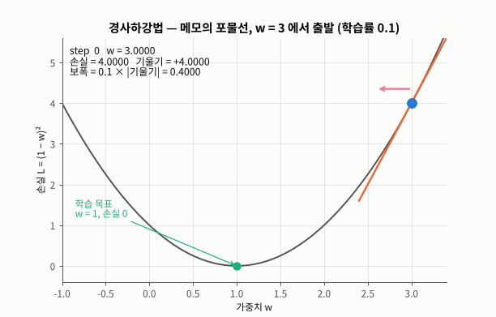
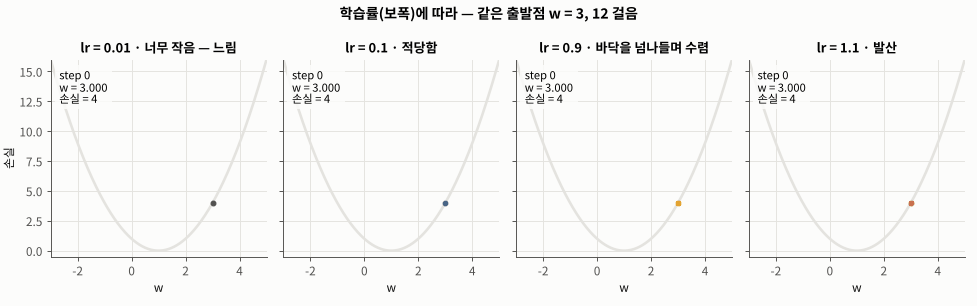
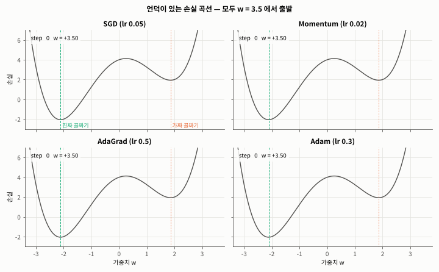
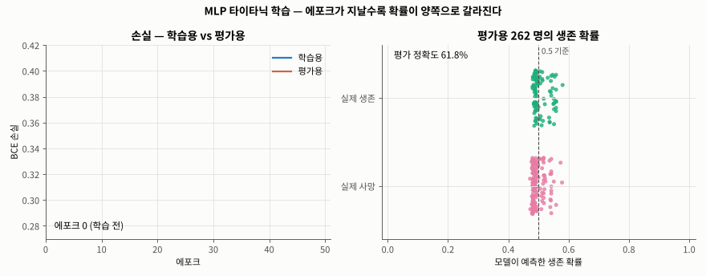
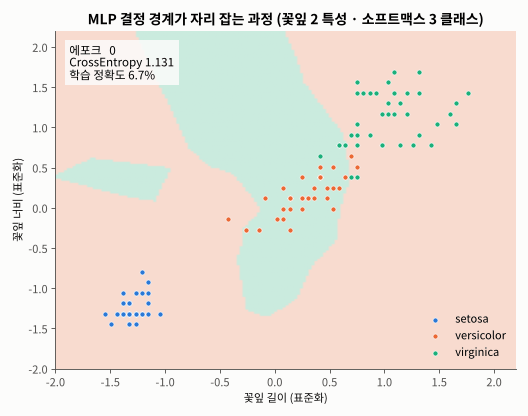

# Day 035 · 2026-10-28 (수)

`데이터 분석과 머신러닝/딥러닝` · 9주차

> **한 줄 요약** — 손실을 줄이려면 가중치를 **기울기의 반대 방향** 으로 `학습률 × 기울기` 만큼 옮긴다(**경사하강법**, 메모의 포물선은 w = 3 → 1.023 으로 20 걸음). 가중치가 수백 개여도 기울기는 **계산 그래프를 거꾸로 한 번 훑는 오차역전파** 로 한꺼번에 구한다(사과 220원 → ∂사과값 2.2). **Momentum** 은 관성으로 가짜 골짜기를 넘을 수 있지만 학습률에 따라 실패도 하고, 실무 표준은 **Adam**. 이걸 PyTorch 5 단계 루프로 묶어 **타이타닉 MLP 87.79%** (로지스틱 회귀 85.88%), 당뇨 75.65%, 붓꽃 30/30 을 얻었고, 200 에포크로 늘리면 평가 손실이 0.334 → 0.444 로 다시 오르는 **과대적합** 도 확인했다.

📂 실습 노트북
- [`lecture/mlp_titanic_binary.ipynb`](./lecture/mlp_titanic_binary.ipynb) — 데이터 분할 · 표준화 · 텐서 · DataLoader · MLP · `BCEWithLogitsLoss` · Adam · 학습 5 단계 · 평가(`classification_report` · 혼동 행렬) · 로지스틱 회귀 / 학습률 / 배치 / 에포크 비교 · 자주 하는 실수 (필기 `MLP_타이타닉_생존자_예측`)
- [`lecture/gradient_descent_backprop.ipynb`](./lecture/gradient_descent_backprop.ipynb) — 배치 vs 미니배치 · 편미분 · 경사하강법 · 학습률 · 행렬 모양 · 다중 분류 손실 · 계산 그래프 · 역전파 · SGD / Momentum / AdaGrad / Adam (메모 `경사하강법` · `다중_분류_손실`, 교재 내용 새로 작성)
- [`lecture/mlp_diabetes_iris.ipynb`](./lecture/mlp_diabetes_iris.ipynb) — 당뇨 이진 분류 · 붓꽃 다중 분류(`CrossEntropyLoss`, 결정 경계) · 붓꽃 회귀(`MSELoss`, RMSE) (실습 데이터로 새로 작성)

📊 실습 데이터 → [`titanic_cleaned.csv`](./lecture/titanic_cleaned.csv) (1,308명 · 이진 분류) · [`diabetes_binary_5050split_health_indicators_BRFSS2015.csv`](./lecture/diabetes_binary_5050split_health_indicators_BRFSS2015.csv) (70,692명 · 이진 분류) · [`iris_dataset.csv`](./lecture/iris_dataset.csv) (150송이 · 다중 분류 · 회귀)
🖼️ 그림 → [`lecture/images/`](./lecture/images/) — 🎬 **시뮬레이션 애니메이션(GIF) 5개** (모두 노트북 코드로 직접 만든 것)
📖 교재 → `딥러닝` 교재8 **p.46~48 · 54~91** (배치 vs 미니배치 · 편미분 · 경사하강법 · 행렬 모양 · 계산 그래프 · 연쇄법칙 · 오차역전파 · 최적화 · PyTorch MLP 분류 / 회귀) — 교재 끝까지
📝 메모 → [`경사하강법.pdf`](./lecture/경사하강법.pdf) · [`다중_분류_손실.pdf`](./lecture/다중_분류_손실.pdf) → 수정본 [`딥러닝_메모_수정본.txt`](./lecture/딥러닝_메모_수정본.txt)

---

## 1. 배치 vs 미니배치 (교재 p.46~48)

| 방식 | 한 번 업데이트에 쓰는 데이터 | 1 에포크 업데이트 횟수 (N = 1046) |
|---|---|---|
| 배치 학습 | 전체 N 개 | **1 번** |
| 미니배치 학습 (n = 32) | 무작위 32 개 | **33 번** (1046 / 32 = 32.7 → 올림, 마지막 묶음 22 개) |

PyTorch 에서는 `TensorDataset` 으로 문제 · 정답을 한 쌍으로 묶고, `DataLoader(batch_size=32, shuffle=True)` 가 매 에포크 섞어서 32 개씩 꺼내 준다.

```python
import torch
from torch.utils.data import TensorDataset, DataLoader

torch.manual_seed(42)
X = torch.randn(1046, 10)                  # 타이타닉 학습용과 같은 크기: 1046 명 × 특성 10
y = torch.randint(0, 2, (1046,)).float()   # 정답 0 / 1

dataset = TensorDataset(X, y)              # 문제 · 정답을 같은 인덱스끼리 한 쌍으로

batch_loader = DataLoader(dataset, batch_size=len(dataset))       # 배치 학습: 전체를 한 번에
mini_loader = DataLoader(dataset, batch_size=32, shuffle=True)    # 미니배치: 섞어서 32 개씩

print(len(batch_loader), len(mini_loader))   # 1 33  ← 1 에포크 업데이트 횟수
sizes = [len(bx) for bx, by in mini_loader]
print(sizes[0], sizes[-1])                   # 32 22 ← 마지막 묶음은 남은 22 개

bx, by = next(iter(mini_loader))             # 미니배치 하나 꺼내 보기
print(bx.shape, by.shape)                    # torch.Size([32, 10]) torch.Size([32])
```

---

## 2. 편미분 · 경사하강법 (교재 p.54~58)

**편미분** = 변수 하나만 움직이고 나머지는 상수로. 모두 모은 배열이 **기울기**. $f(x_0, x_1) = x_0^2 + x_1^2$ 의 (3, 4) 기울기 = **(6, 8)**.

$$W_{new} = W_{old} - \eta \frac{\partial L}{\partial W}$$

메모 : $y = wx$ ($x = 1$), 정답 1 → $L = (1 - w)^2$. **w = 3 (손실 4) → w = 2 (손실 1) → w = 1 (손실 0)**.

```python
import numpy as np

def numerical_gradient(f, x, h=1e-4):
    """변수를 하나씩만 ±h 움직여 중앙 차분 → 편미분을 모은 기울기 배열"""
    x = x.astype(float).copy()
    grad = np.zeros_like(x)
    for i in range(x.size):
        orig = x[i]
        x[i] = orig + h; fxh1 = f(x)          # i 번째 변수만 +h (나머지는 상수 취급)
        x[i] = orig - h; fxh2 = f(x)          # i 번째 변수만 -h
        grad[i] = (fxh1 - fxh2) / (2 * h)
        x[i] = orig                           # 원래 값으로 되돌리기
    return grad

f = lambda x: np.sum(x ** 2)                  # f(x0, x1) = x0² + x1²
print(numerical_gradient(f, np.array([3.0, 4.0])))   # [6. 8.]

def gradient_descent(w, lr=0.1, steps=20):
    """메모의 손실 L = (1 - w)² 를 경사하강법으로 내려가기"""
    for _ in range(steps):
        grad = -2 * (1 - w)                   # dL/dw (연쇄법칙: 2(1-w) × (-1))
        w = w - lr * grad                     # 기울기의 반대 방향으로 lr × 기울기 만큼
    return w

print(gradient_descent(3.0, lr=0.1))    # 1.0231   ← 목표 w = 1 근처
print(gradient_descent(3.0, lr=0.01))   # 2.3352   ← 너무 작아 아직 멀다
print(gradient_descent(3.0, lr=1.1))    # 77.6752  ← 너무 커서 발산
```



🎬 학습률 0.1 로 w = 3 에서 출발. 기울기 +4 → 보폭 0.4 로 크게 내려가다가, 바닥에 가까워질수록 기울기 · 보폭이 같이 줄어 20 걸음 뒤 w = 1.0231 (손실 0.0005).



🎬 같은 출발점, 12 걸음. lr 0.01 은 w = 2.57 로 아직 멀고, 0.1 은 1.137, 0.9 는 바닥을 넘나들며(3 → −0.6 → 2.28 …) 같은 1.137 로 수렴, **1.1 은 w = 18.8 로 발산**.

---

## 3. 행렬 모양 · 다중 분류 손실 (교재 p.59~61 · 메모)

| X | W1 | Z | W2 | Y · T | ∂L/∂W1 · ∂L/∂W2 |
|---|---|---|---|---|---|
| (4, 2) | (2, 3) | (4, 3) | (3, 3) | (4, 3) | **(2, 3) · (3, 3)** — 가중치와 같은 모양 |

원-핫 정답이면 **정답 클래스의 확률 하나만** 손실에 남는다 : $E = -(0 \cdot \log 0.1 + 1 \cdot \log 0.7 + 0 \cdot \log 0.2) = -\log 0.7 = 0.357$.

```python
import numpy as np

rng = np.random.default_rng(0)
X  = rng.normal(size=(4, 2))                   # 미니배치 4 개 × 입력 특성 2 개
W1 = rng.normal(size=(2, 3)); b1 = np.zeros(3) # 입력 2 → 은닉 노드 3
W2 = rng.normal(size=(3, 3)); b2 = np.zeros(3) # 은닉 3 → 출력 3 (클래스 3 개)

Z = np.maximum(0, X @ W1 + b1)                 # (4, 2) @ (2, 3) → (4, 3), ReLU
A = Z @ W2 + b2                                # (4, 3) @ (3, 3) → (4, 3), 클래스별 점수
Y = np.exp(A) / np.exp(A).sum(axis=1, keepdims=True)   # 소프트맥스: 행마다 확률 합 1
print(X.shape, Z.shape, Y.shape, Y.sum(axis=1))         # (4, 2) (4, 3) (4, 3) [1. 1. 1. 1.]

# 메모 : 개 · 고양이 · 호랑이, 정답 고양이
y = np.array([0.1, 0.7, 0.2])                  # 소프트맥스 출력(확률)
t = np.array([0, 1, 0])                        # 원-핫 정답
print(t * np.log(y))                           # [-0. -0.3567 -0.] ← 정답 칸만 남는다
print(np.sum(t * np.log(y)))                   # -0.3567 (음수)
print(-np.sum(t * np.log(y)))                  # 0.3567  ← 앞에 - 를 붙인 교차 엔트로피 (양수)
```

---

## 4. 계산 그래프 · 연쇄법칙 · 오차역전파 (교재 p.62~70)

```python
class MulLayer:                         # 곱셈 노드
    def forward(self, x, y):
        self.x, self.y = x, y
        return x * y
    def backward(self, dout):           # 위에서 온 미분 × '상대편' 입력
        return dout * self.y, dout * self.x
# 사과 100원 × 2개 × 소비세 1.1 = 220원
# 역전파 → ∂금액/∂사과값 2.2 · ∂개수 110 · ∂소비세 200  (PyTorch .backward() 와 같음)
```

퍼셉트론 하나($z = wx + b$, $a = \sigma(z)$, BCE)의 가중치 기울기 :

$$\frac{\partial L}{\partial w} = \frac{\partial L}{\partial a} \times \frac{\partial a}{\partial z} \times x = -1.4966 \times 0.2217 \times 2 = -0.6636 = (a - t)\,x$$

역전파 손계산 · 수치 미분 · PyTorch 자동 미분 세 값이 같았다. 시그모이드 + BCE 를 붙이면 $(a - t)x$ 로 간단해져서 PyTorch 는 `BCEWithLogitsLoss` 로 합쳐 둔다.

---

## 5. 최적화 — SGD · Momentum · AdaGrad · Adam (교재 p.71~78)

| | 업데이트 | 아이디어 |
|---|---|---|
| SGD | $W - \eta g$ | 기울기 반대로 한 걸음 |
| Momentum | $v = 0.9v - \eta g,\ W + v$ | 속도(관성) 기억 |
| AdaGrad | $h += g^2,\ W - \frac{\eta}{\sqrt h} g$ | 많이 움직인 가중치는 보폭 ↓ |
| Adam | 기울기 평균 + 기울기² 평균(오래된 값은 잊음) | Momentum + 보폭 자동 조절 |

```python
import numpy as np

loss = lambda w: (w ** 2 - 4) ** 2 / 4 + w     # 언덕이 있는 손실 곡선
grad = lambda w: w * (w ** 2 - 4) + 1           # 기울기 dL/dw

def sgd(w, lr=0.05, steps=100):
    for _ in range(steps):
        w -= lr * grad(w)                       # 기울기 반대로 한 걸음
    return w

def momentum(w, lr=0.02, alpha=0.9, steps=100):
    v = 0.0                                     # 속도
    for _ in range(steps):
        v = alpha * v - lr * grad(w)            # 이전 속도(관성) + 이번 기울기
        w += v
    return w

def adagrad(w, lr=0.5, steps=100):
    h = 0.0                                     # 기울기 제곱 누적
    for _ in range(steps):
        g = grad(w)
        h += g * g
        w -= lr * g / (np.sqrt(h) + 1e-7)       # 많이 움직였을수록 보폭 ↓ (1e-7: 0 으로 나누기 방지)
    return w

def adam(w, lr=0.3, b1=0.9, b2=0.999, steps=100):
    m = s = 0.0
    for t in range(1, steps + 1):
        g = grad(w)
        m = b1 * m + (1 - b1) * g               # 기울기 평균 (관성)
        s = b2 * s + (1 - b2) * g * g           # 기울기² 평균 (오래된 값은 잊음)
        m_hat = m / (1 - b1 ** t)               # 처음엔 0 쪽으로 치우쳐서 보정
        s_hat = s / (1 - b2 ** t)
        w -= lr * m_hat / (np.sqrt(s_hat) + 1e-8)
    return w

for name, opt in [('SGD', sgd), ('Momentum', momentum), ('AdaGrad', adagrad), ('Adam', adam)]:
    w = opt(3.5)                                # 모두 w = 3.5 에서 출발
    print(f'{name:8s} w = {w:+.2f}  손실 = {loss(w):+.2f}')
# SGD      w = +1.86  손실 = +1.93   ← 가짜 골짜기
# Momentum w = -2.12  손실 = -2.06   ← 진짜 골짜기
# AdaGrad  w = +1.86  손실 = +1.93
# Adam     w = +1.85  손실 = +1.93

# PyTorch 내장 옵티마이저도 같은 결과: optim.SGD(..., momentum=0.9) → -2.12, optim.Adam(lr=0.3) → 1.85
```



🎬 손실 $L = \frac{(w^2-4)^2}{4} + w$, 가짜 골짜기 w ≈ 1.86 · 진짜 골짜기 w ≈ −2.11. w = 3.5 에서 100 걸음. SGD · AdaGrad 는 가짜 골짜기에서 기울기 0 으로 멈추고, **Momentum(lr 0.02) 만 관성으로 언덕을 넘어 −2.12** 에 도착. Adam(lr 0.3) 은 w = 0.91 까지 갔다가 되돌아왔다.

| lr | SGD | Momentum | AdaGrad | Adam |
|---|---|---|---|---|
| 0.02 | 가짜 | **진짜** | 가짜 | 가짜 |
| 0.05 | 가짜 | 가짜 | 가짜 | 가짜 |
| 0.1 | 가짜 | **진짜** | 가짜 | 가짜 |
| 0.5 | 발산 | 발산 | 가짜 | **진짜** |

언덕을 넘는지는 알고리즘만이 아니라 **학습률 · 출발점** 에도 달렸다. Adam · AdaGrad 는 기울기 크기로 나누어서 큰 lr 에서도 발산하지 않는다.

---

## 6. PyTorch MLP — 타이타닉 이진 분류 (필기 · 교재 p.79~85)

```python
binary_model = nn.Sequential(
    nn.Linear(10, 32), nn.ReLU(),     # 입력 10 → 은닉 32
    nn.Linear(32, 16), nn.ReLU(),     # 은닉 32 → 16
    nn.Linear(16, 1),                 # 출력 1 (logit) — 시그모이드는 손실 함수 안에
)
criterion = nn.BCEWithLogitsLoss()
optimizer = optim.Adam(binary_model.parameters(), lr=0.005)

for batch_x, batch_y in train_loader:
    optimizer.zero_grad()                                   # ① 기울기 초기화
    outputs = binary_model(batch_x)                         # ② 순전파 (32, 1)
    loss = criterion(outputs, batch_y.unsqueeze(1))         # ③ 손실 — 정답도 (32, 1)
    loss.backward()                                         # ④ 역전파
    optimizer.step()                                        # ⑤ 갱신

with torch.no_grad():                                       # 평가 (교재 p.85)
    probs = torch.sigmoid(binary_model(X_test_tensor))
    predictions = (probs >= 0.5).int().cpu().numpy().ravel()
```



🎬 학습 전에는 262 명의 생존 확률이 모두 0.5 근처(정확도 61.8%). 에포크가 지날수록 실제 사망자는 0 쪽, 생존자는 1 쪽으로 갈라져 50 에포크 **87.8%**. 학습 손실 0.295 · 평가 손실 0.342.

| 실험 | 평가 정확도 | 비고 |
|---|---|---|
| 로지스틱 회귀 (기준) | 0.8588 | 은닉층 없음 |
| **MLP 기본** (lr 0.005, 배치 32, 50 에포크) | **0.8779** | 생존 재현율 0.798 (99 명 중 20 명 놓침) · 필기 실행은 0.8740 |
| lr 0.001 | 0.8626 | 50 에포크로는 덜 내려감 |
| 배치 학습 50 에포크 | 0.8626 | 업데이트 50 번뿐 (미니배치는 1,650 번) |
| 배치 학습 500 에포크 | 0.8550 | 평가 손실 147 에포크 0.349 → 0.583 |
| 미니배치 200 에포크 | 0.8397 | 평가 손실 48 에포크 0.334 → 0.444 **과대적합** |

실수 두 가지 : 정답 `unsqueeze(1)` 를 빼면 **ValueError**, 모델 끝에 `Sigmoid` + `BCEWithLogitsLoss` 면 시그모이드가 두 번 → 손실이 0.608 아래로 못 내려감(그땐 `BCELoss` 와 짝).

---

## 7. 다중 분류 · 회귀 — 당뇨 · 붓꽃 (교재 p.81~91)

| 문제 | 출력층 | 손실 | 정답 텐서 | MLP | 기준 모델 |
|---|---|---|---|---|---|
| 당뇨 이진 분류 (특성 21) | 1 | `BCEWithLogitsLoss` | float (N, 1) | **0.7565** | 로지스틱 0.7485 |
| 붓꽃 다중 분류 (특성 4) | 3 | `CrossEntropyLoss` | long (N,) | **30 / 30** | 로지스틱 0.9667 |
| 붓꽃 꽃잎 너비 회귀 (특성 3) | 1 (항등) | `MSELoss` | float (N, 1) | RMSE **0.229 cm** | 선형 회귀 0.228 cm |



🎬 꽃잎 길이 · 너비 2 특성만으로 학습한 MLP 의 영역. 에포크 15 에는 setosa 영역이 versicolor 까지 덮어 학습 정확도 66.7%, 150 에포크에는 꺾인 경계 두 개로 세 품종이 나뉘어 95.0% (평가 96.7%).

- 당뇨 · 회귀는 MLP 가 기준 모델과 거의 같다 — 관계가 대부분 선형이면 은닉층이 할 일이 없다. **딥러닝이 항상 더 낫지 않으니 기준 모델과 꼭 비교.**
- `CrossEntropyLoss` 는 원-핫(float, (N, 3)) 정답도 같은 값(0.044636)을 낸다. 안 되는 건 (N, 1).
- 회귀에서 예측 (30, 1) · 정답 (30,) 이면 브로드캐스팅으로 MSE 가 0.0526 → **0.9875 (19 배)**, 에러 없이 경고만.

---

## 정리

| | 이진 분류 | 다중 분류 | 회귀 |
|---|---|---|---|
| 출력 뉴런 | 1 | 클래스 수 | 1 |
| 출력층 활성화 | 시그모이드 (손실 안에) | 소프트맥스 (손실 안에) | 없음 (항등) |
| PyTorch 손실 | `BCEWithLogitsLoss` | `CrossEntropyLoss` | `MSELoss` |
| 정답 | float (N, 1) | long (N,) | float (N, 1) |
| 예측 | `sigmoid(logit) >= 0.5` | `argmax(logit, dim=1)` | 출력 그대로 |
| 평가 | 정확도 · 혼동 행렬 | 정확도 · 혼동 행렬 | MSE · RMSE |

---

## 🔁 복습

**필기 · 메모 · 교재에서 고친 부분**
- [x] 필기 : 안 쓰는 `from torch.cuda import is_available`, 빈 셀 `# 무료 gpu 연결`, Colab `drive.mount` → 같은 폴더 CSV
- [x] 필기 : 시드가 없어 매번 결과가 달라짐(필기 실행 손실 0.3026 · 정확도 0.8740) → `torch.manual_seed` + DataLoader `generator`
- [x] 필기 : 주석 `strafity` → stratify, `hyperparamter` → hyperparameter, `lr(학습)` → 학습률. `params` 는 하이퍼파라미터가 아니라 **학습되는 파라미터**
- [x] 필기 평가 : 변수 오타 `test_ouput` → `test_output`, `test_probs1` 은 확률이 아니라 0/1 예측값 → `test_preds` 로 통일, 같은 예측을 두 번 하던 두 셀을 합침, (N, 1) → `.ravel()`
- [x] 필기 : 평가를 마지막에 한 번만 → `y_test_tensor` 로 에포크별 평가 손실 · 정확도 기록 + 혼동 행렬, `train()` 은 에포크마다
- [x] 메모 `경사하강법` : "입력 함수의 총합" → **입력 신호의 총합**, "손실이 크면 기울기도 크다" 는 볼록한 포물선에서만 ($|g| = 2\sqrt L$)
- [x] 메모 `다중_분류_손실` : $\sum t\log P = -\log 0.7$ (양수) → $\sum t\log P = \log 0.7$ (**음수**), $E = -\log 0.7 = 0.357$. 점수 $n_1$ 과 확률 0.1 사이에 **소프트맥스** 가 빠짐, 번호 `1)` 중복
- [x] 교재 p.47 · 48 같은 슬라이드 반복, "N/n 번" → **올림** (33 번)
- [x] 교재 p.72 "보폭 = 업데이트된 가중치의 크기" → 보폭 = **학습률 × 기울기**
- [x] 교재 p.75 "모멘텀은 가짜 골짜기를 탈출" → lr 0.05 에서는 넘어갔다 되돌아와 실패. 탈출 **가능성** 을 높일 뿐
- [x] 교재 p.78 Adam = Momentum + AdaGrad → 정확히는 Momentum + **RMSProp** + 편향 보정
- [x] 교재 p.83 "다중 분류 정답은 원-핫이 아닌 LongTensor **여야**" → 원-핫 float 도 가능(PyTorch 1.10+), (N, 1) 이 진짜 에러
- [x] 교재 p.85 `.int().numpy()` → GPU 면 **`.cpu()`** 필요
- [x] 교재 p.88 · 89 제목 "분류 문제" → **회귀**, `criterion(test_preds, y_test)` 는 정답 (N, 1) 일 때만 맞음

**직접 해본 것**
- 메모의 포물선을 경사하강법으로 직접 내려가고 학습률 0.01 · 0.1 · 0.5 · 0.9 · 1.1 비교
- 수치 미분으로 2층 신경망의 기울기를 구해 가중치와 모양이 같은지 확인
- 곱셈 노드 클래스로 사과 계산 그래프 역전파 → PyTorch `.backward()` 와 대조, 퍼셉트론 기울기를 세 가지 방법으로 검산
- SGD · Momentum · AdaGrad · Adam 을 numpy 로 구현해 언덕이 있는 손실 곡선에서 경주, 학습률별 표
- 타이타닉 MLP 평가(`classification_report`)를 정리하고 로지스틱 회귀 · 학습률 · 배치 · 에포크 비교, 실수 재현(`unsqueeze` 누락, 시그모이드 두 번)
- 당뇨 · 붓꽃 데이터로 이진 · 다중 · 회귀 세 유형을 같은 5 단계 루프로, 결정 경계 그리기
- `FuncAnimation` 으로 애니메이션 5 개

**막혔던 부분 / 질문**
- [ ] 50 에포크가 좋았던 건 평가용을 보고 고른 것 — 평가용을 건드리지 않고 멈출 시점을 정하려면? → **검증 데이터 · 조기 종료(early stopping)**
- [ ] 과대적합을 줄이는 다른 방법은? → **Dropout · 가중치 감소(weight decay) · 배치 정규화**
- [ ] 당뇨 데이터에서 놓친 환자 19% 를 줄이려면 임계값을 얼마로? (정밀도 · 재현율, Day 029)

📂 [수업 자료 폴더](./lecture/) · [복습 자료 폴더](./review/)

---

## 🔗 참고 링크

- [PyTorch — `nn.Linear`](https://pytorch.org/docs/stable/generated/torch.nn.Linear.html) · [`nn.Sequential`](https://pytorch.org/docs/stable/generated/torch.nn.Sequential.html) · [`BCEWithLogitsLoss`](https://pytorch.org/docs/stable/generated/torch.nn.BCEWithLogitsLoss.html) · [`CrossEntropyLoss`](https://pytorch.org/docs/stable/generated/torch.nn.CrossEntropyLoss.html) · [`MSELoss`](https://pytorch.org/docs/stable/generated/torch.nn.MSELoss.html)
- [PyTorch — `torch.optim` (SGD · Adam · Adagrad)](https://pytorch.org/docs/stable/optim.html) · [Datasets & DataLoaders 튜토리얼](https://pytorch.org/tutorials/beginner/basics/data_tutorial.html) · [Autograd 튜토리얼](https://pytorch.org/tutorials/beginner/basics/autogradqs_tutorial.html)
- [Wikipedia — Gradient descent](https://en.wikipedia.org/wiki/Gradient_descent) · [Backpropagation](https://en.wikipedia.org/wiki/Backpropagation) · [Chain rule](https://en.wikipedia.org/wiki/Chain_rule)
- [Kingma & Ba (2014) — Adam: A Method for Stochastic Optimization](https://arxiv.org/abs/1412.6980)
- 데이터 : [Kaggle — Diabetes Health Indicators Dataset (BRFSS 2015)](https://www.kaggle.com/datasets/alexteboul/diabetes-health-indicators-dataset) · [UCI — Iris](https://archive.ics.uci.edu/dataset/53/iris)
