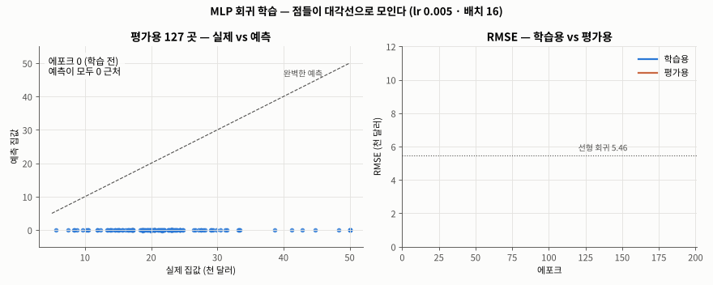
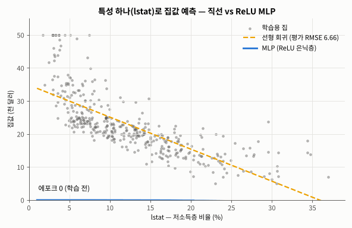
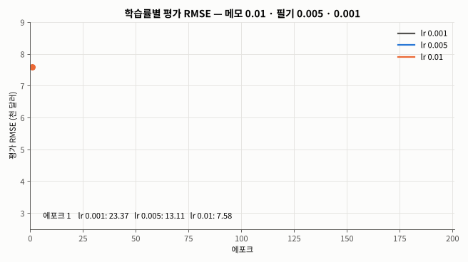
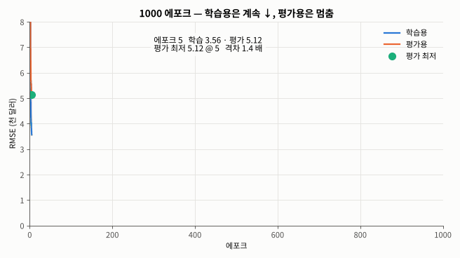
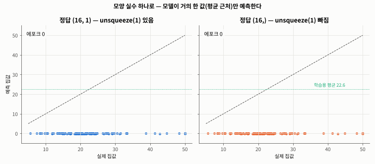

# Day 036 · 2026-10-29 (목)

`데이터 분석과 머신러닝/딥러닝` · 9주차

> **한 줄 요약** — 어제 타이타닉 **분류** 틀에서 출력층 활성화를 빼고(항등 함수) 손실을 **`MSELoss`** 로 바꾸면 그대로 **회귀** 모델이 된다. 보스턴 집값을 13 → 64 → 32 → 1 MLP 로 예측해 평가 **RMSE 3.87 (천 달러)**, 선형 회귀 5.46 · 랜덤 포레스트 4.07 보다 좋았다 — ReLU 뉴런들이 `lstat` 과 집값의 **곡선** 관계를 잡기 때문. 메모의 **lr 0.01** 은 42 에포크 이후 오히려 나빠졌고(4.78), 1000 에포크면 학습 0.46 · 평가 3.79 로 **과대적합**. 정답에 `unsqueeze(1)` 하나 빠지면 에러 없이 MSE 가 **2.2 → 135.8** 로 틀려 모델이 평균만 찍는다.

📂 실습 노트북
- [`lecture/mlp_boston_regression.ipynb`](./lecture/mlp_boston_regression.ipynb) — 데이터 · 표준화 · 텐서 · DataLoader · MLP 회귀 · `MSELoss` · Adam · 학습 5 단계 · RMSE / R² 평가 · 기준 모델 · 학습률 · 배치 · 표준화 · 1000 에포크 · 시드 · 모양 실수 비교 (필기 `MLP_보스톤_주택_가격_예측`)

📊 실습 데이터 → [`house_price.csv`](./lecture/house_price.csv) (보스턴 주택 506 곳 · 특성 13 + 집값 `medv`)
🖼️ 그림 → [`lecture/images/`](./lecture/images/) — 🎬 **시뮬레이션 애니메이션(GIF) 5개** (모두 노트북 코드로 직접 만든 것)
📖 교재 → `딥러닝` 교재8 **p.86~89 · 91** (회귀 모델 설계 · 학습 · MSE / RMSE 평가 · MLP 회귀 실습) — Day 035 에서 붓꽃으로 먼저 본 범위를 보스턴 데이터로 실습
📝 메모 → [`MLP_회귀_메모.pdf`](./lecture/MLP_회귀_메모.pdf) → 수정본 [`MLP_회귀_메모_수정본.txt`](./lecture/MLP_회귀_메모_수정본.txt)

---

## 1. 데이터 · 분할 · 표준화

보스턴 교외 506 곳, 정답 `medv` = 집값 중앙값(천 달러, 5 ~ 50, 평균 22.5). 특성 13 개 — 범죄율 `crim` · 방 개수 `rm` · 저소득층 비율 `lstat` · 재산세 `tax` 등.

```python
df = pd.read_csv('house_price.csv')                # 506 행 × 14 열
X_data = df.drop(columns=['medv'])                 # 문제: 특성 13 개
y_data = df['medv']                                # 정답: 집값

# 회귀는 정답이 연속값이라 stratify 없이 75 : 25
X_train, X_test, y_train, y_test = train_test_split(
    X_data, y_data, test_size=0.25, random_state=0)   # 학습 379 · 평가 127

scaler = StandardScaler()
X_train_scaled = scaler.fit_transform(X_train)     # 평균 · 표준편차는 학습용으로만
X_test_scaled = scaler.transform(X_test)           # 평가용은 변환만 (데이터 누수 방지)
```

`tax` 는 187 ~ 711, `nox` 는 0.385 ~ 0.871 — 단위가 이렇게 다르면 표준화가 필요하다(빼면 평가 RMSE 3.87 → 5.38, 6절).

> 참고 : `medv` 최댓값 50.0 이 16 곳 — '50 이상' 을 잘라 기록한 값. `b` 컬럼은 인구 구성 지표라 윤리 문제로 scikit-learn 1.2 부터 이 데이터셋(`load_boston`)이 빠졌다.

---

## 2. MLP 회귀 모델 — 메모의 구조

입력 13 → 은닉층 뉴런마다 $y_j = W_{j1}x_1 + \dots + W_{j13}x_{13} + b_j$ → ReLU → **출력 뉴런 1 개, 활성화 없음(항등)** = 예측 집값.

```python
# 텐서 · 미니배치
X_train_tensor = torch.tensor(X_train_scaled, dtype=torch.float32)
y_train_tensor = torch.tensor(y_train.values, dtype=torch.float32)      # (379,)
train_loader = DataLoader(TensorDataset(X_train_tensor, y_train_tensor),
                          batch_size=16, shuffle=True)                  # 24 묶음 (마지막 11 개)

model = nn.Sequential(
    nn.Linear(13, 64),   # [입력층 → 은닉층1] 뉴런 64 개, 각자 가중치 13 개 + 편향
    nn.ReLU(),
    nn.Linear(64, 32),   # [은닉층1 → 은닉층2]
    nn.ReLU(),
    nn.Linear(32, 1),    # [은닉층2 → 출력층] 뉴런 1 개 — 뒤에 활성화 함수 없음
)
print(sum(p.numel() for p in model.parameters()))   # 3009  (896 + 2080 + 33)
```

| | 분류 (어제 · 타이타닉) | 회귀 (오늘 · 보스턴) |
|---|---|---|
| 출력층 | 뉴런 1 + 시그모이드(손실 안) | 뉴런 1, **활성화 없음** |
| 손실 | `BCEWithLogitsLoss` | **`MSELoss`** |
| 평가 | 정확도 | **RMSE** (천 달러) · R² |

---

## 3. 손실 · 옵티마이저 · 학습 5 단계 (메모 ① ② · 교재 p.87~88)

$$\text{MSE} = \frac{1}{n}\sum (y_i - t_i)^2 \qquad \text{RMSE} = \sqrt{\text{MSE}}$$

```python
criterion = nn.MSELoss()                                  # ① 평균 제곱 오차
optimizer = optim.Adam(model.parameters(), lr=0.005)      # ② 메모는 0.01, 필기 코드는 0.005

for epoch in range(200):
    model.train()
    for batch_x, batch_y in train_loader:
        optimizer.zero_grad()                                  # ① 기울기 초기화
        predictions = model(batch_x)                           # ② 순전파 (16, 1)
        loss = criterion(predictions, batch_y.unsqueeze(1))    # ③ MSE — 정답도 (16, 1)
        loss.backward()                                        # ④ 역전파
        optimizer.step()                                       # ⑤ 갱신
```



🎬 학습 전에는 127 곳의 예측이 모두 0 근처(왼쪽 아래 한 줄). 에포크가 지나며 점들이 대각선(완벽한 예측)으로 모이고, 200 에포크에 학습 RMSE **1.36** · 평가 RMSE **3.87**. 평가 곡선은 **4 에포크** 만에 선형 회귀(5.46) 아래로 내려간다.

---

## 4. 평가 — RMSE · R² (교재 p.89)

```python
model.eval()
with torch.no_grad():
    test_preds = model(X_test_tensor).cpu().numpy().ravel()   # (127, 1) → (127,)

rmse_mlp = root_mean_squared_error(y_test, test_preds)   # 3.8688 — 평균 약 3,870 달러 빗나감
r2_mlp = r2_score(y_test, test_preds)                    # 0.8168 — 집값 변동의 82% 설명
```

| 실제 | 22.6 | **50.0** | 23.0 | 8.3 | 21.2 |
|---|---|---|---|---|---|
| 예측 | 22.9 | **33.7** | 24.5 | 11.7 | 20.3 |

가장 크게 틀린 곳이 실제 50.0 → 예측 33.7. 50 은 잘라 기록한 값이라 원래 맞히기 어렵다.

---

## 5. 왜 MLP 가 더 낫나 — 기준 모델 · ReLU 곡선

```python
mean_pred = np.full(len(y_test), y_train.mean())                   # 평균으로 찍기
lin = LinearRegression().fit(X_train_scaled, y_train)               # 직선 (은닉층 없음)
rf = RandomForestRegressor(random_state=0).fit(X_train, y_train)    # 트리 앙상블

for name, pred in [('평균', mean_pred), ('선형 회귀', lin.predict(X_test_scaled)),
                   ('랜덤 포레스트', rf.predict(X_test)), ('MLP', test_preds)]:
    print(name, root_mean_squared_error(y_test, pred))
# 평균 9.044 · 선형 회귀 5.457 · 랜덤 포레스트 4.072 · MLP 3.869
```



🎬 특성 `lstat` **하나만** 넣고 같은 구조로 학습. 선형 회귀는 직선이라 lstat 30% 이상에서 집값을 0 근처로 예측(평가 RMSE 6.66). MLP 는 ReLU 뉴런들이 꺾인 직선을 이어 붙여 **곡선** 을 만들고 5.79 까지 내려간다. 어제 붓꽃 회귀(거의 직선 관계)에서는 MLP ≈ 선형 회귀였는데, 관계가 곡선이면 은닉층이 힘을 쓴다.

---

## 6. 학습률 · 배치 · 표준화 바꿔 보기

같은 시드로 조건만 바꿔 처음부터 다시 학습하는 함수를 만들어 비교했다.

```python
def train_model(lr=0.005, batch_size=16, epochs=200, scaled=True, seed=42):
    torch.manual_seed(seed)                                   # 같은 초기 가중치
    m = make_model()
    opt = optim.Adam(m.parameters(), lr=lr)
    loader = DataLoader(TensorDataset(Xtr, y_train_tensor), batch_size=batch_size, shuffle=True,
                        generator=torch.Generator().manual_seed(seed))   # 같은 섞는 순서
    ...                                                       # 5 단계 루프 + 에포크별 RMSE 기록

for lr in [0.001, 0.005, 0.01]:
    train_model(lr=lr)
train_model(batch_size=379)      # 배치 학습 (1 에포크에 업데이트 1 번)
train_model(scaled=False)        # 표준화 X
```

| 조건 | 200 에포크 평가 RMSE | 비고 |
|---|---|---|
| lr 0.001 | 3.95 | 느리지만 안정 |
| **lr 0.005 (필기)** | **3.87** | |
| lr 0.01 (메모) | 4.78 | 42 에포크 3.98 이 최저, 이후 나빠짐 |
| 배치 학습 (379) | 4.64 | 업데이트 200 번 (미니배치는 4,800 번) |
| 표준화 X | 5.38 | 큰 단위 특성이 학습을 흔듦 |
| 시드 0 · 1 | 3.98 · 4.03 | 시드만 바꿔도 ±0.1 — 필기 4.1572 도 이 범위 |



🎬 세 학습률의 평가 RMSE 를 에포크마다 그렸다. lr 0.01 은 처음 5 에포크엔 가장 빨리 내려가지만(4.71) 50 에포크 이후 평균 4.52 로 들쭉날쭉하다 4.78 로 끝나고, 0.001 은 처음 10 에포크 동안 6 이상으로 느리게 출발한다. 0.005 가 3.87 로 가장 낮다.

---

## 7. 오래 학습하면 — 과대적합

```python
long_run = train_model(epochs=1000)
best = long_run[:, 1].argmin()
print(long_run[-1], best + 1, long_run[best, 1])
# 마지막 학습 0.455 · 평가 3.793 / 평가 최저 3.412 @ 353 에포크
```



🎬 학습 RMSE 는 1000 에포크 내내 내려가 0.46, 평가 RMSE 는 353 에포크 3.41 에서 멈추고 3.79 로 끝난다. 분홍 영역(격차)이 점점 벌어져 **8.3 배** — 학습용 집값을 외우고 있다.

---

## 8. 자주 하는 실수 — 정답 `unsqueeze(1)` 빠짐

```python
bx, by = next(iter(train_loader))
criterion(model(bx), by.unsqueeze(1))   # 예측 (16, 1) · 정답 (16, 1) → MSE 2.220
criterion(model(bx), by)                # 예측 (16, 1) · 정답 (16,)   → MSE 135.763 + 경고만
# (16, 1) - (16,) 이 브로드캐스팅되어 (16, 16) 모든 쌍의 차이를 평균

bug = train_model(unsqueeze=False)      # 이대로 학습하면 평가 RMSE 8.82 (평균으로 찍기 9.04 와 비슷)
```



🎬 왼쪽(올바름)은 점들이 대각선으로 모이고, 오른쪽(unsqueeze 빠짐)은 모든 집을 거의 같은 값(평균 20.6 · 표준편차 0.8)으로 예측해 **가로 한 줄** 이 된다. 에러가 안 나서 더 위험하다. 필기처럼 평가에 sklearn `root_mean_squared_error` 를 쓰면 모양을 알아서 맞춰 줘서 안전하다.

---

## 정리

| 모델 / 조건 | 평가 RMSE (천 달러) |
|---|---|
| 평균으로 찍기 | 9.04 |
| unsqueeze 빠진 MLP | 8.82 |
| 선형 회귀 | 5.46 |
| 표준화 안 한 MLP | 5.38 |
| 배치 학습 MLP | 4.64 |
| 랜덤 포레스트 | 4.07 |
| **MLP (lr 0.005 · 배치 16 · 200 에포크)** | **3.87** |
| MLP 1000 에포크 중 최저 (353 에포크) | 3.41 |

---

## 🔁 복습

**필기 · 메모 · 교재에서 고친 부분**
- [x] 필기 : 주석 오타 `cput` → cpu, 쓰지 않는 `from torch.cuda import is_available` 삭제
- [x] 필기 : Colab `drive.mount` · 드라이브 경로 · `display(df)` → 같은 폴더 CSV · `df.head()`
- [x] 필기 : 시드가 없어 RMSE 4.1572 가 재현되지 않음 → `torch.manual_seed` + DataLoader `generator` (같은 조건 3.87)
- [x] 필기 : 주석 `[은닉층2]` · `[출력층]` → [은닉층1 → 은닉층2] · [은닉층2 → 출력층]
- [x] 필기 : `epoch_loss / len(train_loader)` 는 마지막 배치(11 개)도 같은 무게로 평균 → 에포크 끝에 학습용 전체로 다시 계산
- [x] 필기 : `test_preds` 모양 (127, 1) → `.ravel()`, 평가를 RMSE 하나에서 R² · 실제 vs 예측 · 기준 모델 비교까지
- [x] 필기 : `root_mean_squared_error` 는 sklearn **1.4 이상** 에만 있음 (예전 버전은 `mean_squared_error(..., squared=False)`)
- [x] 메모 p.1 : `X_train: 10개의 컬럼` → 보스턴은 **13 개** (10 개는 타이타닉)
- [x] 메모 p.1 : 뉴런 1 번과 n 번이 같은 `W1 … W10` → 뉴런마다 다른 가중치 $W_{j1} \dots W_{j13}$, 출력 뉴런의 입력은 x 가 아니라 은닉층 출력 h
- [x] 메모 p.2 : `lr=0.01` → 필기 코드는 0.005, 비교하면 0.01 이 빨리 과대적합(4.78)

**직접 해본 것**
- 필기를 시드 고정으로 재현하고, 에포크별 학습 · 평가 RMSE 를 기록해 그래프로
- 평균 · 선형 회귀 · 랜덤 포레스트와 비교, `lstat` 하나로 직선 vs ReLU 곡선 비교
- 학습률 3 개 · 배치 학습 · 표준화 X · 1000 에포크 · 시드 3 개 비교 실험
- 정답 모양 실수를 재현해 MSE 가 어떻게 틀리는지, 학습 결과가 어떻게 무너지는지 확인
- `FuncAnimation` 으로 애니메이션 5 개

**막혔던 부분 / 질문**
- [ ] 평가 RMSE 가 가장 낮았던 353 에포크를 평가용을 보고 고른 것 → 평가용을 건드리지 않고 멈추려면 **검증 데이터 · 조기 종료**
- [ ] 정답(집값)도 표준화하면 학습이 더 안정될까? (예측 후 `inverse_transform` 으로 되돌리기)
- [ ] 과대적합을 줄이는 **Dropout · weight decay** 를 넣으면 1000 에포크에서도 평가 RMSE 가 유지될까?

📂 [수업 자료 폴더](./lecture/) · [복습 자료 폴더](./review/)

---

## 🔗 참고 링크

- [PyTorch — `nn.MSELoss`](https://pytorch.org/docs/stable/generated/torch.nn.MSELoss.html) · [`nn.Sequential`](https://pytorch.org/docs/stable/generated/torch.nn.Sequential.html) · [`torch.optim.Adam`](https://pytorch.org/docs/stable/generated/torch.optim.Adam.html) · [Broadcasting semantics](https://pytorch.org/docs/stable/notes/broadcasting.html)
- [scikit-learn — `root_mean_squared_error`](https://scikit-learn.org/stable/modules/generated/sklearn.metrics.root_mean_squared_error.html) · [`r2_score`](https://scikit-learn.org/stable/modules/generated/sklearn.metrics.r2_score.html) · [`load_boston` 제거 안내 (1.2 릴리스 노트)](https://scikit-learn.org/stable/whats_new/v1.2.html)
- [Wikipedia — Root mean square deviation](https://en.wikipedia.org/wiki/Root_mean_square_deviation) · [Coefficient of determination (R²)](https://en.wikipedia.org/wiki/Coefficient_of_determination)
- 데이터 : Harrison & Rubinfeld (1978) Boston Housing — [StatLib 원본](http://lib.stat.cmu.edu/datasets/boston)
