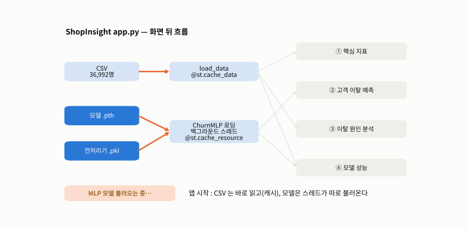
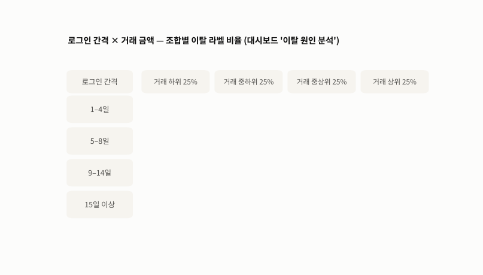
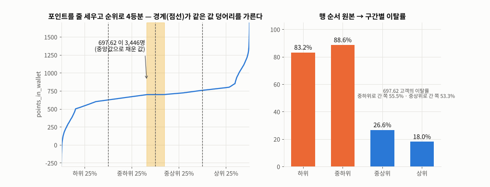
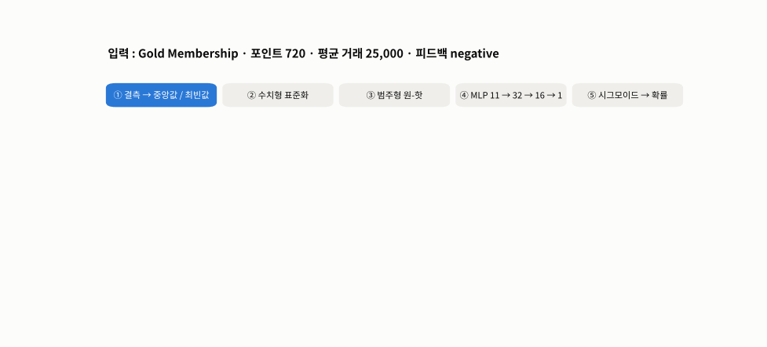
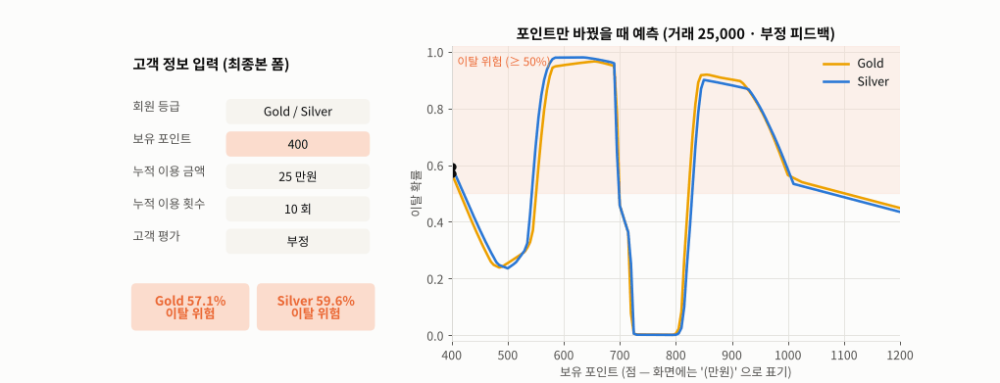

# Day 037 · 2026-10-30 (금)

`데이터 분석과 머신러닝/딥러닝` · 9주차

> **한 줄 요약** — 2차 팀 프로젝트의 **Streamlit 대시보드 `app.py`** 를 만든 날. 화면 뒤 계산을 Streamlit 없이 노트북으로 따라가 보니, CSV 는 **`@st.cache_data`** 로 한 번만 읽고 PyTorch 모델은 **백그라운드 스레드**로 불러와 첫 화면이 기다리지 않는다. 앱은 scikit-learn 버전 문제를 피하려고 전처리기의 통계만 꺼내 **NumPy 로 같은 변환**을 하는데, 이것이 scikit-learn 결과와 **완전히 같다**(`allclose = True`). 저장된 팀 모델은 같은 분할에서 **정확도 93.50% · AUC 97.65%**. 초기본 → 최종본(919 → 967줄)은 **화면만** 바뀌었고 계산 함수 5개는 그대로였다. 다만 최종본 입력 폼의 **'보유 포인트 (만원)'** 표기는 새로 생긴 오류이고, 포인트 4분위는 같은 값 **3,446명**이 행 순서대로 두 구간에 갈린다.

📂 실습 노트북
- [`lecture/streamlit_dashboard_logic.ipynb`](./lecture/streamlit_dashboard_logic.ipynb) — 앱 구조 · Streamlit 기능 · KPI · `create_analysis_tables` 재현 · 4분위 동점 문제 · `ChurnMLP` NumPy 변환 검증 · 입력 폼 계산 · `evaluate_mlp` · ROC
- [`lecture/app_version_changes.ipynb`](./lecture/app_version_changes.ipynb) — `difflib` 로 초기본 vs 최종본 비교 · 변경 분류 · 금액 단위 검증 · 계산 함수 동일 확인

📦 팀 프로젝트 원본 → [`lecture/team_project/`](./lecture/team_project/) — `app.py`(최종본) · `app_v1.py`(초기본) · `requirements.txt` · `.streamlit/config.toml` · `data/` · `models/` ([팀 저장소](https://github.com/SKNETWORKS-FAMILY-AICAMP/SKN37-2ST-2TEAM))
📊 데이터 → `team_project/data/[2nd] customer_churn_ecommerce_cleaned.csv` (36,992명 × 23열)
🖼️ 그림 → [`lecture/images/`](./lecture/images/) — 🎬 **시뮬레이션 애니메이션(GIF) 5개** (모두 노트북과 같은 데이터 · 같은 모델로 직접 만든 것)
🔗 이어서 → 발표일 [Day 038 (11-02)](../2026-11-02/) — EDA · MLP 재학습 · 단순 모델 비교 · 임계값

---

## 1. 앱 구조 — 파일 3개 · 페이지 4개

| 페이지 | 쓰는 것 | 핵심 함수 |
|---|---|---|
| 핵심 지표 | CSV | `load_data` · `create_analysis_tables` |
| 고객 이탈 예측 | 모델 + 전처리기 | `ChurnMLP.predict_proba` (입력 5개) |
| 이탈 원인 분석 | CSV | 피드백 · 거래 금액 구간 · 로그인 간격 · 히트맵 |
| 모델 성능 | CSV + 모델 | `evaluate_mlp` |

| Streamlit 기능 | 하는 일 |
|---|---|
| `@st.cache_data(path, st_mtime)` | 집계 · 성능 결과 저장, **파일이 바뀌면 다시 계산** |
| `@st.cache_resource` + `threading.Thread` | PyTorch 로딩을 백그라운드에서 한 번만 |
| `st.fragment(run_every=0.5)` | 사이드바 상태만 0.5초마다 다시 그려 '연결됨' 으로 |
| `st.session_state` · `st.query_params` | 현재 페이지 기억 · 새로고침해도 유지 |
| `st.form` | 버튼을 눌렀을 때만 예측 |



🎬 앱이 켜지면 CSV 는 바로 읽어 캐시하고 모델은 스레드가 따로 불러온다. 핵심 지표 · 원인 분석 페이지는 CSV 만 쓰므로 모델을 기다리지 않고, 예측 · 성능 페이지만 모델 로딩이 끝나기를 기다린다.

---

## 2. 집계 — 대시보드 숫자 다시 계산

| 화면 | 결과 |
|---|---|
| KPI | 고객 36,992명 · 이탈 라벨 54.1% · 특성 22개 · 결측 0 |
| 회원 등급 | No 97.1% · Basic 96.8% · Silver 42.8% · Gold 37.0% · Platinum · Premium 0% |
| 포인트 4분위 | 83.2% · 88.6% · 26.6% · 18.0% |
| 피드백 | 부정 · 없음 62.7~65.0% · 긍정 피드백 전체 0% |
| 거래 금액 4분위 | 59.1% · 58.5% · 58.1% · 40.6% |
| 로그인 간격 | 1–4일 5.3% · 5–8일 51.0% · 9–14일 51.3% · 15일 이상 58.2% |



🎬 '이탈 원인 분석' 페이지의 로그인 간격 × 거래 금액 히트맵을 셀마다 채웠다(색 기준도 앱과 같게 40 · 50 · 65%). 1–4일 행(1,113명)만 2~11% 로 낮고, 거래 상위 25% 열이 전체적으로 낮다. 단, `avg_frequency_login_days` 는 README 에서도 '정확한 정의 미확인' 인 열이다.

**📝 같은 값이 많은 열의 4분위**

```python
ranks = series.rank(method='first')          # app.py : 정확히 4등분하려고 순위로
pd.qcut(ranks, q=4, labels=['하위 25%', '중하위 25%', '중상위 25%', '상위 25%'])
```



🎬 포인트를 줄 세우면 **697.62(중앙값으로 채운 값)에 3,446명**이 평평하게 몰려 있고, 4분위 경계가 정확히 그 덩어리를 가른다. `rank(method='first')` 는 같은 값을 CSV 순서대로 순위 매겨 1,724명은 '중하위', 1,722명은 '중상위' 로 **임의로** 나뉜다. 행 순서만 섞어도 두 구간 이탈률이 88.6 → 88.1% · 26.6 → 27.1% 로 흔들린다. 값 기준 `pd.qcut(p, 4)` 는 같은 값을 한 구간에 두지만 인원이 10,969 · 7,526 으로 달라진다.

---

## 3. 모델 — `ChurnMLP` 의 NumPy 변환

```python
num[~np.isfinite(num[:, i]), i] = median                           # ① 결측 → 중앙값
num = (num - mean) / scale                                         # ② 표준화
values = frame[col].astype(object).where(frame[col].notna(), fill) # ③ 결측 → 최빈값
np.column_stack([values == c for c in categories])                 # ④ 원-핫 (모르는 값 = 전부 0)
```

전처리기 `.pkl` 은 열지 않고(pickle 은 열 때 코드가 실행될 수 있음) 같은 80 : 20 분할로 다시 fit 한 통계를 넣었다 → **NumPy 변환 == scikit-learn 변환 `True`**, 입력 11개.



🎬 Gold · 부정 피드백 · 평균 거래 25,000 고객이 결측 대체 → 표준화(포인트 720 → +0.176) → 원-핫(Gold · negative 자리만 1) → MLP → 시그모이드를 거친다. 포인트만 **720 → 650** 으로 바꾸면 이탈 확률이 **7.7% → 96.5%**.

| '모델 성능' 페이지 (저장된 팀 모델 · 같은 분할) | 값 |
|---|---|
| Accuracy · Precision · Recall · F1 · ROC-AUC | 93.50% · 94.60% · 93.31% · 93.95% · 97.65% |
| 혼동 행렬 | [[3183, 213], [268, 3735]] (학습 29,593 / 평가 7,399) |

---

## 4. 입력 폼 — 단위와 경계

```python
avg_value = float(total_value) * MANWON / int(total_count)   # 최종본 : 만원 → 원
```



🎬 최종본 폼에서 포인트만 400 → 1,200 으로 옮겼다(거래 25만원 / 10회 · 부정 피드백). Gold 는 **420 · 560 · 700 · 830 · 1,110점**에서 판정이 다섯 번 뒤집힌다 — 경계 근처 고객에게는 '판단 보류' 표시가 필요하다.

- 폼에 범위 제한이 없어 Basic 등급에 평균 거래 **20만원**(데이터 최댓값 99,914 의 2배)을 넣으면 이탈 0.6% — 학습 범위 밖 **외삽**
- 처음 보는 등급(`VIP Membership`)은 원-핫이 전부 0 → 에러 없이 0.6% 를 낸다

---

## 5. 초기본 → 최종본

| 분류 | `app_v1.py` (919줄) | `app.py` (967줄) |
|---|---|---|
| 페이지 이름 | 요약 · 데이터 분석 | **핵심 지표 · 이탈 원인 분석** |
| KPI | 4칸 (특성 4개 · 결측 0 포함) | 2칸 |
| 레이아웃 | `st.columns` (카드 높이 어긋남) | **CSS grid** `row-grid` |
| 그래프 | 정지 | **CSS 애니메이션** (`@keyframes` 막대 자라기 · 선 그리기) |
| 금액 입력 | 원 (예 250000) | **만원** (예 25) × 10,000 — 결과 같음 |
| 포인트 입력 | '보유 포인트' | '보유 포인트 **(만원)**' ← 📝 표기 오류 |

`ChurnMLP` · `evaluate_mlp` · `create_analysis_tables` · `prepare_model_input` · `quartile_series` 는 두 버전 **글자 하나 다르지 않다** — 바뀐 23군데(추가 91줄 · 삭제 43줄)는 모두 화면 쪽.

---

## 🔁 복습

**팀 코드에서 짚어 본 부분**
- [x] NumPy 로 다시 짠 전처리가 scikit-learn `ColumnTransformer` 와 같은지 → `allclose = True` ✔
- [x] 포인트 4분위 `rank(method='first')` → 동점 3,446명이 행 순서대로 두 구간에 갈림 → 값 기준 구간 + 경계값(624 · 698 · 757점) 표시 제안
- [x] '로그인 간격(일)' 로 보여 주는 `avg_frequency_login_days` 는 정의 미확인 · 16.0 에 5,524명 몰림
- [x] 최종본 '보유 포인트 (만원)' → 포인트는 점수(−760 ~ 2,069), 초기본 표기가 맞음
- [x] 입력 범위 제한 없음 → 학습 범위 밖 값도 그럴듯한 확률을 냄 (`max_value` 로 막기)
- [x] 처음 보는 범주 → 원-핫 전부 0 으로 조용히 예측
- [x] 성능 페이지는 현재 CSV 를 다시 나눠 평가 → 학습 때 테스트 인덱스로만 평가해야 정확
- [x] 전처리기를 `.pkl` 대신 통계 JSON 으로 저장하면 scikit-learn 버전 · pickle 보안 문제가 함께 사라짐

**직접 해본 것**
- `app.py` 의 집계 · 전처리 · 예측 · 평가 함수를 Streamlit 없이 노트북에서 재현
- 행 순서를 섞어 가며 4분위 결과가 흔들리는지 확인
- 포인트 · 금액 · 모르는 범주를 넣어 입력 폼 동작 점검
- `difflib.SequenceMatcher` · `unified_diff` 로 두 버전 비교, 함수 본문 동일 여부 검사
- `FuncAnimation` 으로 앱 흐름 · 전처리 단계 · 4분위 · 히트맵 · 입력 폼 애니메이션

**막혔던 부분 / 질문**
- [ ] `@st.cache_resource` 안에서 스레드를 띄우면 여러 사용자가 동시에 접속할 때도 모델은 하나만 올라가나
- [ ] 화면용으로 ROC 점을 70개로 줄였는데, AUC 숫자와 그림이 어긋나 보일 수 있나
- [ ] 동점이 많은 열의 구간을 나누는 표준 방법 (값 기준 · 순위 기준 · 경계 지정)
- [ ] Streamlit Community Cloud 에 배포할 때 `torch` 용량 문제

📂 [수업 자료 폴더](./lecture/) · [복습 자료 폴더](./review/)

---

## 🔗 참고 링크

- [팀 저장소 — SKN37-2ST-2TEAM (ShopInsight)](https://github.com/SKNETWORKS-FAMILY-AICAMP/SKN37-2ST-2TEAM)
- [Streamlit — Caching overview (`st.cache_data` · `st.cache_resource`)](https://docs.streamlit.io/develop/concepts/architecture/caching) · [`st.fragment`](https://docs.streamlit.io/develop/api-reference/execution-flow/st.fragment) · [`st.form`](https://docs.streamlit.io/develop/api-reference/execution-flow/st.form) · [`st.query_params`](https://docs.streamlit.io/develop/api-reference/caching-and-state/st.query_params)
- [pandas — `qcut`](https://pandas.pydata.org/docs/reference/api/pandas.qcut.html) · [`Series.rank`](https://pandas.pydata.org/docs/reference/api/pandas.Series.rank.html)
- [scikit-learn — Model persistence (pickle 주의 · 버전)](https://scikit-learn.org/stable/model_persistence.html)
- [Python — `difflib`](https://docs.python.org/3/library/difflib.html)
