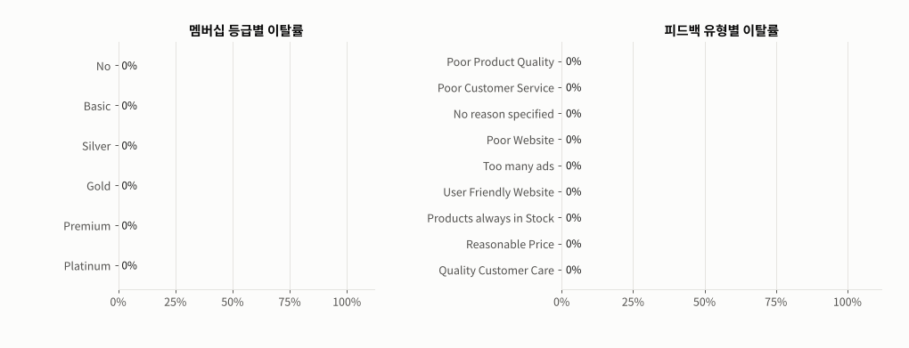
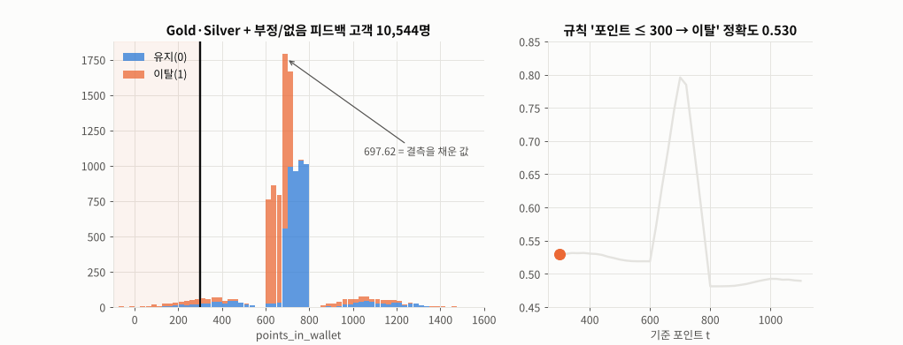
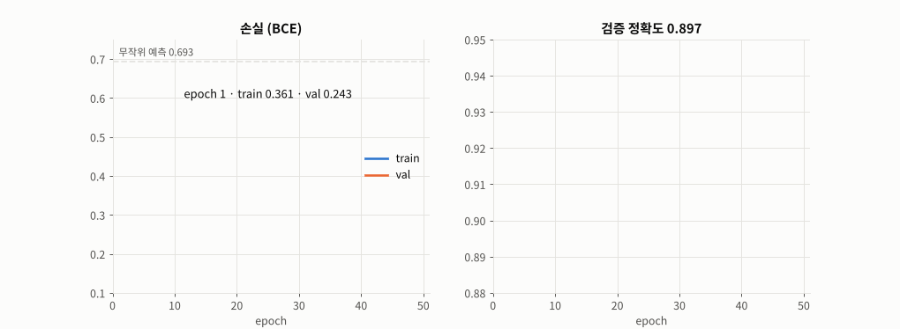
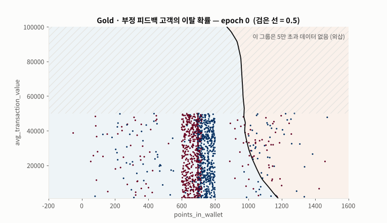
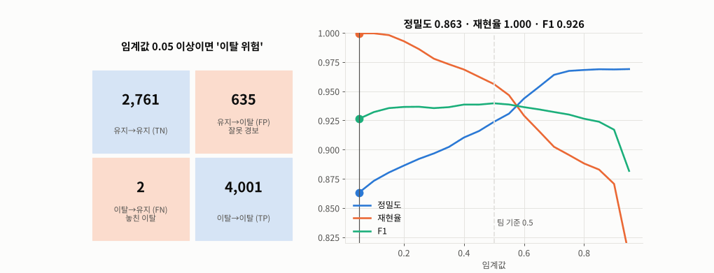

# Day 038 · 2026-11-02 (월)

`LLM (초거대언어모델)` · 10주차

> **한 줄 요약** — 2차 팀 프로젝트 **ShopInsight(이커머스 고객 이탈 예측)** 를 발표한 날. 팀 저장소의 데이터 · 모델 · 앱을 그대로 가져와 다시 돌려 보니, 저장된 팀 MLP 는 다시 평가해도 **정확도 0.935 · AUC 0.977** 로 README(0.938 · 0.976)와 거의 같았다. 다만 이 데이터는 **Platinum·Premium · 긍정 피드백 = 이탈 0%**, **No·Basic = 97%** 처럼 규칙이 거의 정해져 있어서, **규칙 3줄 · 깊이 4 결정 트리도 0.931** 이 나온다. 남은 '애매한' 28.5% 고객은 **포인트 700 점** 근처의 계단으로 갈리고, **평균 거래 금액**은 5만 초과 고객이 전원 다른 조건과 겹쳐 순열 중요도가 **0.1%p** 뿐이었다. 포인트 결측을 중앙값으로 채운 값(697.62)이 **3,446명**에 몰려 있는 것도 확인했다.

📂 실습 노트북
- [`lecture/churn_project_eda.ipynb`](./lecture/churn_project_eda.ipynb) — 데이터 품질(중앙값 대체 흔적 · 음수 포인트) · 멤버십 / 피드백별 이탈률 · 수치형 분포 · 포인트 계단 · 규칙으로 고객 나누기 · 상관
- [`lecture/churn_project_mlp.ipynb`](./lecture/churn_project_mlp.ipynb) — 같은 전처리 · 같은 구조(11 → 32 → 16 → 1)로 다시 학습 · **팀 `.pth` 직접 평가** · 규칙 / 로지스틱 / 트리 비교 · 결정 경계 · 변수 추가 실험 · 순열 중요도 · 임계값 · 대시보드 입력 점검

📦 팀 프로젝트 원본 → [`lecture/team_project/`](./lecture/team_project/) — [팀 저장소 `SKN37-2ST-2TEAM`](https://github.com/SKNETWORKS-FAMILY-AICAMP/SKN37-2ST-2TEAM) 의 `app.py` · `requirements.txt` · `.streamlit/` · `data/` · `models/` 그대로 (팀 소개 · 소감 · 보고서는 팀 저장소 README 에)
📊 데이터 → [`[2nd] customer_churn_ecommerce_cleaned.csv`](./lecture/team_project/data/) — 36,992명 × 23열, 출처 [Hugging Face `d0r1h/customer_churn`](https://huggingface.co/datasets/d0r1h/customer_churn)
🖼️ 그림 → [`lecture/images/`](./lecture/images/) — 🎬 **시뮬레이션 애니메이션(GIF) 5개** (모두 노트북과 같은 데이터 · 같은 시드로 직접 만든 것)
📖 연결된 수업 → 전처리 파이프라인 · 평가 지표(Day 030) · 순열 중요도(Day 031) · PyTorch MLP 이진 분류(Day 035)

---

## 1. 프로젝트 한눈에

| 항목 | 내용 |
|---|---|
| 주제 | 이커머스 멤버십 고객의 이탈 위험 예측 + 실무용 대시보드 |
| 정답 | `churn_risk_score` 1 이탈 (54.1%) / 0 유지 |
| 입력 | `membership_category` · `points_in_wallet` · `avg_transaction_value` · `feedback_group`(긍정 4종 / 부정 4종 / 없음) |
| 전처리 | 수치형 중앙값 대체 → 표준화, 범주형 최빈값 대체 → 원-핫 → **11개** |
| 모델 | PyTorch MLP 11 → 32 → 16 → 1, `BCEWithLogitsLoss`, 임계값 0.5 |
| 서비스 | Streamlit 4페이지 — 핵심 지표 · 고객 이탈 예측(입력 5개) · 이탈 원인 분석 · 모델 성능 |

---

## 2. EDA — 규칙이 거의 정해진 데이터



🎬 멤버십 · 피드백별 이탈률. **Platinum · Premium 0%**, **No · Basic 97%**, **긍정 피드백 4종 0%**, 부정 · 없음은 63~65% 로 비슷 — 팀이 피드백 9종을 3그룹으로 묶은 근거. 성별 · 지역 · 기기 등 다른 범주는 그룹 간 차이가 5%p 이하.

| 고객 그룹 | 인원 | 이탈률 |
|---|---|---|
| 확실한 유지 (Platinum·Premium / 긍정 피드백 / 거래 5만 초과) | 11,032 (29.8%) | 0.000 |
| 거의 이탈 (No·Basic) | 15,416 (41.7%) | 0.969 |
| **애매한 고객** (Gold·Silver + 부정/없음) | 10,544 (28.5%) | 0.481 |

- 거래 금액 5만 초과 **2,874명은 100% 이미 Platinum·Premium 이거나 긍정 피드백** — '거래 금액이 크면 이탈 0%' 는 새 정보가 아니다
- 포인트 4분위 이탈률 0.83 · 0.89 · 0.27 · 0.18 — 그런데 잘게 보면 **500점 이하 57% → 500~697점 95% → 750~850점 1.6% → 850점 초과 다시 54%**, 계단이면서 비단조
- 거래 금액 4분위는 하위 3구간 58~59% 로 비슷하고 **상위 25% 만 41%**



🎬 애매한 고객 10,544명에게 '포인트 ≤ t 면 이탈' 규칙을 적용하며 t 를 옮겼다. **t = 700** 에서 정확도 **0.796** 으로 최고, 그 뒤로는 0.49 로 급락 — 경계가 날카로운 대신 850 이상에서 다시 이탈이 늘어 직선 하나로는 안 된다. 가운데 솟은 막대에는 결측을 중앙값으로 채운 **697.62** 고객이 몰려 있다(전체 3,446명 = Hugging Face 원본 결측 3,443명 + 원래 697.62 였던 3명).

---

## 3. MLP 다시 학습 · 팀 모델 평가

```python
pre = ColumnTransformer([
    ('numeric', Pipeline([('imputer', SimpleImputer(strategy='median')), ('scaler', StandardScaler())]), NUM),
    ('categorical', Pipeline([('imputer', SimpleImputer(strategy='most_frequent')),
                              ('onehot', OneHotEncoder(handle_unknown='ignore', sparse_output=False))]), CAT),
]).fit(X_tr)                                                     # 2 + 6 + 3 = 11개

ckpt = torch.load('team_project/models/mlp_churn_4features.pth', weights_only=True)   # 가중치만 안전하게
team_model = build_mlp(ckpt['input_dim'], ckpt['hidden_dims'])                      # 11 → 32 → 16 → 1
team_model.load_state_dict(ckpt['state_dict'])
```



🎬 같은 구조를 배치 64 · Adam 0.001 · 50 에폭으로 다시 학습. 학습 손실 0.361 → 10 에폭 0.164 → 0.157 에서 멈추고 검증 손실(0.167)도 같이 평평 — 입력 4개 · 파라미터 929개라 과대적합할 것이 거의 없다(팀 README '30 에폭 이후 0.153 수렴' 과 같은 모양).

| 테스트 7,399명 | 정확도 | 정밀도 | 재현율 | F1 | ROC-AUC |
|---|---|---|---|---|---|
| 팀 README | 0.938 | 0.945 | 0.940 | 0.942 | 0.976 |
| 팀 모델 다시 평가 | 0.935 | 0.946 | 0.933 | 0.940 | **0.977** |
| 다시 학습한 MLP | 0.934 | 0.924 | 0.956 | 0.940 | 0.975 |

팀 모델은 README 와 거의 같지만 혼동 행렬이 몇십 명 다르다(다시 평가 `[[3183, 213], [268, 3735]]` vs README `[[3175, 221], [241, 3762]]`) — 학습 때의 **분할 · 전처리 통계가 기록돼 있지 않아서**. 전처리기 `.pkl` 은 pickle(열 때 코드 실행 가능) · scikit-learn 1.6.1 고정이라 열지 않고, 같은 분할로 전처리기를 다시 fit 했다.

---

## 4. MLP 가 꼭 필요했을까 — 단순 모델 비교

| 모델 | 정확도 | F1 | ROC-AUC |
|---|---|---|---|
| 전부 이탈로 찍기 | 0.541 | 0.702 | 0.500 |
| **규칙 3줄** (확실한 유지 → 0, No·Basic 또는 포인트 ≤ 700 → 1) | **0.931** | 0.937 | 0.929 |
| 로지스틱 회귀 | 0.914 | 0.919 | 0.966 |
| 결정 트리 깊이 3 / 4 | 0.917 / **0.931** | 0.925 / 0.936 | 0.920 / 0.945 |
| MLP (다시 학습 / 팀 모델) | 0.934 / 0.935 | 0.940 / 0.940 | 0.975 / 0.977 |

- 정확도는 규칙 · 트리와 0.3%p 차이 — MLP 의 장점은 **확률이 부드럽게 나오는 것(AUC 0.97)**
- 로지스틱이 뒤처지는 이유 = 포인트의 **비단조 계단**. 트리의 첫 질문도 '포인트 ≤ 약 700'



🎬 Gold · 부정 피드백 고객으로 고정하고 포인트 × 거래 금액 평면의 이탈 확률을 에폭마다 그렸다. 처음엔 포인트 700 근처 경계 하나 → 학습이 진행되며 띠가 여러 개 생긴다. 50 에폭 뒤 거래 25,000 기준 판정은 **330 · 540 · 710 · 870 · 1,190점**에서 바뀌고, **540~710점 이탈 · 710~870점 유지 · 870~1,190점 이탈** 띠가 뚜렷하다(데이터가 적은 양 끝은 믿기 어렵다). 이 그룹은 거래 5만 초과 데이터가 **없어서**(빗금) 그 위쪽 확률은 외삽 — 믿으면 안 된다.

**변수를 하나씩 더하면** : 멤버십 0.855 → + 포인트 0.926 → + 피드백 0.930 → + 거래 금액 0.932
**순열 중요도** (섞었을 때 정확도 감소) : 멤버십 0.249 · 포인트 0.089 · 피드백 0.076 · **거래 금액 0.001**

---

## 5. 임계값 — 이탈을 놓치지 않으려면



🎬 임계값을 0.05 → 0.95 로 옮기며 혼동 행렬과 정밀도 · 재현율 · F1 을 그렸다. F1 은 0.3~0.6 에서 0.935~0.940 으로 평평한데, 놓친 이탈(FN)은 0.5 → 176명, 0.3 → **89명**, 0.2 → **29명**으로 줄고 대신 잘못 경보(FP)가 316 → 451 → 510 으로 는다. 이탈 고객을 놓치는 비용이 크면 F1 은 거의 그대로 두고 재현율을 올리는 **0.3~0.4** 를 검토할 만하다.

---

## 정리 — 점검 · 개선 제안

| 항목 | 팀 프로젝트 | 제안 |
|---|---|---|
| 재현성 | 학습 분할 · 시드 · 전처리 통계 기록 없음 | 분할 인덱스 · `random_state` · 전처리기를 모델과 함께 저장 |
| 성능 페이지 | 현재 CSV 를 다시 80 : 20 으로 나눠 평가 | 저장한 테스트 인덱스로만 평가 (학습 고객 섞임 방지) |
| 기준 모델 | MLP 단독 | 규칙 · 로지스틱 · 트리와 함께 보고 |
| 입력 변수 | 4개 | 평균 거래 금액은 중요도 0.1%p — 3개로 충분 |
| 포인트 | 중앙값 대체(697.62 × 3,446명) · 음수 136명(원본 그대로) | `SimpleImputer(add_indicator=True)` · 음수 → 결측 (다른 수치형 열처럼) |
| 전처리기 | `.pkl` (scikit-learn 1.6.1) | `requirements.txt` 에 버전 고정, 또는 통계값을 JSON 으로 |
| 입력 폼 | '보유 포인트 (만원)' | 포인트는 점수(−760 ~ 2,069) — '(점)' 으로 |
| 임계값 | 0.5 | 이탈 놓침 비용이 크면 0.3~0.4 |

---

## 🔁 복습

**팀 결과에서 짚어 본 부분**
- [x] 저장된 팀 MLP 를 `weights_only=True` 로 불러 직접 평가 → 정확도 0.935 · AUC 0.977, README 와 거의 같음 ✔
- [x] README 혼동 행렬과 몇십 명 차이 → 학습 분할 · 전처리 통계가 기록되지 않아 정확한 재현 불가 (`app.py` 의 `evaluation_note` 와 같은 결론)
- [x] `app.py` '모델 성능' 페이지가 CSV 를 다시 나눠 평가 → 학습에 쓴 고객이 섞일 수 있음
- [x] 핵심 요인 4개 중 **평균 거래 금액**은 다른 조건과 완전히 겹침 (5만 초과 2,874명 = 100% Platinum·Premium·긍정 피드백)
- [x] 포인트 결측을 중앙값으로 채워 **697.62 에 3,446명** — 이 고객들의 이탈률은 전체 평균(54%)과 같아 정보가 없음
- [x] 포인트 **음수 136명**이 정제본에 남아 있음 — 정제 때 음수 · −999 · `Error` 를 결측으로 바꾼 열은 `days_since_last_login` · `avg_time_spent` · `avg_frequency_login_days` 이고 포인트는 빠짐 (`avg_frequency_login_days` 도 중앙값 16.0 에 5,524명)
- [x] 대시보드 입력 '보유 포인트 (만원)' → 포인트는 금액이 아니라 점수 / 거래 금액 '원' 단위는 가정

**직접 해본 것**
- 팀 저장소 그대로 가져와 EDA 재현 · 규칙으로 고객 3그룹 나누기 · 포인트 기준 t 찾기
- 같은 `ColumnTransformer` · 같은 MLP 구조로 다시 학습, 학습 / 검증 곡선
- 팀 `.pth` 직접 평가, 규칙 · 로지스틱 · 결정 트리 비교, 트리 규칙 출력
- 결정 경계 · 변수 추가 실험 · 순열 중요도 · 임계값별 혼동 행렬
- `FuncAnimation` 으로 이탈률 · 포인트 기준 · 학습 곡선 · 결정 경계 · 임계값 애니메이션

**막혔던 부분 / 질문**
- [ ] 규칙이 거의 정해진 데이터에서 MLP 와 트리 중 무엇을 '최종 모델' 로 내세워야 하나 — 설명력 vs AUC
- [ ] Hugging Face 원본도 `churn_risk_score` 가 이미 0/1(1 = 20,012 · 0 = 16,980, −1 없음)이다. '이탈 위험 점수' 를 어떤 기준으로 0/1 로 만든 것인지 출처에 설명이 없다 — 정답 정의를 모르면 모델이 무엇을 맞히는지도 모른다
- [ ] 이탈 놓침(FN)과 잘못 경보(FP)의 실제 비용을 정하면 최적 임계값을 계산할 수 있을까
- [ ] 결측 표시 열(`add_indicator`)을 넣으면 697.62 고객들을 더 잘 맞힐까

📂 [수업 자료 폴더](./lecture/) · [복습 자료 폴더](./review/)

---

## 🔗 참고 링크

- [팀 저장소 — SKN37-2ST-2TEAM (ShopInsight)](https://github.com/SKNETWORKS-FAMILY-AICAMP/SKN37-2ST-2TEAM)
- [Hugging Face — `d0r1h/customer_churn`](https://huggingface.co/datasets/d0r1h/customer_churn)
- [scikit-learn — `ColumnTransformer`](https://scikit-learn.org/stable/modules/generated/sklearn.compose.ColumnTransformer.html) · [`SimpleImputer(add_indicator=True)`](https://scikit-learn.org/stable/modules/generated/sklearn.impute.SimpleImputer.html) · [Permutation importance](https://scikit-learn.org/stable/modules/permutation_importance.html)
- [PyTorch — Saving and loading models (`weights_only`)](https://pytorch.org/tutorials/beginner/saving_loading_models.html) · [Python `pickle` 보안 경고](https://docs.python.org/3/library/pickle.html)
- [Streamlit 문서](https://docs.streamlit.io/)
