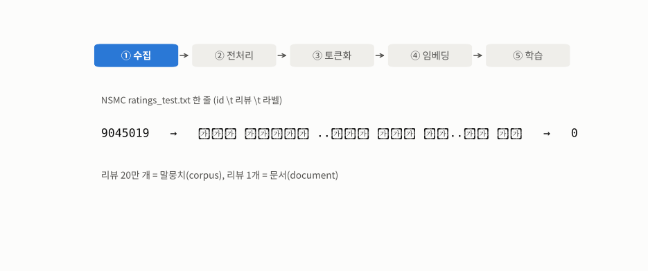
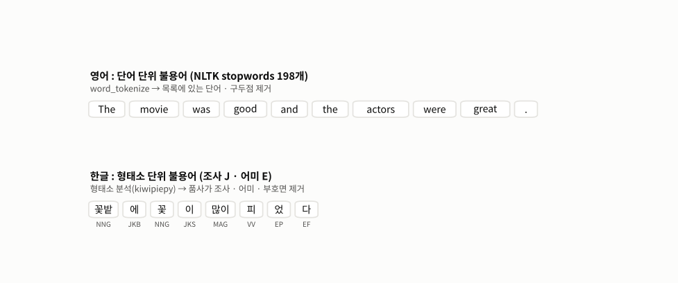
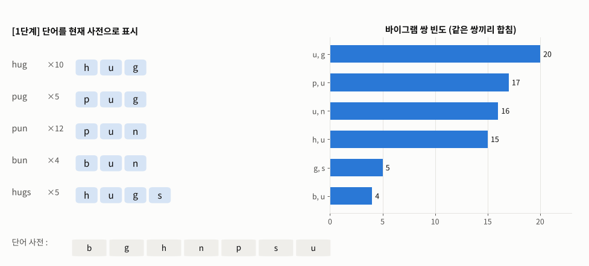
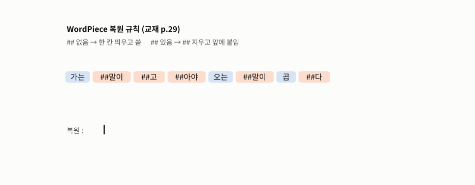
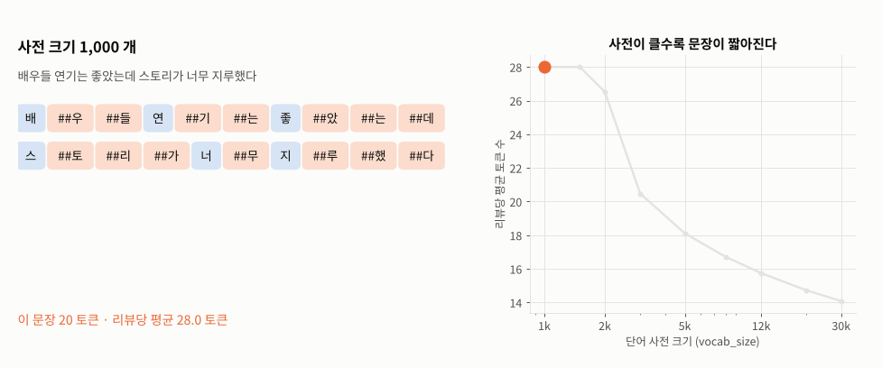

# Day 039 · 2026-11-03 (화)

`LLM (초거대언어모델)` · 10주차

> **한 줄 요약** — 자연어 처리는 **수집 → 전처리 → 토큰화 → 임베딩 → 학습** 5단계다. 불용어는 '드문' 단어가 아니라 **너무 자주 나와서** 의미가 적은 것 — 영어는 **단어**(the · was), 한글은 조사 · 어미 같은 **형태소**라 형태소 분석 후 지운다. 띄어쓰기 단위 사전 3만 개로는 테스트 리뷰 어절의 **36%** 가 사전에 없는 **OOV** 였고, 단어를 **서브워드** 조각으로 나누는 WordPiece 사전 3만 개는 `[UNK]` 가 **1.3%**, 글자 사전을 넓히면(`limit_alphabet`) **0.04%** 까지 줄었다. 교재 BPE 예시(hug · pug · pun · bun · hugs)를 코드로 돌리면 `ug(20) → un(16) → hug(15) → pun(12)` 로 교재 표와 똑같다. 필기의 단어 사전은 **리뷰 id 숫자**까지 학습해 사전의 19% 를 숫자 조각에 쓰고 있었다.

📂 실습 노트북
- [`lecture/nlp_preprocessing_tokenization.ipynb`](./lecture/nlp_preprocessing_tokenization.ipynb) — 자연어 처리 5단계 · 텍스트 구조 · 특수문자 / 불용어 제거 · 형태소(실질 / 형식) · 영어 vs 한글 불용어 · NLTK `sent_tokenize` / `word_tokenize` · 어절 사전의 OOV (메모 `11_03메모`)
- [`lecture/bpe_subword_tokenization.ipynb`](./lecture/bpe_subword_tokenization.ipynb) — 교재 BPE 표를 코드로 재현 · 새 단어 토큰화 · `tokenizers` BPE 와 비교 · BPE vs WordPiece 병합 기준
- [`lecture/wordpiece_vocab_nsmc.ipynb`](./lecture/wordpiece_vocab_nsmc.ipynb) — NSMC 로 `BertWordPieceTokenizer` 단어 사전 · `BertTokenizerFast` 토큰화 · id · `[CLS]`/`[SEP]` · `attention_mask` · 복원 규칙 · OOV 비교 · `limit_alphabet` · 사전 크기 (필기 `단어사전`)

📊 실습 데이터 → [`ratings_train.zip`](./lecture/ratings_train.zip) (15만, 14.6MB 라 zip — 노트북 첫 셀이 자동으로 풀어 줌) · [`ratings_test.txt`](./lecture/ratings_test.txt) (5만) — 네이버 영화 리뷰 NSMC, 탭 구분 `id · document · label`
🖼️ 그림 → [`lecture/images/`](./lecture/images/) — 🎬 **시뮬레이션 애니메이션(GIF) 5개** (모두 노트북과 같은 데이터 · 토크나이저로 직접 만든 것)
📖 교재 → `자연어처리` 교재9 **p.1~30** (자연어 · 자연어 처리 과정 · 텍스트 전처리 · 텍스트 구조 · 형태소 · 불용어 · 토큰화 · NLTK · OOV · 서브워드 · BPE · WordPiece · WordPiece 실습 개요)
📝 메모 → [`11_03메모.txt`](./lecture/11_03메모.txt) → 수정본 [`11_03메모_수정본.txt`](./lecture/11_03메모_수정본.txt) · 필기 → [`단어사전.ipynb`](./lecture/단어사전.ipynb) · 필기에서 만든 [`vocab.txt`](./lecture/vocab.txt)

---

## 1. 자연어 처리 과정 — 5단계

| 단계 | 하는 일 | 오늘 |
|---|---|---|
| ① 수집 | 공공데이터 · 오픈 API · 크롤링 | NSMC 리뷰 20만 개 |
| ② 전처리 | 특수문자 · **불용어** 제거 | 정규식 · NLTK · 형태소 품사 |
| ③ 토큰화 | 의미 있는 단위로 나누기 | 문장 · 단어 · 형태소 · **서브워드** |
| ④ 임베딩 | 토큰 → 숫자 벡터 | 토큰 → **id** 까지 |
| ⑤ 학습 | 목적 달성 (감성 분류 등) | — |



🎬 NSMC 한 줄(`id \t 리뷰 \t 라벨`)이 5단계를 지나는 모습. 특수문자를 지우고, WordPiece 로 7 어절 → 8 토큰(`이야기 ##구먼`), 토큰은 사전의 줄 번호(id)가 되고, 벡터(아직 무작위)로 바뀌어 모델이 라벨 0(부정)을 맞추도록 학습한다.

**텍스트 구조** : 말뭉치(corpus) > 문서 > 문단 > 문장 > 단어 > **형태소** — NSMC 리뷰 199,992개 = 말뭉치, 리뷰 1개 = 문서.

---

## 2. 전처리 — 불용어 · 형태소

```python
nltk.download('punkt_tab'); nltk.download('stopwords')
stopwords_list = nltk.corpus.stopwords.words('english')      # 198개 — the, a, and, is, ... not 도 포함
no_stop = [w for w in tokens_en if w not in stopwords_list]   # 33 단어 → 14 단어
```

예문에서 빈도 1 · 2 · 3위가 `the`(5) · `was`(4) · `and`(2) — 불용어는 **흔한** 단어다.

| | 형태소 (뜻을 가진 가장 작은 단위) | 예 (`kiwipiepy`) |
|---|---|---|
| 실질 형태소 | 실제 뜻 | 꽃밭 · 꽃 · 많이 · 피- · 사과 |
| 형식 형태소 | 문법 관계 — **조사 · 어미 · 접사** | 에 · 이 · -었- · -다 · 풋- |

```python
kiwi.tokenize('꽃밭에 꽃이 많이 피었다')
# 꽃밭/NNG 에/JKB 꽃/NNG 이/JKS 많이/MAG 피/VV 었/EP 다/EF   ← 교재 p.9 와 같음
[t.form for t in kiwi.tokenize(text) if not t.tag.startswith(('J', 'E', 'S'))]   # 조사 · 어미 · 부호 제거
# ['꽃밭', '꽃', '많이', '피']
```



🎬 영어는 `word_tokenize` 결과에서 **단어** 째로(`The` · `was` · `and` …), 한글은 형태소 분석 후 품사가 조사(J) · 어미(E)인 **형태소**를 지운다. 한 어절 `꽃밭에` 안에 조사가 붙어 있어서 띄어쓰기만으로는 못 지운다.

---

## 3. 토큰화 — NLTK · 형태소 · OOV

```python
sent_tokenize('Hello Mr. Smith. How are you?')   # ['Hello Mr. Smith.', 'How are you?']   ← 'Mr.' 는 문장 끝 아님
'Hello Mr. Smith. How are you?'.split('. ')      # ['Hello Mr', 'Smith', 'How are you?']  ← 단순 분리는 틀림
word_tokenize("Don't hesitate, just do it.")     # ['Do', "n't", 'hesitate', ',', 'just', 'do', 'it', '.']
```

한글 리뷰는 `word_tokenize` 로도 `평점이` 처럼 조사가 붙은 채 → 형태소 단위(`평점 / 이`)로 나눠야 한다.

**OOV** : NSMC 학습 리뷰의 서로 다른 어절은 **357,862개**. 많이 나온 3만 개로 사전을 만들면 테스트 어절 380,472개 중 **36.1%** 가 사전에 없다. `재미` 로 시작하는 어절만 **2,362가지**(재미있게 · 재미도 · 재미없다 …) — 조사 · 어미가 붙을 때마다 다른 단어가 된다.

---

## 4. 서브워드 — BPE (교재 p.15~26)

```python
word_freq = {'hug': 10, 'pug': 5, 'pun': 12, 'bun': 4, 'hugs': 5}
# 1) 문자 단위로 분리 → 초기 사전 b g h n p s u
# 2) 이웃한 두 토큰(바이그램) 빈도 합치기 → 3) 최다 쌍 병합 → 2) 반복
```

| 단계 | 최다 쌍 | 빈도 | 사전에 추가 |
|---|---|---|---|
| 1 | (u, g) | 20 = hug 10 + pug 5 + hugs 5 | `ug` |
| 2 | (u, n) | 16 = pun 12 + bun 4 | `un` |
| 3 | (h, ug) | 15 | `hug` |
| 4 | (p, un) | 12 | `pun` |



🎬 왼쪽은 단어를 현재 사전으로 표시한 모습, 오른쪽은 바이그램 빈도. 가장 긴 막대(주황)를 합쳐 사전(아래)에 추가하면 단어 표시가 바뀌고 빈도를 다시 센다. 직접 구현 · Hugging Face `tokenizers` 모두 교재와 같은 사전 `b g h n p s u ug un hug pun` 이 된다.

학습 때 없던 `bug` → `b + ug`, `unhug` → `un + hug` 로 표현(OOV 해결). 초기 문자에 없는 `m` 은 `[UNK]` → 실제 토크나이저는 모든 문자를 초기 사전에 넣고 시작한다.

**BPE vs WordPiece** — 같은 예시에서 BPE 첫 병합은 빈도 최대 `(u, g)`(20), WordPiece 는 점수 $\frac{f(ab)}{f(a)f(b)}$ 최대 `(g, s)`(0.050, 나머지 0.028). `s` 는 언제나 `g` 뒤에만 나오기 때문.

---

## 5. WordPiece 단어 사전 — NSMC (교재 p.27~30)

```python
docs = pd.concat([train['document'], test['document']]).dropna()   # 리뷰 문장만!
open('nsmc_corpus.txt', 'w', encoding='utf-8').write('\n'.join(docs))

wp_tokenizer = BertWordPieceTokenizer(lowercase=False, strip_accents=False)
wp_tokenizer.train(files=['nsmc_corpus.txt'], vocab_size=30000)
wp_tokenizer.save_model('./wordpiece_vocab')                          # vocab.txt : 줄 번호 = id

bert_tokenizer = BertTokenizerFast.from_pretrained('./wordpiece_vocab', do_lower_case=False, strip_accents=False)
bert_tokenizer.tokenize('가는말이고아야 오는말이 곱다')
# ['가는', '##말이', '##고', '##아야', '오는', '##말이', '곱', '##다']   ← 필기 결과와 같음
bert_tokenizer.tokenize('가는 말이 고와야 오는 말이 곱다')
# ['가는', '말이', '고', '##와', '##야', '오는', '말이', '곱', '##다']   ← 띄어 쓰면 '말이' 가 독립 단어
bert_tokenizer('가는 말이 고와야 오는 말이 곱다')
# input_ids [2, 3272, ..., 3]  = [CLS] ... [SEP],  attention_mask [1, 1, ...]
```

| 비교 | 결과 |
|---|---|
| 필기처럼 원본 파일(id · 라벨 포함)로 학습 | 사전 3만 중 숫자 토큰 **5,778개 (19.3%)** — 필기 `vocab.txt` 도 5,778개 |
| 리뷰 문장만 학습 | 숫자 토큰 **154개 (0.5%)** |
| `BertTokenizerFast(..., lowercase=False)` | 무시됨 → `Marvel` → `m ##ar ##ve ##l` |
| `do_lower_case=False` | `M ##ar ##ve ##l` |
| `strip_accents` 옵션 없이 | 한글이 자모로 분해(NFD, `곱다` 2자 → 5자) → 전부 `[UNK]` |



🎬 복원 규칙(교재 p.29) : `##` 없는 토큰은 **한 칸 띄우고**, `##` 있는 토큰은 `##` 를 지우고 **앞에 붙인다**. 토큰을 하나씩 처리하면 원문과 똑같이 돌아온다(`decode` 결과와도 같음).

**OOV 비교 (사전 3만, 학습 리뷰로 만들고 테스트 리뷰로 평가)**

| 사전 | `[UNK]` 비율 |
|---|---|
| 어절(띄어쓰기) 사전 | **36.1%** (어절 기준) |
| WordPiece (`limit_alphabet=1000` 기본) | **1.3%** (토큰 기준) — `및` · `곧` · `왤케` · `갓띵작` 처럼 드문 글자가 든 어절은 **통째로** `[UNK]` |
| WordPiece (`limit_alphabet=6000`) | **0.04%** — 리뷰에 나온 글자 3,004개를 모두 초기 사전에 |

신조어 `노잼각` → `노잼 ##각`, `꿀잼보장` → `꿀잼 ##보 ##장`.



🎬 같은 리뷰를 사전 크기 1,000 → 30,000 으로 바꿔 가며 토큰화했다. 1,000 개면 `배 ##우 ##들 연 ##기 ##는 …` 처럼 거의 글자 단위(리뷰당 평균 **28.0** 토큰), 3만 개면 어절 그대로 6 토큰(평균 **14.1**). 사전 크기는 **메모리 vs 문장 길이**의 절충.

---

## 정리 — 토큰화 단위 비교

| 단위 | 도구 | 장점 | 단점 |
|---|---|---|---|
| 문장 | `sent_tokenize` | 약어 인식 | 다음 단계가 또 필요 |
| 단어 (띄어쓰기) | `split` · `word_tokenize` | 간단 | 한글은 조사가 붙어 **OOV 36%** |
| 형태소 | `kiwipiepy` 등 | 한글 의미 단위 · 불용어 제거 쉬움 | 분석기 · 사전 필요, 신조어 약함 |
| 서브워드 | BPE · **WordPiece** | OOV 거의 없음 · 사전 작게 | 조각이 사람 눈엔 어색 (`##구먼`) |

---

## 🔁 복습

**필기 · 메모 · 교재에서 고친 부분**
- [x] 메모 불용어 "잘 쓰이지 않는 **문장**" → **자주** 쓰이지만 의미가 적은 **단어** (빈도 상위에 몰려 있음)
- [x] 메모 `"말뭉치" 단계를 이룬다` → 말뭉치 > 문서 > 문단 > 문장 > 단어 > 형태소 **계층**
- [x] 메모 `"사과" … 불용어` → 더 나눌 수 없는 **형태소 하나(명사)**, 불용어 아님
- [x] 메모 형식 형태소 "3개를 찾으면 된다" → 조사 · 어미 · 접사 **세 종류**, 한글 불용어는 주로 조사 · 어미
- [x] 메모 `조사,어미,조사` · `관속사` · `NLIK` · `OVV` · `덱스트` → 조사 · 어미 / 접속사 / NLTK / OOV / 텍스트
- [x] 메모 "단어 단위 마침표 기준" → 단어는 **띄어쓰기 + 구두점**, 마침표는 **문장** 기준
- [x] 메모 BPE `hug (hu,ug) 10번 / hu 5번 ug 5번` → hug 에서 각 10번, 합치면 (h,u) **15** · (u,g) **20**
- [x] 메모 바이그램 `(u,p) 12개` → **(u,n)**, `(h.ug)1whdfb` → 한/영 오타, **(h, ug) 10회**
- [x] 필기 드라이브 마운트 · `/content/drive/Othercomputers/...` 경로 → 같은 폴더의 `ratings_*.txt`
- [x] 필기 원본 파일을 그대로 학습 → id · 라벨 · 헤더까지 학습해 사전의 19% 가 숫자 → **`document` 열만** 뽑아 학습
- [x] 필기 `BertTokenizerFast.from_pretrained(..., lowercase=False)` → 그런 인자가 없어 **무시**, 영어가 소문자로 → **`do_lower_case=False`**
- [x] 필기 변수 `BartToken` → BART 는 다른 모델, `wp_tokenizer` 로 / `from enum import Flag` 삭제 / 주석 `대좋해` · `트렌스포머` → 대조해 · 트랜스포머
- [x] 필기 예시 `가는말이고아야` → 속담은 `가는 말이 고와야 오는 말이 곱다` (둘 다 토큰화해서 비교)
- [x] 교재 p.27 WordPiece "가장 빈번한 바이그램 쌍을 병합" → 그건 BPE 기준. WordPiece 는 **빈도 ÷ (각 조각 빈도의 곱)** 점수
- [x] 교재 p.27 토큰 `'##ᆻ다'` → 악센트 제거(NFD)로 한글이 자모로 분해된 흔적. 학습 · 토큰화 모두 `strip_accents=False`

**직접 해본 것**
- 정규식 전처리, NLTK 불용어로 빈도 상위 단어 확인, `kiwipiepy` 로 교재 형태소 예시 확인 · 조사 / 어미 제거
- `split` vs `sent_tokenize` / `word_tokenize` 비교, 어절 사전 OOV 비율 계산
- 교재 BPE 4단계를 직접 구현 · `tokenizers` BPE 와 대조, WordPiece 점수 계산
- NSMC 로 WordPiece 사전 학습(리뷰만 vs 원본 파일), `lowercase` · `strip_accents` 함정 재현, `[CLS]`/`[SEP]` · 패딩 · `attention_mask`, 복원 함수 직접 작성
- 어절 vs WordPiece `[UNK]` 비교, `limit_alphabet` · 사전 크기 실험
- `FuncAnimation` 으로 5단계 · BPE 병합 · 복원 규칙 · 사전 크기 · 불용어 애니메이션

**막혔던 부분 / 질문**
- [ ] 토큰 id → **임베딩 벡터**는 어떻게 학습되나 (교재 p.31~)
- [ ] 이미 학습된 한국어 BERT(KoBERT · KLUE-BERT)의 사전으로 토큰화하면 결과가 어떻게 다를까
- [ ] 감성 분류에서 불용어(`not` · 조사)를 정말 지워야 하나 — 지운 것 / 안 지운 것 정확도 비교
- [ ] GPT 계열 토크나이저(Byte-level BPE)는 왜 `[UNK]` 가 아예 없나

📂 [수업 자료 폴더](./lecture/) · [복습 자료 폴더](./review/)

---

## 🔗 참고 링크

- [NLTK — `nltk.tokenize`](https://www.nltk.org/api/nltk.tokenize.html) · [NLTK Data (punkt_tab · stopwords)](https://www.nltk.org/data.html)
- [Hugging Face LLM Course — Byte-Pair Encoding tokenization](https://huggingface.co/learn/llm-course/chapter6/5) · [WordPiece tokenization](https://huggingface.co/learn/llm-course/chapter6/6)
- [Hugging Face `tokenizers` — 문서](https://huggingface.co/docs/tokenizers/index) · [`BertTokenizerFast`](https://huggingface.co/docs/transformers/model_doc/bert#transformers.BertTokenizerFast)
- [Kiwi (kiwipiepy) — 한국어 형태소 분석기](https://github.com/bab2min/kiwipiepy)
- [NSMC — Naver sentiment movie corpus](https://github.com/e9t/nsmc)
