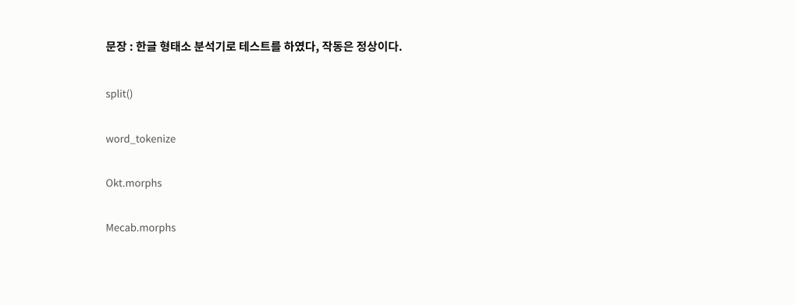
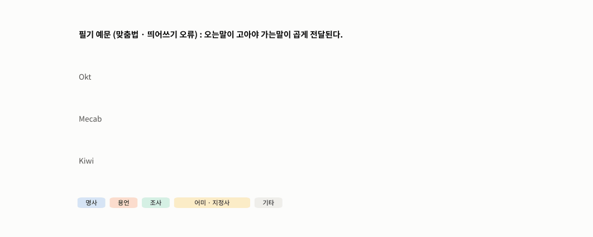
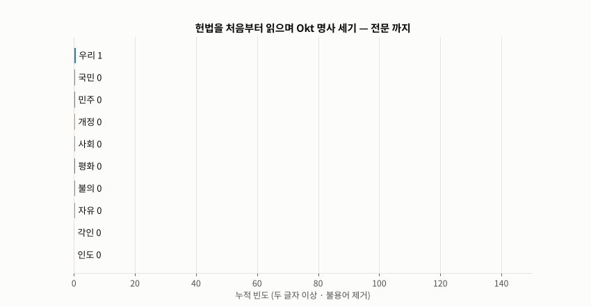
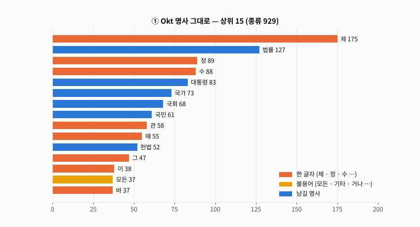
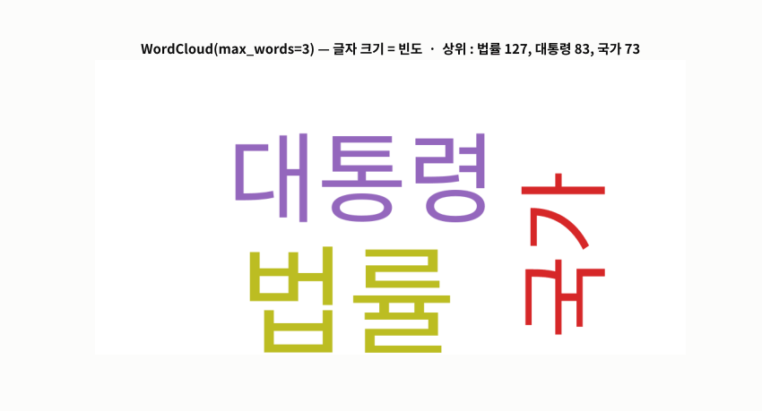
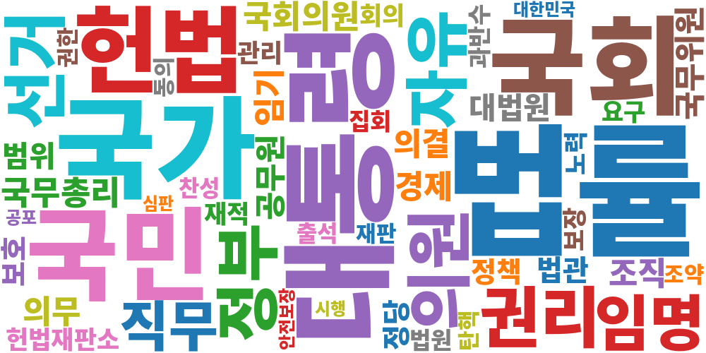

# Day 040 · 2026-11-04 (수)

`LLM (초거대언어모델)` · 10주차

> **한 줄 요약** — 어제 '한글은 형태소 단위로 나눠야 한다' 를 직접 해 본 날. 같은 문장을 `split()` 은 7개, Okt 는 14개, Mecab 은 16개 토큰으로 나눈다. 두 분석기 모두 `morphs` · `pos` · `nouns` 세 함수로 쓰지만 결과는 다르다 — Okt 는 `거나 · 대하 · 로써` 같은 조각을 **명사로 잘못** 뽑고, Mecab 은 `헌법재판소` 를 `헌법 + 재판소` 로 쪼갠다. 대한민국 헌법의 명사를 `Counter` 로 세면 **법률 127 · 대통령 83 · 국가 73** 순이고, 한 글자 명사(`제` 175 · `정` 89 · `수` 88)와 불용어를 걸러야 워드클라우드가 읽힌다. 필기의 `find` 반복은 시작점을 잘못 잡아 '법률' 을 **129번**(실제 128)으로 셌다. 속담 `가는 말이 고와야` 의 `고와야`(ㅂ 불규칙)는 Okt · Mecab 둘 다 틀렸다.

📂 실습 노트북
- [`lecture/korean_morph_analyzers.ipynb`](./lecture/korean_morph_analyzers.ipynb) — 설치 · 실행 방법 · `split` / `word_tokenize` / Okt / Mecab 비교 · Okt `morphs` · `pos` · `nouns` · `norm` · `stem` · 품사표 · Mecab 세종 품사 · 틀린 문장과 불규칙 활용 · 속도 · `RegexpTokenizer` · Kiwi (필기 `단어사전02`)
- [`lecture/constitution_word_frequency.ipynb`](./lecture/constitution_word_frequency.ipynb) — 설치 · 실행 방법 · 헌법 불러오기 · Okt / Mecab 명사 → 한 글자 걸러내기 → `Counter` · 두 분석기 비교 · 불용어 · `find` 로 세기 바로잡기 · 워드클라우드 (필기 `문서_마이닝`)

📊 데이터 → 대한민국 헌법 전문 — KoNLPy 내장 말뭉치 `kolaw.open('constitution.txt')` (받을 파일 없음, 필기의 `constitution.txt` 와 같은 내용)
🖼️ 그림 → [`lecture/images/`](./lecture/images/) — 🎬 **시뮬레이션 애니메이션(GIF) 5개** + 워드클라우드 2장 (모두 노트북과 같은 분석기 · 데이터로 직접 만든 것)
📖 교재 → `자연어처리` 교재9 **p.31~43** (WordPiece 실습 · 한글 형태소 단위 토큰화 · Okt · mecab · 품사 정리 · 단어 빈도수 분석 · `Counter()` · `wordcloud`)
📝 필기 → [`단어사전02.ipynb`](./lecture/단어사전02.ipynb) · [`문서_마이닝.ipynb`](./lecture/문서_마이닝.ipynb) · [`단어사전01.ipynb`](./lecture/단어사전01.ipynb) (WordPiece — 정리는 [Day 039](../2026-11-03/))

⚙️ **설치 · 실행** — `pip install konlpy python-mecab-ko kiwipiepy nltk wordcloud` (Okt 는 **Java** 필요 · Colab 은 기본 포함 / Python 3.13 등에서 `python-mecab-ko` 가 빌드되면 `apt-get install mecab libmecab-dev` 먼저 / 워드클라우드는 **한글 폰트**) → 노트북 맨 위부터 **모두 실행**

---

## 1. 같은 문장 · 네 가지 토큰화

```python
text = '한글 형태소 분석기로 테스트를 하였다, 작동은 정상이다.'
text.split()          # 7개  — '분석기로' · '테스트를' : 조사가 붙은 어절
word_tokenize(text)   # 9개  — 문장부호만 떼어 냄
okt.morphs(text)      # 14개 — '분석 / 기 / 로' · '하였다'
mecab.morphs(text)    # 16개 — '분석기 / 로' · '하 / 였 / 다'
```



🎬 같은 문장을 네 방법으로 나눴다. 띄어쓰기 기준은 조사가 붙은 어절 그대로라 '테스트를 · 테스트가' 가 다른 단어가 되고(Day 039 OOV), 형태소 분석기는 `테스트 / 를` 로 뗀다. Okt 는 `하였다` 를 통째로, Mecab 은 `하 / 였 / 다` 로 더 잘게 나눈다.

---

## 2. Okt · Mecab — `morphs` · `pos` · `nouns`

| 기능 | Okt (`konlpy`) | Mecab (`python-mecab-ko`) |
|---|---|---|
| 형태소 | `okt.morphs(text)` | `mecab.morphs(text)` |
| 형태소 + 품사 | `okt.pos(text)` → `('형태소', 'Noun')` | `mecab.pos(text)` → `('형태소', 'NNG')` |
| 명사 | `okt.nouns(text)` | `mecab.nouns(text)` |
| 품사 체계 | Okt 자체 (Noun · Verb · Josa · Eomi …) | **세종 품사** (NNG · VV · JKS · EF …), 붙으면 `XSV+EF` |
| 그 밖 | `norm=True`(정규화) · `stem=True`(기본형) | 빠름 |

- Okt `stem=True` 는 `잼있었닼` → `재다`, `강추합니당` → `강 + 추하다` 처럼 신조어의 기본형을 엉뚱하게 만든다
- 교재 p.35 Okt 품사표(= `okt.tagset`)에 없는 **`Modifier`**(예 : `오는`)가 실제 결과에 나오고, 관형사 `새 · 첫 · 그` 는 `Noun` 으로 붙는다



🎬 필기 예문(`오는말이 고아야…`)과 바른 속담을 Okt · Mecab · Kiwi 로 품사 태깅했다(파랑 명사 · 주황 용언 · 초록 조사 · 노랑 어미/지정사). 필기 예문은 셋 다 엉키고(Okt 는 `고아`(孤兒) · `곱` 을 명사로), 바른 문장도 `고와야`(ㅂ 불규칙 : 곱 + 아야)를 **Okt · Mecab 은 `고 + 와야`** 로 틀리고 **Kiwi 만 `곱 + 어야`** 로 맞힌다.

**속도** (헌법 전문 명사 추출, 첫 호출 제외) : 이번 실행에서 Okt 가 Mecab 보다 **3.1배**, Kiwi 보다 **4.0배** 느렸다(Java 경유 · 실행마다 조금씩 다름).

---

## 3. 단어 빈도 — `Counter` (교재 p.41~42)

```python
nouns_okt = okt.nouns(text)                          # 3,880개
final_nouns = [n for n in nouns_okt if len(n) > 1]   # 두 글자 이상 3,011개
count = Counter(final_nouns)                         # 종류 850
count.most_common(5)   # [('법률', 127), ('대통령', 83), ('국가', 73), ('국회', 68), ('국민', 61)]
```

| 상위 | Okt (두 글자 이상) | Mecab (두 글자 이상) |
|---|---|---|
| 1~6 | 법률 127 · 대통령 83 · 국가 73 · 국회 68 · 국민 61 · 헌법 52 | 법률 121 · 대통령 84 · 국가 73 · 국민 69 · 국회 69 · 헌법 68 |
| 차이 | `모든`(관형사) · `거나` · `대하` · `로써` · `항의`('제1항의') 같은 조각을 명사로 | `헌법재판소` → `헌법 + 재판소`, `국무위원` → `국무 + 위원` 으로 쪼갬 |



🎬 헌법을 전문 → 제1장 → … → 제10장(부칙 포함) 순서로 읽으며 Okt 명사를 누적해 셌다. 제2장(국민의 권리와 의무)까지는 `국민` 이 1위, 제3장 국회부터 `법률` 이 1위로 올라서 끝까지 지키고, 제4장 정부에서 `대통령` 이 70 으로 단숨에 2위가 된다.



🎬 ① 명사 그대로면 상위가 `제`(제1조) · `정`(정한다) · `수`(할 수) 같은 **한 글자 형식어**(주황), ② 두 글자 이상만 남겨도 `모든 · 기타 · 사항`(노랑)이 끼어 있고, ③ 불용어까지 빼야 `법률 · 대통령 · 국가 …` 가 남는다(종류 850 → 826).

**📝 '법률' 세기** : 필기 코드는 `index = text.find(text)` 로 시작해 위치 0 을 한 번 더 센다 → **129**. 바르게 세면 글자열 **128**, 그중 9번은 `법률안` 의 일부라 명사로는 Okt **127** · Mecab **121** — 단어 빈도는 **토큰화 후** 센다.

---

## 4. 워드클라우드 (교재 p.43)

```python
wc = WordCloud(font_path=font, width=1000, height=500, max_words=50, max_font_size=200,
               background_color='white', colormap='tab10', random_state=0)
wc.generate_from_frequencies(clean)      # 불용어를 뺀 Counter
wc.to_file('wordcloud_okt.png')
plt.imshow(wc); plt.axis('off')
```



🎬 `max_words` 를 3 → 50 으로 늘리며 그렸다. 글자 크기는 빈도 — `법률 · 대통령 · 국가 · 국회 · 국민 · 헌법` 이 헌법의 뼈대다.

| Okt (불용어 제거) | Mecab |
|---|---|
|  |  |

---

## 🔁 복습

**필기 · 교재에서 고친 부분**
- [x] `단어사전02` `MeCap` · `mc` · `mecap` → **MeCab** (`mecab`)
- [x] `단어사전02` 예문 `오는말이 고아야 가는말이 곱게` → 속담은 **가는 말이 고와야 오는 말이 곱다** (순서 · 맞춤법 · 띄어쓰기) — 둘 다 분석해 비교
- [x] `단어사전02` `okt.pos(text)` 출력이 바로 위 `text` 가 아닌 **다른 문장**의 결과 · '(MeCap) 추출' 제목 아래 `okt.nouns` · 출력 문구 불일치 → 셀을 오가며 실행한 흔적, 위에서부터 다시 실행
- [x] `단어사전02` 주석 'MeCab 이 Okt 보다 빠르고 정확하다' → 빠른 것은 맞음(3~4배), 정확도는 문장마다 다름(예문은 둘 다 틀림)
- [x] 오타 `분장으로 부터` · `기중으로` · `word_wokenize` · `taging` → 문장으로부터 · 기준으로 · word_tokenize · tagging
- [x] `문서_마이닝` 드라이브 경로 · 같은 파일 두 번 읽기 · 1만 8천 자 전체 출력 → KoNLPy 내장 헌법 · 한 번 읽기 · 앞부분만
- [x] `문서_마이닝` `index = text.find(text)` 로 '법률' 세기 → **129**(1 많음) → `text.find(target)` 시작 또는 `text.count` = 128
- [x] `문서_마이닝` `Counter` 850개 전체 출력 → `most_common(n)`, Okt 의 조사 · 어미 조각은 불용어로 제거
- [x] `문서_마이닝` 워드클라우드를 파일로 저장만 하고 화면 출력 없음 → `imshow` 추가, 폰트 경로를 하나로 박지 않고 있는 한글 폰트 찾기
- [x] 교재 p.35 Okt 관형사(Determiner) 예시의 `잘` → 문법적으로 **부사**. 실제 Okt 는 관형사를 `Noun` 으로 붙이고, 표에 없는 `Modifier` 도 낸다
- [x] 교재 p.43 `WordClod` → **WordCloud**

**직접 해본 것**
- `split` · `word_tokenize` · Okt · Mecab · Kiwi 토큰화와 품사 태깅 비교, Okt `norm` · `stem`
- 틀린 문장 · 바른 문장 · 불규칙 활용(`고와야`)에서 분석기별 결과 비교, 헌법 전문으로 속도 측정
- `RegexpTokenizer(r"[\w]+")` 와 `r"[\w']+"` 비교
- 헌법 명사 빈도 : 한 글자 · 불용어 단계별 정리, Okt vs Mecab 차이 단어, `find` 세기 바로잡기, 워드클라우드 2장
- `FuncAnimation` 으로 토큰화 비교 · 품사 태깅 · 빈도 누적 · 워드클라우드 · 불용어 단계 애니메이션

**막혔던 부분 / 질문**
- [ ] 분석기가 틀리는 단어(`헌법재판소` 쪼개기, 신조어)는 **사용자 사전**으로 고칠 수 있나 — Okt · Mecab 각각의 방법
- [ ] 한 글자 명사 중 뜻 있는 `법` · `죄` 는 살리고 `제` · `수` 만 빼려면 — 품사 + 목록을 함께 쓰는 불용어 설계
- [ ] 빈도 대신 TF-IDF 로 보면 헌법의 장(章)마다 특징 단어가 달라질까
- [ ] 문장 → 토큰 → id 다음 단계 : 단어를 숫자 벡터로 (임베딩, 교재 p.44~)

📂 [수업 자료 폴더](./lecture/) · [복습 자료 폴더](./review/)

---

## 🔗 참고 링크

- [KoNLPy — 설치](https://konlpy.org/ko/latest/install/) · [`konlpy.tag` (Okt)](https://konlpy.org/ko/latest/api/konlpy.tag/)
- [python-mecab-ko (PyPI)](https://pypi.org/project/python-mecab-ko/) · [Kiwi (kiwipiepy)](https://github.com/bab2min/kiwipiepy)
- [Python — `collections.Counter`](https://docs.python.org/3/library/collections.html#collections.Counter)
- [wordcloud — API](https://amueller.github.io/word_cloud/references.html)
- [NLTK — `RegexpTokenizer`](https://www.nltk.org/api/nltk.tokenize.regexp.html)
