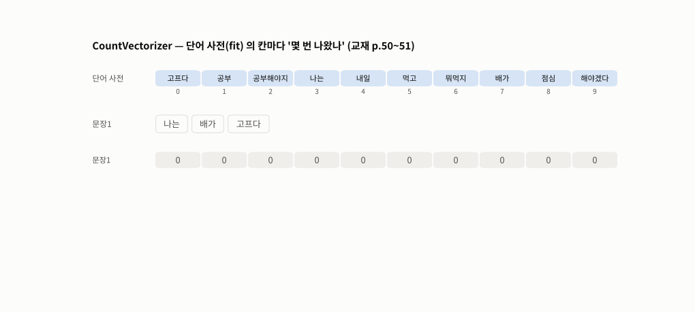
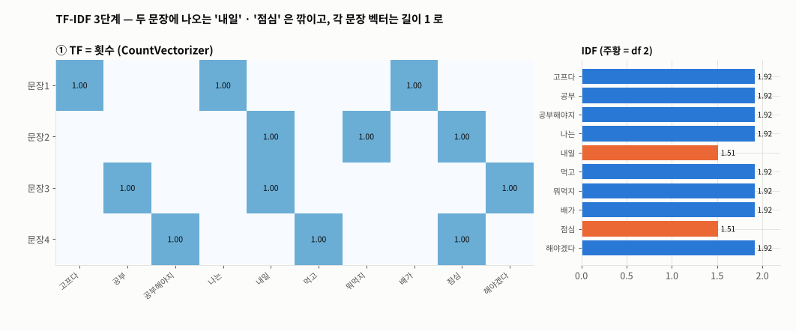
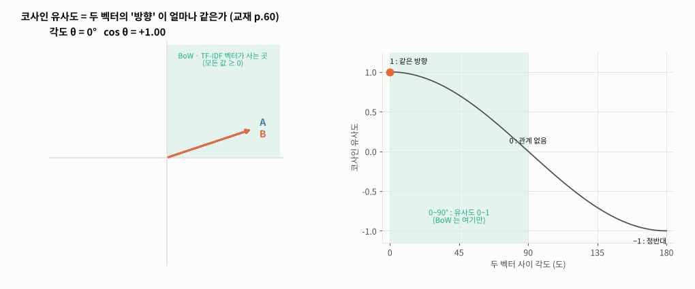
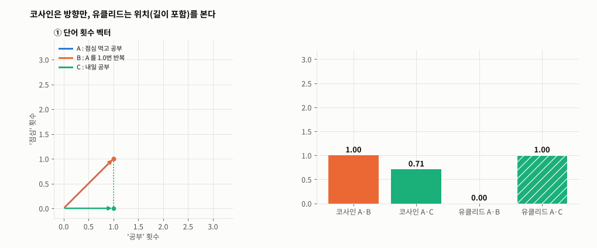
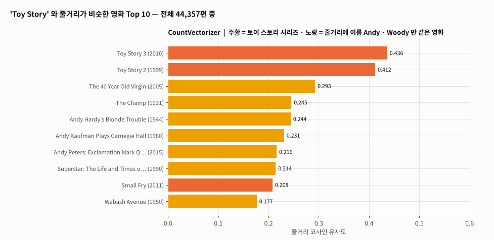

# Day 041 · 2026-11-05 (목)

`LLM (초거대언어모델)` · 10주차

> **한 줄 요약** — 토큰을 **숫자 벡터**로 바꾸는 첫 방법, BoW 를 배운 날. `CountVectorizer` 는 단어 사전 칸마다 **몇 번** 나왔는지 세고(`나는 배가 고프다` → `[1 0 0 1 0 0 0 1 0 0]`), `TfidfVectorizer` 는 여러 문장에 나오는 단어(`내일` · `점심`, IDF 1.51)를 드문 단어(1.92)보다 깎은 뒤 **문장마다 길이 1 로** 나눈다(교재에 빠진 단계). 두 벡터의 방향이 얼마나 같은지가 **코사인 유사도** — BoW 는 값이 모두 0 이상이라 0~1 만 나온다. 영화 4만 4천 편 줄거리로 추천을 만들면 `Toy Story` → `Toy Story 3 · 2` 를 잘 찾지만, `Andy` · `Woody` 라는 **이름만 같은** 영화도 끌려온다. 필기처럼 `.toarray()` 를 쓰면 **26.9GB**, 희소 행렬 그대로면 **14.7MB**.

📂 실습 노트북
- [`lecture/bow_count_tfidf.ipynb`](./lecture/bow_count_tfidf.ipynb) — 설치 · 실행 방법 · 임베딩 · 희소/밀집 · `CountVectorizer` 단어 사전 · 빈도 벡터 · `token_pattern` · 문서 빈도 표 · IDF 손계산 · TF×IDF ÷ 길이(l2) · 정리 노트 숫자 확인 (교재 p.46~58)
- [`lecture/text_similarity_cosine.ipynb`](./lecture/text_similarity_cosine.ipynb) — 설치 · 실행 방법 · 코사인 손계산 · Count / TF-IDF 유사도 · BoW 각도 0~90° · 챗봇 예문 · 유클리드 vs 코사인 · tiktoken · 문장 임베딩 vs TF-IDF · PCA (교재 p.59~62 · 66)
- [`lecture/movie_recommendation.ipynb`](./lecture/movie_recommendation.ipynb) — 설치 · 실행 방법 · 데이터 점검 · 결측 · 자리표시 줄거리 · 희소 행렬 · 추천 함수 · 원본 재현 · Count vs TF-IDF (필기 `nlp_실습6`, 교재 p.63~65)

📊 데이터 → Kaggle [The Movies Dataset](https://www.kaggle.com/datasets/rounakbanik/the-movies-dataset) `movies_metadata.csv` (45,466행) — 이 노트가 쓰는 5개 열만 [`lecture/data/movies_overview.csv.gz`](./lecture/data/) (7MB)
🖼️ 그림 → [`lecture/images/`](./lecture/images/) — 🎬 **시뮬레이션 애니메이션(GIF) 5개** (모두 노트북과 같은 예문 · 데이터로 직접 만든 것)
📖 교재 → `자연어처리` 교재v1 **p.44~68** (p.44~45 단어 빈도 실습은 [Day 040](../2026-11-04/) 헌법으로 정리 · 21. 자연어 딥러닝 · 임베딩 · 희소 표현 · BoW · CountVectorizer · TF-IDF · 텍스트 유사도 · 코사인 유사도 · 추천 시스템 실습 · 밀집 표현)
📝 필기 → [`nlp_실습6.ipynb`](./lecture/nlp_실습6.ipynb) · 정리 노트 [`TF-IDF_정리.md`](./lecture/TF-IDF_정리.md) · [`유클리드_거리_정리.md`](./lecture/유클리드_거리_정리.md) · [`PCA_차원축소_정리.md`](./lecture/PCA_차원축소_정리.md) · [`tokenization-vectorization-embedding.md`](./lecture/tokenization-vectorization-embedding.md) · [`예시코드_토큰화_벡터화_임베딩.md`](./lecture/예시코드_토큰화_벡터화_임베딩.md)

⚙️ **설치 · 실행** — `pip install scikit-learn pandas kiwipiepy sentence-transformers tiktoken` (Count · TF-IDF · 영화 추천은 Colab 기본 패키지만으로 실행 / 문장 임베딩은 첫 실행 때 Hugging Face 에서 한국어 모델 약 440MB 를 받으므로 **인터넷 필요**, GPU 불필요) → 영화 데이터는 노트북 폴더에 `movies_metadata.csv` 또는 `data/movies_overview.csv.gz` → 노트북 맨 위부터 **모두 실행**

---

## 1. 임베딩 · 희소 표현 — `CountVectorizer` (교재 p.46~53)

```
텍스트 수집 → 전처리 → 토큰화 → [임베딩 : 텍스트를 숫자로] → 학습
```

```python
corpus = ['나는 배가 고프다', '내일 점심 뭐먹지', '내일 공부 해야겠다', '점심 먹고 공부해야지']
cv = CountVectorizer()
cv.fit(corpus)                       # 토큰화 → 단어 사전 vocabulary_ (가나다순 번호)
cv.transform(['나는 배가 고프다']).toarray()
# [[1 0 0 1 0 0 0 1 0 0]]           # 고프다 · 나는 · 배가 칸이 1
```

| 표현 | 모양 | 예 |
|---|---|---|
| 희소 (sparse) | 단어 사전 크기만큼 길고 **대부분 0** | BoW — `CountVectorizer`(횟수) · `TfidfVectorizer`(가중치) |
| 밀집 (dense) | 정해진 길이(예 : 768)의 실수, **대부분 0 아님** — 학습으로 만든다 | Word2Vec · BERT · 문장 임베딩 모델 |

- 기본 토큰 규칙은 '어절' 이 아니라 정규식 `\b\w\w+\b` — **한 글자 단어(`나` · `밥`)를 버리고**, 문장부호에서 끊고, 영어는 소문자로
- `fit` 에 없던 단어는 `transform` 에서 **조용히 사라진다**(OOV) — 사전은 말뭉치로 고정



🎬 교재 예문 4개를 차례로 넣으며 문장의 단어가 사전의 어느 칸(주황)에 해당하는지 짚고, 그 칸에 횟수를 적어 문서-단어 행렬을 쌓았다. 마지막 새 문장의 `해야지` 는 사전에 없어 **버려진다** — `공부해야지` · `해야겠다` 와는 다른 단어다.

---

## 2. TF-IDF — 흔한 단어는 깎고, 문장마다 길이 1 로 (교재 p.54~58)

| 기호 | sklearn 기본 |
|---|---|
| TF | 문장 안 **횟수** 그대로 |
| IDF | `ln((1 + N) / (1 + df)) + 1` (교재 p.56 공식과 같음) → df 1 : **1.916**, df 2 : **1.511** |
| TF-IDF | TF × IDF → **문장 벡터를 길이 1 로 나눔** (`norm='l2'`) ← 교재에 없는 단계 |

```python
tfidf = TfidfVectorizer().fit(corpus)
tfidf.idf_                      # = np.log((1 + N) / (1 + df)) + 1  (손계산과 일치)
X = tfidf.transform(corpus)     # 문장3 : 공부 0.618 · 내일 0.487 · 해야겠다 0.618
```



🎬 ① 횟수 → ② × IDF(오른쪽 막대, 주황 = 두 문장에 나오는 `내일` · `점심`) → ③ ÷ 벡터 길이. 같은 '1번 등장' 이라도 `내일`(0.49)이 `해야겠다`(0.62)보다 낮아지고, ③ 을 거쳐야 `TfidfVectorizer().toarray()` 와 같은 숫자가 된다.

---

## 3. 코사인 유사도 (교재 p.59~62)

```python
cosine_similarity(X)          # 희소 행렬 그대로 넣어도 된다
# 문장2 ↔ 문장4 (점심 공유) : Count 0.333 → TF-IDF 0.256
```

| 비교 | 결과 |
|---|---|
| 챗봇 예문 `이 요리의 레시피를 알려줘.` ↔ `이 요리 어떻게 만드는지 알려줘.` | 어절 Count **0.289** (`요리의` ≠ `요리`, `이` 버림) → Kiwi 형태소 **0.721** |
| `점심 먹고 공부` ↔ 같은 말 2번 / ↔ `내일 공부` | 코사인 1.0 / 0.408 — 유클리드는 **둘 다 1.732** |
| BoW 유사도 범위 | 0 ~ 1 (각도 0~90°) — '−1 = 정반대' 는 밀집 임베딩에서만 |



🎬 B 를 0°→180° 돌리며 cos θ 를 그렸다. 초록 영역(모든 값 ≥ 0)이 Count · TF-IDF 벡터가 놓이는 곳이라 BoW 유사도는 0 아래로 내려가지 않는다.



🎬 A(`점심 먹고 공부`)를 반복해 길게 만든 B 는 코사인 1.0 그대로인데 유클리드 거리는 0 → 2.83 으로 커져 내용이 다른 C(1.0)보다 멀어진다. 벡터를 길이 1 로 맞추면(단위 원 위로) B 는 0, C 는 0.77 — 거리도 방향 순서를 따른다(TF-IDF 가 l2 정규화하는 이유).

---

## 4. 밀집 표현 맛보기 — 문장 임베딩 (교재 p.66)

```python
model = SentenceTransformer('jhgan/ko-sroberta-multitask')     # 한국어 문장 임베딩 (768차원)
emb = model.encode(titles, normalize_embeddings=True)          # 0 인 칸 0%
```

| 도서 제목 7개 | TF-IDF (희소) | 문장 임베딩 (밀집) |
|---|---|---|
| 딥러닝 1 ↔ 2 | **1.0** (`1` `2` 를 버려 같은 벡터) | 0.90 |
| AI 수학 ↔ 개발자 수학 | 0.67 | 0.73 |
| 검색 `신경망 처음 배우는 책` | 전부 **0** | 1위 `밑바닥부터 시작하는 딥러닝 1` 0.441 |

글자가 겹치지 않아도 뜻이 가까우면 유사도가 생긴다. 768차원을 PCA 2차원으로 줄이면 설명된 분산은 54% — 그림은 참고용, 비교는 원래 차원에서.

---

## 5. 영화 줄거리 추천 (교재 p.63~65 · 필기 `nlp_실습6`)

```python
cv = CountVectorizer(stop_words='english')
X = cv.fit_transform(movies['overview'])          # 44,357 × 75,827 희소 행렬 (14.7MB)

def recommend(title, k=10, X=X):
    i = title_idx[title]                           # 같은 제목이면 year= 로 고르기
    sims = cosine_similarity(X[i], X).ravel()      # 한 편 vs 전체만 계산
    sims[i] = -1                                   # 자기 자신은 위치로 제외
    return movies.iloc[np.argsort(-sims)[:k]]
```

| 단계 | 필기 | 고친 노트 |
|---|---|---|
| 데이터 | `df2[0:9999]` → 9,999편 | 결측(954 · 6) · 자리표시 줄거리 149 제거 → **44,357편 전체** |
| 행렬 · 유사도 | `.toarray()` + 전체 × 전체 표 (원본 크기로도 약 4GB) | 희소 행렬 + 입력 1편 × 전체 |
| `Toy Story` | Toy Story 2 0.412 (9,999편 중 — 재현 확인) | Count : Toy Story 3 0.436 · 2 0.412 / TF-IDF : 0.532 · 0.472 |



🎬 `Toy Story` 와 비슷한 줄거리 Top 10 을 Count → TF-IDF 로 바꿔 가며 다시 줄 세웠다. 주황은 토이 스토리 시리즈(`Small Fry` 는 버즈가 나오는 단편), 노랑은 `The 40 Year Old Virgin` · `The Champ`(1931) · `Hot Splash` 처럼 **주인공 이름 Andy · Woody 만 같은** 영화 — BoW 는 뜻이 아니라 글자가 같은지를 본다. TF-IDF 는 `buzz` · `woody` 에 무게를 실어 시리즈 점수를 올린다.

---

## 🔁 복습

**필기 · 교재 · 정리 노트에서 고친 부분**
- [x] `nlp_실습6` `drive.mount` 후 `/content/movies_metadata.csv` 읽기 → 드라이브가 아닌 Colab 임시 폴더라 마운트 불필요, `DtypeWarning` 은 `low_memory=False`
- [x] `nlp_실습6` 주석 '결측치 제거 후 원본 df1 에 반영' → `dropna` 는 **새 표 `df2`** 를 만든다
- [x] `nlp_실습6` `df2[0:9999]` + '1만 개(0~9999)' → 슬라이스 끝 미포함이라 **9,999편** (`[:10000]`)
- [x] `nlp_실습6` `.toarray()` (9,999 × 32,382 정수 ≈ 2.6GB) + 전체 유사도 표 2개(0.8GB × 2) → 희소 행렬 그대로 · 한 편 × 전체만 계산 → 4만 편 전체로
- [x] `nlp_실습6` `No overview found.` 같은 자리표시 줄거리 149개가 남아 서로 유사도 1.0 → 제거
- [x] `nlp_실습6` `[1:n+1]` 로 자기 자신 제외 → 동점(중복 행)이면 자기 자신이 섞인다 → 자기 위치를 −1
- [x] `nlp_실습6` 같은 제목 여러 편(예 : `Hamlet` 9편)이면 `df_sim[title]` 이 표가 되어 정렬 실패 · 없는 제목이면 `None` 을 돌려줌 → 행 번호 · `year=` 선택 · 비슷한 제목 안내
- [x] `nlp_실습6` 오타 `임포` · `임퐅트` · `임배딩` · `켤과` · `커럼` · `vecab` → 임포트 · 임베딩 · 결과 · 컬럼 · vocab
- [x] 교재 p.52 · p.57 '토큰화(어절 단위)' → 정규식 `\b\w\w+\b` : **한 글자 단어 버림** · 문장부호 분리 · 영어 소문자
- [x] 교재 p.54 'IDF : 문서 수의 역수 (N/DF)' → 문서 비율의 역수에 **로그** (+ smoothing)
- [x] 교재 p.56 TF-IDF = TF × IDF → sklearn 은 그 뒤 **문장마다 길이 1 로(l2) 나눈 값**을 돌려준다
- [x] 교재 p.60 '두 벡터 사이 각도 0~180, −1 = 정반대' → Count · TF-IDF 는 값이 0 이상이라 **0~90°, 유사도 0~1**
- [x] 교재 p.63 · p.65 '2017년 7월 이전 개봉 영화 45,466편' → 45,466 은 **행 수** (깨진 행 3 · 중복 id 30), 개봉일 2017-08 이후(최대 2020-12) 40행 · 미개봉(`Rumored` · `Planned` …) 포함
- [x] 교재 머리글 `SK네트웍스 Famiy` · 본문 `임폴트` → Family · 임포트
- [x] `tokenization-vectorization-embedding.md` '26글자, 11토큰 (GPT-4o)' → **23글자, o200k_base 14토큰** (`예시코드` 의 43 / 22 / 14 가 맞음)
- [x] `tokenization-vectorization-embedding.md` 'BoW 는 등장했다/안 했다만' → **횟수**를 센다 (등장 여부는 `binary=True`)
- [x] `tokenization-vectorization-embedding.md` '유클리드는 고차원에서 보는 각도에 따라 왜곡' → 각도에 따라 바뀌는 건 **PCA 그림**, 유클리드의 약점은 **벡터 길이(문서 길이)** 영향
- [x] `tokenization-vectorization-embedding.md` '고차원 공간에 심기' vs '저차원 밀집 벡터' → 사전 크기보다 저차원, 사람이 볼 2~3차원보다는 고차원
- [x] `TF-IDF_정리.md` sklearn 차이 설명 → **TF 는 횟수 그대로**(단어 수로 안 나눔)가 빠짐 · `1+` 는 0 나눗셈 방지, 끝의 `+1` 이 '오늘' 을 0 이 아니게 함 · 순위 일치는 이 예시에서만 보장
- [x] `예시코드` 3-2 '한 글자 토큰 포함 시 딥러닝 1 ↔ 2 = 0.6' → **0.65**
- [x] `tokenization-vectorization-embedding.md` 3-3 Kiwi 결과 `ㄴ다`(호환 자모 U+3134) → 실제 출력은 `ᆫ다`(받침 자모 U+11AB, `예시코드` 는 맞게 적음) — 문자열 비교하면 다른 글자. 마침표가 없으면 `EC`, 있으면 `EF`
- 그 밖의 숫자(`TF-IDF_정리` 손계산 · `예시코드` 파트 2 표 · 유클리드 5.0 · 2.0 · PCA ±1.414 · 80%)는 **실행 결과와 같다**

**직접 해본 것**
- 교재 예문으로 단어 사전 · 빈도 벡터 · DF 표 · IDF 손계산 · l2 정규화까지 sklearn 숫자와 맞추기
- Count / TF-IDF / Kiwi 형태소 / 문장 임베딩으로 같은 문장 쌍의 유사도 비교, 유클리드 vs 코사인
- 받은 정리 노트 5개의 예제를 모두 다시 실행해 숫자 확인 (tiktoken 3종 · Kiwi · N-gram · PCA)
- 영화 4만 4천 편 전체로 희소 행렬 추천, 원본 9,999편 결과 재현, Count vs TF-IDF 상위 10편 겹침 비교
- `FuncAnimation` 으로 BoW · TF-IDF 3단계 · 코사인 각도 · 코사인 vs 유클리드 · 추천 순위 애니메이션

**막혔던 부분 / 질문**
- [ ] 영화 줄거리에 **임베딩 모델**(문장 임베딩)을 쓰면 `Andy` · `Woody` 같은 이름 함정이 줄어들까 — 4만 편 임베딩 시간 · 메모리
- [ ] `Finding Nemo` 는 Count 와 TF-IDF 의 상위 10편이 1편만 겹친다 — 어느 쪽이 더 '비슷한 영화' 인지 어떻게 평가하나 (추천 평가 지표)
- [ ] 한글 줄거리라면 `CountVectorizer(tokenizer=형태소 분석기)` 로 Day 040 의 Okt · Mecab 을 붙이면 되나 — 불용어는?
- [ ] 받은 `예시코드` 7-1 이 가리키는 `코사인_유사도_정리.md` 는 자료에 없음 — 따로 받기
- [ ] 다음 : 학습으로 만드는 밀집 표현 — 순환 신경망 RNN (교재 p.69~)

📂 [수업 자료 폴더](./lecture/) · [복습 자료 폴더](./review/)

---

## 🔗 참고 링크

- [scikit-learn — `CountVectorizer`](https://scikit-learn.org/stable/modules/generated/sklearn.feature_extraction.text.CountVectorizer.html) · [`TfidfVectorizer`](https://scikit-learn.org/stable/modules/generated/sklearn.feature_extraction.text.TfidfVectorizer.html) · [텍스트 특징 추출 (TF-IDF 공식)](https://scikit-learn.org/stable/modules/feature_extraction.html#tfidf-term-weighting)
- [scikit-learn — `cosine_similarity`](https://scikit-learn.org/stable/modules/generated/sklearn.metrics.pairwise.cosine_similarity.html)
- [Kaggle — The Movies Dataset](https://www.kaggle.com/datasets/rounakbanik/the-movies-dataset)
- [sentence-transformers](https://www.sbert.net/) · [jhgan/ko-sroberta-multitask](https://huggingface.co/jhgan/ko-sroberta-multitask)
- [tiktoken](https://github.com/openai/tiktoken) · [Kiwi (kiwipiepy)](https://github.com/bab2min/kiwipiepy)
- [오늘코드 — 토큰화, 벡터화, 임베딩 무슨 차이일까?](https://youtu.be/9rbm29bCjaQ) (정리 노트 출처)
