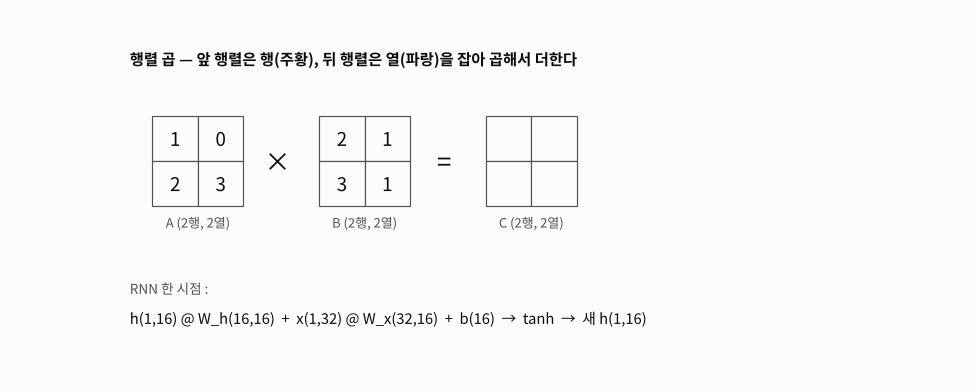
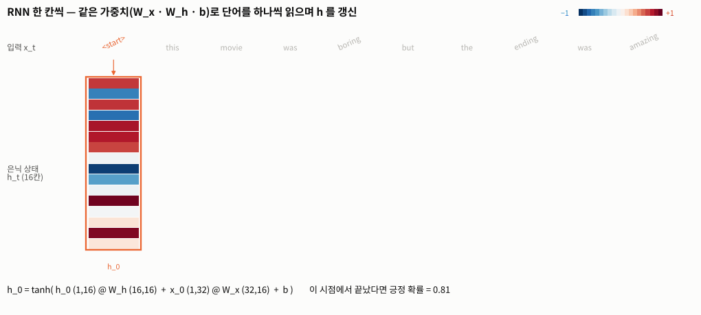
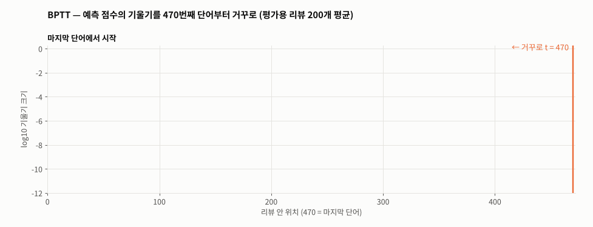
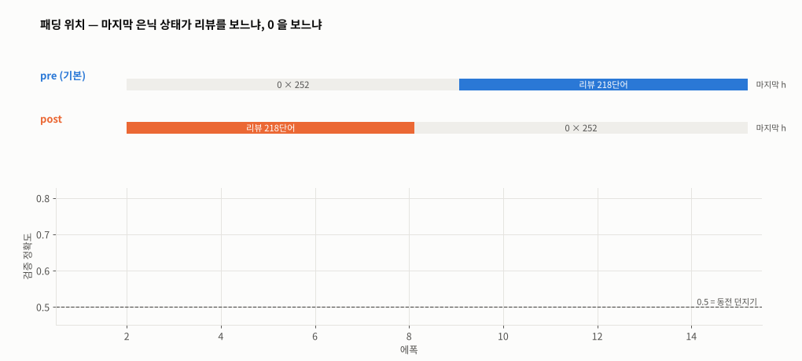
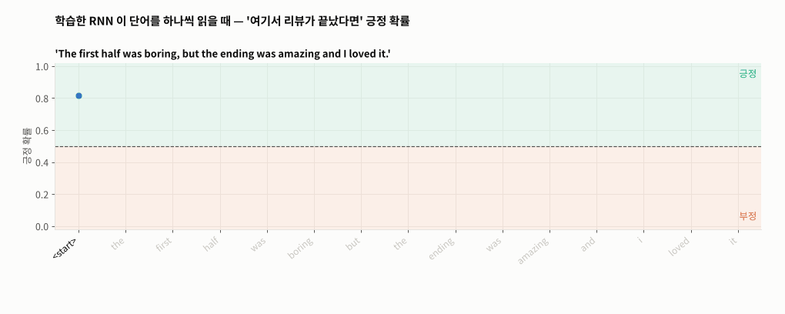

# Day 042 · 2026-11-06 (금)

`LLM (초거대언어모델)` · 10주차

> **한 줄 요약** — 어제의 BoW 는 순서를 버려 `not good , bad` 와 `not bad , good` 을 같은 벡터로 만든다(글자 단위로 세면 `도시` = `시도`). RNN 은 단어를 **하나씩 순서대로** 읽으며 `h = tanh(h @ W_h + x @ W_x + b)` 로 기억을 넘기고, 470 칸 모두 **같은 가중치 800개**를 돌려 쓴다. IMDB 리뷰 2만 개로 Embedding → RNN → Linear 를 학습하면 평가 정확도 **77.6%**. 그런데 기울기를 재 보면 예측은 거의 **마지막 수십 칸**으로만 정해진다(470칸 중 맨 앞 칸 기울기 ≈ 1e-20, 기울기 소실). 패딩을 뒤에 붙이면 마지막 은닉 상태가 0 만 읽어 정확도가 **50%(동전 던지기)** 로 떨어진다. 필기는 행렬 곱 예제에서 멈춰서 모델 · 학습 · 평가까지 이어서 완성했다.

📂 실습 노트북
- [`lecture/matmul_rnn_cell.ipynb`](./lecture/matmul_rnn_cell.ipynb) — 설치 · 실행 방법 · 행렬 곱 손계산 · 모양 규칙 · 에러 예시 · 순차 데이터 · RNN 셀 손계산 = `nn.RNN` · `output` vs `h_n` · 가중치 수 · tanh · BPTT 기울기 소실 (수업 자료 「행렬 간의 곱셈」 · 교재 p.69~78)
- [`lecture/imdb_rnn_sentiment.ipynb`](./lecture/imdb_rnn_sentiment.ipynb) — 설치 · 실행 방법 · IMDB · 단어 복원 · 길이 통계 · 앞쪽 패딩 · 검증 분리 · 모델 · 학습 · 평가 · post 패딩 실험 · BPTT 기울기 · 예측 (필기 `nlp_실습07` 정리 · 완성)

📊 데이터 → IMDB 영화 리뷰 50,000개(학습 25,000 · 평가 25,000, 긍정/부정 반반) — `keras.datasets.imdb.load_data(num_words=10000)` 가 자동으로 받음 (받을 파일 없음)
🖼️ 그림 → [`lecture/images/`](./lecture/images/) — 🎬 **시뮬레이션 애니메이션(GIF) 5개** (노트북과 같은 데이터 · 학습한 모델로 직접 만든 것)
📖 교재 → `자연어처리` 교재v1 **p.69~78** (학습 단계 · 순환 신경망 RNN · 순차 데이터 · 기본 원리 · 다른 신경망과의 차이 · IMDB 감성 분석 실습 개요 · 모델 구성과 데이터 흐름 · RNN 모델 · 연산 과정 · tanh · BPTT) + 수업 자료 「행렬 간의 곱셈」
📝 필기 → [`nlp_실습07.ipynb`](./lecture/nlp_실습07.ipynb)

⚙️ **설치 · 실행** — `pip install keras torch` (Colab 은 기본 포함 / `keras` 는 데이터 받기 · `pad_sequences` 에만 쓰고 **TensorFlow 없이** PyTorch 백엔드로 동작) → 노트북 맨 위부터 **모두 실행** (IMDB 는 첫 실행 때 자동 다운로드 · CPU 로 약 5분)

---

## 1. 행렬 곱 (수업 자료 「행렬 간의 곱셈」)

```python
A = np.array([[1, 0], [2, 3]]);  B = np.array([[2, 1], [3, 1]])
A @ B            # [[ 2  1]
                 #  [13  5]]   C[1,0] = (2×2) + (3×3) = 13
B @ A            # [[4 3] [5 3]] — 순서를 바꾸면 다르다
np.ones((2, 3)) @ np.ones((2, 2))   # ValueError — (m, k) × (k, n) 에서 가운데 k 가 달라서
```



🎬 앞 행렬은 행(주황), 뒤 행렬은 열(파랑)을 잡아 같은 자리끼리 곱해 더하면 결과의 한 칸이 된다. 아래 줄은 RNN 한 시점에서 실제로 일어나는 곱 — `(1,16) @ (16,16)` 과 `(1,32) @ (32,16)` 이 둘 다 `(1,16)` 이 되어야 더할 수 있다.

---

## 2. RNN — 앞 내용을 기억하며 한 단어씩 (교재 p.70~76)

$$h_t = \tanh(W_h\,h_{t-1} + W_x\,x_t + b)$$

```python
rnn = nn.RNN(input_size=32, hidden_size=16, batch_first=True)
output, h_n = rnn(x)          # x : (배치, 470, 32)
output.shape                  # (배치, 470, 16) — 모든 시점 h_1 … h_470
h_n.shape                     # (1, 배치, 16)   — 마지막 h_470 하나 (= output[:, -1])
```

| 층 | 가중치 | 개수 |
|---|---|---|
| `Embedding(10000, 32)` | 단어마다 32칸 벡터 | 320,000 |
| `RNN(32 → 16)` | `W_x` (32,16) · `W_h` (16,16) · 편향 16 + 16 | **800** — 470개 시점이 공유 |
| `Linear(16 → 1)` | 마지막 h → 긍정 점수 | 17 |

- 손으로 5번 돌린 `tanh(h @ W_h + x @ W_x + b)` 와 `nn.RNN` 출력이 **같다** (PyTorch 는 `W_x` 를 (16, 32) 로 뒤집어 저장하고 편향을 두 개로 나눠 둔다)



🎬 학습한 모델로 `This movie was boring but the ending was amazing.` 을 한 단어씩 읽혔다. 세로 16칸이 은닉 상태 h_t(파랑 −1 ~ 빨강 +1) — 같은 가중치로 매번 새로 계산되고, 아래 줄에 '여기서 끝났다면' 긍정 확률이 나온다.

---

## 3. tanh · BPTT · 기울기 소실 (교재 p.77~78)

- tanh 는 `2·sigmoid(2z) − 1` — −1 ~ 1, 기울기는 최대 1 이고 |z| 가 크면 0 에 가깝다
- BPTT : 마지막 시점 손실 → t = T, T−1, …, 1 로 거꾸로 연쇄 법칙 (`loss.backward()` 한 줄)
- 무작위 RNN 100 시점 : 마지막 0.60 → 5칸 앞 **5.6e-3** → 20칸 앞 **6.5e-9**



🎬 학습한 IMDB 모델에서 예측 점수의 기울기를 470번째 칸부터 거꾸로 쟀다(평가 리뷰 200개 평균, 로그 눈금). 100칸 앞이면 약 1/100, 200칸 앞이면 약 1/4,000, 맨 앞 칸은 1e-20 (앞쪽 칸은 대부분 패딩 0 — 리뷰 평균 길이 239) — 긴 리뷰의 앞부분은 학습에도 예측에도 거의 쓰이지 않는다(**장기 의존성 문제** → LSTM · GRU).

---

## 4. IMDB 영화 리뷰 감성 분석 (교재 p.73~74 · 필기 `nlp_실습07`)

```python
(X_train_raw, y_train), (X_test_raw, y_test) = keras.datasets.imdb.load_data(num_words=10000)
X_train = keras.utils.pad_sequences(X_train_raw, maxlen=470)    # 기본 : 앞에 0 채움 · 앞부분 자름

class SentimentRNN(nn.Module):
    def __init__(self):
        super().__init__()
        self.embedding = nn.Embedding(10000, 32)
        self.rnn = nn.RNN(32, 16, batch_first=True)
        self.fc = nn.Linear(16, 1)
    def forward(self, x):
        output, h_n = self.rnn(self.embedding(x))
        return self.fc(h_n[-1]).squeeze(1)          # 마지막 시점만 → logit

criterion = nn.BCEWithLogitsLoss();  optimizer = optim.Adam(model.parameters(), lr=1e-3)
```

| 항목 | 결과 |
|---|---|
| 리뷰 길이 | 평균 238.7 · 90% **467** · 최대 2,494 → `max_len 470` 이면 9.8% 가 앞부분 잘림 |
| 검증 정확도 | 0.547(에폭 1) → **0.778**(에폭 12) · 에폭 13 에 0.623 으로 튐 (흔한 원인은 기울기 폭주 — 이번에 직접 확인하지는 않음) |
| 평가용 25,000개 | **0.776** (검증 최고 에폭 가중치) |
| post 패딩 | 5 에폭 내내 0.49~0.52 |



🎬 위 : 218단어 리뷰를 470칸으로 맞출 때 pre 는 0 을 앞에, post 는 뒤에 붙인다. 마지막 은닉 상태(오른쪽 끝)가 pre 는 리뷰를, post 는 0 252개를 읽은 뒤다. 아래 : 실제 검증 정확도 — pre 는 0.78 까지 오르고 post 는 0.5 에서 움직이지 않는다.



🎬 학습한 모델이 직접 쓴 문장을 한 단어씩 읽을 때의 긍정 확률. `The first half was boring, but … I loved it.` 은 `boring` 에서 떨어졌다가 마지막 `loved it` 에서 **0.73** 으로 올라오고, `expected a great movie but … disappointing and boring` 은 0.61(틀림), `Terrible acting … yet somehow I enjoyed every minute` 은 0.07 — 단어 하나하나의 느낌은 잡지만 '그런데' 로 뒤집히는 구조는 자주 놓친다.

---

## 🔁 복습

**필기 · 교재에서 고친 부분**
- [x] `nlp_실습07` 모델 · 손실 · 학습 · 평가가 없음(행렬 곱 예제에서 멈춤) → Embedding → RNN → Linear · `BCEWithLogitsLoss` · Adam 으로 **완성**
- [x] `nlp_실습07` `import tensorflow as tf` 두 번 · 쓰지 않는 `from torch.cuda import is_available` · `from pygments import token`(자동 완성으로 끼어든 줄) → `keras` 하나로, 안 쓰는 줄 삭제
- [x] `nlp_실습07` `token_lenth` 오타 · 길이 25,000개 전체 출력 → `lengths` · 분위수 · 히스토그램
- [x] `nlp_실습07` 평가용 25,000개만 있음 → 학습에서 **검증 5,000개**를 떼어 에폭 선택, 평가용은 마지막에 한 번
- [x] `nlp_실습07` 데이터 전체를 미리 `.to(device)` → 배치마다 옮기기
- [x] `nlp_실습07` 주석 `X데이터(train,text)` · `형변화` · `트렌스포머` → test · 형변환 · 트랜스포머
- [x] `nlp_실습07` 모양이 안 맞는 행렬 곱 예시가 `matrix3` 만들고 끝 → `try / except` 로 실제 에러 확인
- [x] 교재 p.74 RNN layer 아래 **'가중치 행렬 (470, 32)'** → (470, 32) 는 리뷰 1개를 임베딩한 **입력 행렬**, RNN 가중치는 `W_x` (32,16) · `W_h` (16,16) · 편향 = 800개
- [x] 교재 p.76 `h_470 → [모든 시점의 은닉 상태]` → 모든 시점은 `output`(h_1 … h_470), 마지막 시점이 `h_n`(= h_470)
- [x] 교재 p.77 `하이퍼블릭 탄젠트` → **하이퍼볼릭**(hyperbolic) 탄젠트
- [x] 교재 머리글 `SK네트웍스 Famiy` → Family
- [x] 교재 p.70 `도시` · `시도` 예시 → **글자** 순서 이야기다. 단어 단위 BoW 에서는 두 단어가 서로 달라 구별된다 — BoW 가 못 구별하는 건 `not good , bad` ↔ `not bad , good` 처럼 **같은 단어를 다른 순서로** 쓴 경우
- 원본 주석 `0 패딩 · 1 시작 · 2 없는 단어 · 3 사용 안 함`, 교재 p.73 의 50,000개 · 25,000 / 25,000, 수업 자료의 `[[2,1],[13,5]]` 는 **맞다**

**직접 해본 것**
- 행렬 곱 손계산 · 교환법칙 반례 · 모양 에러, RNN 셀 5단계 손계산을 `nn.RNN` 과 비교
- 무작위 RNN 과 학습한 IMDB 모델에서 시점별 기울기 크기 측정 (BPTT 기울기 소실)
- IMDB 단어 번호 → 단어 복원, 길이 통계, 검증 분리 후 15 에폭 학습 · 최고 에폭 선택 · 평가
- `padding='post'` 실험, 직접 쓴 영어 리뷰 예측
- `FuncAnimation` 으로 행렬 곱 · RNN 은닉 상태 · 리뷰 읽기 확률 · BPTT · 패딩 비교 애니메이션

**막혔던 부분 / 질문**
- [ ] 에폭 13 처럼 손실이 갑자기 튈 때 `clip_grad_norm_` 을 넣으면 학습 곡선이 얼마나 안정될까
- [ ] `max_len` 을 470 대신 200 으로 줄이면? — 어차피 마지막 수십 단어만 본다면 정확도는 비슷하고 속도는 2배일까
- [ ] post 패딩도 `pack_padded_sequence` 를 쓰면 pre 와 같아질까
- [ ] 다음 : 기울기 소실을 줄이는 LSTM · GRU, 양방향 RNN

📂 [수업 자료 폴더](./lecture/) · [복습 자료 폴더](./review/)

---

## 🔗 참고 링크

- [PyTorch — `nn.RNN`](https://pytorch.org/docs/stable/generated/torch.nn.RNN.html) · [`nn.Embedding`](https://pytorch.org/docs/stable/generated/torch.nn.Embedding.html) · [`BCEWithLogitsLoss`](https://pytorch.org/docs/stable/generated/torch.nn.BCEWithLogitsLoss.html)
- [Keras — IMDB 데이터셋](https://keras.io/api/datasets/imdb/)
- [NumPy — `matmul`](https://numpy.org/doc/stable/reference/generated/numpy.matmul.html)
- [Understanding LSTM Networks (colah)](https://colah.github.io/posts/2015-08-Understanding-LSTMs/) — RNN 의 장기 의존성 문제
