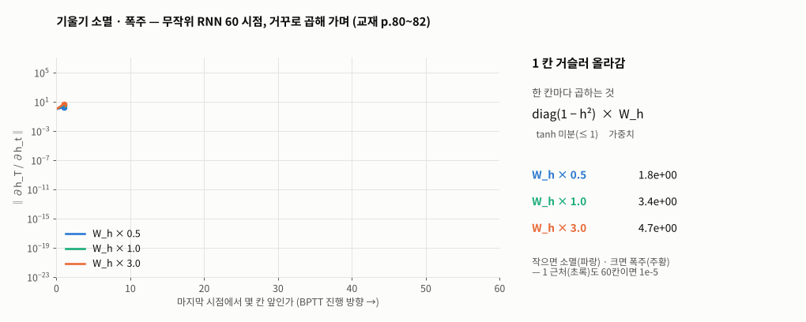
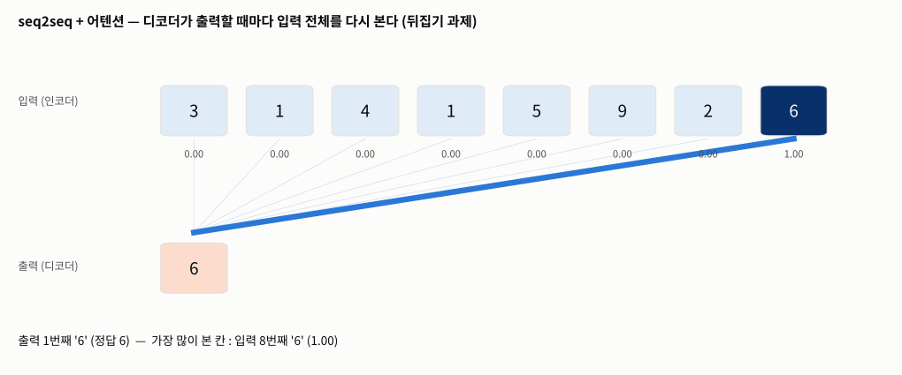
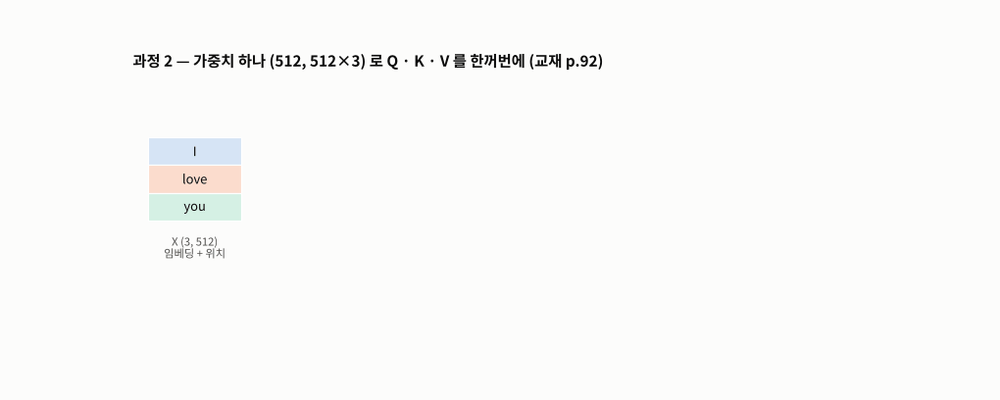
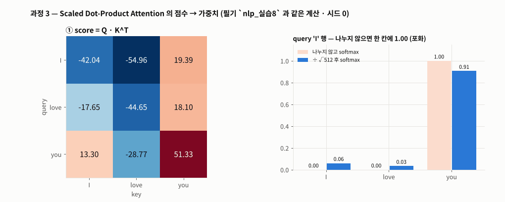
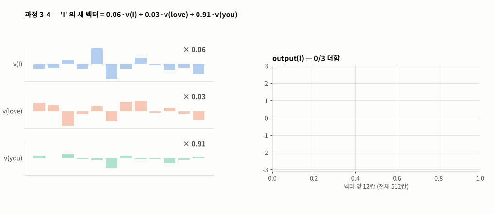

# Day 043 · 2026-11-09 (월)

`LLM (초거대언어모델)` · 11주차

> **한 줄 요약** — RNN 의 세 가지 한계를 직접 재 보고, 그 해결책인 self-attention 을 손으로 계산한 날. BPTT 는 한 칸 거슬러 갈 때마다 **tanh 미분 × $W_h$** 를 곱해서 $W_h$ 가 작으면 소멸(59칸 앞 1e-20), 크면 폭주(1e+5)한다. seq2seq 는 문장 전체를 **문맥 벡터 하나**에 담아 숫자 뒤집기 정확도가 길이 5 → 20 에서 0.98 → 0.47 로 무너지고, 디코더가 입력 전체를 다시 보는 어텐션을 붙이면 0.69 로 버틴다. self-attention 은 `softmax(Q·Kᵀ / √d_k)·V` — 내적이 √d 배로 커져 softmax 가 한 칸에 몰리지 않게 나누고, 행마다 합 1 인 가중치로 value 를 섞어 **같은 `love` 도 문맥에 따라 다른 벡터**가 된다. 필기 계산은 `F.scaled_dot_product_attention` 과 똑같았다.

📂 실습 노트북
- [`lecture/rnn_limits_seq2seq.ipynb`](./lecture/rnn_limits_seq2seq.ipynb) — 설치 · 실행 방법 · 기울기 소멸 / 폭주 실측 · 병렬 처리 · seq2seq 문맥 벡터 vs 어텐션 · 교재 분류 코드의 손실 짝 · Transformer 인코더 층 (교재 p.79~89)
- [`lecture/self_attention_scratch.ipynb`](./lecture/self_attention_scratch.ipynb) — 설치 · 실행 방법 · WordPiece · 임베딩 + 위치 · Q · K · V · score · scaling · softmax · output · 내장 함수 확인 · 위치 정보 · 문맥 반영 (필기 `nlp_실습8`, 교재 p.90~96)

📊 데이터 → 받을 파일 없음 (숫자 뒤집기 과제는 코드가 생성 · `I love you` 는 BERT WordPiece 사전으로 토큰화)
🖼️ 그림 → [`lecture/images/`](./lecture/images/) — 🎬 **시뮬레이션 애니메이션(GIF) 5개** (노트북과 같은 계산 · 같은 시드로 직접 만든 것)
📖 교재 → `자연어처리` 교재v1 **p.79~96** (BPTT 연쇄 법칙 · 기울기 소멸 · 장기 의존성 · 병렬 처리의 한계 · RNN 분류 모델 코드 · seq2seq · Transformer · self-attention · Q · K · V · Scaled Dot-Product Attention · 어텐션 출력)
📝 필기 → [`nlp_실습8.ipynb`](./lecture/nlp_실습8.ipynb)

⚙️ **설치 · 실행** — `pip install torch transformers` (Colab 은 기본 포함 / `transformers` 는 BERT 토크나이저 사전을 받는 데만 쓰므로 **인터넷 필요**) → 노트북 맨 위부터 **모두 실행** (`rnn_limits_seq2seq` 는 CPU 로 약 4~5분)

---

## 1. RNN 의 한계 — 기울기 소멸 · 폭주 (교재 p.80~83)

$$\frac{\partial h_k}{\partial h_{k-1}} = \mathrm{diag}(1-h_k^2)\,W_h \quad (\tanh' \le 1 \ \text{과}\ W_h \ \text{를 함께 곱한다})$$

| 59칸 거슬러 간 기울기 | W_h × 0.5 | × 1.0 | × 3.0 |
|---|---|---|---|
| ‖∂h_T / ∂h_t‖ | 9.2e-21 (소멸) | 1.7e-5 | **1.0e+5 (폭주)** |



🎬 무작위 RNN 60 시점에서 마지막 은닉 상태의 기울기를 한 칸씩 거꾸로 곱해 갔다(로그 눈금). $W_h$ 가 작으면 직선으로 떨어지고(소멸), 크면 계속 커진다(폭주). 1 근처(초록)도 60칸이면 1e-5 — 앞쪽 단어는 학습되기 어렵다(**장기 의존성 문제**).

- **병렬 처리** : RNN 은 $h_{t-1}$ 을 기다려야 $h_t$ 를 계산 → 길이 256 이면 256번 차례로. 어텐션은 행렬 곱 몇 번에 한꺼번에(계산량은 T² 로 더 많지만 기다리는 단계가 없다 — GPU 에서 유리). 여러 문장(배치)은 RNN 도 동시에 계산한다

---

## 2. seq2seq — 고정 크기 문맥 벡터의 병목 (교재 p.87)

```
인코더 GRU : 3 1 4 1 5 9 2 6 → 마지막 h (64칸) = 문맥 벡터  → 디코더 GRU : 6 2 9 5 1 4 1 3
+ 어텐션   : 디코더가 매 단계 score = enc_out · h → softmax → 인코더 모든 시점의 가중합을 함께 입력
```

| 숫자 뒤집기 정확도 | 길이 5 | 10 | 20 | 30 |
|---|---|---|---|---|
| 문맥 벡터 하나 | 0.982 | 0.832 | 0.468 | 0.324 |
| + 어텐션 | 0.999 | 0.908 | **0.688** | 0.394 |



🎬 길이 8 짜리 `3 1 4 1 5 9 2 6` 을 뒤집을 때(8개 모두 정답) 디코더가 출력할 때마다 입력의 어느 칸을 보는지(진할수록 가중치 큼). 출력 1번째는 입력 마지막 칸 `6` 을 보고, 그다음부터는 **방금 낸 숫자의 자리**를 보며 한 칸씩 앞으로 옮겨 간다 — 어느 칸을 볼지(뒤집기 규칙)를 스스로 배웠다. 끝에 노트북의 정확도 막대.

- 교재 p.87 그림의 디코더 입력 `<sos> je suis étudiant` 처럼 정답을 한 칸 밀어 넣는 것은 학습 때의 **교사 강요(teacher forcing)** — 실제 번역 때는 자기가 방금 낸 단어를 넣는다

---

## 3. Transformer (교재 p.88~89)

- **Attention Is All You Need** (Vaswani 외, 2017) — RNN 없이 어텐션만으로 인코더 · 디코더
- 인코더 층 = Multi-Head self-Attention → Feed Forward, 각각 **Add & Norm**(잔차 연결 + 층 정규화) / 디코더 층 = **Masked** self-Attention → 인코더 출력을 key · value 로 쓰는 Attention → Feed Forward

```python
layer = nn.TransformerEncoderLayer(d_model=512, nhead=8, dim_feedforward=2048, batch_first=True)
layer(torch.randn(1, 3, 512)).shape     # (1, 3, 512) — 모양 그대로 · 가중치 3,152,384개
```

---

## 4. self-attention 을 손으로 (교재 p.90~96 · 필기 `nlp_실습8`)

$$\mathrm{Attention}(Q, K, V) = \mathrm{softmax}\!\left(\frac{QK^{\top}}{\sqrt{d_k}}\right)V$$

```python
X = word_emb(ids) + pos_emb(torch.arange(3))                         # 'I love you' → (3, 512)
W = torch.randn(512, 512 * 3) / math.sqrt(512)                       # W_q | W_k | W_v
query, key, value = (X @ W).split(512, dim=1)                        # 각 (3, 512)
weight = F.softmax(query @ key.mT / math.sqrt(512), dim=-1)          # (3, 3), 행 합 1
output = weight @ value                                              # (3, 512) 문맥 반영 벡터
torch.allclose(output, F.scaled_dot_product_attention(query[None], key[None], value[None])[0])   # True
```



🎬 임베딩 X (3, 512) 에 가중치 하나 (512, 1536) 를 곱해 qkv (3, 1536) 를 만들고 512 칸씩 잘라 Q · K · V 를 얻는다 — 필기의 `[:, 0:512]` · `[:, 512:1024]` · `[:, 1024:]`.

| 내적 표준편차 | d = 4 | 64 | 512 |
|---|---|---|---|
| q · k | 2.0 | 7.9 | 22.7 (≈ √d) |
| ÷ √d 후 | 1.0 | 1.0 | 1.0 |



🎬 필기와 같은 계산(시드 0)의 score → ÷√512 → softmax. 오른쪽은 query `I` 행 — 나누지 않고 softmax 하면 한 칸에 1.00 이 몰려(포화) 기울기가 사라진다. 학습 전 무작위 가중치라 세 단어 모두 `you` 를 가장 많이 본다 — 교재 표처럼 자기 자신에 0.9 가 몰리는 것은 설명용 예시이고, 실제로는 학습으로 정해진다.



🎬 각 단어의 새 벡터 = attention weight 로 value 벡터(앞 12칸만 표시)를 섞은 것. `I` 는 0.06·v(I) + 0.03·v(love) + 0.91·v(you).

- 위치 정보 없이 단어 순서를 바꾸면 결과도 **줄만 바뀐다** — self-attention 계산에는 순서가 없어서 위치를 더한다
- `I love you` 와 `you love me` 의 `love` 는 입력 벡터가 같은데 self-attention 뒤 코사인 **0.609** — 같은 단어도 문맥에 따라 다른 벡터 (contextual embedding)

---

## 🔁 복습

**필기 · 교재에서 고친 부분**
- [x] `nlp_실습8` `F.softmax(scaled_attention_score)` → `UserWarning: Implicit dimension` · 2차원이라 우연히 맞았을 뿐 → **`dim=-1`** (key 방향, 행 합 1)
- [x] `nlp_실습8` 시드가 없어 실행마다 숫자가 다름 → `torch.manual_seed(0)`
- [x] `nlp_실습8` 주석 '반영 비율 × (각 단어의 **임베딩 행렬**)' → 곱하는 것은 **value 벡터** ($xW_v$)
- [x] `nlp_실습8` docstring 예시 번호 `[250, 12000, 700]` (사전 30000) → 실제 BERT WordPiece 사전(30,522)에서 `I love you` = `[1045, 2293, 2017]`
- [x] `nlp_실습8` 오타 `로분터` · `각중치` · `곱셉` · `이용행서` · `백터` → 로부터 · 가중치 · 곱셈 · 이용해서 · 벡터, 빈 셀 `##` 삭제
- [x] 교재 p.81 'tanh 미분값 ≤ 1 이라 곱할수록 0 으로 수렴' → 곱해지는 것은 **tanh′ × $W_h$** — $W_h$ 가 크면 **폭주**도 생긴다. 오타 `수련` → 수렴
- [x] 교재 p.83 '병렬 처리 불가' → **한 문장 안의 시점끼리** 병렬이 안 되는 것 (배치는 병렬)
- [x] 교재 p.85 코드는 출력에 `Sigmoid` → 손실은 `BCELoss` 와 짝 (`BCEWithLogitsLoss` 에 확률을 넣으면 틀린 값)
- [x] 교재 p.88 `Attention is all you need` → **Attention Is All You Need**
- [x] 교재 p.89 그림에 **Add & Norm** 이 빠짐 · `Feed Forwrad` → Forward
- [x] 교재 p.91 `position_embedding layer 가중치 행렬 (max_length, 512)`(학습형, BERT · GPT) 과 그림의 `0.84 · 0.54 · 0.91 · −0.42`(= sin · cos 고정값, 원 논문) 는 **다른 방식** · 원 논문 토큰화는 BPE(영-독) · word-piece(영-불) · 오타 `임배딩` → 임베딩
- [x] 교재 p.94~96 자기 자신에 0.9 가 몰리는 표는 **설명용 예시** — 실제 가중치는 학습으로 정해진다(학습 전엔 무작위). p.96 '[I 정보 × 90%]' 의 정보 = value 벡터
- [x] 교재 머리글 `SK네트웍스 Famiy` → Family
- 교재 p.94 scaling(÷ √key 차원) · p.92 (512, 512×3) 한 번에 만들기 · p.96 예시 계산(0.9×0.1 + 0.03×0.2 + 0.07×0.5 = 0.131)은 **맞다**

**직접 해본 것**
- $W_h$ 크기별 BPTT 기울기 실측(소멸 · 폭주), 선형 RNN 과 비교
- RNN 루프 vs 어텐션 한 번 시간 비교 — 이 CPU 에서는 RNN 이 빨랐다(계산량은 어텐션이 더 많음)
- GRU seq2seq 숫자 뒤집기를 길이 5~30 · 어텐션 유무로 8번 학습, 어텐션 가중치 그림
- BERT WordPiece 토큰화 · sin/cos 위치 인코딩 계산(교재 그림 값 재현)
- self-attention 손계산 = `F.scaled_dot_product_attention`, √d 스케일링 실험, 위치 정보 유무 · 같은 단어 다른 문맥 비교
- `FuncAnimation` 으로 기울기 흐름 · seq2seq 어텐션 · Q·K·V · score → softmax · 가중합 애니메이션

**막혔던 부분 / 질문**
- [ ] Multi-Head : 512 를 8개 head 가 64씩 나눠 계산하면 head 마다 다른 관계(문법 · 의미)를 볼까 — `nn.MultiheadAttention` 으로 확인
- [ ] 디코더의 **Masked** self-attention 은 score 행렬 위쪽 삼각형을 −∞ 로 — 직접 만들어 보기
- [ ] 학습된 BERT 의 실제 attention weight 는 교재 표처럼 생겼을까
- [ ] seq2seq 길이 30 은 학습을 더 하면 어텐션 쪽이 따라잡을까

📂 [수업 자료 폴더](./lecture/) · [복습 자료 폴더](./review/)

---

## 🔗 참고 링크

- [Attention Is All You Need (arXiv 1706.03762)](https://arxiv.org/abs/1706.03762)
- [PyTorch — `F.scaled_dot_product_attention`](https://pytorch.org/docs/stable/generated/torch.nn.functional.scaled_dot_product_attention.html) · [`nn.TransformerEncoderLayer`](https://pytorch.org/docs/stable/generated/torch.nn.TransformerEncoderLayer.html)
- [The Illustrated Transformer (Jay Alammar)](https://jalammar.github.io/illustrated-transformer/)
- [Hugging Face — WordPiece 토큰화](https://huggingface.co/learn/llm-course/chapter6/6)
