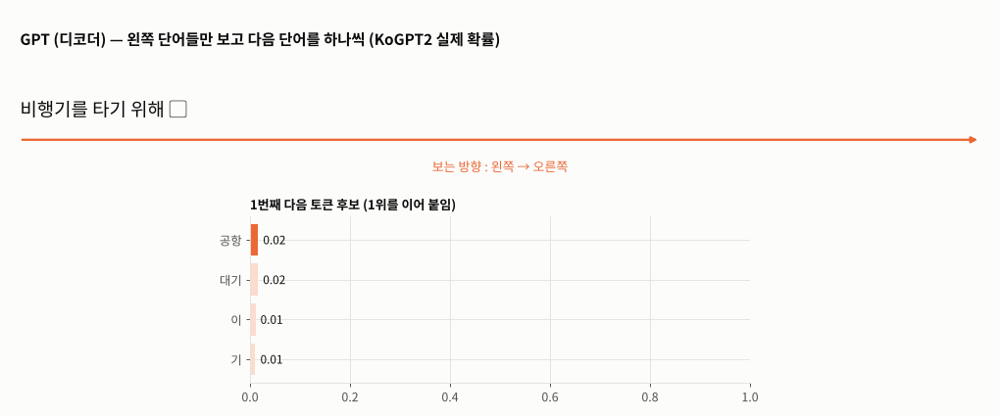
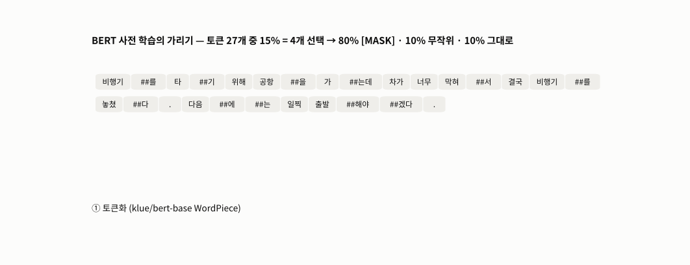
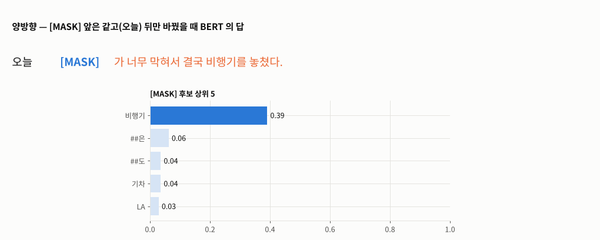
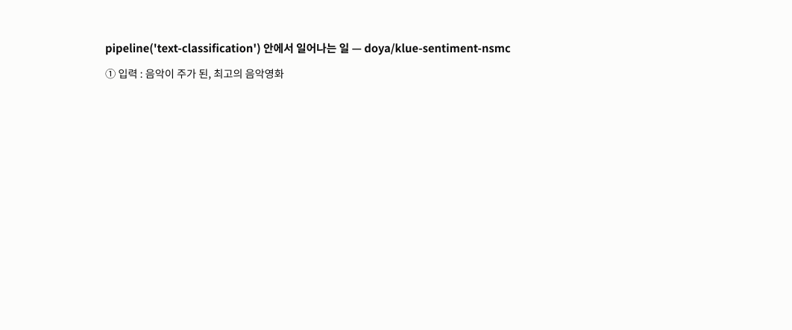
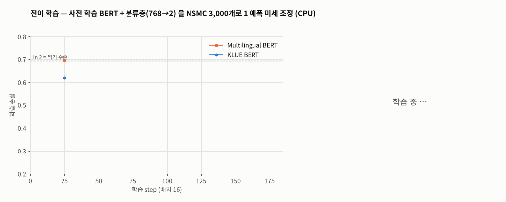

# Day 044 · 2026-11-10 (화)

`LLM (초거대언어모델)` · 11주차

> **한 줄 요약** — Transformer 의 디코더만 쓴 **GPT**(다음 단어 맞히기)와 인코더만 쓴 **BERT**(빈칸 맞히기 + 다음 문장 맞히기)를 직접 돌리고, 남이 사전 학습해 둔 BERT 를 가져와 **네이버 영화 리뷰로 미세 조정**한 날. klue BERT 는 `오늘 [MASK]가 너무 고파서` 의 빈칸을 **뒤 문맥**까지 보고 `배`(0.85)로 채운다. `pipeline()` 한 줄로 감성 분석 · 문장 생성을 해 보고, 영화 리뷰 모델을 **마켓컬리 갈비탕 리뷰 200개**에 돌리면 196개가 긍정 — 부정 4개는 모두 '대파 넣으면 더 맛있어요' 같은 제안을 잘못 본 것이다. CPU 로 리뷰 3,000개만 1 에폭 학습해도 KLUE BERT 는 **0.576 → 0.843**, 다국어 BERT 는 0.697 — 다국어 사전에는 `ㅋ · ㅠ · 밌` 이 없어 `ㅋㅋㅋ 재밌다 ㅠㅠ` 가 통째로 `[UNK]` 가 된다(리뷰의 29%).

📂 실습 노트북
- [`lecture/bert_mlm_nsp.ipynb`](./lecture/bert_mlm_nsp.ipynb) — 설치 · 실행 방법 · GPT vs BERT · 입력 형식 · 세 임베딩 · MLM · 양방향 · 15% 가리기 · NSP · 문맥 벡터 (교재 p.97~107 · BERT 논문)
- [`lecture/pipeline_inference.ipynb`](./lecture/pipeline_inference.ipynb) — 설치 · 실행 방법 · 영어 · 금융 · 영화 감성 분석 · 레이블 뜻 · 컬리 리뷰 · KoGPT2 문장 생성 (필기 `nlp_실습9`, 교재 p.109~111 · 114)
- [`lecture/nsmc_finetune_bert.ipynb`](./lecture/nsmc_finetune_bert.ipynb) — 설치 · 실행 방법 · 데이터 · 토크나이저 비교 · Dataset · `Trainer` 미세 조정 · 저장 · 추론 · 컬리 리뷰 (필기 `nlp_실습10_전이학습`, 교재 p.108 · 112~113)

📊 데이터 → [`lecture/data/kurly_reviews.csv`](./lecture/data/) (마켓컬리 `[사미헌] 갈비탕` 리뷰 200개) · 네이버 영화 리뷰 NSMC(학습 15만 · 평가 5만)는 [Day 039 폴더](../2026-11-03/lecture/)에 이미 있음 (노트북이 없으면 [e9t/nsmc](https://github.com/e9t/nsmc) 에서 자동으로 읽음)
🖼️ 그림 → [`lecture/images/`](./lecture/images/) — 🎬 **시뮬레이션 애니메이션(GIF) 5개** (노트북과 같은 모델 · 데이터로 직접 만든 것)
📖 교재 → `자연어처리` 교재v1 **p.97~114** (Transformer 실습 · GPT · BERT · MLM 동작 과정 1~5 · NSP · 사전 학습 / 전이 학습 / 추론 · Hugging Face · `pipeline()` · 텍스트 분류 실습 · 감성 분석 · 문장 생성) + BERT 논문(Devlin 외, 2018 · [arXiv 1810.04805](https://arxiv.org/abs/1810.04805))
📝 필기 → [`nlp_실습9.ipynb`](./lecture/nlp_실습9.ipynb) · [`nlp_실습10_전이학습.ipynb`](./lecture/nlp_실습10_전이학습.ipynb)

⚙️ **설치 · 실행** — `pip install transformers accelerate torch scikit-learn pandas` (Colab 은 기본 포함 / `Trainer` 는 `accelerate` 필수) → 모델은 첫 실행 때 Hugging Face 에서 자동 다운로드(**인터넷 필요**, 합쳐 약 3.5GB) → 노트북 맨 위부터 **모두 실행** (미세 조정은 GPU 면 전체 데이터 · CPU 면 일부만 자동 선택)

---

## 1. GPT 와 BERT (교재 p.98~107)

| | GPT | BERT |
|---|---|---|
| Transformer | 디코더만 | 인코더만 |
| 사전 학습 | 다음 단어 맞히기 | `[MASK]` 맞히기(MLM) + 다음 문장 맞히기(NSP) |
| 보는 방향 | 왼쪽 → 오른쪽 | 양방향 |
| 크기 | GPT-1 117M · GPT-2 1.5B | base 110M · large 340M (논문) |



🎬 위 : KoGPT2 가 `비행기를 타기 위해` 뒤에 올 토큰 후보를 확률로 내고 1위를 이어 붙인다(왼쪽만 본다). 아래 : klue BERT 가 교재 예문의 `[MASK]` 를 앞뒤 문맥으로 채운다 — 1위 `길이` 0.61 · 2위 `차가` 0.30.

```python
enc = tokenizer('my dog is cute', 'he likes playing')
# ['[CLS]', 'my', 'dog', 'is', 'cute', '[SEP]', 'he', 'likes', 'playing', '[SEP]']
# token_type_ids [0,0,0,0,0,0,1,1,1,1]  ← Segment 임베딩
# 임베딩 = LayerNorm(Token + Segment + Position)   — (32000,768) · (2,768) · (512,768)
```



🎬 사전 학습 때의 가리기 — 토큰의 15% 를 고르고(노랑) 그중 80% 는 `[MASK]`, 10% 는 무작위 단어, 10% 는 그대로 둔다. `DataCollatorForLanguageModeling` 으로 2,000문장을 가려 세 보니 14.9% · 80.5 / 9.6 / 9.9%.



🎬 `[MASK]` 앞은 모두 `오늘` 인데 뒤 문맥만 바꾸면 답이 바뀐다 — 막혀서 → `비행기`(뒤의 '비행기를 놓쳤다' 에 끌림), 아파서 → `아침` · `하루` · `머리`, 고파서 → `배` 0.85.

- **NSP** : `[CLS]` 벡터로 이어지는 문장인지 판단 — `my dog is cute. / he likes playing in the park.` IsNext 1.000, `/ the stock market fell sharply today.` NotNext 0.997
- **문맥 벡터** : 같은 '배' 도 '타는 배' 끼리 0.83, '먹는 배' 끼리 0.69, 뜻이 다른 쌍 0.46~0.66

---

## 2. 추론 — `pipeline()` (교재 p.109~111 · 114 · 필기 `nlp_실습9`)

```python
kor_classifier = pipeline('text-classification', model='doya/klue-sentiment-nsmc')
kor_classifier(['음악이 주가 된, 최고의 음악영화'])     # [{'label': 'LABEL_1', 'score': 0.993}]  ← 1 = 긍정
kor_classifier(reviews, truncation=True, max_length=512, batch_size=16)   # 긴 리뷰는 잘라서
```

| 모델 | 결과 |
|---|---|
| SST-2 (영어) | `awesome` POSITIVE 0.9999 · `awful` NEGATIVE 0.9997 |
| FinBERT (영어 금융) | `Stocks rallied …` positive 0.898 · `fell … weakened` negative 0.969 |
| KR-FinBert-SC | `코스피 사상 첫 6,600선` **neutral** 0.909 — '사상 최고치' · '큰 폭 상승' 으로 써도 neutral |
| klue-sentiment-nsmc → 컬리 리뷰 200개 | 긍정 196 · 부정 4 (4개 모두 먹는 방법 · 제안을 잘못 본 것) |
| KoGPT2 생성 | `근육이 커지기 위해서는 무엇보다 규칙적인 생활습관이 중요하다. …` (사실 확인 안 된 문장) |



🎬 `pipeline('text-classification')` 한 줄 안에서 ① 입력 → ② 토큰화 · 번호 → ③ BERT `[CLS]` 벡터 → 분류층 logit → ④ softmax → `{'label', 'score'}`. 마지막 예(`갈비탕 끓여서 먹기 전에 대파 썰어넣으면 더 맛있어요.`)는 logit 이 −0.12 · −0.29 로 비슷해 부정 0.541 로 잘못 나온다.

---

## 3. 전이 학습 — NSMC 로 BERT 미세 조정 (교재 p.108 · 112~113 · 필기 `nlp_실습10_전이학습`)

```python
model = BertForSequenceClassification.from_pretrained('klue/bert-base', num_labels=2,
                                                      id2label={0: 'negative', 1: 'positive'}, label2id=…)
args = TrainingArguments(output_dir='out_klue', num_train_epochs=1, per_device_train_batch_size=16,
                         learning_rate=5e-5, weight_decay=0.01, warmup_steps=0.1, eval_strategy='epoch',
                         save_strategy='no', report_to='none')
trainer = Trainer(model=model, args=args, train_dataset=train_ds, eval_dataset=val_ds,
                  processing_class=tokenizer, compute_metrics=compute_metrics)
trainer.train(); trainer.evaluate(test_ds); trainer.save_model('kor_finetuned_model')
```

| 항목 | Multilingual BERT | KLUE BERT |
|---|---|---|
| 사전 크기 | 119,547 | 32,000 |
| 예문 토큰 수 | 35 (`시 ##간`) | 32 (`시간`) |
| NSMC 90% 분위수 / 평균 토큰 | 51 / 24.1 | 43 / 20.4 |
| [UNK] 가 있는 리뷰 | **29.2%** (`ㅋㅋㅋ 재밌다 ㅠㅠ` → `[UNK] [UNK] [UNK]`) | 5.1% |
| 평가 정확도 — 원본 (GPU · 학습 12만) | 0.848 | **0.898** |
| 평가 정확도 — 이번 (CPU · 학습 3,000 · 평가 2,000) | 0.697 | **0.843** (미세 조정 전 0.576) |



🎬 3,000개 · 1 에폭(188 step) 동안의 학습 손실. KLUE 는 50 step 만에 0.48 로 떨어지고, 다국어는 ln 2(0.693, 찍기) 근처에서 천천히 내려간다. 오른쪽 : 미세 조정 전 0.576 → 다국어 0.697 · KLUE 0.843.

- 저장한 모델을 불러와도 정확도 0.843 그대로, 레이블이 `negative` · `positive` 로 나온다
- 같은 컬리 리뷰 200개에 직접 학습한 모델과 공개 모델을 돌리면 **98.0%** 같은 판단

---

## 🔁 복습

**필기 · 교재 · 논문 대조에서 고친 부분**
- [x] `nlp_실습9` `pipeline(task='text-classification')` 모델 미지정 → '**No model was supplied**' 경고 · 버전마다 기본 모델이 바뀔 수 있음 → 모델 이름 명시 (`distilbert/distilbert-base-uncased-finetuned-sst-2-english`)
- [x] `nlp_실습9` 결과 `LABEL_0` · `LABEL_1` 의 뜻이 없음 → NSMC 규칙 **0 = 부정 · 1 = 긍정**, 직접 학습할 때는 `id2label` 지정
- [x] `nlp_실습9` · `nlp_실습10` 쓰지 않는 `drive.mount` · 드라이브 고정 경로 → 노트북 폴더 / 원 저장소에서 읽기
- [x] `nlp_실습10` 빈 셀 `# 무료 gpu 설정` → 메뉴 방법 안내 + GPU 유무에 따라 데이터 크기 자동 선택
- [x] `nlp_실습10` `tokenize()` 는 `[CLS]` · `[SEP]` 를 안 세므로 90% 분위수(50 · 42)를 그대로 `max_length` 로 쓰면 내용이 2 토큰 덜 들어감 → **분위수 + 2**
- [x] `nlp_실습10` `learning_rate=0.0001` → BERT 논문 미세 조정 권장값 **5e-5 · 3e-5 · 2e-5**(부록 A.3) 중 5e-5 + 워밍업 10%
- [x] `nlp_실습10` 1 에폭인데 `load_best_model_at_end` · `save_strategy='epoch'` → 다시 불러오며 '**missing keys … LayerNorm**' 경고가 났음 → `save_strategy='no'` 로 학습 끝난 모델을 그대로 쓰고 `save_model()` 로 저장
- [x] `nlp_실습10` KLUE 데이터셋 출력 문구가 '**BERT 다국어 모델** 학습용 데이터' (복사 흔적) · 객체 주소만 출력 · 15만 개 리스트 전체 출력 → 개수 · 키 · 통계만
- [x] `nlp_실습10` `padding=True` → `padding='max_length'` (뜻을 분명히) · `clone().detach()` 불필요 · 오타 `임폴트` · `토크의 수` · `np.percentilte` · `저`(저장)
- [x] 로컬 실행 시 `Trainer` 가 **`accelerate` 없으면 ImportError** → 설치 안내 추가
- [x] KoGPT2 를 `pipeline('text-generation', model='skt/kogpt2-base-v2')` 로만 부르면 글자가 깨짐 → `PreTrainedTokenizerFast` 에 `bos_token='</s>'` 등 지정
- [x] 긴 컬리 리뷰 → `truncation=True, max_length=512`
- [x] 교재 p.99 BERT-large '3억4천5백만' → 논문 표기 **340M**
- [x] 교재 p.101 토큰 번호 `CLS 2 · SEP 3 · MASK 4` 는 klue BERT 사전 기준(영어 BERT 는 101 · 102 · 103) · 세 임베딩의 합 뒤 **LayerNorm** 이 빠짐
- [x] 교재 p.101 'Masking' → 실제 규칙은 **15% 선택 → 80% [MASK] · 10% 무작위 · 10% 그대로**(논문 3.1)
- [x] 교재 머리글 `SK네트웍스 Famiy` → Family
- 교재 p.98 GPT-1 117M · GPT-2 1,542M, p.99 33억 단어(BooksCorpus 8억 + 위키 25억), p.106 NSP 50 : 50, p.112 NSMC 15만 / 5만 은 **맞다**

**직접 해본 것**
- klue BERT 로 교재 MLM 예문 · 양방향 빈칸 · 15% 가리기 통계, 영어 BERT 로 NSP, 같은 단어 '배' 의 문맥 벡터 비교
- `pipeline` 으로 영어 · 금융 · 영화 감성 분석, 레이블 순서 비교, 컬리 리뷰 200개 분류 · 오분류 읽기, KoGPT2 greedy · sampling 생성
- NSMC 토큰화 비교([UNK] 비율), 미세 조정 전 · 후 정확도, 다국어 vs KLUE, 저장 → 불러오기 → `pipeline` 추론, 두 모델 일치율
- `FuncAnimation` 으로 GPT vs BERT · MLM 가리기 · 양방향 빈칸 · 미세 조정 곡선 · pipeline 내부 애니메이션

**막혔던 부분 / 질문**
- [ ] 컬리 리뷰처럼 **분야가 다른** 데이터에 맞추려면 — 리뷰 몇 개에 레이블을 달아야 미세 조정 효과가 날까
- [ ] KR-FinBert 가 지수 상승 기사를 neutral 로 보는 기준은 — 학습 데이터(레이블 정의)를 모델 카드에서 확인하기
- [ ] 다국어 BERT 의 [UNK] 를 줄이려면 사전에 자음 · 모음 토큰을 추가(`add_tokens`)하면 될까
- [ ] 다음 : SentenceTransformer 로 문장 임베딩 · 문장 유사도 · 챗봇 (교재 p.115~)

📂 [수업 자료 폴더](./lecture/) · [복습 자료 폴더](./review/)

---

## 🔗 참고 링크

- [BERT 논문 (arXiv 1810.04805)](https://arxiv.org/abs/1810.04805) · [KLUE 벤치마크 (arXiv 2105.09680)](https://arxiv.org/abs/2105.09680)
- [Hugging Face — Pipelines](https://huggingface.co/docs/transformers/main_classes/pipelines) · [Trainer](https://huggingface.co/docs/transformers/main_classes/trainer)
- 모델 카드 : [klue/bert-base](https://huggingface.co/klue/bert-base) · [doya/klue-sentiment-nsmc](https://huggingface.co/doya/klue-sentiment-nsmc) · [snunlp/KR-FinBert-SC](https://huggingface.co/snunlp/KR-FinBert-SC) · [ProsusAI/finbert](https://huggingface.co/ProsusAI/finbert) · [skt/kogpt2-base-v2](https://huggingface.co/skt/kogpt2-base-v2)
- [NSMC (e9t/nsmc)](https://github.com/e9t/nsmc)
