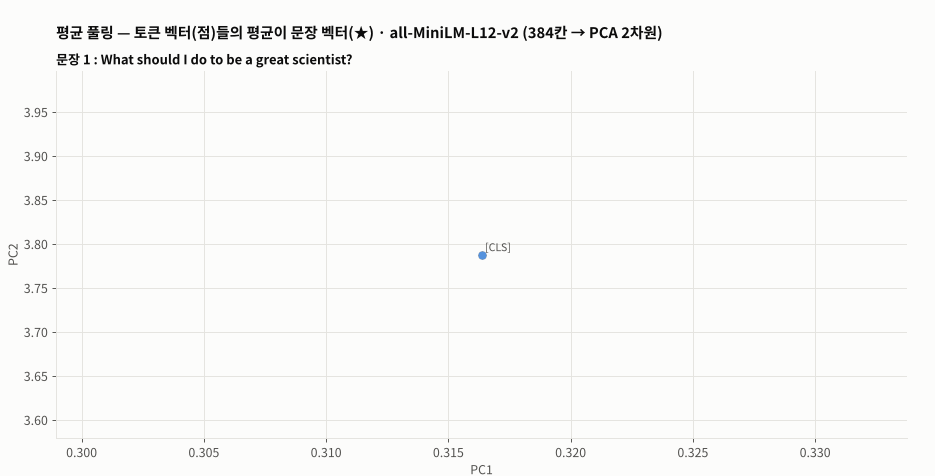
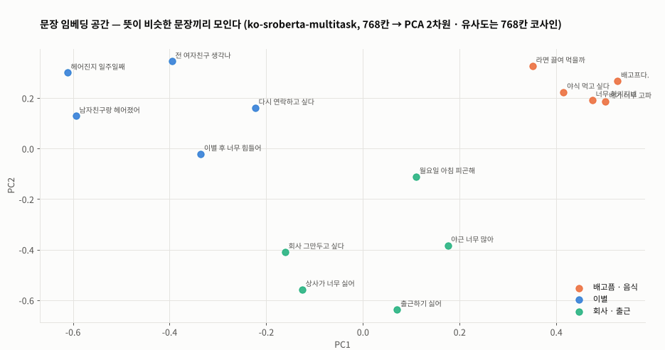
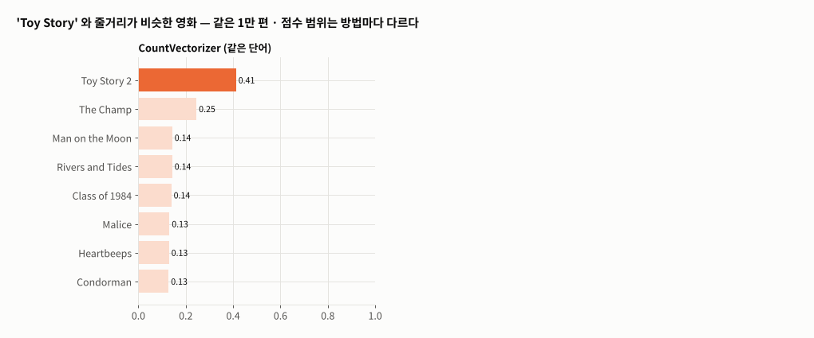
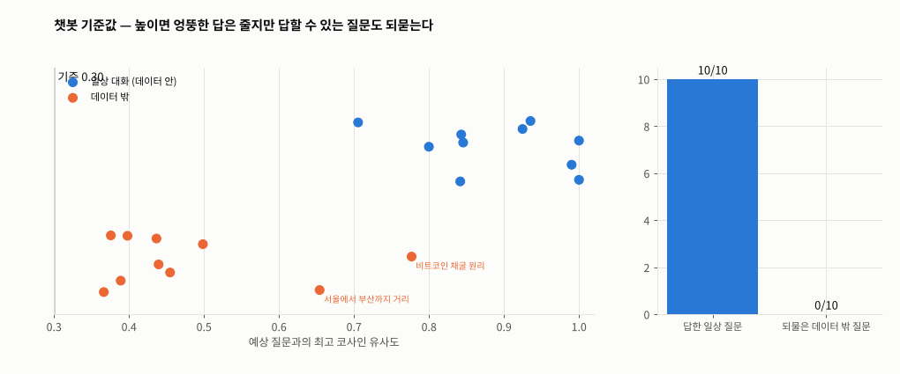

# Day 045 · 2026-11-11 (수)

`LLM (초거대언어모델)` · 11주차

> **한 줄 요약** — 문장 하나를 벡터 하나로 만드는 **SentenceTransformer** 로 문장 유사도 · 영화 추천 · 챗봇을 만든 날. 문장 벡터는 토큰 벡터들의 **평균**(패딩 제외)이고, 손으로 계산한 평균이 `encode()` 결과와 정확히 같았다. 다만 그냥 BERT 의 평균은 무관한 문장도 0.47 로 가깝게 보고, **문장 쌍으로 추가 학습한** 모델이어야 같은 뜻 0.96 · 무관 −0.06 으로 갈린다. 영화 줄거리를 문장 벡터로 바꾸면 `Toy Story` → `Toy Story 2` 가 0.41 → 0.79 로 뚜렷해지고, 제목 없이 '장난감들이 살아 움직이는 이야기' 로도 찾는다. 챗봇은 예상 질문 11,823개 중 가장 비슷한 질문의 답을 고른다 — 데이터 밖 질문(파이썬 · 양자역학)에도 엉뚱한 답을 내던 것을 **유사도 기준 0.5 미만이면 되묻게** 고쳤다(그래도 '비트코인 채굴' 0.78 은 통과).

📂 실습 노트북
- [`lecture/sentence_similarity_sbert.ipynb`](./lecture/sentence_similarity_sbert.ipynb) — 설치 · 실행 방법 · 영어 · 평균 풀링 손계산 · 한국어 두 모델 · 4개 언어 · 점수 범위 · 문장 학습 안 한 BERT (필기 `nlp_실습11`, 교재 p.115~117)
- [`lecture/movie_recommendation_sbert.ipynb`](./lecture/movie_recommendation_sbert.ipynb) — CountVectorizer vs SentenceTransformer 영화 추천 · 줄거리로 검색 (필기 `nlp_실습6_영화추천서비스`, 교재 p.117)
- [`lecture/chatbot_similarity.ipynb`](./lecture/chatbot_similarity.ipynb) — 설치 · 실행 방법 · 데이터 · 배치 임베딩 · 유사도 · 챗봇 함수 · 기준값 (필기 `nlp_실습12`, 교재 p.119~120)

📊 데이터 → [`lecture/data/ChatBotData.csv`](./lecture/data/) (Q · A · label 11,823줄 · [songys/Chatbot_data](https://github.com/songys/Chatbot_data) MIT) · 영화 줄거리는 [Day 041 `data/movies_overview.csv.gz`](../2026-11-05/lecture/data/)
🖼️ 그림 → [`lecture/images/`](./lecture/images/) — 🎬 **시뮬레이션 애니메이션(GIF) 5개** (노트북과 같은 모델 · 데이터로 직접 만든 것)
📖 교재 → `자연어처리` 교재v1 **p.115~120** (SentenceTransformer · 문장 임베딩 만드는 법 · 용도 · 문장 유사도 측정 실습 · 문장 유사도를 이용한 추천시스템 · ChatBot 실습) — 교재 마지막 장
📝 필기 → [`nlp_실습11.ipynb`](./lecture/nlp_실습11.ipynb) · [`nlp_실습12.ipynb`](./lecture/nlp_실습12.ipynb) · [`nlp_실습6_영화추천서비스.ipynb`](./lecture/nlp_실습6_영화추천서비스.ipynb)

⚙️ **설치 · 실행** — `pip install sentence-transformers scikit-learn pandas` (Colab 은 기본 포함) → 모델은 첫 실행 때 Hugging Face 에서 자동 다운로드(**인터넷 필요**, e5 1.1GB 포함 약 3GB) → 노트북 맨 위부터 **모두 실행** (CPU 로 챗봇 임베딩 약 2분 · 영화 1만 편 약 3~4분)

---

## 1. 문장 임베딩 — 토큰 벡터의 평균 (교재 p.115~117)

```python
model = SentenceTransformer('sentence-transformers/all-MiniLM-L12-v2')   # Transformer → Pooling(mean) → Normalize
emb = model.encode(sentences)                # (문장 수, 384)
model.similarity(emb, emb)                   # 코사인 유사도 행렬
```



🎬 세 영어 문장의 토큰 벡터(점)를 PCA 2차원에 찍고 평균(★)을 냈다. 과학자 두 문장의 ★ 은 서로 가깝고(0.90) 항공권 문장은 멀다(0.07). 손으로 계산한 '패딩 뺀 평균 → 정규화' 가 `encode()` 와 같다.

| 문장 쌍 | 같은 뜻 | 무관 |
|---|---|---|
| 다국어 MiniLM (한국어 퇴사 질문) | 0.918 | −0.140 |
| 한국어 KLUE-RoBERTa (NLI · STS 학습) | **0.961** | −0.061 |
| klue/bert-base 평균 (문장 학습 X) | 0.905 | **0.47** |
| e5-large-instruct (4개 언어) | 0.926~0.957 | 0.69~0.75 |

- 문장 쌍으로 '같은 뜻이면 가깝게' 학습한 모델이어야 무관한 문장이 멀어진다
- e5 는 점수가 0.7~1.0 에 몰린다 → **다른 모델끼리 점수를 비교하지 말고**, 한 모델 안에서 순위로 본다



🎬 배고픔 · 이별 · 출근 문장 15개를 ko-sroberta 로 임베딩해 2차원에 그렸다. 주제끼리 모이고, 새 질문(✖)을 넣으면 같은 주제의 문장이 가장 가깝다(`출근하기 싫어요` → `출근하기 싫어` 0.97).

---

## 2. 문장 유사도로 영화 추천 (교재 p.117 · 필기 `nlp_실습6_영화추천서비스`)

```python
X_st = st_model.encode(overviews, batch_size=64, normalize_embeddings=True)   # (10000, 384)
sims = X_st @ X_st[i]                                                          # 길이 1 → 내적 = 코사인
```



🎬 같은 1만 편에서 `Toy Story` 와 비슷한 영화. CountVectorizer 는 `Toy Story 2`(0.41) 다음부터 단어만 겹치는 영화, 문장 임베딩은 `Toy Story 2`(0.79) 가 확실히 앞서고 `Elf` · `Pinocchio` 같은 가족 · 판타지 영화가 뒤따른다.

| | CountVectorizer | SentenceTransformer |
|---|---|---|
| GoldenEye 상위 10 | 007 시리즈 | 007 시리즈 (6편 겹침) |
| Jumanji 상위 10 | `Word Wars` · `Dungeons & Dragons` (game 단어) | `Peter Pan` · `Labyrinth` (0편 겹침) |
| `A group of toys come to life …` 검색 | 관계없는 영화 | `Dolls` · `Toy Story` · `Pinocchio` · `Toy Story 2` |
| 계산 | 1초 · 희소 | 약 200초(CPU) · 밀집 384칸 · 128 토큰까지만 읽음 |

---

## 3. 검색형 챗봇 (교재 p.119~120 · 필기 `nlp_실습12`)

```python
q_emb = model.encode(df['Q'].tolist(), batch_size=64, normalize_embeddings=True)   # (11823, 768) — 한 번에
u = model.encode([question], normalize_embeddings=True)[0]
sims = q_emb @ u                                    # 11,823개 유사도를 행렬 곱 한 번에
answer = df.A[sims.argmax()] if sims.max() >= 0.5 else '잘 모르겠어요. 다르게 말해 주실래요?'
```


🎬 사용자 질문 → 비슷한 예상 질문 상위 5(막대) → 1위 질문의 답. `배가 고파요` → `배가 너무 고파`(0.934) → `뭐 좀 챙겨드세요.`, `헤어진 지 일주일 됐어` → `헤어진지 일주일째`(0.915). `파이썬 리스트 정렬하는 법 알려줘` 는 최고 0.49 라 되묻는다.



🎬 일상 질문 10개(파랑)와 데이터 밖 질문 10개(주황)의 최고 유사도에 기준선을 움직였다. 0.5 면 일상 10/10 답하고 데이터 밖 8/10 되묻는다 — `비트코인 채굴 원리`(0.78) · `서울에서 부산까지 거리`(0.65) 는 비슷한 단어의 일상 질문에 걸려 통과한다. 기준을 높이면 엉뚱한 답은 줄지만 답할 수 있는 질문도 되묻는다.

---

## 🔁 복습

**필기 · 교재에서 고친 부분**
- [x] `nlp_실습12` 예상 질문을 `for` 로 **한 문장씩 11,823번** `encode` → `encode(리스트, batch_size=64)` 한 번 + `.npy` 저장
- [x] `nlp_실습12` 유사도를 `for` 로 11,823번 계산 · 리스트 전체 `print` · 질문 1만 개 `print` → 정규화 벡터 **행렬 곱 한 번**, 상위 5개만
- [x] `nlp_실습12` `chatbot()` 이 부를 때마다 전역 표 `df1` 에 `similarity` 칸을 덮어씀(부작용) → 지역 변수
- [x] `nlp_실습12` 데이터 밖 질문에도 무조건 1위 답 → **유사도 기준 미만이면 되묻기**
- [x] `nlp_실습12` `label` 을 '불필요한 컬럼' 으로 삭제 → 0 일상 · 1 이별 · 2 사랑 주제라 남김 · 같은 질문 161줄에 답이 여러 개인데 `idxmax()` 는 늘 첫 답 → 동점 중 무작위
- [x] `nlp_실습11` 같은 첫 문장을 두 번 임베딩(두 리스트) → 세 문장 한 번에
- [x] `nlp_실습11` e5 결과의 자기 자신 유사도 `0.9995` · `float16` → 가중치 파일이 반정밀도라 생긴 반올림 오차, `torch_dtype=torch.float32` 로 불러오면 1.000
- [x] `nlp_실습6_영화추천서비스` `.toarray()` · 1만 × 1만 표 → 희소 행렬 · 한 편 × 전체 (자세한 수정은 Day 041) — `[0:10000]` 은 이번 수정본에서 맞게 바뀜
- [x] 오타 `백터` · `임배딩` · `호츨` · `simialrity_list` → 벡터 · 임베딩 · 호출 · similarity_list
- [x] 교재 p.115 'BERT 의 모든 출력 벡터 평균' → **패딩 칸은 빼고** 평균, 그리고 문장 쌍으로 **추가 학습한** 모델이어야 문장 유사도가 맞다 (그냥 BERT 평균은 무관 0.47)
- [x] 교재 머리글 `SK네트웍스 Famiy` → Family
- 원본 결과(영어 0.8955 · 한국어 0.9178 / 0.9606 · `배가 고파요` → `뭐 좀 챙겨드세요.` · `여행가고 싶다` → `계획을 세워보세요.`)는 **같게 재현**

**직접 해본 것**
- 평균 풀링 손계산 = `encode()`, 4개 모델 점수 범위 비교, 문장 학습 여부에 따른 유사도 차이
- 영화 1만 편 CountVectorizer vs 문장 임베딩 추천 · 상위 10편 겹침 · 줄거리 문장으로 검색
- 챗봇 데이터 label · 중복 질문 확인, 배치 임베딩 · 행렬 곱 검색 · 상위 5 · 기준값으로 되묻기 · 데이터 안 / 밖 질문 점수 분포
- `FuncAnimation` 으로 평균 풀링 · 임베딩 공간 · 영화 추천 비교 · 챗봇 검색 · 기준값 애니메이션

**막혔던 부분 / 질문**
- [ ] 같은 질문에 답이 여러 개(label 1 이별 · 2 사랑이 섞임)일 때 대화 맥락으로 고를 수 있을까
- [ ] 챗봇 예상 질문이 수백만 개가 되면 행렬 곱도 느려진다 — 벡터 DB(FAISS 등)의 근사 검색
- [ ] 검색한 답을 LLM 에 넘겨 자연스럽게 다시 쓰게 하면(RAG) 데이터 밖 질문은 어떻게 처리할까
- [ ] 한국어 영화 줄거리(또는 컬리 리뷰)로 추천 · 검색을 만들면 ko-sroberta 가 얼마나 잘할까

📂 [수업 자료 폴더](./lecture/) · [복습 자료 폴더](./review/)

---

## 🔗 참고 링크

- [Sentence-Transformers 문서](https://www.sbert.net/) · [Sentence-BERT 논문 (arXiv 1908.10084)](https://arxiv.org/abs/1908.10084)
- 모델 카드 : [all-MiniLM-L12-v2](https://huggingface.co/sentence-transformers/all-MiniLM-L12-v2) · [paraphrase-multilingual-MiniLM-L12-v2](https://huggingface.co/sentence-transformers/paraphrase-multilingual-MiniLM-L12-v2) · [ddobokki/klue-roberta-base-nli-sts](https://huggingface.co/ddobokki/klue-roberta-base-nli-sts) · [jhgan/ko-sroberta-multitask](https://huggingface.co/jhgan/ko-sroberta-multitask) · [intfloat/multilingual-e5-large-instruct](https://huggingface.co/intfloat/multilingual-e5-large-instruct)
- [songys/Chatbot_data](https://github.com/songys/Chatbot_data)
