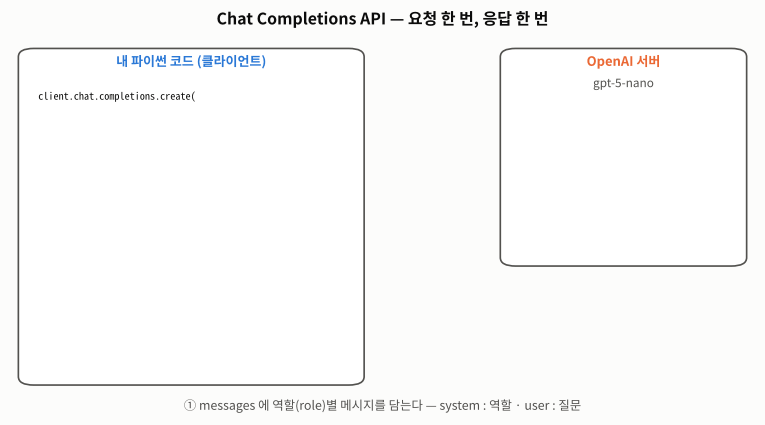
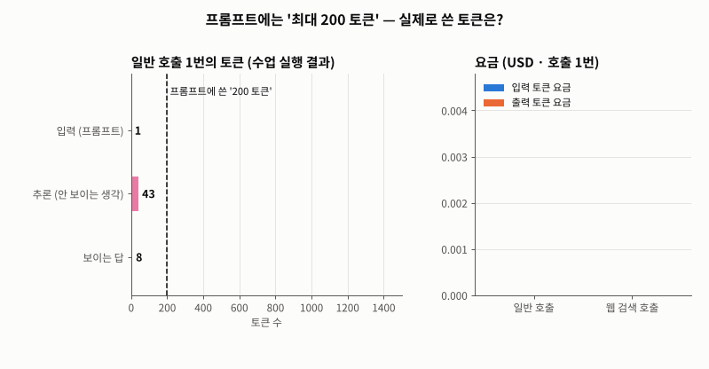
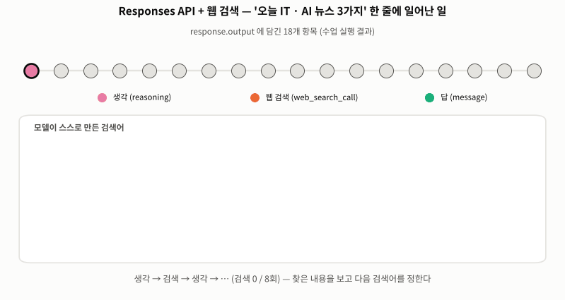
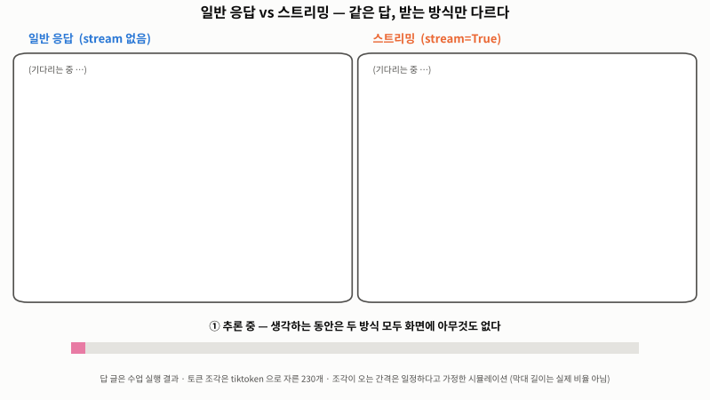
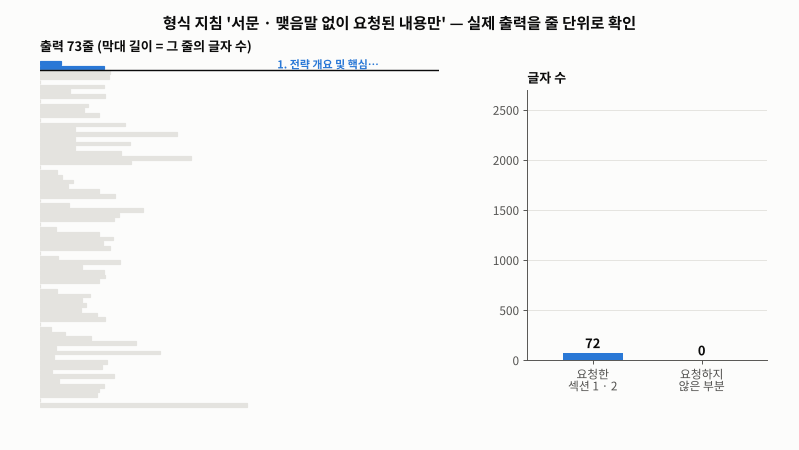

# Day 046 · 2026-11-12 (목)

`LLM (초거대언어모델)` · 11주차

> **한 줄 요약** — ChatGPT 화면이 아니라 **API** 로 모델을 부른 첫날. `messages` 에 **system · user** 역할을 담아 보내면 응답 **객체**가 오고, 글은 `response.choices[0].message.content` 에 있다. 프롬프트에 "최대 200 토큰" 이라고 썼지만 실제 사용량은 입력 **43** · 출력 **1,519**(그중 84% 가 안 보이는 **추론** 1,280) — 길이는 부탁이 아니라 매개변수로 건다. **Responses API** 에 웹 검색을 붙이니 한 줄 질문에 모델이 **8번 검색**했고 입력이 40,764 토큰(948배)으로 불었다. 출력 형식은 **JSON 모드**와 **형식 지침 + 예시**로 정하는데, "맺음말 없이" 라고 해도 실제 출력의 **26%** 가 요청하지 않은 내용이었다 → 형식은 코드로 세어 확인한다. 내 필기의 오류(`inputs` · `message` · `promt` · `get-5-nano` · 변수에 안 담은 스트림)는 전부 재현해서 고쳤다.

📂 실습 노트북
- [`lecture/openai_api_basics.ipynb`](./lecture/openai_api_basics.ipynb) — 준비(.env) · dict ↔ JSON · 토큰 세기 · Chat Completions · 사용량 · 요금 · Responses 웹 검색 · 스트리밍 (필기 `openai_api_실습`, 교재 p.2~11)
- [`lecture/prompt_output_format.ipynb`](./lecture/prompt_output_format.ipynb) — 작성 원칙 · JSON 모드 · 형식 지침 + 예시 · 형식 준수 확인 · 필기 오류 재현 (필기 `프롬프트_작성_방법` · `프롬프트_작성_방법2_01`, 교재 p.12~14)
- [`lecture/review_sentiment_analysis.ipynb`](./lecture/review_sentiment_analysis.ipynb) — 단어 세기 기준선 · JSON 정답 예시 · 판단 근거 키워드 · 결과 검사 함수 (필기 `고객_리뷰_감성_분석_API`, 교재 p.15~17)

🖼️ 그림 → [`lecture/images/`](./lecture/images/) — 🎬 **시뮬레이션 애니메이션(GIF) 5개** (숫자와 글은 수업 실행 결과에서 가져온 것)
📖 교재 → `AI Agent` 교재10 **p.2~17** (22. 생성형 AI의 언어 모델(LLM) — API · JSON · OpenAI API 사용법 · 토큰 · API 키 관리 · 프롬프트 엔지니어링 · 고객 리뷰 감성 분석) — 다음은 p.18 `23. LangChain`
📝 필기 → [`openai_api_실습.ipynb`](./lecture/openai_api_실습.ipynb) · [`프롬프트_작성_방법.ipynb`](./lecture/프롬프트_작성_방법.ipynb) · [`프롬프트_작성_방법2_01.ipynb`](./lecture/프롬프트_작성_방법2_01.ipynb) · [`고객_리뷰_감성_분석_API.ipynb`](./lecture/고객_리뷰_감성_분석_API.ipynb) · 강의 코드 [`openai_api_강의본.ipynb`](./lecture/openai_api_강의본.ipynb) · [`프롬프트_작성_방법2_강의본.ipynb`](./lecture/프롬프트_작성_방법2_강의본.ipynb)

⚙️ **설치 · 실행** — `pip install openai python-dotenv tiktoken pandas` → 노트북 폴더에 `.env` (`OPENAI_API_KEY="sk-…"`, **GitHub 에 올리지 않는다**) → 맨 위부터 모두 실행 (인터넷 · 요금 필요, 전부 돌려도 몇 센트)

> **출력 표시** — 정리 노트북은 API 키가 없는 환경에서 만들었다. `# 📼` 셀의 출력은 **수업 시간 실행 결과**를 옮긴 것, `# ⏳` 셀(9개)은 **출력이 비어 있어 직접 실행**해야 한다. 감성 분석 노트북은 필기가 오류에서 멈춰 모델 응답이 없다.

---

## 1. API · JSON · 토큰 (교재 p.3~10)

```python
load_dotenv(find_dotenv(usecwd=True))        # .env → 환경 변수 OPENAI_API_KEY (키 값은 print 하지 않는다)
client = OpenAI()                            # OpenAI 서버와의 연결 통로

json.dumps(book, ensure_ascii=False)         # dict → JSON 문자열 (큰따옴표 · true · null)
json.loads(text)                             # JSON 문자열 → dict
```



🎬 내 코드가 `messages`(system · user)를 JSON 으로 보내면 서버의 모델이 먼저 속으로 생각(추론 1,280토큰)하고 답(239토큰)을 쓴다. 돌아온 응답 객체에서 답 글자는 `choices[0].message.content`.

| | Python `dict` | JSON 문자열 |
|---|---|---|
| 자료형 | `dict` | `str` → 네트워크로 보낼 수 있다 |
| 따옴표 | `'` · `"` | `"` 만 — `str(dict)` 는 JSON 이 아니다 (`JSONDecodeError`) |
| 값 | `True` · `None` | `true` · `null` |

- **토큰** = 서브워드 조각. `Chatbot` → `Chat` + `bot`, `I am a` 는 단어마다 1개, `대규모 언어 모델` 은 6개 (한국어가 더 든다)

---

## 2. Chat Completions — 사용량과 요금

```python
response = client.chat.completions.create(
    model='gpt-5-nano',
    messages=[{'role': 'system', 'content': system_prompt},     # 역할 · 규칙
              {'role': 'user', 'content': user_prompt}])        # 질문
response.choices[0].message.content      # 답 글자
response.usage                           # 토큰 사용량
```



🎬 "최대 200 토큰 내에서" 라고 쓴 호출의 실제 토큰 — 입력 43, 추론 1,280, 보이는 답 239. 요금은 일반 호출 $0.00061, 웹 검색 호출 $0.00410(입력 40,764 토큰).

| | 토큰 | 비고 |
|---|---|---|
| 입력 | 43 | tiktoken 으로 센 33 + 역할 표시 등 포장 10 |
| 출력 | 1,519 | 추론 1,280 (84%) + 보이는 답 239 |
| 요금 | $0.00061 | 출력이 99.6% (출력 단가가 입력의 8배) |

- 프롬프트의 "200 토큰" 은 **부탁**이다. 강의 코드의 답은 230토큰, 시스템 프롬프트만 '날씨 안내 AI' 로 바꾼 내 필기의 답은 239토큰
- 진짜 상한은 `max_completion_tokens` (추론 토큰 포함) · 추론을 줄이려면 `reasoning_effort='minimal'` — ⏳ 직접 실행해 볼 셀

---

## 3. Responses API — 웹 검색 · 스트리밍

```python
web_response = client.responses.create(
    model='gpt-5-nano',
    tools=[{'type': 'web_search_preview'}],      # 웹 검색 도구
    instructions='너는 리서치 전문가이며 …',        # 시스템 프롬프트
    input='오늘 주요 글로벌 IT 및 AI 관련 핵심 뉴스를 3가지로 요약해 줘')   # 사용자 프롬프트 (inputs ❌)
web_response.output_text                         # 답 글자
```



🎬 `output` 의 18개 항목을 순서대로 — 생각 → 검색 → 생각 → … 을 8번 되풀이한 뒤 답을 쓴다. 검색어는 `IT AI news today` 처럼 넓게 시작해 `CoreWeave results` · `OpenAI data centers` 로 좁혀진다.

| | Chat Completions | Responses |
|---|---|---|
| 시스템 / 사용자 프롬프트 | `messages` 의 `role` | `instructions=` / `input=` |
| 답 꺼내기 | `choices[0].message.content` | `output_text` |
| 내장 도구 | 없음 | 웹 검색 등 |
| 수업 실행 사용량 | 입력 43 · 출력 1,519 | 입력 40,764 · 출력 5,157 (추론 4,416) |

```python
stream = client.chat.completions.create(model='gpt-5-nano', messages=[...], stream=True)   # 꼭 변수에 담는다
for chunk in stream:
    if chunk.choices and chunk.choices[0].delta.content:
        print(chunk.choices[0].delta.content, end='', flush=True)                           # message 가 아니라 delta
```



🎬 같은 답(230토큰)을 일반 응답은 다 만든 뒤 한꺼번에, 스트리밍은 조각이 오는 대로 보여 준다. 전체 시간과 요금은 같고 첫 글자가 보이는 시점만 다르다(조각 간격은 일정하다고 가정한 시뮬레이션).

---

## 4. 프롬프트 — 출력 형식 지정 (교재 p.12~14)

| 원칙 (교재 p.13) | 오늘 쓴 곳 |
|---|---|
| 구체적인 지시 | "핵심 메시지 3가지" · "3개월 · 월 200개" |
| 역할 부여 | 시스템 프롬프트 — 친환경 · 웰빙 분야 디지털 마케팅 전문가 |
| 맥락 제시 | `<핵심 목표>` · `<제품 정보>` (구분자) |
| 예시 활용 | `<예시>` 뼈대 · JSON 키 이름 |
| 반복 및 개선 | 결과가 형식을 지켰는지 세어 보고 프롬프트 수정 |

```python
output = get_completion(prompt, json_mode=True)     # response_format={'type': 'json_object'} — 프롬프트에 "JSON" 이 있어야 한다
data = json.loads(output)                           # 문자열 → dict
pd.DataFrame(data['books'])                         # → 표
```

- JSON 모드는 **문법만** 보장한다. 최상위 키 `books` · `book_id` 의 모양(`B001`) · 영어 장르(`Fantasy`)는 모델이 정했다 → 키 · 형식 · 언어를 예시 JSON 으로 고정



🎬 요가 매트 마케팅 전략 출력 73줄을 위에서부터 읽으며 요청한 섹션(파랑)과 아닌 부분(주황)을 나눈다. 2,302자 대 803자 — "서문이나 맺음말 없이 요청된 내용만" 이라는 지침을 26% 어겼다.

- 예시(메시지 2개)와 지시(3가지)가 다를 때는 지시를 따랐고, 예시의 `[핵심 메시지 1]` 대괄호는 그대로 베껴 썼다
- "즉시 실행 가능하게 · 의도와 기대 효과를" 과 "요청된 내용만" 이 서로 당긴다 → "섹션은 정확히 2개 · 마지막 줄은 2번 섹션의 항목" 처럼 **셀 수 있는 규칙**으로 고침

---

## 5. 고객 리뷰 감성 분석 (교재 p.15~17)

```python
example_json = json.dumps({'감성 분석 결과': '긍정'}, ensure_ascii=False)     # f'{dict}' 는 작은따옴표 → JSON 아님
result = parse_sentiment(output, customer_review)    # json.loads → 값이 긍정 / 부정인지 → 키워드가 리뷰에 있는 말인지
```

| 방법 | 오늘의 리뷰(바지 · 좋은 말과 아쉬운 말이 섞임) |
|---|---|
| 내가 고른 단어 세기 | 긍정 3 · 부정 5 → **부정** |
| 사람이 읽으면 | "그래도 … 마음에 들어요", "이정도면 만족입니다" → 긍정 쪽 |
| LLM (JSON 모드) | ⏳ 직접 실행 — 필기는 `message=` 오류에서 멈춰 결과가 없다 |

- 교재 p.16 의 형식 표기(`"긍정" 또는 "부정"`, `...`)는 설명용이라 JSON 이 아니다 → 예시는 올바른 JSON 으로, 값의 범위는 문장으로

---

## 🔁 복습

**필기 · 교재에서 고친 부분**
- [x] `openai_api_실습` `inputs="hot 뉴스 …"` → `TypeError` → **`input=`**
- [x] `openai_api_실습` LLM 을 묻는데 시스템 프롬프트가 '날씨 안내 AI' → 질문에 맞는 역할 (날씨 버전은 비교용으로 남김)
- [x] 스트리밍 : `create(..., stream=True)` 결과를 **변수에 안 담아** 앞 셀의 `response` 를 돌았다 → `'tuple' object has no attribute 'choices'` → `stream = …` · 반복문이 `"""` 안에 있던 것도 꺼냄 · 주석의 `instructions` / `input` 은 Responses API 설명
- [x] `프롬프트_작성_방법2_01` `model='get-5-nano'` · `promt` (2곳) · `print(f"LLM 출력:(output)")` → `gpt-5-nano` · `prompt` · `{output}`
- [x] `프롬프트_작성_방법2` 프롬프트 : `<예시>` ↔ `<예 시>` · 닫는 태그 없음 · 목표 문장 중복 · "불필요한" 같은 판단이 필요한 금지 → 태그 통일 · 셀 수 있는 규칙
- [x] `프롬프트_작성_방법` 최상위 키 · 값 형식 미지정, 결과를 `print` 만 → 예시 JSON 으로 고정 · `json.loads` → `DataFrame`
- [x] `고객_리뷰_감성_분석_API` `message=` → `TypeError: Missing required arguments` → **`messages=`** (고친 뒤 호출 셀을 다시 실행하지 않아 오류가 남아 있었음)
- [x] `고객_리뷰_감성_분석_API` 정답 예시 `{'감성 분석 결과': '긍정'}` (작은따옴표) → `json.dumps` · 미완성이던 (2) 는 프롬프트 · 호출 · 검사 함수까지 작성
- [x] 모든 필기 : `.env` 를 `C:\Users\Jinho\work\.env` 절대 경로로 읽음 → `find_dotenv()`
- [x] 오타 `comletion` · `새성된` · `요쳥` · `챗팅` · `월빙` · `전문이다` · `제공해야되` · `backicks` → completion · 생성된 · 요청 · 채팅 · 웰빙 · 전문가야 · 제공해야 돼 · backticks
- [x] 교재 p.9 `먹었다 → 먹 + 었 + 다` → 개념 예시. 실제 `o200k_base` 는 `먹` + `었다` 2토큰
- [x] 교재 p.7 '결재 후 API 키 발급' → 결제 · 머리글 `SK네트웍스 Famiy` → Family
- 수업 실행 결과(LLM 설명 답 · 뉴스 3건 요약 · 책 3권 JSON · 요가 매트 전략)는 **그대로 옮겨** 분석에 썼다

**직접 해본 것**
- tiktoken 으로 프롬프트와 답의 토큰을 직접 세어 `usage` 와 맞춰 봄 (33 + 10 = 43 · 답 230 ≈ 239)
- 사용량 → 요금 계산 함수, 일반 호출과 웹 검색 호출 비교 (6.7배)
- 웹 검색 응답의 `output` 을 뜯어 검색어 8개 확인
- 형식 지침 준수 여부를 코드로 측정 (요청하지 않은 부분 26%)
- 필기의 오류 6가지를 원본 코드 그대로 재현
- `FuncAnimation` 으로 요청 · 응답 / 토큰 사용량 / 웹 검색 과정 / 스트리밍 / 형식 확인 애니메이션

**막혔던 부분 / 질문**
- [ ] `# ⏳` 셀 9개를 내 키로 실행해 결과 채우기 — 특히 감성 분석 : 모델은 긍정 / 부정 중 무엇이라 하는가, 근거 키워드는 리뷰에 있는 말인가
- [ ] `max_completion_tokens` 를 작게 주면 추론만 하다 빈 답이 오는지, `reasoning_effort='minimal'` 로 추론 토큰이 얼마나 줄어드는지
- [ ] 고친 요가 매트 프롬프트(v2)를 여러 번 돌리면 '요청하지 않은 부분' 이 0% 로 유지되는가
- [ ] JSON 모드보다 엄격한 방법(스키마를 주는 Structured Outputs · Pydantic) — 교재 p.133~138
- [ ] 이 호출들을 묶는 LangChain 의 체인 (교재 p.18~)

📂 [수업 자료 폴더](./lecture/) · [복습 자료 폴더](./review/)

---

## 🔗 참고 링크

- [OpenAI API 문서](https://platform.openai.com/docs) · [Chat Completions](https://platform.openai.com/docs/api-reference/chat) · [Responses](https://platform.openai.com/docs/api-reference/responses/create) · [요금표](https://platform.openai.com/docs/pricing)
- [openai-python](https://github.com/openai/openai-python) · [tiktoken](https://github.com/openai/tiktoken) · [python-dotenv](https://github.com/theskumar/python-dotenv)
- [JSON 공식 설명 (json.org)](https://www.json.org/json-ko.html) · [Python `json` 모듈](https://docs.python.org/ko/3/library/json.html)
