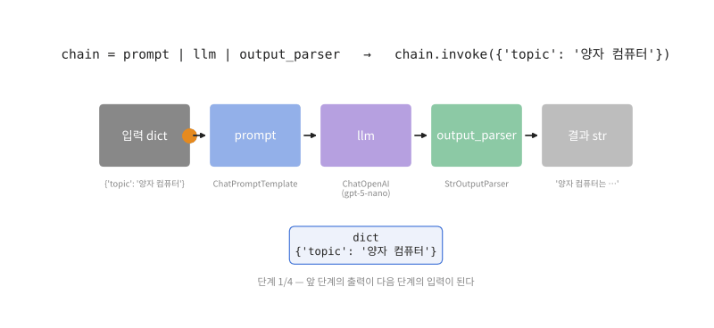
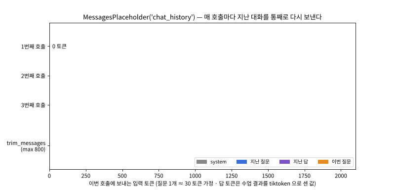
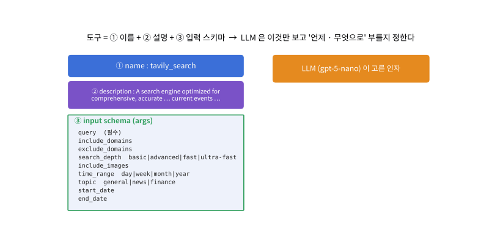
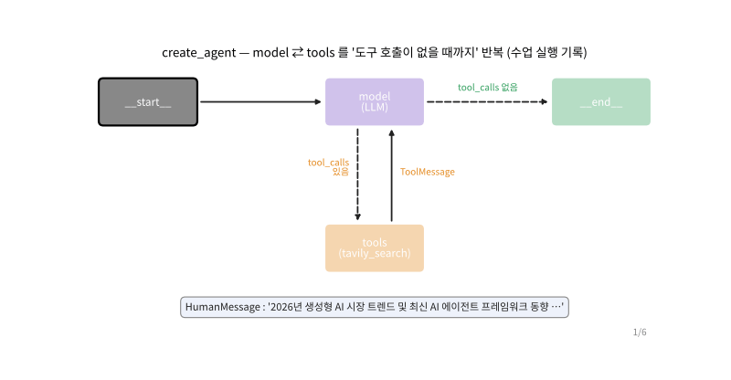
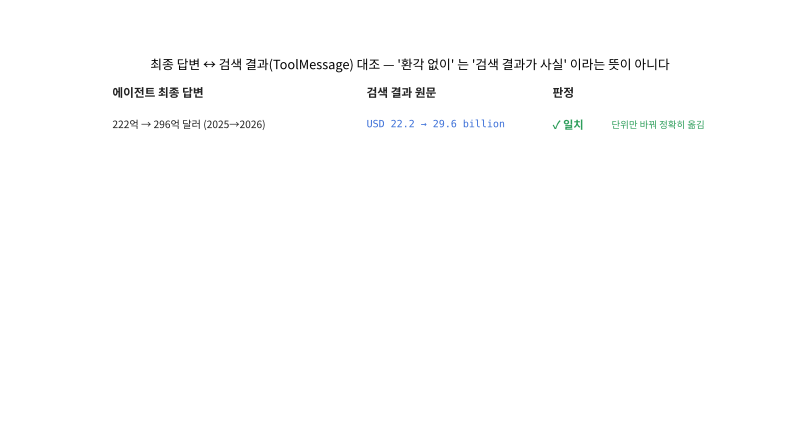

# Day 047 · 2026-11-13 (금)

`LLM (초거대언어모델)` · 11주차

> **한 줄 요약** — 어제 직접 부르던 OpenAI API 를 **LangChain** 으로 묶었다. `prompt | llm | parser` 한 줄이 **체인**이고, `MessagesPlaceholder` 에 대화 기록을 통째로 다시 넣는 것이 챗봇의 '기억' 이다(3번째 호출엔 입력이 65 → **1,532** 토큰). **도구**는 이름 · 설명 · 입력 스키마로 이루어지고, `create_agent` 는 LLM 이 '도구가 더 필요 없다' 할 때까지 model ⇄ tools 를 반복한다 — 수업 에이전트는 검색어 **3개를 한 번에** 정해 검색하고, 결과 9개(입력 5,468 토큰)를 읽어 답했다. 답의 숫자 · 이름은 모두 검색 결과에 있었지만 한 문장은 **뜻을 거꾸로** 옮겼다 → '환각 없이' 는 검토를 대신하지 않는다. API 키 없이 정리하느라 **가짜 LLM** 으로 체인 · 에이전트의 흐름을 돌려 봤다.

📂 실습 노트북
- [`lecture/langchain_chain_basics.ipynb`](./lecture/langchain_chain_basics.ipynb) — 프롬프트 · LLM · 출력 파서 · LCEL 체인 · '100 토큰 이내' 검사 · 감성 분석 체인 완성 · 구조화 출력 (필기 `LangChain_실습1` · `실습2`, 교재 p.18~24)
- [`lecture/langchain_chatbot_memory.ipynb`](./lecture/langchain_chatbot_memory.ipynb) — `MessagesPlaceholder` · 대화 기록 · 입력 토큰 증가 · `trim_messages` · `chat()` 함수 (필기 `LangChain_실습3`, 교재 p.25~26)
- [`lecture/agent_tools_tavily.ipynb`](./lecture/agent_tools_tavily.ipynb) — 도구의 3요소 · `@tool` · Tavily 검색 결과 검증 · `create_agent` · 수업 에이전트 기록 분석 · 답변 대조 · 교재의 체인 2개 방식 (필기 `LangChain_실습4` · `실습5`, 교재 p.27~33)

📊 데이터 → 없음 (리뷰 문장 · 검색 결과는 노트북 안에 있음)
🖼️ 그림 → [`lecture/images/`](./lecture/images/) — 🎬 **시뮬레이션 애니메이션(GIF) 5개** (숫자와 글은 수업 실행 결과에서 가져온 것)
📖 교재 → `AI Agent` 교재10 **p.18~33** (23. LangChain — 정의 · 라이브러리 vs 프레임워크 · 체인 · LCEL · Chain 실습 · 감성 분석 · 챗봇 · AI 에이전트와 도구 · TavilySearch · 실시간 검색 에이전트) — 다음은 p.34 `24. RAG`
📝 필기 → [`LangChain_실습1.ipynb`](./lecture/LangChain_실습1.ipynb) · [`LangChain_실습2.ipynb`](./lecture/LangChain_실습2.ipynb) · [`LangChain_실습3.ipynb`](./lecture/LangChain_실습3.ipynb) · [`LangChain_실습4.ipynb`](./lecture/LangChain_실습4.ipynb) · [`LangChain_실습5.ipynb`](./lecture/LangChain_실습5.ipynb)

⚙️ **설치 · 실행** — `pip install langchain langchain-openai langchain-tavily python-dotenv tiktoken pandas` → 노트북 폴더에 `.env` (`OPENAI_API_KEY="sk-…"` · `TAVILY_API_KEY="tvly-…"`, **GitHub 에 올리지 않는다**) → 맨 위부터 모두 실행 (인터넷 · 요금 필요, 에이전트 1번 ≈ $0.002 + Tavily 6크레딧)

> **출력 표시** — 정리 노트북은 API 키가 없는 환경에서 만들었다. `# 📼` 셀(7개)의 출력은 **수업 시간 실행 결과**를 옮긴 것, `# ⏳` 셀(4개)은 **출력이 비어 있어 직접 실행**, `# 🧪` 셀은 **정해 둔 답을 내는 가짜 LLM** 으로 흐름만 돌린 것이다.

---

## 1. LangChain 과 체인 — LCEL (교재 p.18~23)

```python
prompt = ChatPromptTemplate.from_messages([('system', '…100 토큰 이내로 간결하게…'), ('user', '{topic}에 대해서 설명해 줘')])
llm = ChatOpenAI(model='gpt-5-nano')
chain = prompt | llm | StrOutputParser()        # LCEL : 앞의 출력이 뒤의 입력
chain.invoke({'topic': '양자 컴퓨터'})            # 딕셔너리로 {topic} 을 채운다
```



🎬 `{'topic': …}` 딕셔너리가 프롬프트를 지나 **메시지 목록**이 되고, LLM 을 지나 **`AIMessage`** 가 되고, 출력 파서를 지나 **글자(str)** 가 된다. 마지막 결과는 266자 · 168토큰 — 프롬프트의 '100 토큰 이내' 를 넘었다.

| 구성 요소 | 클래스 | 입력 → 출력 |
|---|---|---|
| 프롬프트 | `ChatPromptTemplate` | dict → 메시지 목록 (`format_messages()` 로 API 없이 확인) |
| LLM | `ChatOpenAI` | 메시지 → `AIMessage` |
| 출력 파서 | `StrOutputParser` | `AIMessage` → str |
| 체인 | `prompt \| llm \| parser` | `RunnableSequence` — `invoke` · `batch` |

- **라이브러리 vs 프레임워크**(교재 p.20) : 라이브러리는 내가 골라 쓰는 도구 세트, 프레임워크는 정해진 틀(체인 · 에이전트)에 부품을 끼워 넣는 조립 세트
- '100 토큰 이내로' 는 **부탁**이다(Day 046 과 같은 교훈). 길이를 묶으려면 `max_completion_tokens`, 프롬프트엔 '세 문장으로' 처럼 확인할 수 있는 단위

---

## 2. 고객 리뷰 감성 분석 체인 (교재 p.24)

```python
class Sentiment(BaseModel):
    label: Literal['긍정', '부정', '중립']
    reason: str
    keywords: list[str]

chain = sentiment_prompt | ChatOpenAI(model='gpt-5-nano').with_structured_output(Sentiment)
chain.batch([{'review': r} for r in reviews])   # 결과가 글이 아니라 객체 → s.label
```

- 필기는 프롬프트까지 쓰고 'llm 모델 생성' 빈 셀에서 멈췄다 → 체인 · 실행까지 완성
- '긍정 또는 부정으로 제시하세요' 만으로는 답이 자유 형식 글 → **구조화 출력**으로 칸을 정하면 `'좋음'` 같은 엉뚱한 값은 `OutputParserException` 으로 잡힌다(가짜 LLM 으로 확인)

---

## 3. 챗봇 — `MessagesPlaceholder` (교재 p.25~26)

```python
prompt = ChatPromptTemplate.from_messages([('system', '…이전 대화 맥락을 정확하게 기억하여…'),
                                           MessagesPlaceholder(variable_name='chat_history')])
history.append(HumanMessage(질문))
answer = chain.invoke({'chat_history': history})
history.append(AIMessage(answer))
```



🎬 LLM 은 기억하지 못한다 — 호출할 때마다 system + **지난 질문 · 답 전부** + 이번 질문을 보낸다. 수업 대화의 답(240 · 1,167 · 134 토큰)이 쌓여 3번째 호출 입력은 약 1,532 토큰. `trim_messages(max_tokens=800)` 으로 최근 대화만 남기면 151 토큰.

| 호출 | 보내는 입력 (≈) | 안에 든 것 |
|---|---|---|
| 1 | 65 | system + Q1 |
| 2 | 335 | + A1(240) + Q2 |
| 3 | 1,532 | + A2(1,167) + Q3 |

- 수업 결과는 답만 남고 `input()` 질문 글자는 남지 않았다 → 질문을 인자로 받는 `chat()` 함수로 바꿈 (노트북 '모두 실행' 에서도 멈추지 않음)

---

## 4. AI 에이전트와 도구 — TavilySearch (교재 p.27~30)

```python
search_tool = TavilySearch(max_results=3)       # .env 의 TAVILY_API_KEY
search_tool.name          # 'tavily_search'           ① 이름
search_tool.description   # 'A search engine optimized for …'  ② 설명
search_tool.args          # query · search_depth · time_range · topic …  ③ 입력 스키마
```



🎬 LLM 이 보는 것은 도구의 ① 이름 ② 설명 ③ 입력 스키마뿐이다. `max_results=3` 은 만들 때 고정, 나머지 칸은 LLM 이 호출마다 채운다 — 수업 에이전트는 검색 3번 모두 `search_depth='advanced'` · `time_range='year'` 를 스스로 골랐다.

| 'Tesla의 2026년 2분기 실적' 검색 (수업 결과) | 점수 | 내용 |
|---|---|---|
| CapitalMEG 블로그 | 0.79 | 매출 **282억 달러** · 조정 EPS **0.33달러** |
| Tesla IR PDF (공식) | 0.70 | Total revenues **28,236** (백만 달러, +26%) · non-GAAP EPS **0.33** — 블로그와 일치 |
| 한국경제 | 0.55 | **유료 구독 안내문뿐** — 쓸모없는 결과 |

- `@tool` 을 붙이면 내 함수도 도구 : 함수 이름 = 이름, docstring = 설명, 타입 힌트 = 입력 스키마 (`won_to_dollar` 예제)

---

## 5. 실시간 검색 에이전트 — `create_agent` (교재 p.31~33)

```python
agent = create_agent(model=ChatOpenAI(model='gpt-5-nano'), tools=[TavilySearch(max_results=3, search_depth='advanced')],
                     system_prompt='…웹 검색 결과에 기반하여 환각 없이…한국어로')
response = agent.invoke({'messages': [{'role': 'user', 'content': '2026년 생성형 AI 시장 트렌드 및 …'}]})
response['messages'][-1].content          # 최종 답
```



🎬 수업 실행 기록 그대로 — ① LLM 이 검색어 3개를 **한 번에** 요청(`finish_reason='tool_calls'`) ② 도구가 3번 실행돼 `ToolMessage` 3개(출처 9개) ③ LLM 이 검색 결과를 모두 읽고(입력 5,468 토큰) 최종 답(`stop`). 도구 호출이 없으면 끝.

| LLM 호출 | 입력 | 출력 (그중 추론) | 끝난 이유 |
|---|---|---|---|
| 1 — 검색어 결정 | 1,376 | 713 (576) | `tool_calls` × 3 |
| 2 — 최종 답 | 5,468 | 4,174 (2,816) | `stop` |



🎬 최종 답의 숫자 · 이름을 검색 결과 원문과 대조 — `USD 29.6 billion` → '296억 달러' 처럼 **11개 모두 원문에 있었다.** 그러나 '복잡한 상태 관리는 **LangGraph 로 직접 내려가라**(*Drop to LangGraph directly*)' 를 '**LangGraph 로 내려가지 않고도** 제어 가능' 으로 뜻을 뒤집었고, `GPT-6 Astra` 는 블로그 한 곳의 말이다.

- **교재 방식**(p.31~32)은 `tool_calling_chain`(prompt | llm_with_tools) → 도구 실행 → `ToolMessage` → `final_answer_chain`(prompt | llm | parser) **체인 2개**. 필기는 `create_agent` — 노트북에 둘 다 구현(교재 방식은 도구를 한 번만 쓰고 끝, `create_agent` 는 반복)

---

## 🔁 복습

**필기 · 교재에서 고친 부분**
- [x] `LangChain_실습1` 시스템 프롬프트 '100 토큰 이내로' → 실제 답 **168토큰** · 길이는 `max_completion_tokens`, 프롬프트엔 '세 문장' 같은 단위
- [x] `LangChain_실습1` `print(output_parser)` 가 빈 줄 · `print(prompt)` 가 내부 구조 → `repr()` · `format_messages()` 로 실제 전송 내용 확인
- [x] `LangChain_실습2` 'llm 모델 생성' 빈 셀에서 멈춤 → LLM · 체인 · 실행 완성 + 자유 형식 글 대신 `with_structured_output` (긍정 · 부정 · 중립 / 근거 / 키워드)
- [x] `LangChain_실습3` `while True: input()` → '모두 실행' 에서 멈추고 질문이 기록에 안 남음 → `chat()` 함수 · 끝없이 쌓이는 기록 → `trim_messages` · 쓰지 않는 `import os` 삭제 · `print(chatbot_chain)` 수천 자 출력 → `format_messages()`
- [x] `LangChain_실습4` 검색 결과 dict 를 한 줄로 `print` → 출처 · 점수 · 길이 표 · 공식 IR 과 숫자 대조 · 유료 안내문 결과 걸러 보기
- [x] `LangChain_실습5` `print(f'[최종 에이전트 답변]: {response}')` → 답이 아니라 메시지 전체 **22,000자** 출력 → `response['messages'][-1].content` + 메시지 종류별 요약
- [x] `LangChain_실습5` 에이전트 답의 오류 : 'LangGraph 로 내려가지 않고도' (원문과 반대 · 같은 답 뒷부분과 모순) · '헬Healthcare' 깨진 표현 → 노트북에 원문 대조로 표시
- [x] 모든 필기 : `load_dotenv('.env')` (지금 폴더만 찾음) → `find_dotenv(usecwd=True)` (상위 폴더까지) · 키 값 대신 '있음/없음' 만 출력
- [x] 교재 p.29 `search_depth` 는 basic · advanced 만 적음 → 설치된 `langchain-tavily 0.2.18` 은 **fast · ultra-fast** 도 받음. `advanced(권장)` 는 검색 1번에 **2크레딧**(basic 1) — 수업 에이전트 1번 = 6크레딧
- [x] 교재 p.31 '체인 2개(`tool_calling_chain` · `final_answer_chain`)' 설명 ↔ 필기는 `create_agent` → 두 방식 모두 구현해 차이(1회 vs 반복) 정리
- [x] 교재 p.21 체인 = '선형적으로 연결' → 기본은 순서대로지만 LCEL 은 `RunnableParallel` 로 병렬 · 분기도 만든다 (`create_agent` 도 내부는 반복하는 그래프)
- [x] 교재 p.28 '외부 시스템(API, 함수, 데이터베이스 등)**와**' → **과** · 머리글 `SK네트웍스 Famiy` → Family

**직접 해본 것**
- `GenericFakeChatModel` 을 고쳐(`bind_tools`) API 없이 체인 · `create_agent` · 체인 2개 에이전트의 **메시지 흐름**을 실제로 돌려 봄 · `draw_mermaid()` 로 그래프 확인
- tiktoken 으로 수업 답의 토큰을 세어 '100 토큰' 검사 · 대화 기록에 따른 입력 토큰 증가 계산
- 수업 에이전트 출력(22KB 글자)을 정규식으로 분석 — 메시지 순서 · 도구 호출 인자 · LLM 별 토큰 · 출처 9개
- 최종 답의 주장 11개를 검색 결과 원문과 대조 → 단어는 다 있지만 뜻이 뒤집힌 문장 발견
- 키 없이 `TavilySearch.model_fields` 로 도구의 이름 · 설명 · 입력 스키마 확인
- `FuncAnimation` 으로 LCEL 흐름 / 대화 기록 / 도구 구성 / 에이전트 반복 / 답변 대조 애니메이션

**막혔던 부분 / 질문**
- [ ] `# ⏳` 셀 4개를 내 키로 실행 — 구조화 출력 감성 분석은 세 번째 리뷰(맛은 괜찮은데 포장이 터짐)를 무엇으로 보는가
- [ ] 같은 질문을 `create_agent` 로 여러 번 돌리면 검색어 · 검색 횟수 · 답이 얼마나 달라지는가
- [ ] 시스템 프롬프트에 '검색 결과 문장을 인용하고 출처 URL 을 붙여라' 를 넣으면 뜻이 뒤집히는 오류가 줄어드는가
- [ ] `search_depth='basic'` 으로 바꾸면 크레딧은 절반 — 답의 품질 차이는?
- [ ] 대화 기록을 자르지 않고 요약해서 줄이는 방법, 그리고 검색 결과를 미리 저장해 두고 꺼내 쓰는 방법 — 다음 단원 `24. RAG` (교재 p.34~)

📂 [수업 자료 폴더](./lecture/) · [복습 자료 폴더](./review/)

---

## 🔗 참고 링크

- [LangChain 문서](https://docs.langchain.com/oss/python/langchain/overview) · [에이전트 `create_agent`](https://docs.langchain.com/oss/python/langchain/agents) · [도구](https://docs.langchain.com/oss/python/langchain/tools) · [구조화 출력](https://docs.langchain.com/oss/python/langchain/structured-output)
- [langchain-tavily](https://github.com/tavily-ai/langchain-tavily) · [Tavily 검색 API](https://docs.tavily.com/documentation/api-reference/endpoint/search) · [Tavily 크레딧](https://docs.tavily.com/documentation/api-credits)
- [LangGraph](https://docs.langchain.com/oss/python/langgraph/overview) · [Pydantic](https://docs.pydantic.dev/latest/) · [gpt-5-nano 모델 문서](https://developers.openai.com/api/docs/models/gpt-5-nano)
- 이전 : [Day 046 — OpenAI API · 프롬프트 출력 형식](../2026-11-12/README.md)
