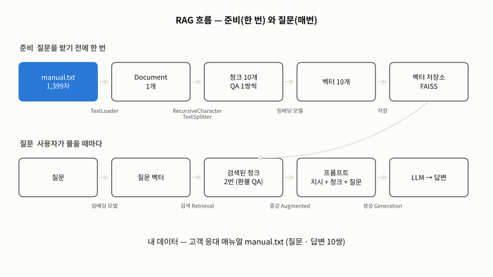
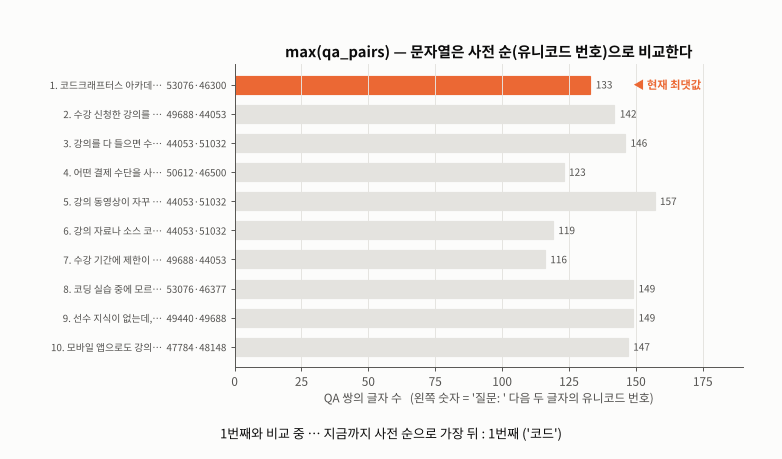
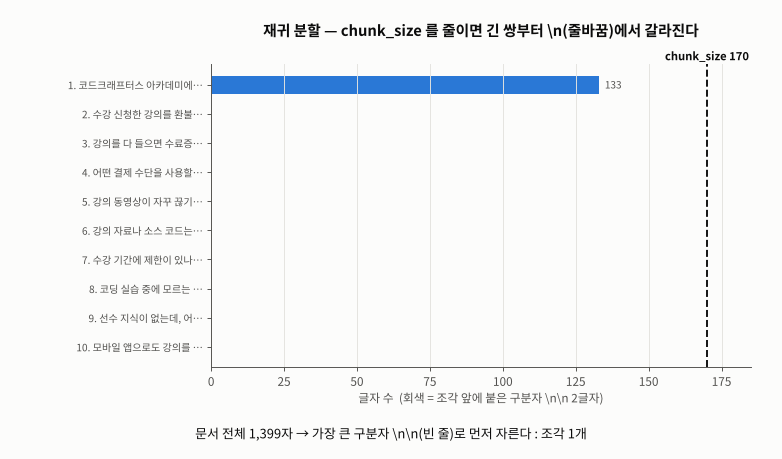
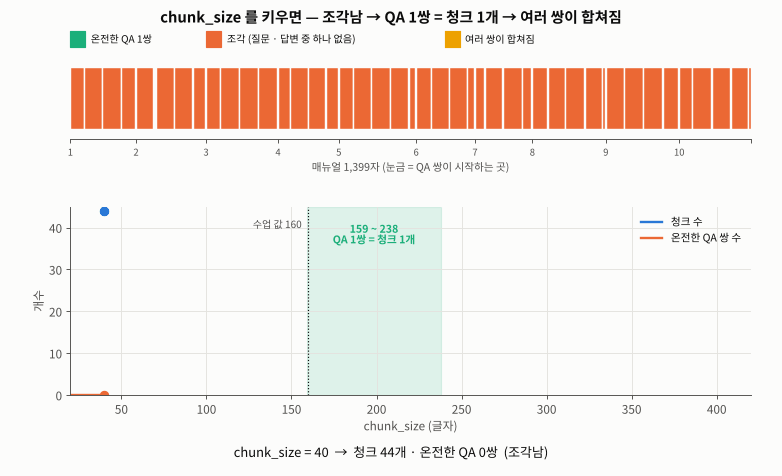
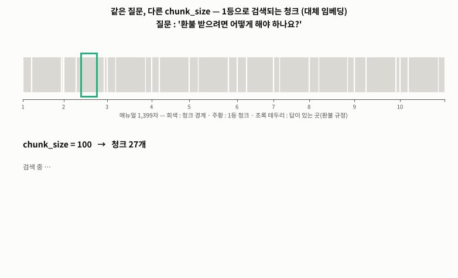

# Day 048 · 2026-11-16 (월)

`LLM (초거대언어모델)` · 12주차

> **한 줄 요약** — LLM 의 약점(환각 · 지식의 한계 · 출처 불분명)을 메우는 **RAG** 를 시작했다. 답하기 전에 내 문서를 **검색**해서 프롬프트에 **붙이고**(증강) 그걸 근거로 **생성**한다. 오늘은 준비 단계의 앞 두 칸 — `TextLoader` 로 `manual.txt`(QA 10쌍 · 1,399자)를 **`Document` 1개**로 불러오고, `RecursiveCharacterTextSplitter(chunk_size=160, chunk_overlap=0)` 로 **청크 10개 = QA 10쌍**으로 잘랐다. 가장 긴 쌍이 157자라 160 을 골랐는데, 재 보니 가능한 값은 **159 ~ 238** 이었다(157 · 158 은 11개로 갈라진다 — 구분자 `\n\n` 2글자가 길이에 포함되기 때문). 매뉴얼 전체가 **1,291 토큰**이라 임베딩 입력 제한(8,192)과는 상관이 없고, 자르는 진짜 이유는 **검색 정확도**다. 내 필기는 매뉴얼 대신 `.env` 를 불러와 **API 키가 출력에 찍혔다** → 키 폐기 · 재발급.

📂 실습 노트북
- [`lecture/rag_overview_flow.ipynb`](./lecture/rag_overview_flow.ipynb) — 빛과 그림자 · RAG 5단계 · 실습 개요 · 키 없이 준비 → 검색 → 증강 한 바퀴 · `chunk_size` 별 검색 결과 · 대체 임베딩의 한계 (교재 p.34~38)
- [`lecture/rag_loader_text_splitter.ipynb`](./lecture/rag_loader_text_splitter.ipynb) — `TextLoader` · `Document` · QA 쌍 길이 재기 · `RecursiveCharacterTextSplitter` · `split_documents` 검증 · `chunk_size` / `chunk_overlap` 실험 · 글자 vs 토큰 (필기 `RAG_실습06` · `1RAG_실습1`, 교재 p.38)

📊 실습 데이터 → [`manual.txt`](./lecture/manual.txt) (코드크래프터스 아카데미 고객 응대 매뉴얼 · 질문/답변 10쌍 · 1,399자)
🖼️ 그림 → [`lecture/images/`](./lecture/images/) — 🎬 **시뮬레이션 애니메이션(GIF) 5개** (모두 노트북과 같은 데이터 · 같은 코드로 계산한 것)
📖 교재 → `AI Agent` 교재10 **p.34~38** (24. RAG — 생성형 AI : 빛과 그림자 · 가장 현실적인 대안 RAG · 실습 '지능형 고객 응대 Chatbot' 개요) — 다음은 p.39 실습 과정 7단계 · 벡터 데이터베이스
📝 필기 → [`RAG_실습06.ipynb`](./lecture/RAG_실습06.ipynb) (내 필기 · 출력의 API 키 값은 가림) · [`1RAG_실습1.ipynb`](./lecture/1RAG_실습1.ipynb) (강의본)

⚙️ **설치 · 실행** — `pip install langchain-community langchain-text-splitters langchain-openai faiss-cpu python-dotenv tiktoken scikit-learn pandas matplotlib` → 노트북과 같은 폴더에 `manual.txt` → 맨 위부터 모두 실행. 불러오기 · 분할은 **API 키 없이** 돌아간다

> **출력 표시** — `rag_overview_flow` 의 `# 🧪` 셀은 진짜 임베딩 모델 대신 **글자 겹침(TF-IDF)으로 벡터를 만드는 대체 임베딩**으로 흐름만 돌린 것, `# ⏳` 셀(2개)은 API 키가 필요해 **출력이 비어 있다**(다음 수업에서 실행). `rag_loader_text_splitter` 는 모든 셀을 실제로 실행했다.

---

## 1. 생성형 AI 의 빛과 그림자 → RAG (교재 p.35~37)

| 그림자 (약점) | RAG 가 채우는 방법 |
|---|---|
| **환각** — 그럴듯한 거짓말 | 답하기 전에 근거 문서를 찾아 프롬프트에 넣고 '이 안에서만 답하라' |
| **지식의 한계** — 특정 시점까지만 학습, 회사 내부 자료는 모름 | 다시 학습시키지 않고 최신 · 내부 데이터를 **검색**해서 준다 |
| **출처 불분명** — 근거를 알 수 없음 | 검색된 문서의 `metadata` 를 출처로 함께 보여 준다 |

**RAG** = 검색(Retrieval) + 증강(Augmented) + 생성(Generation)



🎬 윗줄은 질문을 받기 전에 **한 번** 해 두는 준비(불러오기 → 분할 → 임베딩 → 저장), 아랫줄은 질문마다 도는 흐름(질문 임베딩 → 검색 → 증강 → 생성). 오늘 수업은 윗줄의 ① ② 까지. '환불 받으려면…' 질문에는 2번 청크(환불 QA · 142자)가 검색된다.

| 교재 그림 번호 | 무슨 일 | 코드 |
|---|---|---|
| ② Query | 질문으로 지식 저장소를 **검색** | `vector_store.similarity_search(question)` |
| ④ Prompt + Query + 컨텍스트 | 질문에 청크를 붙인다 = **증강** | `prompt.format_messages(context=…, question=…)` |
| ⑤ 응답 | LLM 이 그 프롬프트로 답한다 = **생성** | `llm.invoke(messages)` |

- Day 047 의 검색 에이전트와 닮았다. 차이는 **무엇을 검색하는가** — 그때는 웹(Tavily), RAG 는 내가 미리 저장해 둔 문서
- '증강' 은 특별한 연산이 아니라 **검색된 글을 프롬프트의 정해진 자리에 붙여 넣는 것**

---

## 2. 데이터 불러오기 — `TextLoader` → `Document` (교재 p.38)

```python
manual_path = 'manual.txt'                                  # 경로 변수 이름에 '무슨 파일인지' 를 담는다
documents = TextLoader(manual_path, encoding='utf-8').load()   # [Document] — .txt 1개 → Document 1개
documents[0].metadata        # {'source': 'manual.txt'}      어디서 왔는지 (나중에 출처)
documents[0].page_content    # 글 내용 1,399자
assert documents[0].page_content.startswith('질문:')          # 기대한 파일인지 바로 확인
```

- 내 필기는 `TextLoader(file_path)` 의 `file_path` 에 **`.env` 경로**가 들어 있어, 매뉴얼 대신 `.env` 를 읽고 **API 키 2개를 출력**했다. 노트북은 출력도 파일에 저장되므로 `.gitignore` 의 `.env` 로는 막지 못한다 → 변수 이름을 나누고(`manual_path`), 불러온 직후 `assert`, 올리기 전 출력 확인
- `manual.txt` 는 윈도우 줄바꿈(`\r\n`)이다. 텍스트 모드로 읽어야 `\n` 으로 바뀌어 `split('\n\n')` 이 동작한다(변환 없이 읽으면 1,427자 · 조각 1개)

---

## 3. `chunk_size` 를 정하려면 — QA 쌍의 길이 재기

```python
qa_pairs = manual_text.split('\n\n')                 # 빈 줄 = QA 쌍의 경계 → 10쌍
character_length = [len(pair) for pair in qa_pairs]   # [133, 142, 146, 123, 157, 119, 116, 149, 149, 147]
max(character_length)                                 # 157 (5번째 — 강의 동영상 재생)
```



🎬 필기의 `max(qa_pairs)` 는 숫자가 아니라 문장을 돌려준다. 문자열은 **사전 순**으로 비교해서 `코`(53076)로 시작하는 것 중 `드`(46300) < `딩`(46377) 인 **8번째(149자)** 가 뽑힌다. 길이로 고르려면 `key=len` → 5번째 · **157자**.

- `for out in string_txt: qa_pairs.append(out)` 는 '단어' 가 아니라 **글자 147개**를 리스트에 붙인다(10 → 157개). 필기의 출력이 멀쩡해 보인 것은 셀 실행 순서 때문 — 위에서부터 다시 실행하면 달라진다

---

## 4. 텍스트 분할 — `RecursiveCharacterTextSplitter`

```python
text_splitter = RecursiveCharacterTextSplitter(chunk_size=160, chunk_overlap=0)
chunks = text_splitter.split_documents(documents)     # 청크 10개, 각 청크 = QA 한 쌍
all(c.page_content == p for c, p in zip(chunks, qa_pairs))   # True — 코드로 검증
```

| 매개 변수 | 뜻 | 기본값 |
|---|---|---|
| `chunk_size` | 청크의 최대 길이 — **글자 수**(`len`) 기준 | 4000 |
| `chunk_overlap` | 이웃 청크가 겹치는 길이 | 200 |
| `separators` | 앞에서부터 차례로 시도하는 구분자 | `['\n\n', '\n', ' ', '']` |



🎬 먼저 `\n\n`(빈 줄)로 10조각. `chunk_size` 를 170 에서 140 으로 내리면 선에 걸리는 긴 쌍부터 다음 구분자 `\n` 에서 **질문 / 답변으로 갈라진다** — 158 에서 5번째 쌍(11개), 150 에서 8 · 9번째까지(13개), 140 에서는 6쌍이 갈라져 16개.



🎬 `chunk_size` 를 40 에서 420 까지 키운다. 작을 때는 전부 조각(주황), **159 ~ 238 에서만 QA 1쌍 = 청크 1개**(초록 10칸), 239 부터 이웃한 짧은 쌍이 한 청크로 합쳐진다(노랑).

| `chunk_size` | 청크 수 | 온전한 QA 쌍 | 상태 |
|---|---|---|---|
| 100 | 27 | 0 | 답변이 여러 조각으로 |
| 150 | 13 | 7 | 3쌍이 질문 / 답변으로 갈라짐 |
| 157 · 158 | 11 | 9 | 가장 긴 쌍(157자)이 갈라짐 |
| **159 ~ 238** | **10** | **10** | 수업 값 160 은 이 구간의 맨 아래 |
| 239 | 9 | 8 | 6 · 7번째 쌍이 합쳐짐 |
| 4000 (기본값) | 1 | 0 | 문서 전체가 청크 1개 |

- **왜 157 이 아니라 159 부터인가** — 기본값 `keep_separator=True` 는 구분자 `\n\n` 을 뒤 조각 앞에 붙인 채 길이를 잰다(157 + 2 = 159). `keep_separator=False` 로 바꾸면 157 부터 10개가 된다
- `chunk_overlap` 은 이 데이터에서 0 · 20 · 40 모두 결과가 같다 — 조각 하나가 QA 한 쌍(116자 이상)이라 겹칠 조각이 없다. `chunk_size=80` 처럼 공백 단위로 잘릴 때 비로소 14 ~ 19자씩 겹친다
- 매뉴얼 전체 = **1,291 토큰**(`cl100k_base`) → 임베딩 입력 제한 8,192 의 16%. 같은 160 이라도 `from_tiktoken_encoder` 로 **토큰 기준**이면 11개로 갈라진다(5번째 쌍 159 토큰)

---

## 5. 왜 QA 한 쌍씩 자르나 — 검색 결과로 확인 (🧪 대체 임베딩)



🎬 같은 질문 '환불 받으려면 어떻게 해야 하나요?' 를 `chunk_size` 만 바꿔 검색한다. 주황 = 1등 청크, 초록 테두리 = 답(환불 규정)이 있는 곳.

| `chunk_size` | 1등 청크 | 답(7일 · 5%) |
|---|---|---|
| 100 | '질문: … 어떻게 가입하나요?' 질문 줄만 28자 | 없음 — 질문과 답변이 갈라졌다 |
| **160** | 환불 QA 한 쌍 142자 | 있음 — 필요한 내용만 |
| 300 | 가입 QA + 환불 QA 277자 | 있음 — 절반은 상관없는 내용 |
| 4000 | 매뉴얼 전체 1,399자 | 있음 — 어떤 질문이든 같은 결과 |

- 검색된 청크 2개를 넣은 프롬프트는 약 **225 토큰**, 매뉴얼을 통째로 넣으면 약 **857 토큰**. 이 크기면 통째로 넣어도 된다 — RAG 는 문서가 수백 쪽이 될 때 필요한 방법을 작은 데이터로 연습하는 것
- 대체 임베딩은 **글자가 겹쳐야** 찾는다 : 매뉴얼과 낱말이 겹치는 질문 6/6, 뜻만 같은 질문(`돈 돌려줘` · `핸드폰 지원돼?` · `자격증 나와요?` …) **0/6** → 뜻을 학습한 임베딩 모델이 필요한 이유

---

## 정리

| 단계 | 코드 | 오늘 결과 |
|---|---|---|
| 준비 ① 불러오기 | `TextLoader('manual.txt', encoding='utf-8').load()` | `Document` 1개 · 1,399자 |
| 준비 ② 분할 | `RecursiveCharacterTextSplitter(chunk_size=160, chunk_overlap=0).split_documents(documents)` | 청크 10개 = QA 10쌍 (116 ~ 157자) |
| 준비 ③ ④ 임베딩 · 저장 | `FAISS.from_documents(chunks, OpenAIEmbeddings())` | 다음 수업 (🧪 대체 임베딩으로 흐름만) |
| 질문 검색 | `vector_store.as_retriever().invoke(question)` | 🧪 '환불 …' → 2번 청크 |
| 질문 증강 | `prompt.format_messages(context=…, question=…)` | 시스템 메시지에 청크 2개 · 약 225 토큰 |
| 질문 생성 | `llm.invoke(messages)` | ⏳ 다음 수업 |

---

## 🔁 복습

**필기 · 교재에서 고친 부분**
- [x] `RAG_실습06` `TextLoader(file_path)` — `file_path` 가 `.env` 경로라 **매뉴얼 대신 `.env` 를 읽고 API 키 2개가 출력에 저장됨** → `manual_path` 로 분리 · 불러온 직후 `assert` · 올린 필기는 키 값을 가림 · **키는 폐기 후 재발급**
- [x] `RAG_실습06` `max(qa_pairs)` 를 '가장 긴 QA 단락의 글자 수' 로 출력 → 사전 순 최댓값(8번째 · 149자 문장)이 나옴 → `max(len(p) for p in qa_pairs)` = **157**
- [x] `RAG_실습06` `#단어 출력` `for out in string_txt: qa_pairs.append(out)` → 글자 147개가 리스트에 붙어 157개 · 실행 순서 때문에 출력만 멀쩡 → 삭제(단어는 `split()`)
- [x] `RAG_실습06` 변수 `menu_text` → `manual_text` · `print(type(string_txt))` 삭제 · 끊긴 메모 `load() 함수 -> Textlo` 완성
- [x] 필기 · 강의본 `C:\Users\…` 절대 경로 → `'manual.txt'` 상대 경로 · `find_dotenv(usecwd=True)`
- [x] 필기 · 강의본 파일을 `TextLoader` 와 `open()` 으로 두 번 읽음 → `documents[0].page_content` 사용
- [x] 필기 · 강의본 분할 도구를 **만들고 끝** → `split_documents()` 실행 · 청크 10개 = QA 10쌍 검증
- [x] 메모 '`\n` 문장' → `\n` 은 줄바꿈(문장 끝은 기본 구분자에 없음) · '`chunk_size` 보다 짧으면 병합' → 합쳐도 `chunk_size` 를 넘지 않을 때만
- [x] 메모 '`load()` · `split_documents()` 는 전용 함수' → `BaseLoader` · `TextSplitter` 의 공통 함수(다른 로더 · 분할 도구도 같은 이름)
- [x] 메모 '입력 길이 제한(8,192 토큰)을 고려하여 분할' → 매뉴얼 전체가 1,291 토큰. 이 실습의 분할 이유는 **검색 정확도** · 제한은 토큰, `chunk_size` 는 글자
- [x] 수업 값 `chunk_size=160` (최대 157자) → 맞는 값이지만 가능한 구간 159 ~ 238 의 맨 아래. 구분자 2글자를 더해 계산하고 여유를 둔다
- [x] 필기 `FAISS` · `OpenAIEmbeddings` 임포트 → 오늘 범위에서 쓰지 않음 · `langchain-community 0.4.2` 는 임포트 때 'sunset' 경고
- [x] 교재 p.34 `Retrieval Augmented Generation` → 원 논문 표기는 하이픈 `Retrieval-Augmented Generation` (교재 p.39 는 하이픈 사용)
- [x] 교재 p.37 그림 ③ '증강된 컨텍스트' 가 저장소에서 돌아옴 → 돌아오는 것은 **검색된** 관련 정보, 증강은 프롬프트에 붙이는 ④ 단계
- [x] 교재 p.38 그림 — 질문 뒤 벡터 DB 가 '내 데이터' 를 lookup → 내 데이터는 **미리** 분할 · 임베딩해 저장(준비 단계). 그림에 분할 단계가 없음
- [x] 교재 p.36~37 RAG 가 '약점을 보완' → 환각을 줄이지만 없애지는 못한다(Day 047 에이전트는 검색 결과를 받고도 뜻을 거꾸로 옮김)

**직접 해본 것**
- 가짜 키를 넣은 임시 `.env` 로 '`.env` 를 `TextLoader` 로 읽는' 실수를 재현
- `chunk_size` 를 20 ~ 420 까지 1씩 바꿔 가며 청크 수 · 온전한 QA 쌍 수를 세어 경계(159 · 238)를 찾고, `keep_separator` 로 원인 확인
- `chunk_overlap` 이 실제로 몇 글자 겹치는지 세는 함수 작성
- tiktoken 으로 QA 쌍별 토큰 수(105 ~ 159) · 전체 1,291 토큰 계산, `from_tiktoken_encoder` 로 토큰 기준 분할
- QA 쌍으로 직접 `Document` 만들기(`metadata` 에 `qa_id` · `question`) · `add_start_index=True`
- `Embeddings` 를 상속한 대체 임베딩(글자 2~3개 묶음 TF-IDF)을 만들어 `FAISS.from_documents` → `as_retriever` → 프롬프트 증강까지 키 없이 실행
- `FuncAnimation` 으로 RAG 흐름 / 재귀 분할 / max 비교 / chunk_size 변화 / chunk_size 별 검색 결과 애니메이션

**막혔던 부분 / 질문**
- [ ] `OpenAIEmbeddings` 로 바꾸면 대체 임베딩이 틀린 6개 질문(`돈 돌려줘` · `핸드폰 지원돼?` …)을 몇 개나 맞히는가 (교재 p.39 과정 ③ ④)
- [ ] `FAISS` 와 `ChromaDB` 의 차이, 저장소를 파일로 저장했다가 다시 불러오는 방법 (교재 p.40 벡터 데이터베이스)
- [ ] 검색 개수 `k` 를 1 · 2 · 3 으로 바꾸면 답이 어떻게 달라지는가 — 매뉴얼에 없는 질문에는 '없는 내용' 이라고 답하는가
- [ ] 다음 실습 'PDF 기반 RAG(헌법 Q&A)' 처럼 QA 구조가 없는 긴 글에서는 `chunk_size` · `chunk_overlap` 을 무엇을 보고 정하는가 (교재 p.44~)

📂 [수업 자료 폴더](./lecture/) · [복습 자료 폴더](./review/)

---

## 🔗 참고 링크

- [LangChain 검색(Retrieval) 개요](https://docs.langchain.com/oss/python/langchain/retrieval) · [RAG 튜토리얼](https://docs.langchain.com/oss/python/langchain/rag) · [시맨틱 검색 튜토리얼](https://docs.langchain.com/oss/python/langchain/knowledge-base)
- [텍스트 분할 도구](https://docs.langchain.com/oss/python/integrations/splitters) · [`RecursiveCharacterTextSplitter`](https://docs.langchain.com/oss/python/integrations/splitters/recursive_text_splitter) · [`langchain-community` sunset 공지 #674](https://github.com/langchain-ai/langchain-community/issues/674)
- [OpenAI 임베딩 가이드](https://developers.openai.com/api/docs/guides/embeddings) · [tiktoken](https://github.com/openai/tiktoken) · [FAISS](https://github.com/facebookresearch/faiss)
- RAG 원 논문 : [Lewis et al., 2020 — Retrieval-Augmented Generation for Knowledge-Intensive NLP Tasks](https://arxiv.org/abs/2005.11401)
- 이전 : [Day 047 — LangChain 체인 · 챗봇 · 도구와 에이전트](../2026-11-13/README.md)
