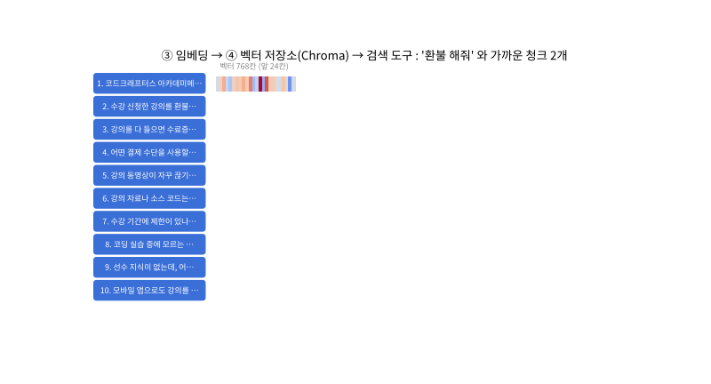
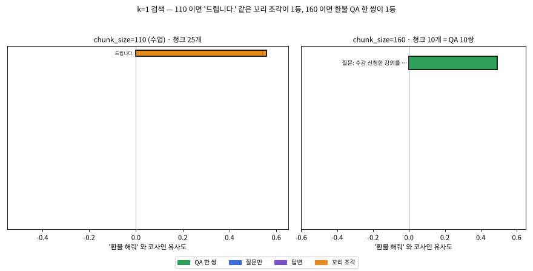
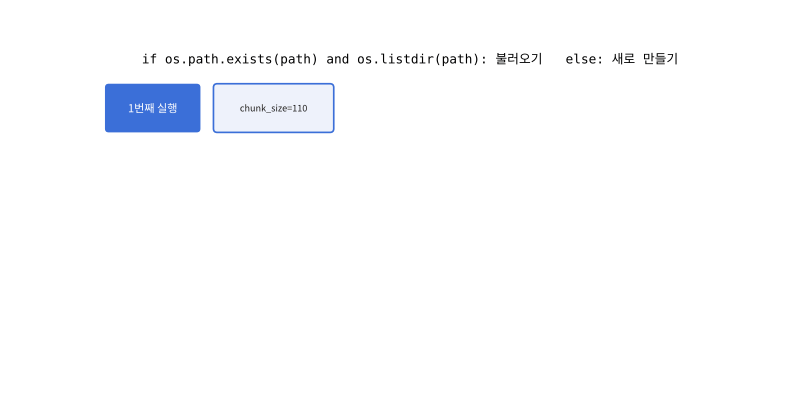
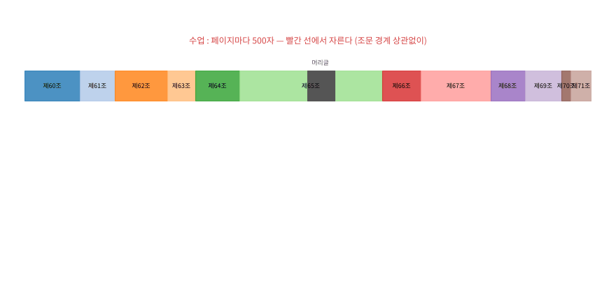
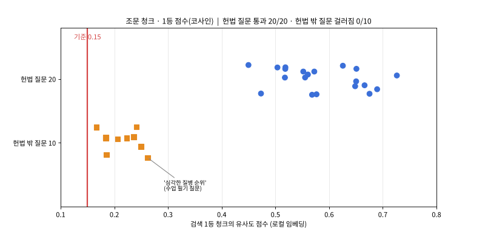

# Day 049 · 2026-11-17 (화)

`LLM (초거대언어모델)` · 12주차

> **한 줄 요약** — 어제 자른 청크를 **임베딩**해서 **벡터 저장소(Chroma)** 에 넣고, 질문과 가까운 청크를 찾는 **검색 도구**를 RAG 체인에 연결해 고객 응대 챗봇과 **PDF 헌법 Q&A 챗봇**을 완성했다. 수업 값 `chunk_size=110` 은 질문과 답을 갈라 놓아 '환불 해줘' 의 1등이 **`드립니다.`** 같은 꼬리 조각이 됐고, 수업 챗봇도 **질문 줄만** 찾았다(160 이면 QA 한 쌍). Chroma 폴더를 열어 보니 원문은 SQLite 의 `embedding_metadata`, 검색용 벡터 인덱스는 **UUID 폴더의 HNSW 파일**이었다(교재의 'embeddings_queue = 벡터 저장소' 는 쓰기 기록). 헌법 PDF 를 500자로 자르면 52개 중 **27개가 조문 중간에서** 시작한다 → **조문(제N조) 하나 = 청크 하나**로 바꾸자 같은 임베딩으로 정답 조문이 2등 안에 드는 질문이 **13 → 19개**(20개 중)로 늘었다. 검색 도구는 '심각한 질병 순위' 처럼 관계없는 질문에도 항상 k개를 돌려준다 → **점수 기준**으로 걸렀다. 내 필기의 마지막 오류(`conttext`)는 고쳐 놓고 다시 실행하지 않은 것이었다.

📂 실습 노트북
- [`lecture/rag_vectorstore_chroma.ipynb`](./lecture/rag_vectorstore_chroma.ipynb) — 7단계 · `chunk_size` 110 vs 160 · 임베딩 · Chroma 폴더 · SQLite · '폴더가 있으면 불러오기' 함정 · 검색 · 점수 · FAISS vs Chroma · 메타데이터 필터 · RAG 체인 · 챗봇 (필기 `RAG_실습07`, 교재 p.39~43 · 45~51)
- [`lecture/rag_pdf_constitution.ipynb`](./lecture/rag_pdf_constitution.ipynb) — `PyMuPDFLoader` · 500자 분할의 문제 · 조문 단위 청크 + 메타데이터 · 검색 비교 · 점수 기준 · 수업 기록 분석 · 장 필터 · 출처를 붙인 RAG 체인 (필기 `RAG_실습08` · 강의본 `RAG_실습8_1`, 교재 p.44)

📊 실습 데이터 → [`manual.txt`](./lecture/manual.txt) (고객 응대 매뉴얼 · QA 10쌍, Day 048 과 같은 파일) · [`대한민국헌법(헌법)(제00010호)(19880225).pdf`](./lecture/) (국가법령정보센터 · 14쪽)
🖼️ 그림 → [`lecture/images/`](./lecture/images/) — 🎬 **시뮬레이션 애니메이션(GIF) 5개** (노트북과 같은 데이터 · 같은 로컬 임베딩으로 계산한 것)
📖 교재 → `AI Agent` 교재 **p.39~51** (실습 과정 7단계 · 벡터 데이터베이스 · 데이터 전처리 및 임베딩 / 벡터 저장소 · 검색 도구 / RAG 완성 실습 · PDF 기반 RAG(헌법 Q&A) · FAISS vs ChromaDB · SQLite · 메타데이터 필터링 예시) — 다음은 p.52 ChromaDB 연산자 정리
📝 필기 → [`RAG_실습07.ipynb`](./lecture/RAG_실습07.ipynb) · [`RAG_실습08.ipynb`](./lecture/RAG_실습08.ipynb) (내 필기) · [`RAG_실습8_1.ipynb`](./lecture/RAG_실습8_1.ipynb) (강의본)

⚙️ **설치 · 실행** — `pip install langchain-community langchain-text-splitters langchain-chroma faiss-cpu pymupdf langchain-openai langchain-huggingface sentence-transformers python-dotenv pandas` → 노트북과 같은 폴더에 `manual.txt` · 헌법 PDF → 맨 위부터 모두 실행 (🧪 로컬 임베딩 모델 약 440MB 를 처음 한 번 받음 · 그다음은 **API 키 없이** 실행)

> **출력 표시** — `# 📼` 셀은 **수업 시간 실행 결과**를 옮긴 것, `# ⏳` 셀(3개)은 API 키가 필요해 **출력이 비어 있다**, `# 🧪` 셀은 OpenAI 임베딩 대신 **로컬 한국어 임베딩**(`ko-sroberta-multitask`)으로 실제로 검색했거나 **가짜 LLM** 으로 체인 흐름만 돌린 것이다. 검색 순위 · 점수는 수업의 `text-embedding-3-small` 과 다를 수 있다.

---

## 1. 실습 과정 7단계 — ③ 임베딩 · ④ 벡터 저장소 (교재 p.39~42)

```python
embeddings = OpenAIEmbeddings(model='text-embedding-3-small')         # ③ 청크 → 1,536 차원 벡터
vectorstore = Chroma.from_documents(documents=chunks, embedding=embeddings,
                                    persist_directory='chroma_db_manual_160')   # ④ 벡터 + 원문을 디스크에
retriever = vectorstore.as_retriever(search_kwargs={'k': 2})          # ④ 검색 도구
retriever.invoke('환불 해줘')                                          # 질문과 가까운 청크 2개
```



🎬 QA 10쌍이 각각 768칸 벡터가 되어 Chroma 에 들어간다(원문 · 메타데이터는 `chroma.sqlite3`, 벡터 인덱스는 UUID 폴더). 질문 '환불 해줘' 도 같은 모델로 벡터가 되고, 코사인 유사도가 높은 2번(환불 QA, 0.49) · 5번 청크가 컨텍스트로 뽑힌다.

| `persist_directory` 안 | 들어 있는 것 |
|---|---|
| `chroma.sqlite3` → `embedding_metadata` | 원문(`chroma:document`) · 메타데이터(`source` …) |
| `chroma.sqlite3` → `embeddings_queue` | **쓰기 기록** — 한 줄에 벡터 3,072 bytes(768 × 4) |
| `<UUID>/data_level0.bin` 등 | 검색에 쓰는 **HNSW 벡터 인덱스** (내 필기 출력의 `'c23a45ad-…'` 폴더) |

- 임베딩 모델은 **저장할 때와 질문할 때 같아야** 한다. 로컬 모델로 바꿔 끼울 수 있는 것도 `embed_documents` · `embed_query` 두 함수만 쓰기 때문

---

## 2. `chunk_size` 가 검색 결과를 바꾼다



🎬 같은 질문 '환불 해줘' 를 `k=1` 로 검색한다. `chunk_size=110`(25개)이면 1등이 꼬리 조각 **`드립니다.`**(주황) — 답이 없다. 160(10개 = QA 10쌍)이면 1등이 환불 QA 한 쌍(초록).

| `chunk_size` | 청크 | 질문 '환불 해줘' 1등 (🧪) |
|---|---|---|
| **110** (수업) | 25 = 질문만 10 · 답변 10 · 꼬리 조각 5 | `드립니다.` — 답 없음 |
| **160** (Day 048) | 10 = QA 10쌍 | 환불 QA 한 쌍 — 답 있음 |

- 수업 챗봇 실행 기록에서도 검색된 것은 '질문: 수강 신청한 강의를 환불하고 싶어요…' **질문 줄 하나**뿐이었다 → LLM 이 받은 컨텍스트에 환불 규정이 없다

---

## 3. '폴더가 있으면 불러오기' 의 함정

```python
if os.path.exists(chroma_path) and os.listdir(chroma_path):   # 수업 코드
    vectorstore = Chroma(persist_directory=chroma_path, embedding_function=embeddings)   # 불러오기
else:
    vectorstore = Chroma.from_documents(documents=docs, embedding=embeddings, persist_directory=chroma_path)
```



🎬 110 으로 만든 뒤 `chunk_size` 를 160 으로 고쳐 다시 실행해도 폴더가 있으니 **불러오기만** 한다 → 그대로 25개. 폴더 이름에 설정을 넣으면(`chroma_db_manual_160`) 새로 만든다.

- 내 필기 출력 `__is not new___` · `경로2 : ['c23a…', 'chroma.sqlite3']` 가 이 상태 — 언제 어떤 설정으로 만든 DB 인지 출력만으로는 알 수 없다 → 불러온 뒤 `vectorstore._collection.count()` 확인
- 같은 프로세스에서 쓰던 DB 폴더를 지우고 다시 만들면 `attempt to write a readonly database` → 커널을 다시 시작

---

## 4. FAISS vs ChromaDB · 메타데이터 필터 (교재 p.45~51)

| | FAISS | ChromaDB |
|---|---|---|
| 만들기 | `FAISS.from_documents(docs, emb)` | `Chroma.from_documents(docs, emb, persist_directory=…)` |
| 저장 | 직접 `save_local()` → `index.faiss` + `index.pkl` | 자동 (`chroma.sqlite3` + 인덱스 폴더) |
| 불러오기 | `load_local(…, allow_dangerous_deserialization=True)` — 피클이라 **내가 만든 파일만** | `Chroma(persist_directory=…, embedding_function=…)` |
| 필터 | 간단한 `{'category': '결제'}` 가능 — 먼저 `fetch_k`(20)개 찾고 거름 | `$eq` · `$and` · `$in` · `$gte` … — 거른 범위 안에서 찾음 |

```python
retriever = vectorstore.as_retriever(search_kwargs={'k': 2, 'filter': {
    '$and': [{'category': {'$eq': '수강'}}, {'qa_id': {'$gte': 6}}]}})     # where category='수강' and qa_id >= 6
```

- 🧪 같은 청크 · 같은 임베딩이면 FAISS 와 Chroma 의 상위 3개가 같다
- 매뉴얼 QA 10쌍에 `category`(계정 · 결제 · 수강 · 기술지원 · 학습지원)를 붙이자 모호한 질문 '어떻게 해야 하나요?' 도 `{'category': '결제'}` 로 결제 QA 2개만 나왔다. 조건이 둘이면 반드시 `$and` — 그냥 키 두 개를 넣으면 Chroma 가 `ValueError`

---

## 5. RAG 체인 · 챗봇 (교재 p.43)

```python
prompt = ChatPromptTemplate.from_messages([('system', system_prompt), ('user', '{question}')])   # system 안에 {context}
rag_chain = prompt | ChatOpenAI(model='gpt-5-nano') | StrOutputParser()

def ask(question):
    docs = retriever.invoke(question)                                       # 검색
    context = '\n\n'.join(d.page_content for d in docs)                     # 증강할 글
    return rag_chain.invoke({'context': context, 'question': question})     # 생성

# 한 체인으로 : {'context': retriever | format_docs, 'question': RunnablePassthrough()} | prompt | llm | parser
```

- 내 필기의 마지막 출력 `missing variables {'context'} … Received: ['conttext', 'question']` — 오타를 코드에서 고쳤지만 **다시 실행하지 않아** 오류가 남았다. 고친 코드도 `response` 를 **출력하지 않고**, `q` 확인보다 검색이 먼저 실행된다

---

## 6. PDF 헌법 Q&A — 조문 단위로 자르기 (교재 p.44)

```python
pages = PyMuPDFLoader('대한민국헌법(헌법)(제00010호)(19880225).pdf').load()   # 14쪽 → Document 14개 (page 는 0부터)
docs = RecursiveCharacterTextSplitter(chunk_size=500, chunk_overlap=0).split_documents(pages)   # 수업 : 52개
articles = article_documents(pages)    # 개선 : 머리글 제거 · 제N조 하나 = Document 하나 · metadata {article, chapter, part} → 137개
```



🎬 제60 ~ 71조 구간. 수업 방식은 **페이지마다** 500자 한도에서 자른다(빨간 선) — 제65조 ② 는 페이지가 바뀌는 곳에서 '3분의 2 이상의 찬성이 / 있어야 한다' 로 갈리고 머리글(회색)이 끼어든다. 조문 시작에서 자르면(초록 선) 이런 조각이 없다. 아래 : 같은 로컬 임베딩 · `k=2` 로 헌법 질문 20개를 검색한 결과.

| | 500자 청크 (수업) | 조문 청크 (개선) |
|---|---|---|
| 청크 수 | 52 | 137 (전문 1 · 제1 ~ 130조 · 부칙 6) |
| 조문 중간에서 시작 | **27** (500자 한도 20 · 페이지 경계 7) | 0 |
| 머리글 섞임 | 14 | 0 |
| 🧪 정답 조문 1등 / 2등 안 (20문항) | 12 / 13 | **15 / 19** |
| 출처 표시 | 페이지 번호뿐 | `제42조 · 제3장 국회` |

- `split_documents()` 는 페이지 `Document` 를 따로따로 자른다 → 청크가 페이지를 넘지 못해서 페이지에 걸친 조문은 `chunk_size` 를 키워도 잘린다
- 로컬 모델(`ko-sroberta`)은 128 토큰까지만 읽는다 — 500자 청크는 52개 중 43개의 뒷부분을 못 읽고, 조문 청크는 137개 중 20개. OpenAI 임베딩(8,191 토큰)은 이 문제가 없지만 **여러 조문이 한 벡터에 섞이는** 문제는 같다

**수업 기록(강의본)** — 질문 4번. 1번 '국회의원 임기' 는 1등 청크(제46 ~ 50조)에 답이 없고 **2등**(머리글 + 제41 ~ 46조)에 제42조가 있어 `k=2` 덕분에 '4년 (제42조)' 로 답했다. 2 · 3번(국무위원 임명 · 대통령 중임)도 제87조 · 제70조를 밝혀 답했고, 4번은 '찾을 수 없습니다' 였는데 질문 글자가 기록에 없어 확인할 수 없다.

---

## 7. 관계없는 질문 — 점수 기준 · 장(章) 필터



🎬 조문 청크에서 헌법 질문 20개(파랑)와 헌법 밖 질문 10개(주황)의 1등 점수. 기준선을 0.15 → 0.55 로 옮기며 통과 / 걸러짐을 센다. 내 필기의 '심각한 질병 순위' 는 0.26 — 기준 0.30 이면 20/20 통과 · 10/10 걸러짐.

```python
retriever = store.as_retriever(search_type='similarity_score_threshold', search_kwargs={'score_threshold': 0.30, 'k': 2})
retriever.invoke('심각한 질병 순위')    # [] → LLM 을 부르지 않고 '찾을 수 없습니다'
```

- 내 필기 기록 : '심각한 질병 순위' 에도 검색 도구는 **중앙선거관리위원회 · 헌법개정** 조문 2개를 돌려줬다 — 관계가 있는지는 모르고 가장 덜 먼 k개를 고를 뿐
- 기준값은 모델 · 데이터마다 다르다 — 매뉴얼에서는 같은 모델로도 '회사 주소'(0.34)가 '돈 돌려줘'(0.40)와 가까워 여유가 작았다. 안 / 밖 질문을 직접 재서 정한다
- 장 필터 `{'chapter': '제5장 법원'}` 로 '임기는 몇 년이야?' → 제105조(대법원장 임기). 다만 필터는 **범위**만 보장한다 — 국회 · 정부에서는 제42조 · 제70조가 2등 안에 들지 못했다(🧪)

---

## 정리

| 단계 | 코드 | 오늘 확인한 것 |
|---|---|---|
| ③ 임베딩 | `OpenAIEmbeddings('text-embedding-3-small')` | 🧪 로컬 `ko-sroberta-multitask` 768차원 · 128 토큰 |
| ④ 저장 | `Chroma.from_documents(..., persist_directory=…)` | SQLite(원문 · 메타데이터) + HNSW 인덱스 폴더 · 설정이 바뀌면 폴더도 바꾼다 |
| ④ 검색 | `as_retriever(search_kwargs={'k': 2, 'filter': …})` | 항상 k개 → 점수 기준 · 필터 |
| 분할 | 매뉴얼 160 · 헌법은 조문 단위 | 110 → 꼬리 조각 1등 · 500자 → 27개가 조문 중간 |
| ⑤ ⑥ ⑦ | `prompt \| llm \| StrOutputParser()` · `ask()` | `conttext` · 답 미출력 · 종료 순서 / 출처 조문 표시 |

---

## 🔁 복습

**필기 · 교재에서 고친 부분**
- [x] `RAG_실습07` `chunk_size=110` → 질문과 답이 갈리고 꼬리 조각 5개(`드립니다.` …) → `k=1` 검색이 답 없는 조각을 가져옴 → **160** (QA 한 쌍 = 청크 하나, Day 048)
- [x] `RAG_실습07` 마지막 출력 `'conttext'` 오류 — 코드만 고치고 재실행 안 함 · `response` 미출력 → `print` · 검색이 `q` 확인보다 먼저 → 순서 바꿈 · 오류 나면 `break` 로 챗봇 종료 → `ask()` 함수
- [x] `RAG_실습07` `retriever_docs[0].page_content` → `k` 를 늘려도 첫 문서만 → `'\n\n'.join(...)` (`format_docs`)
- [x] `RAG_실습07` 주석 처리 코드 `vectorstore.index_to_docstore_id` · `get_by_ids` → **FAISS** 용 · Chroma 는 `vectorstore.get()`. 셀 끝 `""" … """` 가 마지막 값이라 주석이 **출력으로** 찍힘
- [x] `RAG_실습07` 주석 '`from_documents()` : 임베딩하고 **메모리에** 저장' → `persist_directory` 를 주면 **디스크**
- [x] `RAG_실습07` · `RAG_실습08` `from langchain_community.vectorstores import Chroma` → 출력의 `LangChainDeprecationWarning` 대로 `from langchain_chroma import Chroma` (강의본은 이미 이것)
- [x] `RAG_실습07` · `RAG_실습08` '폴더가 있으면 불러오기' → 설정을 바꿔도 옛날 DB → 폴더 이름에 설정 · 불러온 뒤 청크 수 확인
- [x] `RAG_실습08` 500자 분할 → 52개 중 27개가 조문 중간에서 시작 · 머리글 14번 → **머리글 제거 + 조문 단위 137개 + 메타데이터**
- [x] `RAG_실습08` 검색 테스트 '심각한 질병 순위' → 헌법과 관계없는 조문 2개 → `similarity_score_threshold` 로 거르기
- [x] `RAG_실습08` `print("분할된 문서:\n", docs)` 52개 전체(약 4만 7천 자) 출력 · `if chroma_path == None: print("테스트")`(실행될 수 없는 줄) → 개수 · 예시만 · 삭제
- [x] `RAG_실습08` · `RAG_실습8_1` `while True: try … except Exception: print(…)` → 오류가 나도 반복을 계속해 `input()` 이 실패하는 환경에서는 오류 문구를 끝없이 찍음 → `ask()` 분리
- [x] `RAG_실습08` 오타 `헌번` · `백터` · `반 리스트` · `두개에 다큐멘터` → 헌법 · 벡터 · 빈 리스트 · 두 개의 Document / `.env` 절대 경로 `C:\Users\…` → `find_dotenv()`
- [x] `RAG_실습8_1` 챗봇 출력에 **질문 글자가 없어** 4번째 답('찾을 수 없습니다')이 맞는지 확인 불가 → 질문도 함께 출력 · `metadata['page']` 는 0부터라 출처 표시는 `+1`
- [x] 교재 p.50 '임베딩 벡터 : `embeddings_queue` 테이블에 저장' → `embeddings_queue` 는 **쓰기 기록**(벡터가 들어 있긴 하다), 검색에 쓰는 벡터 인덱스는 **UUID 폴더의 HNSW 파일**(`data_level0.bin`). `embedding_metadata` 에는 원문과 **메타데이터**가 함께
- [x] 교재 p.49 'FAISS → Chroma, 코드 1줄 변경으로 교체' → 만드는 줄은 1줄이지만 **저장 · 불러오기**는 다르다(`save_local` · `load_local(…, allow_dangerous_deserialization=True)` ↔ `persist_directory`)
- [x] 교재 p.46 'FAISS 는 메타데이터 검색이 제한적' → LangChain FAISS 도 간단한 `filter` 는 된다. 다만 먼저 `fetch_k` 개를 찾은 **뒤** 거른다
- [x] 교재 p.51 필터 예시는 맞다 — 조건 둘을 `$and` 로 감싸야 하는 이유 : 키 두 개를 그냥 넣으면 `ValueError: Expected where to have exactly one operator`
- [x] 교재 p.48 `as_retriever(search_kwargs={'filter': {'category': 'tech'}}` → 닫는 괄호 `)` 빠짐 · p.46 `'메타데이터 검색 기’능'` → 따옴표 위치 `'메타데이터 검색 기능'`
- [x] 교재 p.40 '② 환각(Hallucination) **방지**' → 줄여 줄 뿐 막지는 못한다(검색이 틀리면 근거 없는 답 · Day 047)
- [x] 교재 머리글 `SK네트웍스 Famiy` → Family

**직접 해본 것**
- Chroma `persist_directory` 의 파일과 `chroma.sqlite3` 테이블을 직접 열어 원문 · 메타데이터 · 벡터가 어디 있는지 확인
- '폴더가 있으면 불러오기' 로 설정을 바꿔도 옛날 DB 가 쓰이는 것을 재현
- 로컬 한국어 임베딩으로 키 없이 Chroma · FAISS 검색, `chunk_size` 110 vs 160 비교, 코사인 점수로 데이터 밖 질문 확인
- 매뉴얼 QA 에 분류를 붙여 `$eq` · `$and` · `$gte` · `$in` 필터 실행
- 헌법 PDF 를 정규식으로 조문 137개로 나누고 메타데이터(조 · 장 · 본문/부칙) 부착, 질문 20개로 500자 청크와 검색 정확도 비교
- 헌법 안 / 밖 질문 30개의 점수 분포로 기준값 정하기, 장 필터 실험
- 강의본 챗봇 기록을 정규식으로 다시 읽어 질문마다 검색된 청크 번호 찾기
- `FuncAnimation` 으로 벡터 DB 흐름 / 110 vs 160 / 오래된 DB / 헌법 분할 / 점수 기준 애니메이션

**막혔던 부분 / 질문**
- [ ] `# ⏳` 셀을 내 키로 실행 — `text-embedding-3-small` 로도 조문 청크가 500자 청크보다 나은가, 점수 기준은 몇이 적당한가
- [ ] 강의본 4번째 질문은 무엇이었을까 — 검색된 제51 ~ 53조(법률안)로 답할 수 있는 질문이었다면 '찾을 수 없습니다' 는 잘못된 거절
- [ ] 제12조(755자)처럼 긴 조문은 항(①②…) 단위로 더 나누는 것이 나을까
- [ ] 이전 대화를 기억하는 RAG 챗봇 — Day 047 의 `MessagesPlaceholder` 와 검색을 함께 쓰려면?
- [ ] 다음 : ChromaDB 연산자 정리 · MySQL 문법과 비교 (교재 p.52~)

📂 [수업 자료 폴더](./lecture/) · [복습 자료 폴더](./review/)

---

## 🔗 참고 링크

- [LangChain RAG 튜토리얼](https://docs.langchain.com/oss/python/langchain/rag) · [벡터 저장소 개요](https://docs.langchain.com/oss/python/integrations/vectorstores) · [Chroma 통합](https://docs.langchain.com/oss/python/integrations/vectorstores/chroma) · [FAISS 통합](https://docs.langchain.com/oss/python/integrations/vectorstores/faiss)
- [Chroma 문서 — 메타데이터 필터(where)](https://docs.trychroma.com/docs/querying-collections/metadata-filtering) · [FAISS](https://github.com/facebookresearch/faiss)
- [OpenAI 임베딩 가이드](https://developers.openai.com/api/docs/guides/embeddings) · [jhgan/ko-sroberta-multitask](https://huggingface.co/jhgan/ko-sroberta-multitask) · [PyMuPDF](https://pymupdf.readthedocs.io/)
- [국가법령정보센터 — 대한민국헌법](https://www.law.go.kr/법령/대한민국헌법)
- 이전 : [Day 048 — RAG 개념 · 불러오기 · 텍스트 분할](../2026-11-16/README.md)
