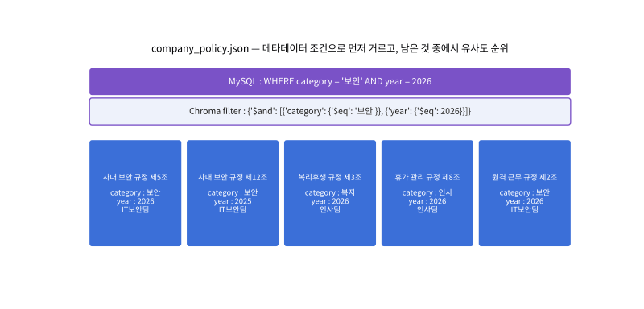
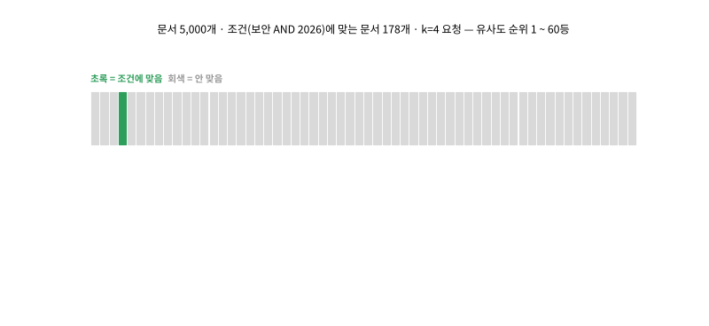
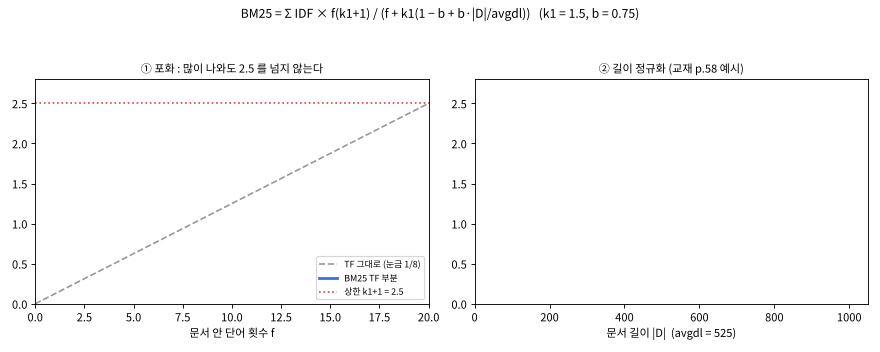
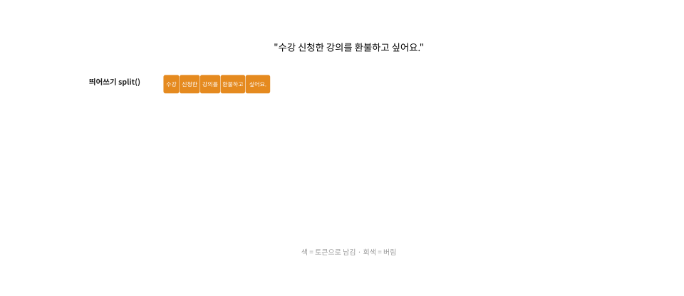
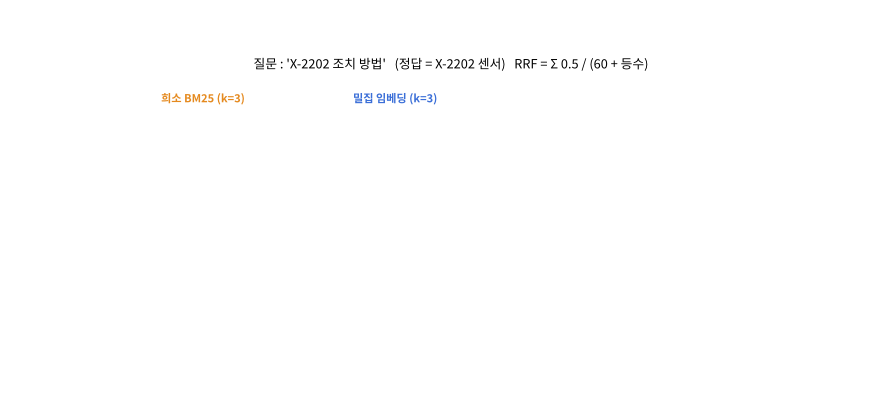

# Day 050 · 2026-11-18 (수)

`LLM (초거대언어모델)` · 12주차

> **한 줄 요약** — 검색을 세 방향으로 넓혔다. ① **메타데이터 필터** — `{'$and': [{'category': {'$eq': '보안'}}, {'year': {'$eq': 2026}}]}` 는 SQL 의 `WHERE category='보안' AND year=2026`. 문서 5,000개에서 같은 조건으로 4개를 요청하니 Chroma 는 4개, FAISS 는 **1개** — FAISS 는 유사도로 먼저 20개(`fetch_k`)를 뽑은 **뒤에** 거르기 때문(교재 p.54 결론의 실제 근거). ② **BM25 희소 검색** — 단어가 글자 그대로 겹쳐야 찾는 대신 오류 코드 · 조항 번호에 강하다. 한글은 **MeCab 형태소**로 잘라야 하고(띄어쓰기로는 질문 5개 중 3개만), 손으로 계산한 점수가 `rank_bm25` 와 같았다. ③ **하이브리드** — BM25 와 임베딩의 **등수**를 RRF 로 합친다. 연습용 오류 코드 문서에서 임베딩은 'X-2202' 를 묻는데 **X-2201** 을 가져왔고, BM25 는 겹치는 단어가 없는 '컴퓨터 화면이 안 켜져요' 에 **0점짜리** 문서를 내놨다. 둘을 합치면 앞의 문제는 풀리지만 0점 결과가 '1등' 으로 섞이는 문제가 남았고, 고쳐 보니 고친 만큼 다른 질문이 틀렸다(15문항 모두 14/15) → **질문 묶음으로 재면서** 고친다.

📂 실습 노트북
- [`lecture/chroma_filter_csvloader.ipynb`](./lecture/chroma_filter_csvloader.ipynb) — 연산자 · MySQL 비교 · 자주 틀리는 것 · FAISS 필터와 `fetch_k` · 5,000개 비교 · `CSVLoader` (교재 p.51~54, 필기 `RAG_실습6`)
- [`lecture/bm25_sparse_search.ipynb`](./lecture/bm25_sparse_search.ipynb) — `TF-IDF 정리` 다시 계산 · BM25 공식 · MeCab 토큰화 · 손계산 · 코드 검색 · 0점 문제 (교재 p.55~61, 필기 `RAG_실습4` 완성)
- [`lecture/hybrid_search_rrf.ipynb`](./lecture/hybrid_search_rrf.ipynb) — 희소 · 밀집 · 하이브리드 비교 · RRF 손계산 · 단일 검색의 문제 · 고쳐 보기 · RAG 체인 (교재 p.62~64, 필기 `RAG_실습5_1`)

📊 실습 데이터 → [`manual.txt`](./lecture/manual.txt) · [`tech_support_manual.txt`](./lecture/tech_support_manual.txt) (스마트홈 기술 지원 QA 8쌍) · [`company_policy.json`](./lecture/company_policy.json) (사내 규정 5개 + 메타데이터) · [`ChatBotData_sample.csv`](./lecture/ChatBotData_sample.csv) (챗봇 Q · A 30줄)
🖼️ 그림 → [`lecture/images/`](./lecture/images/) — 🎬 **시뮬레이션 애니메이션(GIF) 5개** (노트북과 같은 데이터 · 같은 코드로 계산한 것)
📖 교재 → `AI Agent` 교재 **p.52~64** (ChromaDB 연산자 · MySQL 비교 · 실습 결론 · 밀집 vs 희소 검색 · 희소 검색이 필요한 분야 · BM25 · 한글 처리 · 장단점 · 하이브리드 검색 · RRF · EnsembleRetriever) — 다음은 p.65 하이브리드 실습 · p.66 `25. 서울시 상권 분석 및 보고서 작성 멀티 에이전트`
📝 필기 → [`RAG_실습4.ipynb`](./lecture/RAG_실습4.ipynb) · [`RAG_실습5_1.ipynb`](./lecture/RAG_실습5_1.ipynb) · [`RAG_실습6.ipynb`](./lecture/RAG_실습6.ipynb) · 정리 자료 `TF-IDF 정리`(PDF, 올리지 않음 — 계산은 노트북에서 확인)

⚙️ **설치 · 실행** — `pip install langchain-community langchain-classic langchain-chroma faiss-cpu rank_bm25 python-mecab-ko langchain-huggingface sentence-transformers langchain-openai python-dotenv scikit-learn pandas matplotlib` (리눅스에서 `python-mecab-ko` 빌드 오류 → `apt-get install mecab libmecab-dev` 먼저) → 데이터 4개를 노트북과 같은 폴더에 → 맨 위부터 모두 실행 (🧪 로컬 임베딩 약 440MB 를 처음 한 번 받음 · **API 키 없이** 실행)

> **출력 표시** — `# 📼` 셀은 **수업 시간 실행 결과**, `# ⏳` 셀(1개)은 API 키가 필요해 **비어 있다**, `# 🧪` 셀은 밀집 검색을 OpenAI 대신 **로컬 한국어 임베딩**(`ko-sroberta-multitask`)으로 돌렸거나 **가짜 LLM** 으로 흐름만 본 것. BM25 는 임베딩이 필요 없어 수업과 같은 방식 · 같은 결과다.

---

## 1. 메타데이터 필터 연산자 (교재 p.51~53)

```python
retriever = vectorstore.as_retriever(search_kwargs={'k': 1, 'filter': {
    '$and': [{'category': {'$eq': '보안'}}, {'year': {'$eq': 2026}}]}})
retriever.invoke('비밀번호 규정 알려줘')      # → 사내 보안 규정 제5조
```



🎬 `company_policy.json` 의 규정 5개에 조건을 바꿔 가며 건다(초록 = 통과). 조건으로 **먼저** 후보를 줄이고, 그 안에서 질문과 가까운 순서로 `k` 개를 고른다.

| 할 일 | MySQL | Chroma `filter` |
|---|---|---|
| 같다 · 다르다 | `=` · `!=` | `$eq` · `$ne` (FAISS 는 **`$neq`**) |
| 크기 비교 | `>` `>=` `<` `<=` | `$gt` `$gte` `$lt` `$lte` |
| 목록 안 · 밖 | `IN` · `NOT IN` | `$in` · `$nin` (교재 표에는 없음) |
| 그리고 · 또는 | `AND` · `OR` | `{'$and': [...]}` · `{'$or': [...]}` |
| 개수 | `LIMIT 1` | `'k': 1` (유사도 순서로 1개) |

- 조건 두 개를 `$and` 없이 한 딕셔너리에 넣으면 `ValueError: Expected where to have exactly one operator`
- **자료형까지** 맞아야 한다 — `year` 는 숫자 2026, 글자 `'2026'` 으로 거르면 0개. CSV 에서 읽은 값은 모두 글자(§3)

---

## 2. FAISS vs ChromaDB — '구조적으로 강력' 의 뜻 (교재 p.54)



🎬 문서 5,000개 중 조건(보안 AND 2026)에 맞는 것은 178개(초록). FAISS 는 유사도로 먼저 **20개**(빨간 상자)를 뽑고 그 안에서 거르니 1개만 남는다. Chroma 는 조건에 맞는 178개 안에서 1 ~ 4등을 찾는다(전체 유사도 순위로는 4 · 82 · 91 · 180등).

| 문서 5,000개 (가짜 임베딩 · 이 환경 한 번 측정) | FAISS | Chroma |
|---|---|---|
| 저장 | 0.45초 | 2.94초 |
| 검색 (필터 없음) | 0.44ms | 1.57ms |
| 필터 + k=4 | **1개** | **4개** |

- 속도는 FAISS 가 빠르지만 둘 다 ms 단위. 차이가 나는 것은 **필터 결과** — FAISS 는 `fetch_k=5000` 처럼 키워야 4개를 찾는다(그만큼 느려진다)

---

## 3. CSV 불러오기 — `CSVLoader` (필기 `RAG_실습6`)

```python
loader = CSVLoader(file_path='ChatBotData_sample.csv', encoding='utf-8',
                   content_columns=['Q', 'A'], metadata_columns=['label'])
docs = loader.load()     # 30개 · page_content 'Q: 12시 땡!\nA: 하루가 또 가네요.' · metadata {'source', 'row': 0, 'label': '0'}
```

- 한 줄 = Document 하나 — Q 와 A 를 한 Document 에 넣어 **질문으로 찾고 답을 함께** 얻는다(분할 불필요)
- 🧪 로컬 임베딩으로도 '가족 여행 갈거야. 기대가 많이 되' → **row 23 · 28** — 수업(OpenAI)과 같다
- `label` 은 글자 `'0'` → `{'label': '0'}` 은 3개, `{'label': 0}` 은 **0개**

---

## 4. TF-IDF → BM25 (교재 p.55~58 · 정리 자료 `TF-IDF 정리`)

$$\text{Score}(D, Q) = \sum_{q_i \in Q} \text{IDF}(q_i) \cdot \frac{f(q_i, D)\,(k_1 + 1)}{f(q_i, D) + k_1\left(1 - b + b\,\frac{|D|}{\text{avgdl}}\right)}$$



🎬 왼쪽 : 단어가 많이 나와도 BM25 의 TF 부분은 $k_1 + 1 = 2.5$ 를 넘지 않는다(포화). 오른쪽 : 같은 횟수라도 문서가 길수록 깎인다 — 교재 p.58 예시 '1,000단어 중 5번(1.66) < 50단어 중 3번(2.15)'.

| IDF (문서 3개 예시 · 정리 자료) | 사과 (DF 1) | 바나나 (DF 2) |
|---|---|---|
| 정리 자료 `N / DF` | 3.0 | 1.5 |
| $\log(N/DF)$ | 1.099 | 0.405 |
| sklearn $\ln\frac{1+N}{1+DF}+1$ | 1.693 | 1.288 |
| BM25(`rank_bm25`) $\ln\frac{N-DF+0.5}{DF+0.5}$ | 0.511 | **−0.511** |

- 정리 자료의 표 계산은 모두 맞다. 다만 `N/DF` 는 단순형이고 실제는 **로그** — 모든 문서에 나오는 단어가 0 이 되어야 '흔한 단어를 지운다'
- BM25 IDF 는 절반 넘는 문서에 나오는 단어에서 **음수** → `rank_bm25` 는 0.25 × 평균 IDF 로 바꿔 넣는다(매뉴얼의 `질문` · `답변` · `:` → −3.045 → 0.371)
- 손으로 계산한 점수가 `rank_bm25.get_scores` 와 **같다** ('환불하고 싶어요' → 2번 문서 5.102, 나머지 0)

---

## 5. 한글은 형태소로 — MeCab (교재 p.59 · 필기 `RAG_실습4`)

```python
def mecab_tokenizer(text):            # 필기는 여기 for 에서 멈춤 → 완성
    return [morph for morph, pos in mecab.pos(text) if pos.startswith(('N', 'V', 'S'))]
sparse_retriever = BM25Retriever.from_documents(documents=docs, preprocess_func=mecab_tokenizer, k=2)
```



🎬 같은 문장을 띄어쓰기 · MeCab · 수업 함수(N · V · S) · 코드를 통째로 남기는 함수로 자른다. 수업 함수는 `SH-M200X` 를 `SH` `-` `M` `200` `X` 로, `ERR-502` 를 `ERR` `-` `502` 로 조각내고 `-` · `?` 같은 **문장부호도 토큰으로** 남긴다(`S` 에 `SF` · `SY` 가 포함).

| 질문 5개 (매뉴얼 10쌍) | 띄어쓰기 | MeCab |
|---|---|---|
| 1등이 맞은 수 | 3 — 질문을 매뉴얼 문장과 똑같이 쓴 경우만 | **5** |
| '수료증 발급되나요?' | 점수 0 (`수료증` ≠ `수료증을`) → 엉뚱한 문서 | `수료증` 으로 정답 |

- 매뉴얼에 **없는** `ERR-503` 을 물어도 `ERR` · `오류` 가 겹쳐 ERR-502 문서가 1등 → LLM 이 틀리게 답할 위험. 코드를 통째로 남기면 `ERR-503` 은 어디에도 없는 토큰이 된다
- 겹치는 단어가 없으면 점수가 모두 0 — 그래도 `BM25Retriever` 는 **k개를 돌려준다**('프린터 용지가 걸렸어요' → 8번 · 7번)

---

## 6. 하이브리드 검색 · RRF (교재 p.62~64 · 필기 `RAG_실습5_1`)

```python
hybrid_retriever = EnsembleRetriever(retrievers=[sparse_retriever, dense_retriever], weights=[0.5, 0.5])
# RRF(d) = Σ w_i / (60 + 등수_i)   ← 점수 대신 등수만 쓴다 (BM25 2.06 과 코사인 0.65 는 척도가 달라 더할 수 없다)
```



🎬 연습용 오류 코드 문서 6개(교재 p.63 예를 확인하려고 만든 것). 'X-2202 조치 방법' 은 밀집이 **X-2201** 을 1등으로 가져오지만 희소가 코드 일치로 X-2202 를 1등으로 끌어올린다. '컴퓨터 화면이 안 켜져요' 는 희소 점수가 모두 0 인데도 그 1등(프린터)이 RRF 에 들어가, 밀집 1등(모니터)과 **동점** — 순서가 앞선 프린터가 1등이 됐다.

| 🧪 1등이 정답인 질문 | 수업 방식 | ① 0점 제외 | ② 코드 토큰 + 0점 제외 |
|---|---|---|---|
| 기술 지원 매뉴얼 10문항 | 10 | 10 | 9 (부사 `안` 이 NET-104 의 '연결 안 됨' 과 겹침) |
| 연습용 오류 코드 5문항 | 4 (화면 → 프린터) | 4 (X-2210 → X-2202, BM25 동점의 순서) | 5 |

- RRF 손계산 = `EnsembleRetriever` ($c = 60$) · 교재 p.64 예시 순서(1등+2등 > 3등+1등 > 2등+3등)는 0.03252 > 0.03227 > 0.03200 으로 맞다
- 수업 값 `chunk_size=210` 은 최대 QA 208자 + 구분자 2 에 **딱 맞는 최솟값**(208 · 209 → 9개)
- 수업 챗봇 기록 3번(ERR-502 · 강제 재부팅 · DL-900) — 하이브리드가 매번 3개를 모았고, 답은 모두 근거 QA 와 맞았다

---

## 정리

| | 희소 (BM25) | 밀집 (임베딩) | 하이브리드 (RRF) |
|---|---|---|---|
| 기준 | 글자 그대로 겹치는 단어 | 뜻이 가까운 문장 | 두 결과의 **등수** |
| 강점 | 코드 · 조항 · 고유명사 | 다른 말로 한 같은 뜻 | 둘 다 |
| 약점 | 동의어 · 겹치는 단어 없음(0점이어도 k개) | 숫자만 다른 비슷한 문서 | 0점 결과 · 동점이 섞임 |
| 준비 | 형태소 토큰화 (`preprocess_func`) | 임베딩 모델 · 벡터 저장소 | `EnsembleRetriever(weights=…)` |
| 거르기 | — | Chroma `filter` (먼저 거름) · FAISS (`fetch_k` 안에서) | — |

---

## 🔁 복습

**필기 · 정리 자료 · 교재에서 고친 부분**
- [x] `RAG_실습4` 토큰화 함수가 `for` 에서 끊김 → 완성, `BM25Retriever` 로 검색까지
- [x] `RAG_실습4` · `RAG_실습5_1` 함수 설명 'S : 숫자 및 외국어, 기호 등' → `S` 는 마침표 · 붙임표 · 쉼표 같은 **문장부호까지** 토큰으로 남김 · `V` 는 지정사 `VCP` 까지 · `ERR-502` 를 세 조각으로 → 매뉴얼에 없는 `ERR-503` 에도 ERR-502 문서가 1등
- [x] `RAG_실습5_1` BM25 점수가 모두 0 이어도 k개를 돌려줘 하이브리드 순위가 흐려짐 → 0점 제외 · 코드 토큰을 시험 — 각각 새로 틀리는 질문이 생겨 **질문 묶음으로 재면서** 고쳐야 함
- [x] `RAG_실습5_1` `chunk_size=210` 은 딱 맞는 최솟값(208 + 2) — QA 가 늘면 다시 잰다
- [x] `RAG_실습5_1` · `RAG_실습6` '폴더가 있으면 불러오기'(`chroma_db_tech_support` · `chroma_db_csv`) · `while True … except Exception: print` → Day 049 와 같이 고침
- [x] `RAG_실습6` CSV 메타데이터는 글자 → `{'label': '0'}` (숫자 `0` 으로는 0개)
- [x] 정리 자료 `TF-IDF 정리` 'IDF = N / DF' → 계산 표는 맞지만 실제 IDF 는 로그(모든 문서에 나오면 0) — BM25 는 $\ln\frac{N-DF+0.5}{DF+0.5}$
- [x] 교재 p.57 BM25 의 IDF '단어가 등장한 문서 수의 역수 (N/DF)' → 로그 · 0.5 보정 · 절반 넘게 나오면 음수(`rank_bm25` 는 작은 값으로 바꿈)
- [x] 교재 p.58 '… 더 관련성이 높다고' 에서 문장이 끊김 → '본다' (계산해도 맞다 : 1.66 < 2.15)
- [x] 교재 p.52 연산자 표에 `$in` · `$nin` 이 없음 · FAISS 는 '다르다' 가 `$neq`
- [x] 교재 p.53 `LIMIT 1` ↔ `'k': 1` → `k` 는 **유사도 순서**로 자른다
- [x] 교재 p.54 'ChromaDB 가 구조적으로 강력' → 근거 : FAISS 필터는 `fetch_k` 개 안에서만 거른다(5,000개에서 4개 요청에 1개)
- [x] 교재 p.62 표 밀집 검색 약점 '환각' → 환각은 LLM 이 만든다. 밀집 검색의 약점은 **비슷하지만 틀린 문서**(X-2201 ↔ X-2202)를 가져오는 것
- [x] 교재 p.64 '척도가 달러서' · '백터 1등' → 달라서 · 벡터 / '밀집 검색은 0 ~ 1 사이' → 코사인은 −1 ~ 1, Chroma 기본은 거리(작을수록 가까움)
- [x] 교재 머리글 `SK네트웍스 Famiy` → Family

**직접 해본 것**
- `company_policy.json` 으로 연산자 7가지를 MySQL `WHERE` 와 나란히 실행, 자료형 · `$and` 실수 재현
- 가짜 임베딩 문서 5,000개로 FAISS · Chroma 저장 · 검색 시간과 필터 결과 비교, `fetch_k` 바꿔 보기
- 정리 자료의 TF-IDF 예시를 4가지 IDF 로 다시 계산, BM25 포화 · 길이 정규화 그래프
- BM25 점수를 손으로 계산해 `rank_bm25` 와 비교, 띄어쓰기 vs MeCab, 코드를 통째로 남기는 토크나이저
- 교재 p.63 의 예를 연습용 문서 6개로 재현, RRF 손계산, 0점 제외 · 코드 토큰 두 가지 수정을 15문항으로 평가
- `FuncAnimation` 으로 메타데이터 필터 / FAISS `fetch_k` / 토큰화 비교 / BM25 곡선 / RRF 애니메이션

**막혔던 부분 / 질문**
- [ ] `# ⏳` 셀을 내 키로 — OpenAI 임베딩도 'X-2202' 를 X-2201 로 헷갈리는가, 'ERR-503' 질문에 '찾을 수 없습니다' 로 답하는가
- [ ] `weights` 를 [0.7, 0.3] · [0.3, 0.7] 로 바꾸면 15문항 결과가 어떻게 달라지는가
- [ ] BM25 의 $k_1$ · $b$ 를 바꾸면? (`BM25Retriever.from_documents(..., bm25_params={'k1': …, 'b': …})`)
- [ ] 질문 묶음을 수십 개로 늘려 '수업 방식 vs 고친 방식' 을 다시 재기
- [ ] 다음 : 하이브리드 실습(p.65) → `25. 서울시 상권 분석 및 보고서 작성 멀티 에이전트` (p.66~)

📂 [수업 자료 폴더](./lecture/) · [복습 자료 폴더](./review/)

---

## 🔗 참고 링크

- [Chroma — 메타데이터 필터(where)](https://docs.trychroma.com/docs/querying-collections/metadata-filtering) · [LangChain FAISS 통합](https://docs.langchain.com/oss/python/integrations/vectorstores/faiss) · [LangChain Chroma 통합](https://docs.langchain.com/oss/python/integrations/vectorstores/chroma)
- [LangChain BM25 retriever](https://docs.langchain.com/oss/python/integrations/retrievers/bm25) · [rank_bm25](https://github.com/dorianbrown/rank_bm25) · [python-mecab-ko](https://github.com/jonghwanhyeon/python-mecab-ko)
- [Robertson & Zaragoza — The Probabilistic Relevance Framework: BM25 and Beyond (2009)](https://www.staff.city.ac.uk/~sbrp622/papers/foundations_bm25_review.pdf)
- [Cormack et al. — Reciprocal Rank Fusion (SIGIR 2009)](https://plg.uwaterloo.ca/~gvcormac/cormacksigir09-rrf.pdf)
- 이전 : [Day 049 — 벡터 저장소 · RAG 체인 · PDF 헌법 Q&A](../2026-11-17/README.md)
