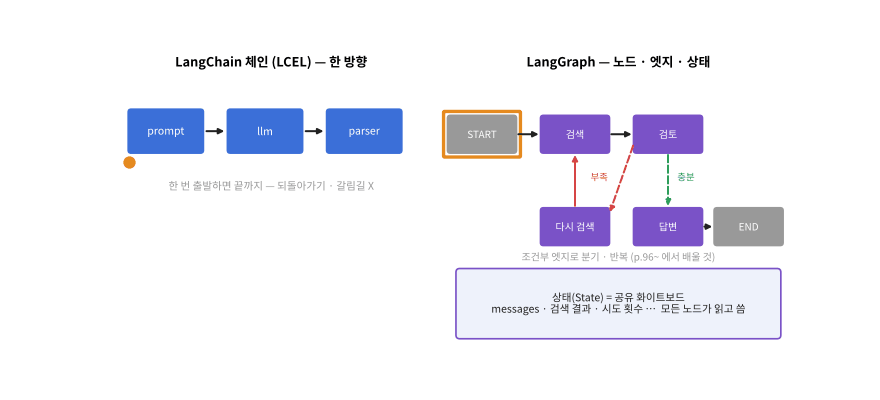
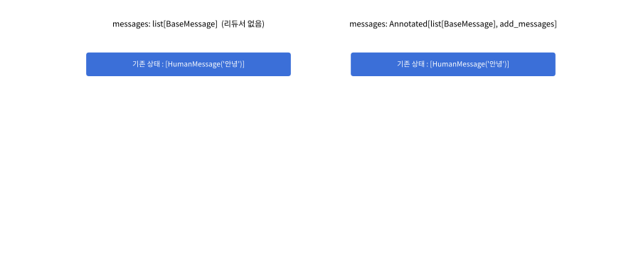
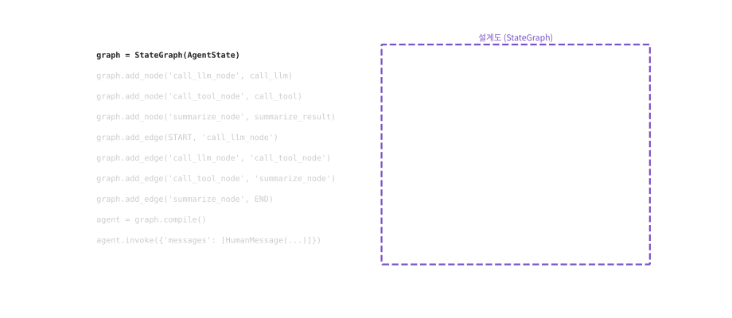
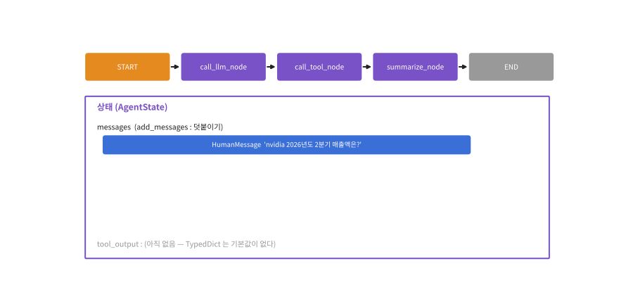
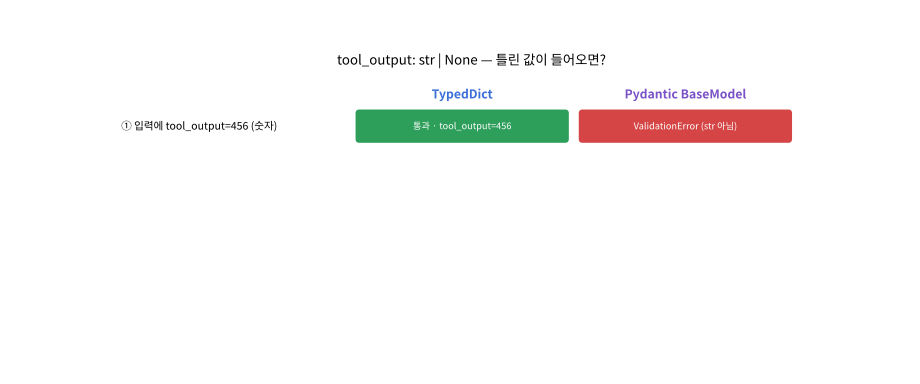

# Day 051 · 2026-11-19 (목)

`LLM (초거대언어모델)` · 12주차

> **한 줄 요약** — RAG 단원을 마치고 `25. 서울시 상권 분석 멀티 에이전트` 로 넘어가며 **LangGraph** 를 시작했다. 일하는 함수 = **노드**, 다음에 갈 곳 = **엣지**, 모든 노드가 같이 쓰는 화이트보드 = **상태**. 상태 양식은 `TypedDict` 나 Pydantic `BaseModel` 로 정하고, `messages` 에 **`add_messages` 리듀서**를 붙여야 대화가 덮어써지지 않고 쌓인다(빼면 질문이 사라진다). 실행해 보니 교재 p.87 · 91 의 `ToolMessage(content=…)` 는 `tool_call_id` 가 없어 **오류**, 내 필기의 `tool_calls` 는 `id` 가 없어 실행하면 **오류** — 도구 호출과 도구 답은 **같은 id 로 짝**을 지어야 한다. Pydantic 상태는 틀린 값을 막지만 검사하는 때는 '**다음 노드가 받을 때**' 라서 마지막 노드의 틀린 출력은 그대로 나왔고, `invoke()` 결과는 BaseModel 이 아니라 **dict** 였다.

📂 실습 노트북
- [`lecture/langgraph_typeddict_state.ipynb`](./lecture/langgraph_typeddict_state.ipynb) — 체인 vs 그래프 · 타입 힌트 · TypedDict · 리듀서 · 노드 · 그래프 만들기 · `invoke` / `stream` · 빠진 키 (교재 p.72~87 · 92~93, 필기 `LangGraph_실습1` · `LangGraph_실습1_1`)
- [`lecture/langgraph_pydantic_state.ipynb`](./lecture/langgraph_pydantic_state.ipynb) — `BaseModel` · `Field` · BaseModel 상태 그래프 · 검사 시점 · 비교표 (교재 p.88~91 · 94~95)

📊 데이터 → 없음 (노드가 정해 둔 메시지를 돌려주는 모의 실행)
🖼️ 그림 → [`lecture/images/`](./lecture/images/) — 🎬 **시뮬레이션 애니메이션(GIF) 5개** (노트북과 같은 그래프를 실제로 실행한 기록)
📖 교재 → `AI Agent` 교재 **p.65~95** (하이브리드 실습 · 25. 서울시 상권 분석 및 보고서 작성 멀티 에이전트 시나리오 · 25-1. LangGraph — LangChain 한계 · 정의 · 노드 · 엣지 · 상태 · 타입 힌트 · TypedDict · Pydantic · 실습 2개) — 다음은 p.96 조건부 엣지
📝 필기 → [`LangGraph_실습1.ipynb`](./lecture/LangGraph_실습1.ipynb) (그래프 만들기에서 멈춤) · [`LangGraph_실습1_1.ipynb`](./lecture/LangGraph_실습1_1.ipynb) (실행 완료본)

⚙️ **설치 · 실행** — `pip install langgraph` → 맨 위부터 모두 실행 (**API 키 · 인터넷 · 데이터 필요 없음**)

> **출력 표시** — 모든 셀을 실제로 실행했다. `# 📼` 셀(1개)만 수업 시간 출력을 옮긴 것.

---

## 1. 서울시 상권 분석 멀티 에이전트 — 앞으로 만들 것 (교재 p.66~71)

| 단계 | 내용 |
|---|---|
| 문제 | 감에 의존하는 입지 선정 · 보고서 1~2주 · 분석팀 병목 |
| 목표 | 서울시 분기 · 연령 · 시간대별 매출 데이터로 '자연어 질문 → 몇 분 안에 분석 보고서' |
| 구조 | LangGraph 4단계 : **질문 재구성 → SQL 생성(NL2SQL) → 실행 → 보고서 작성** · 각 노드는 PydanticAI Agent · SQLite · 대화 기억은 `AsyncSqliteSaver` |
| 개발 순서 | ① 서울 열린데이터광장 API 로 데이터 파이프라인 ② 4개 노드 ③ 생성형 AI 로 웹 APP |

- '그럼 거기와 흑리단길을 비교하면 2024년도 여성 매출액은?' 처럼 **앞 대화를 알아야** 풀 수 있는 질문을 '2024년도 성수동카페거리와 흑리단길 상권의 여성 매출액 비교' 로 바꾸는 것이 첫 노드 — 오늘 배운 **상태(대화 기록)** 가 필요한 이유
- 📝 교재 p.68 'gpt-5-nano 로 강력한 추론' → nano 는 GPT-5 계열에서 가장 작고 싼 모델이다(OpenAI 문서에는 지원 종료 예정 표시, Day 047). SQL 생성처럼 정확도가 중요한 노드는 결과를 검증하는 단계가 필요하다

---

## 2. 왜 LangGraph 인가 (교재 p.73~81)



🎬 왼쪽 : LCEL 체인은 `prompt → llm → parser` 를 한 방향으로 끝까지 간다. 오른쪽 : 그래프는 '검토' 결과가 부족하면 '다시 검색' 으로 **되돌아갈** 수 있고, 모든 노드가 **상태**(화이트보드)를 읽고 쓴다.

| 구성 요소 | 뜻 | 코드 |
|---|---|---|
| 노드 | 누가 무엇을 하나 — 함수 하나 | `graph.add_node('이름', 함수)` |
| 엣지 | 다음에 어디로 — 일반 / 조건부 | `graph.add_edge(a, b)` · `add_conditional_edges` (다음 시간) |
| 상태 | 모든 노드의 공유 메모리 + 주고받는 형식(API) | `StateGraph(AgentState)` |

- 📝 교재 p.73 'LangChain 은 단방향 · 기억 없음' 은 **LCEL 체인** 이야기다. Day 047 의 `create_agent` 는 이미 안에서 LangGraph 그래프(`model ⇄ tools` 반복)였고, 대화 기록도 `MessagesPlaceholder` 로 넘겼다

---

## 3. 상태 정의 — TypedDict · 리듀서 (교재 p.82~87)

```python
class AgentState(TypedDict):
    messages: Annotated[list[BaseMessage], add_messages]   # 대화는 덧붙이기
    tool_output: str | None                                # 리듀서 없음 → 덮어쓰기
```



🎬 같은 노드(`AIMessage('반갑습니다!')` 를 돌려줌)를 두 상태로 실행했다. 리듀서가 없으면 질문 `HumanMessage('안녕')` 이 **덮어써져 사라지고**, `add_messages` 가 있으면 `[Human, AI]` 로 쌓인다.

- 타입 힌트(`retries: int`)와 `TypedDict` 는 **안내문**이다 — `agent_node('세 번', 123)` · `User(id='삼')` 도 오류 없이 실행된다
- `add_messages` 는 덧붙이기 + **같은 id 면 교체** + 글자도 메시지로 바꿔 받기
- TypedDict 에는 **기본값이 없다** — 도구 노드를 건너뛰고 요약 노드가 `state['tool_output']` 을 읽으면 `KeyError`

---

## 4. 노드 · 그래프 · 실행 (교재 p.87 · 92~93 · 필기)

```python
def call_llm(state: AgentState) -> dict:          # 상태 전체를 받아 '바꿀 항목만' dict 로
    return {'messages': [AIMessage(content='', tool_calls=[{'name': 'tavily_search', 'args': {...}, 'id': 'call_search_001'}])]}

def call_tool(state: AgentState) -> dict:
    call = state['messages'][-1].tool_calls[0]
    return {'messages': [ToolMessage(content=result, tool_call_id=call['id'])], 'tool_output': result}   # id 로 짝

graph = StateGraph(AgentState)
graph.add_node('call_llm_node', call_llm); ...
graph.add_edge(START, 'call_llm_node')            # = set_entry_point('call_llm_node')
...
agent = graph.compile()                           # StateGraph → CompiledStateGraph
agent.stream({...}, stream_mode='updates')        # 노드마다 바뀐 부분
```



🎬 코드 한 줄마다 설계도에 노드 · 엣지가 생기고, `compile()` 에서 실행 가능한 그래프가 된 뒤 `invoke` 로 START → END 까지 흐른다.



🎬 실제 실행 기록(`stream_mode='values'`). 노드를 지날 때마다 `messages` 에 AI(tool_calls `id=call_search_001`) → Tool(`tool_call_id=call_search_001`) → AI 가 덧붙고, 도구 노드에서 `tool_output` 이 채워진다.

| 확인한 오류 | 원인 |
|---|---|
| 교재 p.87 · p.91 `ToolMessage(content=…)` → `KeyError: 'tool_call_id'` | 도구 답은 어느 호출에 대한 답인지 `tool_call_id` 필수 |
| 필기 `LangGraph_실습1` `tool_calls=[{'name', 'args'}]` → `TypeError: … missing 'id'` | 도구 호출에는 `id` 필수 — 필기는 실행 전에 멈춰 드러나지 않았다 |
| 필기 실행본 : 도구 호출 없는 `AIMessage` 뒤의 `ToolMessage` | 모의 실행은 돌지만, 실제 OpenAI API 는 `tool_calls` 없는 메시지 뒤의 `tool` 메시지를 거부한다 |

---

## 5. Pydantic `BaseModel` 상태 (교재 p.88~91 · 94~95)

```python
class AgentState(BaseModel):
    messages: Annotated[list[BaseMessage], add_messages] = Field(default_factory=list)
    tool_output: str | None = Field(default=None)              # 기본값 → 빠진 키 문제 없음
def call_llm(state: AgentState) -> dict:
    question = state.messages[-1].content                      # 점(.)으로 읽는다 — state['messages'] 는 TypeError
```



🎬 `tool_output: str | None` 자리에 숫자가 들어오는 네 가지 경우. TypedDict 는 모두 통과(빠진 키만 `KeyError`), BaseModel 은 ① 입력 ② 다음 노드가 받을 때 오류를 내지만 ③ **마지막 노드**의 틀린 출력은 그대로 통과한다.

| | TypedDict | BaseModel |
|---|---|---|
| 틀린 자료형 | 그대로 담음 | 오류 — 그래프 입력 · **다음 노드 입력**에서 (마지막 노드 출력은 검사 안 됨) |
| 기본값 | 없음 → `KeyError` | `Field(default=…)` |
| 노드에서 읽기 | `state['messages']` | `state.messages` |
| `invoke()` 결과 | dict | **dict** |

- `Field(default=3, ge=1, le=10, min_length=2, description='…')` — 범위 · 길이 제약이 실제로 오류를 낸다. `description` 은 `model_json_schema()` 에 들어간다

---

## 🔁 복습

**필기 · 교재에서 고친 부분**
- [x] `LangGraph_실습1` `AIMessage(tool_calls=[{'name': 'tavily_search', 'args': …}])` → `id` 가 없어 **실행하면 `TypeError`** → `'id': 'call_search_001'`
- [x] 두 필기 `ToolMessage(tool_call_id='searcg_tool_call_id_123')` → 오타 · 앞의 도구 호출과 짝이 안 맞음 → 직전 `tool_calls[0]['id']` 사용
- [x] `LangGraph_실습1_1` 도구 호출이 없는 `AIMessage('도구 사용을 요청합니다.')` 뒤에 `ToolMessage` → 실제 API 에는 보낼 수 없는 순서 → `tool_calls` 를 가진 AIMessage 로
- [x] 두 필기 노드 설명 `{'messages':[BaseMessage], 'tool_output']}` → 괄호 짝 · `{'messages': [...], 'tool_output': ...}`
- [x] 두 필기 `set_entry_point` → 같은 뜻의 `add_edge(START, …)` 도 함께 · 필기 출력 `<StateGraph at 0x…>` 는 `add_edge` 가 그래프 자신을 돌려줘서 찍힌 것(오류 아님)
- [x] 교재 p.87 · p.91 `ToolMessage(content=tool_result)` → **`KeyError: 'tool_call_id'`** — `tool_call_id` 필수
- [x] 교재 p.89 표 '결과물 타입 : Pydantic BaseModel' → 노드가 받는 상태는 BaseModel, **`invoke()` 결과는 dict**
- [x] 교재 p.89 '실행 중 잘못된 값이 들어오면 **즉시** 에러' → 입력과 **다음 노드가 받을 때** 에러 · 마지막 노드의 출력은 검사되지 않음
- [x] 교재 p.90 'Field 설명이 LLM 시스템 프롬프트에 포함' → 그 모델을 LLM 의 **답 형식**으로 줄 때(`with_structured_output` 등)만. 그래프 상태의 설명은 LLM 에게 자동으로 가지 않는다
- [x] 교재 p.73 'LangChain = 단방향 비순환 · 기억 없음' → LCEL 체인의 이야기 · `create_agent` 는 이미 LangGraph 반복 구조
- [x] 교재 p.68 'gpt-5-nano 로 강력한 추론' → GPT-5 계열에서 가장 작은 모델 · 지원 종료 예정 표시
- [x] 교재 p.86 주석 'TypedDict 클래스 **함수** 상속' → 클래스 상속 · p.74 제목 `LangGrpah` → LangGraph · 머리글 `Famiy` → Family

**직접 해본 것**
- 타입 힌트 · TypedDict 에 틀린 값을 넣어 실행되는지 확인
- 리듀서 있음 / 없음 두 상태로 같은 노드 실행, `add_messages` 를 직접 불러 덧붙이기 · 교체 · 글자 변환 확인
- 교재 코드와 필기 코드의 메시지 오류 재현, id 짝을 맞춘 노드로 고쳐 실행, `stream` 으로 노드별 변경 확인
- BaseModel `Field` 제약 · JSON 스키마, BaseModel 상태로 같은 그래프 실행, 검사 시점 3가지 실험
- `FuncAnimation` 으로 체인 vs 그래프 / 상태 흐름 / 리듀서 / TypedDict vs BaseModel / 그래프 만들기 애니메이션

**막혔던 부분 / 질문**
- [ ] 조건부 엣지(`add_conditional_edges`) — LLM 이 도구를 부르면 도구 노드로, 아니면 END 로 (교재 p.96~)
- [ ] 모의 노드 대신 진짜 `ChatOpenAI.bind_tools` 와 `ToolNode` 를 넣으면 이 그래프가 Day 047 의 `create_agent` 와 같아지는가
- [ ] 노드 출력까지 검사하고 싶으면 — 노드 안에서 `AgentState(**update)` 로 직접 검사? 
- [ ] `AsyncSqliteSaver` 체크포인터로 대화 상태를 저장 · 이어 가기 (시나리오의 대화 관리)

📂 [수업 자료 폴더](./lecture/) · [복습 자료 폴더](./review/)

---

## 🔗 참고 링크

- [LangGraph 개요](https://docs.langchain.com/oss/python/langgraph/overview) · [Graph API (State · Nodes · Edges)](https://docs.langchain.com/oss/python/langgraph/graph-api) · [Use the graph API (Pydantic 상태 · 검사)](https://docs.langchain.com/oss/python/langgraph/use-graph-api)
- [Python `typing` — TypedDict · Annotated](https://docs.python.org/3/library/typing.html) · [Pydantic — Models · Fields](https://docs.pydantic.dev/latest/concepts/models/)
- [LangChain 메시지 — ToolMessage · tool_calls](https://docs.langchain.com/oss/python/langchain/messages)
- 이전 : [Day 050 — 메타데이터 필터 · BM25 · 하이브리드 검색](../2026-11-18/README.md)
