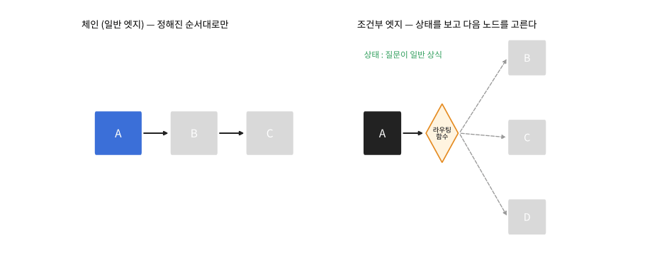
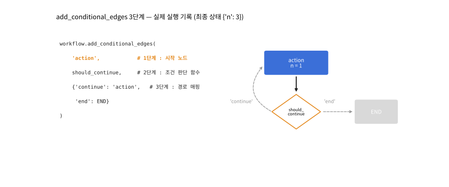
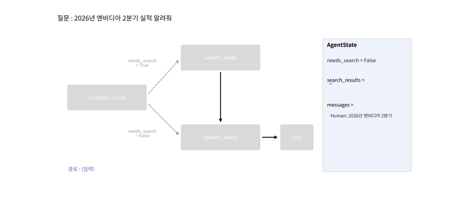
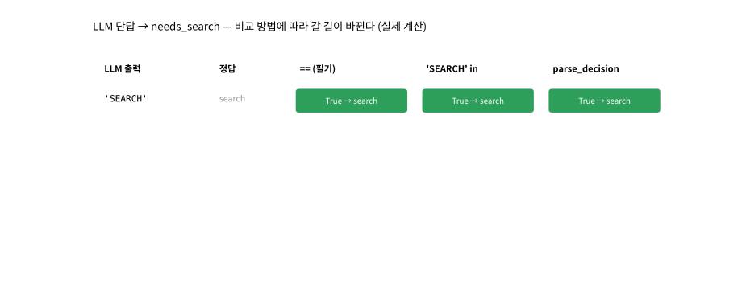
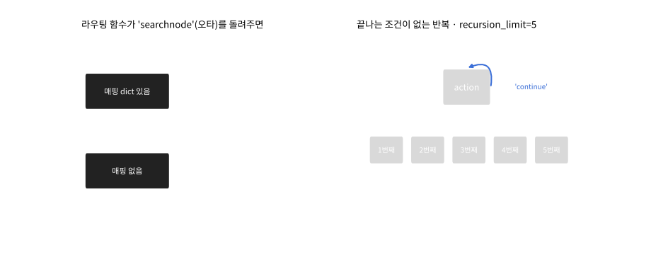

# Day 052 · 2026-11-20 (금)

`LLM (초거대언어모델)` · 12주차

> **한 줄 요약** — 어제의 일반 엣지(`add_edge`)는 다음 노드가 하나로 고정이었다. 오늘은 **조건부 엣지** `add_conditional_edges(시작 노드, 라우팅 함수, {이름: 노드})` 로 **상태를 보고 다음 길을 고르는** 그래프를 만들었다 — 질문을 SEARCH / NO_SEARCH 로 분류해서 최신 정보가 필요할 때만 Tavily 검색을 거쳐 답한다. 필기는 라우팅 함수 앞에서 멈춰 있어 교재 흐름대로 완성했고, 실행해 보니 필기에는 **`load_dotenv()` 를 부르지 않음**, 검색이 0개면 **`UnboundLocalError`**, LLM 이 `'SEARCH'` 처럼 **따옴표를 붙이면 검색을 건너뜀** 이 숨어 있었다. 매핑 없이 라우팅하면 그림이 틀리고 오타가 **조용히** 그래프를 끝내며, 반복 그래프의 기본 `recursion_limit` 은 25 가 아니라 **10007** 이었다.

📂 실습 노트북
- [`lecture/langgraph_conditional_edges.ipynb`](./lecture/langgraph_conditional_edges.ipynb) — 일반 vs 조건부 엣지 · 3단계 매핑 · 매핑 / `Literal` 과 그림 · 오타 이름 · 반복과 `recursion_limit` (교재 p.96~99)
- [`lecture/langgraph_search_router_agent.ipynb`](./lecture/langgraph_search_router_agent.ipynb) — 질문 분류 → (필요할 때만) Tavily 검색 → 답변 에이전트 완성 · 실행 경로 · 고친 부분 (교재 p.100~102, 필기 `LangGraph_실습3`)

📊 데이터 → 없음 (웹 검색은 실행할 때 Tavily 로)
🖼️ 그림 → [`lecture/images/`](./lecture/images/) — 🎬 **시뮬레이션 애니메이션(GIF) 5개** (노트북과 같은 그래프를 실제로 실행한 기록)
📖 교재 → `AI Agent` 교재 **p.96~102** (25-1. LangGraph 에이전트 — 조건부 엣지 · 실습 : 조건부 분기를 활용한 동적 에이전트 워크플로우 개요 · 작업 흐름) — 다음은 p.103 조건부 분기를 활용한 고객 응대 Chatbot Agent
📝 필기 → [`LangGraph_실습3.ipynb`](./lecture/LangGraph_실습3.ipynb) (노드 3개까지 · 라우팅 함수 정의에서 멈춤)

⚙️ **설치 · 실행** — `pip install langgraph langchain-openai langchain-tavily python-dotenv` → `.env` 에 `OPENAI_API_KEY` · `TAVILY_API_KEY` → 맨 위부터 실행 (**키가 없으면 `# 🧪` 가짜 LLM · 가짜 검색으로 끝까지 실행**)

> **출력 표시** — `# ⏳` 진짜 API 가 필요해 비어 있는 셀(2개) · `# 🧪` 가짜 LLM · 검색으로 실제 실행한 셀(그래프가 고르는 길과 오류는 진짜와 같음) · 표시 없음 = 실제 실행

---

## 1. 왜 조건부 엣지인가 (교재 p.96~98)



🎬 왼쪽 : 일반 엣지로 이은 체인은 B 에서 예외가 나도 다른 길이 없어 멈춘다. 오른쪽 : 조건부 엣지는 상태(일반 상식 / 최신 정보 / 결과 부족)에 따라 라우팅 함수가 C · B · D 중 하나를 고르고, D → A 처럼 **되돌아가는** 길도 만들 수 있다.

| | 일반 엣지 `add_edge(a, b)` | 조건부 엣지 `add_conditional_edges` |
|---|---|---|
| 다음 노드 | 만들 때 하나로 고정 | **실행할 때** 상태를 보고 고름 |
| 가능한 모양 | A → B → C | 분기 · 되돌아가기(반복) · 끝내기(`END`) |
| Mermaid 그림 | 실선 `-->` | 점선 `-.->` |

---

## 2. 3단계 매핑 (교재 p.99)

```python
workflow.add_conditional_edges(
    'action',                              # 1단계 : 어디서 출발할지 (시작 노드)
    should_continue,                       # 2단계 : 어떤 기준으로 판단할지 (라우팅 함수)
    {'continue': 'action', 'end': END},    # 3단계 : 결과에 따라 어디로 보낼지 (경로 매핑)
)
```



🎬 교재 코드를 '1씩 올리다가 3 이면 끝' 으로 채워 실제로 실행한 기록이다. `action` 이 n 을 바꾸면 `should_continue` 가 n 을 보고 `'continue'` / `'end'` 를 돌려주고, 매핑이 그 이름을 `action`(자기 자신) 또는 `END` 로 바꾼다.

- 라우팅 함수는 노드가 아니다 — **이름만 돌려주고 상태는 바꾸지 못한다**
- 매핑 키와 노드 이름이 다르면(`'continue'` → `'action'`) 그림의 점선 위에 키가 적힌다

---

## 3. 검색이 필요할 때만 Tavily 로 (교재 p.100~102 · 필기)

```python
class AgentState(BaseModel):
    messages: Annotated[list[BaseMessage], add_messages] = []
    needs_search: bool = False          # classifier_node 가 채움
    search_results: str = ''            # search_node 가 채움

def route_by_search_need(state: AgentState) -> Literal['search_node', 'answer_node']:
    return 'search_node' if state.needs_search else 'answer_node'

workflow.add_node('search_node', tavily_search_node)          # 노드 이름 ≠ 함수 이름
workflow.set_entry_point('classifier_node')                    # = add_edge(START, …)
workflow.add_conditional_edges('classifier_node', route_by_search_need,
                               {'search_node': 'search_node', 'answer_node': 'answer_node'})
workflow.add_edge('search_node', 'answer_node')
workflow.add_edge('answer_node', END)
agent = workflow.compile()
```



🎬 같은 그래프에 질문 3개를 넣은 실제 `stream` 기록(🧪 가짜 LLM · 검색). '2026년 엔비디아 2분기 실적' 은 `needs_search=True` → `search_node` 가 `search_results` 를 채우고 → 답변, '리스트 컴프리헨션' · '안녕하세요' 는 `classifier → answer` 로 바로 간다. 오른쪽은 노드를 지날 때마다 바뀌는 상태.

| 노드 | 읽는 것 | 돌려주는 것 |
|---|---|---|
| `classifier_node` | 마지막 질문 → LLM 에게 SEARCH / NO_SEARCH | `{'needs_search': bool}` |
| `search_node` (`tavily_search_node`) | 마지막 질문 → `TavilySearch(max_results=3)` → dict `{'results': [{url, content, …}]}` | `{'search_results': '출처 … 내용 …'}` |
| `answer_node` | `needs_search` · `search_results` 가 있으면 시스템 프롬프트에 `[웹 검색 결과]` 로 넣음 | `{'messages': [AIMessage]}` |

- `invoke()` 결과는 dict 이고, 검색을 건너뛴 질문의 결과에는 **`search_results` 키가 없다**(쓰인 항목만 들어옴) → `result.get('search_results', '')`

---

## 4. 실행해서 찾은 함정



🎬 LLM 의 단답 5가지를 세 방법으로 불리언으로 바꾼 실제 계산. 필기의 `== 'SEARCH'` 는 프롬프트를 따라 쓴 `'SEARCH'`(따옴표) · `Search.` 를 놓쳐 **검색을 건너뛰고**, `'SEARCH' in` 은 **`NO_SEARCH` 안의 SEARCH** 를 잡아 전부 검색으로 보낸다. 앞뒤 따옴표 · 마침표를 떼고 `==` 로 비교한 것만 모두 맞았다.



🎬 왼쪽 : 라우팅 함수가 `'searchnode'`(오타)를 돌려주면 매핑이 있을 때는 `KeyError` 로 바로 드러나지만, 매핑이 없으면 경고 한 줄만 남기고 `classifier_node` 에서 **조용히 끝난다**. 오른쪽 : 끝나는 조건이 없는 반복은 `recursion_limit=5` 에서 `GraphRecursionError` — 기본값은 10007 이다.

| 확인한 것 | 결과 |
|---|---|
| 매핑 없음 · 타입 힌트 없음 | 실행은 되지만 그림이 `classifier_node --> __end__` 로 **틀림** → 매핑 dict 나 `-> Literal[...]` |
| 기본 `recursion_limit` | **10007** (langgraph 1.2.21 `_internal/_config.py`, 환경 변수 `LANGGRAPH_DEFAULT_RECURSION_LIMIT`) · 25 는 `langchain_core` 의 기본값 — LLM 이 들어간 반복은 상태에 횟수를 두고 limit 을 직접 걸자 |
| `TavilySearch` 결과 0개 | `ToolException` 을 **던짐** · 다른 오류는 `{'error': …}` dict 를 **돌려줌** (langchain-tavily 0.2.18 소스) |

---

## 🔁 복습

**필기 · 교재에서 고친 부분**
- [x] 필기 `from dotenv import load_dotenv` 만 하고 **호출하지 않음** → `.env` 키가 안 들어가 `ChatOpenAI` · `TavilySearch` 생성에서 오류 → `load_dotenv(find_dotenv(usecwd=True))` (교재 p.100 1단계 'API 키 로드')
- [x] 필기 `tavily_search_node` 의 `except` 가 `combined_results` 를 정하지 않음 → 검색 결과 0개(`ToolException`)에서 **`UnboundLocalError`** → 기본값을 먼저 두고 오류 글을 상태에 남김
- [x] 필기는 `TavilySearch` 가 돌려주는 `{'error': …}` 를 '검색 결과가 없습니다' 로 처리해 오류가 가려짐 → `'error'` 키를 따로 처리
- [x] 필기 `decision == "SEARCH"` → 따옴표 · 마침표가 붙은 답을 놓침 (`in` 으로 바꾸면 `NO_SEARCH` 오판) → 앞뒤 기호를 떼고 비교하는 `parse_decision`
- [x] 필기가 '라우팅 함수 정의' 에서 멈춤 → `route_by_search_need` · 그래프 구성 · 컴파일 · 실행을 교재 p.100~101 대로 완성
- [x] 필기 오타 `Pydanctic` → Pydantic · `히스토뢰` → 히스토리 · `블리언` → 불리언 · `'reuslts'` → `'results'`
- [x] 교재 p.101 `work.add_edge("answer_node", END)` → `workflow.add_edge(...)` (그대로면 `NameError`)
- [x] 교재 p.101 그림 상자는 `tavily_search_node`, 엣지 코드는 `"search_node"` → 엣지에 쓰는 것은 `add_node` 의 **노드 이름** · `add_node('search_node', tavily_search_node)` 로 등록해야 맞다
- [x] 교재 p.96 목록에 '결재 반려 및 예외 상황 발생' 이 두 번 들어 있음 (중복)

**직접 해본 것**
- 교재 p.99 `should_continue` 를 채워 반복 · 종료 실행, Mermaid 점선 · 키 글자 확인
- 매핑 dict / 매핑 없음 / `Literal` 세 방식의 실행 경로와 그림 비교, 오타 이름 실험
- 끝나지 않는 반복으로 `GraphRecursionError` 를 내고 기본 `recursion_limit` 을 소스에서 확인
- langchain-tavily 소스로 `TavilySearch` 의 오류 처리 확인, 필기 검색 노드의 `UnboundLocalError` 재현
- 가짜 LLM · 가짜 검색으로 질문 3개 · 검색 실패의 실행 경로와 최종 상태 확인
- `FuncAnimation` 으로 컨베이어 vs 조건부 / 3단계 매핑 / 검색 분기 / 분류 비교 / 오타 · limit 애니메이션

**막혔던 부분 / 질문**
- [ ] 진짜 gpt-5-nano 는 '2026년' 이 없는 시사 질문(예 : '오늘 코스피')도 SEARCH 로 고르는가 — `# ⏳` 셀로 확인
- [ ] 분류를 문자열 대신 `with_structured_output(Literal['SEARCH', 'NO_SEARCH'])` 로 받으면 함정이 사라지는가
- [ ] 검색이 실패했을 때 `answer_node` 가 오류 글을 '검색 결과' 로 넣지 않게 — `search_ok: bool` 상태 항목?
- [ ] 결과가 부족하면 검색어를 바꿔 다시 검색하는 반복(재시도 횟수 + 조건부 엣지)
- [ ] 다음 시간 : RAG 체인을 노드로 감싸 조건부 분기하는 고객 응대 Chatbot Agent (교재 p.103~)

📂 [수업 자료 폴더](./lecture/) · [복습 자료 폴더](./review/)

---

## 🔗 참고 링크

- [LangGraph Graph API — 조건부 엣지 · 라우팅](https://docs.langchain.com/oss/python/langgraph/graph-api) · [Use the graph API (분기 · 반복 · recursion limit)](https://docs.langchain.com/oss/python/langgraph/use-graph-api)
- [GRAPH_RECURSION_LIMIT 오류](https://docs.langchain.com/oss/python/langgraph/errors/GRAPH_RECURSION_LIMIT)
- [langchain-tavily (TavilySearch)](https://docs.langchain.com/oss/python/integrations/tools/tavily_search) · [Tavily](https://tavily.com/)
- [python-dotenv](https://pypi.org/project/python-dotenv/)
- 이전 : [Day 051 — LangGraph 입문 · 상태 · TypedDict · Pydantic](../2026-11-19/README.md)
