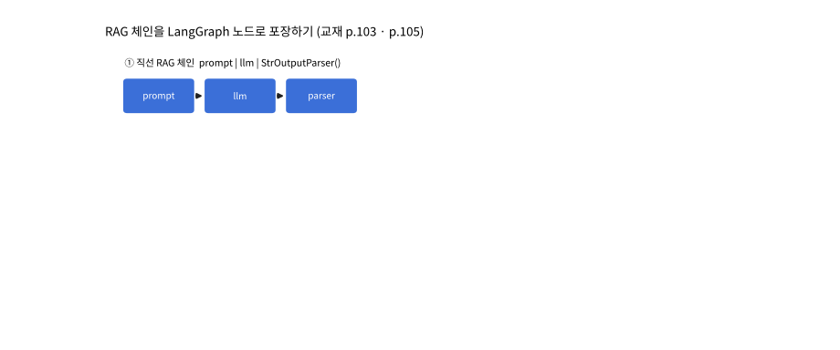
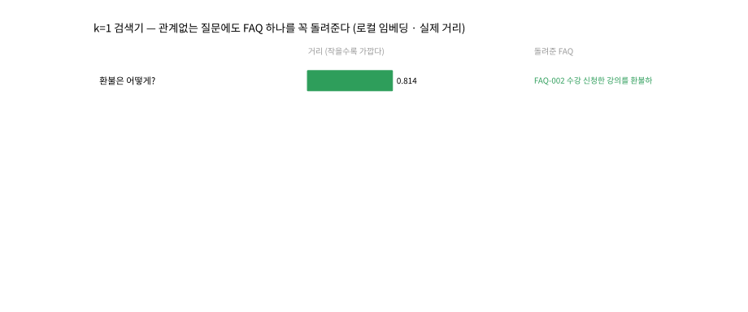
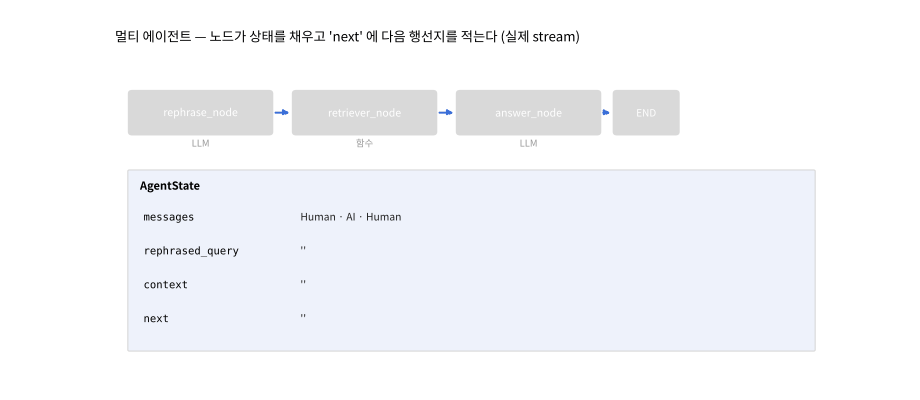
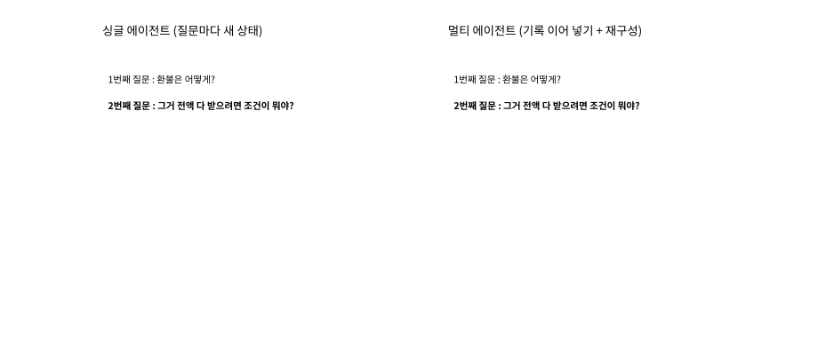
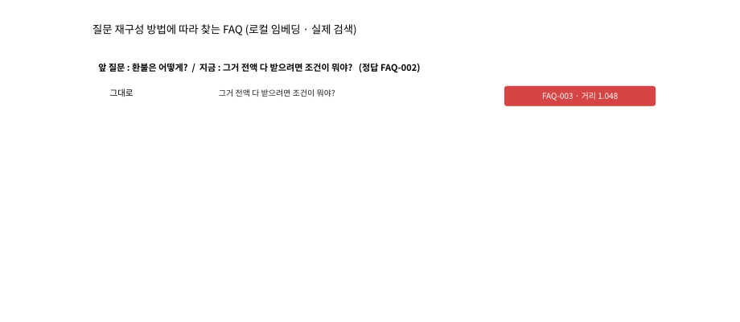

# Day 053 · 2026-11-23 (월)

`LLM (초거대언어모델)` · 13주차

> **한 줄 요약** — 지난주까지 만든 '직선' RAG 체인을 LangGraph **노드 하나**(`rag_node`)로 감싸 FAQ 고객 응대 **싱글 에이전트**를 만들고, 일을 **질문 재구성(LLM) → 문서 검색(함수) → 답변(LLM)** 세 노드로 나눈 **멀티 에이전트**로 키웠다. 실행해 보니 싱글 에이전트는 질문마다 새 상태로 시작해 '**그거** 전액 다 받으려면?' 을 수료증 FAQ 로 답했고, k=1 검색기는 '안녕하세요' 에도 FAQ 하나를 꼭 끼워 넣었다. 멀티 에이전트는 앞 대화를 `messages` 로 이어 넣고 질문을 다시 써서 환불 FAQ 를 찾았다 — 다만 재구성이 '이어 붙이기' 수준이면 주제가 바뀐 질문에서 틀리므로 **한 문장으로 다시 쓰는 LLM** 이 필요하다. 지난 시간 검색 에이전트의 수업 실행본(`실습3_1`)이 답한 NVIDIA 실적 숫자는 보도자료와 모두 맞았다.

📂 실습 노트북
- [`lecture/langgraph_single_agent_rag_chatbot.ipynb`](./lecture/langgraph_single_agent_rag_chatbot.ipynb) — FAQ RAG 를 노드로 · 저장소 함정 · k=1 검색 · 대화 루프 · 교재 p.105 조건부 분기판 (교재 p.103~106, 필기 `LangGraph_실습4`)
- [`lecture/langgraph_multi_agent_rag.ipynb`](./lecture/langgraph_multi_agent_rag.ipynb) — 싱글 vs 멀티 · 전용 체인 · 상태 확장 · `next` 라우터 · 이어서 묻기 · 재구성 품질 (교재 p.107~119, 필기 `LangGraph_실습5`)
- [`lecture/langgraph_search_router_class_run.ipynb`](./lecture/langgraph_search_router_class_run.ipynb) — Day 052 검색 분기 에이전트의 수업 실행 기록 · NVIDIA 실적 대조 (필기 `LangGraph_실습3_1`)

📊 데이터 → [`lecture/faq_manual.csv`](./lecture/faq_manual.csv) — 가상의 온라인 교육 플랫폼 FAQ 10개 (가입 · 환불 · 수료증 · 결제 · 동영상 · 자료 · 수강 기간 · 질문 게시판 · 입문 강의 · 모바일 앱)
🖼️ 그림 → [`lecture/images/`](./lecture/images/) — 🎬 **시뮬레이션 애니메이션(GIF) 5개** (같은 FAQ · 그래프를 실제로 실행한 기록)
📖 교재 → `AI Agent` 교재 **p.103~119** (실습 : 조건부 분기를 활용한 고객 응대 Chatbot Agent · 에이전트 유형 — 싱글 / 멀티 · 멀티 에이전트 적용 시 핵심 변화 포인트 5가지 · 실습 : 멀티 에이전트 RAG 시스템 구축) — 다음은 p.120 비동기 처리(async · await · 코루틴)
📝 필기 → [`LangGraph_실습3_1.ipynb`](./lecture/LangGraph_실습3_1.ipynb) (Day 052 완성 · 실행본) · [`LangGraph_실습4.ipynb`](./lecture/LangGraph_실습4.ipynb) (싱글 에이전트) · [`LangGraph_실습5.ipynb`](./lecture/LangGraph_실습5.ipynb) (멀티 에이전트 — 재구성 체인에서 멈춤)

⚙️ **설치 · 실행** — `pip install langgraph langchain-openai langchain-community langchain-chroma python-dotenv` → 같은 폴더에 `faq_manual.csv` · `.env`(`OPENAI_API_KEY`) → 맨 위부터 실행 (**키가 없으면 `# 🧪` 로컬 임베딩 · 가짜 LLM 셀로 끝까지 실행**)

> **출력 표시** — `# 📼` 수업 출력 옮김(실행 기록 노트) · `# ⏳` 키가 필요해 비어 있는 셀 · `# 🧪` 로컬 임베딩 · 가짜 LLM 으로 실제 실행(검색 순위 · 거리는 OpenAI 임베딩과 다를 수 있음) · 표시 없음 = 실제 실행

---

## 1. RAG 체인 → 노드 → 싱글 에이전트 (교재 p.103~106 · 필기 `실습4`)



🎬 `prompt | llm | StrOutputParser()` 체인을 `rag_node` 함수 안에 넣으면(검색은 그 앞에서 `retriever.invoke`) `START → rag_node → END` 그래프가 된다. 노드가 되면 앞뒤로 다른 노드와 조건부 엣지를 붙일 수 있다 — 교재 p.105 는 `classifier_node` 가 인사 · 일반 상식이면 검색 없이 `answer_node` 로 보낸다.

```python
loader = CSVLoader('faq_manual.csv', encoding='utf-8',
                   content_columns=['question', 'answer'], metadata_columns=['faq_id', 'category'])
retriever = Chroma.from_documents(docs, model, persist_directory=...).as_retriever(search_kwargs={'k': 1})

def rag_node(state: AgentState) -> dict:
    question = state.messages[-1].content
    context = retriever.invoke(question)[0].page_content
    return {'messages': [AIMessage(rag_chain.invoke({'context': context, 'question': question}))]}
```



🎬 로컬 임베딩으로 실제 검색한 거리. 환불 · 수료증 · 영상 질문은 맞는 FAQ 를 찾지만, k=1 검색기는 '그거 전액 …' · '안녕하세요' · '오늘 날씨' 에도 **가장 가까운 FAQ 하나를 꼭** 돌려준다 — 그 글이 그대로 컨텍스트가 된다. 앞의 것은 질문 재구성, 뒤의 둘은 검색 전 분류(p.105)가 필요한 이유다.

| 확인한 것 | 결과 |
|---|---|
| `content_columns` 만 | 메타데이터 `{'source', 'row'}` — `faq_id` · `category` 는 어디에도 안 남음 |
| `from_documents` 를 같은 폴더에 두 번 | 문서 **20개 (중복)** |
| 필기의 '폴더 있으면 불러오기' | 중복은 막지만 CSV · 임베딩 모델을 바꿔도 **옛 벡터** 사용 → 바꿀 때는 새 폴더 이름 |
| `while` + `input()` 루프 | 질문마다 `AgentState(messages=[질문])` 새로 → 앞 대화를 모름 |

---

## 2. 싱글 vs 멀티 에이전트 (교재 p.107~110)

| | 싱글 에이전트 | 멀티 에이전트 |
|---|---|---|
| 구조 | LLM 하나가 처음부터 끝까지 | 역할이 정해진 에이전트들이 **상태를 공유**하며 협력 |
| 장점 | 단순 · 디버깅 쉬움 | 역할 분담 · 새 에이전트 추가 쉬움 |
| 단점 | 일이 많으면 프롬프트 하나가 과부하 | 통신 · 오류 전파 · 관리가 복잡 |

- 📝 교재 p.110 '멀티 = 병렬로 성능 향상' 은 에이전트가 **동시에** 돌 때다. 오늘 구조는 차례로 이어져 LLM 호출이 1번 → 2번(재구성 + 답변)으로 늘어 **더 느리고 비싸다**. 얻는 것은 '그거' 를 풀어내는 정확도다

---

## 3. 멀티 에이전트 RAG — 핵심 변화 5가지 (교재 p.111~119 · 필기 `실습5`)

```python
class AgentState(BaseModel):
    messages: Annotated[list[BaseMessage], add_messages] = []
    rephrased_query: str = ''     # rephrase_node → retriever_node
    context: str = ''             # retriever_node → answer_node
    next: str = ''                # 노드가 적는 다음 행선지

def rephrase_node(state):                                   # LLM 노드
    history, question = state.messages[:-1], state.messages[-1].content
    return {'rephrased_query': rephrase_chain.invoke({'chat_history': history, 'input': question}), 'next': 'retriever_node'}

workflow.add_conditional_edges('rephrase_node', router, {'retriever_node': 'retriever_node'})   # router = lambda s: s.next
...
result = agent.invoke({'messages': chat + [HumanMessage(question)]})      # 앞 대화를 이어 넣는다
```



🎬 실제 `stream` 기록. `rephrase_node` 가 `rephrased_query` 를, `retriever_node` 가 `context`(FAQ-002) 를 채우고 각자 `next` 에 다음 노드 이름을 적으면 `router` 가 그 이름을 읽어 넘긴다. 마지막 `answer_node` 가 AI 답을 `messages` 에 덧붙이고 `next='end'`.



🎬 같은 두 번째 질문 '그거 전액 다 받으려면 조건이 뭐야?'. 싱글 에이전트는 messages 1개로 시작해 수료증 FAQ(✗), 멀티 에이전트는 앞 대화 3개를 받아 질문을 고친 뒤 환불 FAQ(✓)를 찾았다.



🎬 재구성 방법 3가지로 실제 검색한 결과. '앞 질문 + 지금 질문 이어 붙이기'(정리 노트의 🧪 가짜 재구성)는 환불 질문에서는 통하지만, '강의 영상이 안 나와요 → 그럼 그건 앱에서도 돼?' 에서는 앞 주제(동영상 FAQ-005)에 끌려간다. '모바일 앱에서도 강의 영상을 볼 수 있어?' 처럼 **한 문장으로 다시 쓰면** 둘 다 맞는다 — 교재가 재구성을 LLM 에 맡기는 이유.

| 변화 (p.111~116) | 싱글 | 멀티 |
|---|---|---|
| 1 노드 | `rag_node` | `rephrase_node`(LLM) · `retriever_node`(함수) · `answer_node`(LLM) |
| 2 상태 | `messages` | + `rephrased_query` · `context` · `next` |
| 3 흐름 | 직선 | 노드가 `next` 를 적고 `router` 가 읽는 조건부 엣지 |
| 4 체인 | `rag_chain` | `rephrase_chain`(질문만 고침) · `qa_chain`(응대만) |
| 5 대화 기록 | 없음 | `MessagesPlaceholder('chat_history')` + `messages[:-1]` / `messages[-1]` |

- 📝 지금은 노드마다 갈 곳이 하나라 `next` + `router` 는 `add_edge` 세 줄과 결과가 같다. 이 방식은 노드가 **실행 중에 길을 고를 때**(인사면 검색 건너뛰기, 결과가 없으면 재구성으로 되돌아가기) 쓸모가 생긴다

---

## 4. 지난 시간 검색 에이전트의 수업 실행 기록 (필기 `실습3_1`)

| 확인 | 결과 |
|---|---|
| 경로 | '리스트와 튜플 차이' → `classifier → answer` · 'Nvidia 2026년 2분기 실적' → `classifier → search → answer` |
| 분류 비용 | 단어 하나(`NO_SEARCH` · `SEARCH`)에 reasoning 토큰 **64 · 256개** — gpt-5-nano 는 추론 모델 |
| NVIDIA 답 | 매출 $96.2B(+106%) · 데이터센터 $89.0B · 영업이익 $63.7B · GAAP EPS 2.46 / 비GAAP 2.22 · 배당 $0.25 — **보도자료와 모두 일치** |
| 주의 | 'NVIDIA 2026년 2분기' 는 **회계연도 FY2027 Q2 = 2026년 5~7월** (FY2026 Q2 로 읽으면 2025년 5~7월 · 매출 $46.7B). GAAP EPS 가 비GAAP 보다 큰 것은 투자 평가이익 등 영업 외 손익 때문으로 오류가 아니다 |

---

## 🔁 복습

**필기 · 교재에서 고친 부분**
- [x] `실습4` · `실습5` `CSVLoader(content_columns=…)` 만 → `faq_id` · `category` 가 사라짐 → `metadata_columns` 추가
- [x] `실습4` · `실습5` '폴더가 있으면 불러오기' → CSV · 모델을 바꿔도 옛 벡터 사용 (확인 없이 `from_documents` 를 다시 부르면 중복 20개) → 데이터 · 모델마다 다른 폴더 이름
- [x] `실습4` `retrieved_docs[0]` → 결과가 비면 `IndexError` → 빈 결과 처리 · `'exit'` 비교에 `strip()`
- [x] `실습4` 대화 루프가 질문마다 새 상태 → '그거' 질문이 수료증 FAQ 로 → 멀티 에이전트에서 `messages` 를 이어 넣고 재구성
- [x] `실습5` 재구성 체인에서 멈춤 → 상태 확장 · 노드 3개 · `router` · 그래프 · 2턴 실행을 교재 p.111~116 대로 완성
- [x] `실습5` 재구성 프롬프트 '모호한 질문(예: …), …' → '모호한 질문**을**' (조사 빠짐) · `print(rephrase_prompt)` 대신 실제 메시지 순서 출력
- [x] `실습3_1` 변수 이름 `inital_state1` → `initial_state1` · `load_dotenv()` 호출 없음 (Day 052 정리 노트에서 고침)
- [x] 필기 오타 `백터` → 벡터 · 제목 `chatobt` → chatbot
- [x] 교재 p.105 `work.add_edge("answer_node", END)` → `workflow.add_edge` (p.101 과 같은 오타)
- [x] 교재 p.110 '멀티 = 병렬 처리로 성능 향상' → 오늘처럼 순차 구조면 LLM 호출이 늘어 더 느림 · 얻는 것은 정확도
- [x] 교재 p.114 'gpt-5-nano 급으로도 상용 성능' → 기대 효과일 뿐 보장 아님 (직접 확인할 것)
- [x] 교재 p.104 과정 2) '텍스트 분할' → FAQ 한 행이 2~3문장이라 필기 · 정리 모두 분할하지 않음

**직접 해본 것**
- FAQ 10개를 로컬 임베딩 Chroma 에 넣고 질문 6개 · 재구성 3가지의 거리를 실제로 계산
- 싱글 에이전트 대화 루프를 입력 목록으로 흉내 내 '기억 없음' 확인, 교재 p.105 분기판 구현
- 멀티 에이전트를 끝까지 만들어 2턴 대화 · `stream` 으로 상태 채워지는 순서 확인
- `실습3_1` 수업 출력의 NVIDIA 실적을 보도자료와 한 줄씩 대조
- `FuncAnimation` 으로 체인 → 노드 / k=1 검색 / 싱글 vs 멀티 / 상태 흐름 / 재구성 품질 애니메이션

**막혔던 부분 / 질문**
- [ ] 진짜 gpt-5-nano 재구성은 '그럼 그건 앱에서도 돼?' 를 '모바일 앱으로 강의를 들을 수 있나요?' 로 바꾸는가 — `# ⏳` 셀로 확인
- [ ] 검색 거리가 멀면(예 : 1.2 이상) 컨텍스트를 비우는 방법 vs 분류 노드 — 무엇이 나은가
- [ ] `invoke` 마다 `messages` 를 직접 이어 넣는 대신 체크포인터(`MemorySaver` · `thread_id`)로 대화 기억
- [ ] 분류 · 재구성 같은 짧은 일에 `reasoning_effort='minimal'` 을 주면 토큰 · 시간이 얼마나 줄어드는가
- [ ] 다음 시간 : 비동기 처리 — `async def` · `await` · `asyncio.run(main())` (교재 p.120~)

📂 [수업 자료 폴더](./lecture/) · [복습 자료 폴더](./review/)

---

## 🔗 참고 링크

- [LangGraph 멀티 에이전트 개요](https://docs.langchain.com/oss/python/langchain/multi-agent) · [Graph API (조건부 엣지)](https://docs.langchain.com/oss/python/langgraph/graph-api)
- [LangChain RAG 튜토리얼](https://docs.langchain.com/oss/python/langchain/rag) · [Chroma 통합](https://docs.langchain.com/oss/python/integrations/vectorstores/chroma)
- [CSVLoader](https://python.langchain.com/api_reference/community/document_loaders/langchain_community.document_loaders.csv_loader.CSVLoader.html)
- [NVIDIA Q2 FY2027 실적 보도자료](https://investor.nvidia.com/news/press-release-details/2026/NVIDIA-Announces-Financial-Results-for-Second-Quarter-Fiscal-2027/)
- 이전 : [Day 052 — LangGraph 조건부 엣지 · 검색 분기 에이전트](../2026-11-20/README.md)
