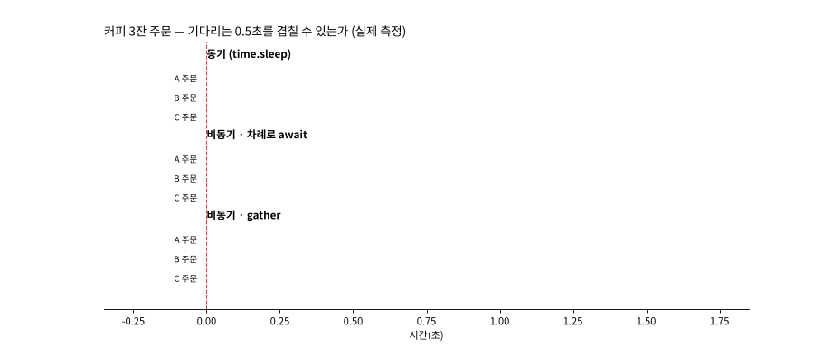
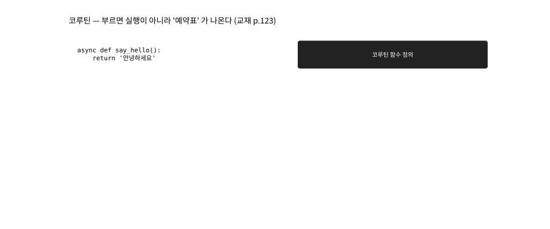
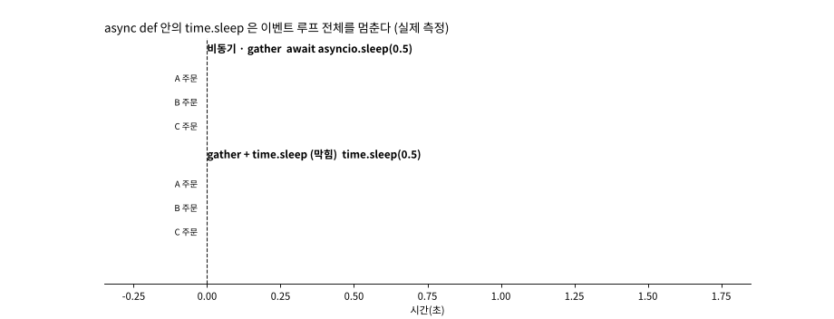
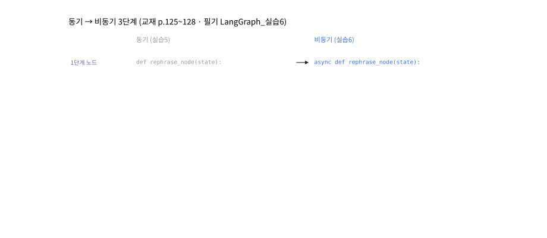
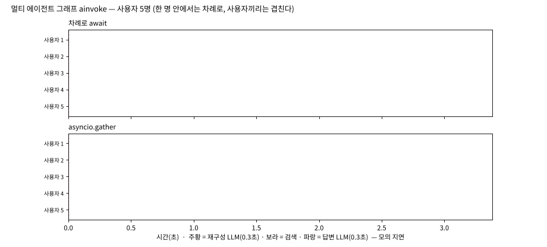

# Day 054 · 2026-11-24 (화)

`LLM (초거대언어모델)` · 13주차

> **한 줄 요약** — 응답을 기다리는(I/O) 시간이 대부분인 에이전트를 위해 **비동기 처리**를 배우고, 어제 완성한 멀티 에이전트 RAG 챗봇을 `async def` 노드 · `await … ainvoke` · `main()` 으로 바꿨다. 시간을 재 보니 `async` · `await` 를 붙이기만 해서는 빨라지지 않았다 — 커피 3잔을 차례로 `await` 하면 동기와 똑같이 1.5초, **`gather` 로 동시에 걸어야** 0.5초였다. 챗봇도 한 사람의 대화(재구성 → 검색 → 답변)는 0.67초로 같았고, **사용자 5명을 동시에** 받을 때 3.35초 → 0.94초로 줄었다. 필기 `실습6` 의 `main()` 은 입력 없는 `ainvoke()` 오류를 `except` 가 삼켜 **무한 반복**하는 구조라 고쳤고, Jupyter 에서는 교재의 `asyncio.run(main())` 대신 `await main()` 을 써야 한다. 어제 멈췄던 `실습5` 의 수업 완성본은 '그거' 를 '수강한 강의를 전액 환불' 로 풀어 맞는 FAQ 를 찾았다.

📂 실습 노트북
- [`lecture/python_asyncio_basics.ipynb`](./lecture/python_asyncio_basics.ipynb) — 동기 vs 비동기 시간 재기 · 코루틴 · 실행 방법 2가지 · 막는 호출 · I/O vs CPU (교재 p.120~124)
- [`lecture/langgraph_async_multi_agent_rag.ipynb`](./lecture/langgraph_async_multi_agent_rag.ipynb) — 비동기 3단계 · 그래프 · `main()` 고치기 · 1명 / 5명 시간 비교 (교재 p.125~128, 필기 `LangGraph_실습6`)
- [`lecture/langgraph_multi_agent_class_run.ipynb`](./lecture/langgraph_multi_agent_class_run.ipynb) — 동기 멀티 에이전트의 수업 3턴 대화 읽기 (필기 `LangGraph_실습5` 완성본)

📊 데이터 → [`lecture/faq_manual.csv`](./lecture/faq_manual.csv) — Day 053 과 같은 FAQ 10개
🖼️ 그림 → [`lecture/images/`](./lecture/images/) — 🎬 **시뮬레이션 애니메이션(GIF) 5개** (실제로 시간을 잰 기록)
📖 교재 → `AI Agent` 교재 **p.120~129** (LangGraph 에이전트 기능 업데이트 — 비동기 처리 : 개념 · 필요성 · 코루틴 · 실행 방법 / 고급 기능 적용 실습 — 비동기 처리 방식으로의 변화 3단계 · 실습 : 멀티 에이전트 RAG 시스템 업그레이드(1) / 체크포인팅 도입) — 다음은 p.130~ 체크포인팅 구현
📝 필기 → [`LangGraph_실습5.ipynb`](./lecture/LangGraph_실습5.ipynb) (동기 멀티 에이전트 완성 · 실행본) · [`LangGraph_실습6.ipynb`](./lecture/LangGraph_실습6.ipynb) (비동기판 — 그래프 · `main()` 미완성)

⚙️ **설치 · 실행** — asyncio 노트는 설치 없음. 에이전트 노트는 `pip install langgraph langchain-openai langchain-community langchain-chroma python-dotenv` → 같은 폴더에 `faq_manual.csv` · `.env` → 맨 위부터 실행 (**키가 없으면 `# 🧪` 로컬 임베딩 · 0.3초 가짜 LLM 으로 끝까지 실행**) · 필기의 `AsyncSqliteSaver` 는 `pip install langgraph-checkpoint-sqlite` 필요

> **출력 표시** — `# 📼` 수업 출력 옮김 · `# ⏳` 키가 필요해 비어 있는 셀 · `# 🧪` 로컬 임베딩 · 가짜 LLM 으로 실제 실행 · 표시 없음 = 실제 실행 (걸린 시간은 실행마다 조금씩 다름)

---

## 1. 동기 vs 비동기 — 기다림을 겹칠 수 있는가 (교재 p.120~122)



🎬 커피 한 잔에 0.5초씩 기다리는 주문 3개를 실제로 실행해 잰 시간. 동기(`time.sleep`)와 **비동기라도 차례로 `await`** 한 경우는 똑같이 1.5초, `asyncio.gather` 로 세 주문을 동시에 걸어야 0.5초다.

```python
async def order_async(name):
    await asyncio.sleep(0.5)          # 기다리는 동안 이벤트 루프에 양보 (진동벨)
    return f'{name} 커피'

[await order_async(n) for n in 'ABC']                       # 1.5초 — 하나씩
await asyncio.gather(*(order_async(n) for n in 'ABC'))      # 0.5초 — 동시에
```

| 개념 | 뜻 |
|---|---|
| 동기 (Blocking) | 결과가 올 때까지 다음 줄로 못 간다 |
| 비동기 | 기다리는 동안 **다른 코루틴**이 실행될 수 있다 — 기다릴 일이 여러 개일 때만 이득 |
| I/O 바운드 | LLM 호출 · 웹 검색 · DB · 파일처럼 **기다리는 시간**이 대부분 → 비동기가 효과 |
| CPU 바운드 | 계산만 하는 일 → `gather` 해도 그대로 (0.45초 vs 0.46초) |

---

## 2. 코루틴 · 실행 방법 (교재 p.123~124)



🎬 `say_hello()` 를 부르면 실행되지 않고 **코루틴 객체(예약표)** 만 나온다. `await` 해야 이벤트 루프가 실제로 돌리고, `await` 를 잊으면 결과 대신 객체와 'never awaited' 경고가 남는다.

| 어디서 | 실행 |
|---|---|
| `async def` 함수 안 | `result = await say_hello()` |
| `.py` 파일 | `asyncio.run(main())` — 프로그램에서 **딱 한 번** (교재 p.124 권장) |
| Jupyter · VS Code 노트북 | **`await main()`** — `asyncio.run` 은 `RuntimeError: … running event loop` |



🎬 같은 `gather` 라도 `async def` 안에서 `time.sleep` 을 쓰면 이벤트 루프가 그동안 멈춰 1.5초가 걸린다. 동기 함수는 `asyncio.to_thread` 로 넘기고(0.5초), LangChain 부품은 `invoke` 대신 `await … ainvoke` 를 쓴다.

---

## 3. 멀티 에이전트 RAG 챗봇을 비동기로 — 3단계 (교재 p.125~128 · 필기 `실습6`)



🎬 `실습5`(동기) → `실습6`(비동기)에서 바뀌는 줄만 나란히 놓았다. 노드는 `async def`, 체인 · 검색기 · 그래프 호출은 `await … ainvoke`, 실행은 `main()` 안에서. `add_node` · `add_edge` · `compile` 은 그대로다.

```python
async def rephrase_node(state: AgentState) -> dict:                 # 1단계
    if state.messages[:-1]:
        query = await rephrase_chain.ainvoke({...})                  # 2단계
    ...

async def main():                                                    # 3단계
    inputs = {'messages': []}
    while True:
        user_input = input('사용자: ')
        if user_input.strip().lower() == 'exit': break
        inputs['messages'].append(HumanMessage(content=user_input))
        try:
            final_state = await multi_agent.ainvoke(inputs)
        except Exception as e:
            print(f'오류: {e}'); break                              # 📝 무한 반복 방지
        inputs = final_state

await main()                 # Jupyter   /   asyncio.run(main())  # .py
```



🎬 같은 멀티 에이전트 그래프(모의 지연 : 재구성 · 답변 LLM 0.3초)를 사용자 5명에게 실행한 실제 기록. 한 사용자 안에서는 재구성 → 검색 → 답변이 차례로 이어지고(앞 결과가 필요하므로), **사용자끼리는 `gather` 로 겹쳐** 3.28초가 0.66초가 됐다.

| 측정 (🧪 LLM 0.3초) | 시간 |
|---|---|
| 1명 · 동기 `invoke` / 비동기 `ainvoke` | 0.67초 / 0.67초 — **같다** |
| 5명 · 차례로 (동기 / 비동기 `await`) | 3.35초 / 3.35초 |
| 5명 · `asyncio.gather` | **0.94초** |
| 동기 노드 그래프 + `ainvoke` + `gather` | 0.95초 — LangGraph 가 동기 노드를 스레드에서 돌림 |

---

## 4. 어제 그래프의 수업 실행 기록 (필기 `실습5` 완성본)

| 턴 | 사용자 | 재구성된 쿼리 |
|---|---|---|
| 1 | 수강 신청한 강의를 환불하고 싶어요 | (기록 없음 → 그대로 · LLM 호출 안 함) |
| 2 | 그거 전액 다 받으려면 조건이 어떻게 되나요? | 수강한 강의를 전액 환불받으려면 어떤 조건을 충족해야 합니까? |
| 3 | (같은 질문) | 수강 신청한 강의를 전액 환불받으려면 어떤 조건을 충족해야 합니까? |

- 진짜 LLM 은 '그거' 를 한 문장으로 풀어 써서 환불 FAQ 를 찾았고, 답의 조건(7일 이내 · 수강률 5% 미만)은 FAQ 와 일치
- 답변 1 · 2 의 출력 토큰 중 **추론 토큰이 88% · 84%** (896 / 1022 · 704 / 834)
- 답변이 '주문번호를 알려주시면 **고객센터로 전달해 드리겠습니다**' — 이 챗봇에 없는 기능을 약속했다

---

## 🔁 복습

**필기 · 교재에서 고친 부분**
- [x] `실습6` 그래프 구성 셀이 주석뿐 (`mult_agent` 오타 포함) → 동기판과 같은 `add_node` · `add_edge` · `compile` 로 채움
- [x] `실습6` `main()` 의 `await multi_agent.ainvoke()` → 입력이 없어 `TypeError` · `except` 가 출력만 하고 `while True` 로 돌아가 **같은 오류를 끝없이 출력** → `ainvoke(inputs)` · `input()` · `exit` · 오류 시 `break`
- [x] `실습6` `from langgraph.checkpoint.sqlite.aio import AsyncSqliteSaver` → `langgraph-checkpoint-sqlite` 설치 없으면 `ModuleNotFoundError` · 오늘은 쓰지 않음(다음 시간 체크포인팅)
- [x] `실습5` `inputs = final_state` → 앞 턴의 `rephrased_query` · `context` 까지 다음 입력에 남음(수업 출력에서 확인) → `{'messages': final_state['messages']}` 만 넘기는 편이 안전
- [x] `실습5` 답변이 없는 기능(주문 확인 · 고객센터 전달)을 약속 → 시스템 프롬프트에 '매뉴얼에 없는 절차 · 기능을 약속하지 말 것'
- [x] 교재 p.124 · p.128 `asyncio.run(main())` → `.py` 파일용 · Jupyter 는 `RuntimeError` → `await main()` (필기 주석이 맞음)
- [x] 교재 p.120~122 '비동기 = 기다리지 않고 다음 작업' → 동시에 걸어 둔 작업이 있을 때만 빨라짐 · 차례로 `await` 하면 동기와 같은 시간 · 한 사람의 챗봇 대화는 빨라지지 않음
- [x] 교재 p.125 번호 ① 다음이 ③ (② 빠짐)

**직접 해본 것**
- `asyncio.sleep` · `time.sleep` 으로 동기 / 차례로 `await` / `gather` / 막는 호출 / `to_thread` / CPU 계산 시간 재기
- Jupyter 안 `asyncio.run` 오류 재현 · 같은 코드를 `.py` 로 저장해 실행
- 필기 `실습6` 완성 · 비동기 노드 그래프에 `invoke` 해 `TypeError` 확인 · 필기 `main()` 의 오류 재현
- 같은 일을 하는 동기 · 비동기 그래프로 1명 / 5명 / `gather` 시간 비교
- `langgraph-checkpoint-sqlite` 를 설치해 `AsyncSqliteSaver` import 확인
- `FuncAnimation` 으로 카페 / 코루틴 / 루프 막힘 / 3단계 / 5명 gather 애니메이션 (실제 측정 시간)

**막혔던 부분 / 질문**
- [ ] 체크포인팅 — `AsyncSqliteSaver` + `thread_id` 로 `inputs = final_state` 없이 대화 기억하기 (교재 p.129~)
- [ ] `astream` 으로 답변을 토큰 단위로 흘려보내기 — 비동기의 또 다른 쓸모
- [ ] 한 질문 안에서 서로 기다릴 필요가 없는 일(여러 검색 · 여러 에이전트)을 병렬 노드로 동시에 — LangGraph 의 병렬 분기
- [ ] 진짜 gpt-5-nano 로 1명 / 3명 `gather` 시간 — `# ⏳` 셀

📂 [수업 자료 폴더](./lecture/) · [복습 자료 폴더](./review/)

---

## 🔗 참고 링크

- [Python asyncio — 코루틴과 태스크](https://docs.python.org/3/library/asyncio-task.html) · [asyncio.run · gather · to_thread](https://docs.python.org/3/library/asyncio-task.html#running-an-asyncio-program)
- [LangGraph Graph API](https://docs.langchain.com/oss/python/langgraph/graph-api) · [Use the graph API](https://docs.langchain.com/oss/python/langgraph/use-graph-api)
- [langgraph-checkpoint-sqlite (PyPI)](https://pypi.org/project/langgraph-checkpoint-sqlite/)
- 이전 : [Day 053 — 싱글 · 멀티 에이전트 RAG 챗봇](../2026-11-23/README.md)
