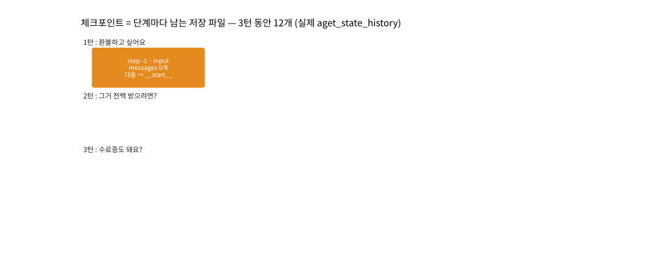
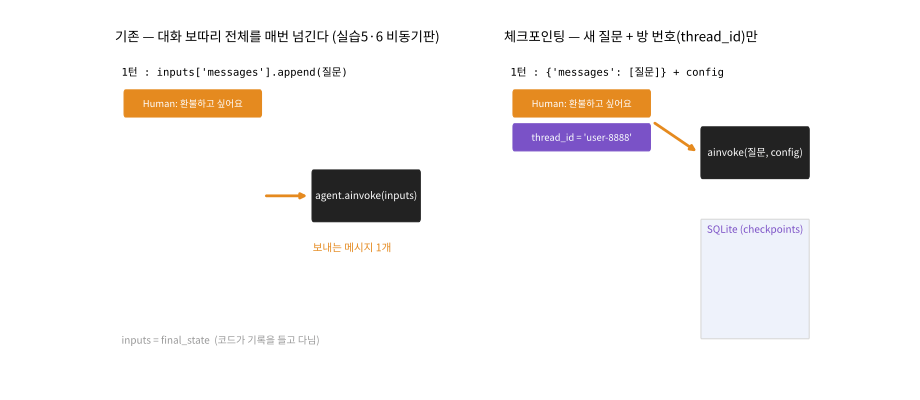
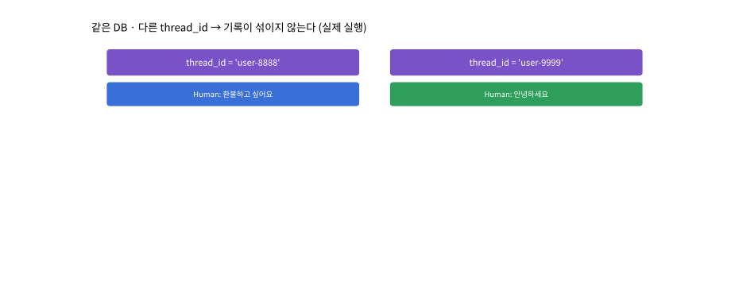
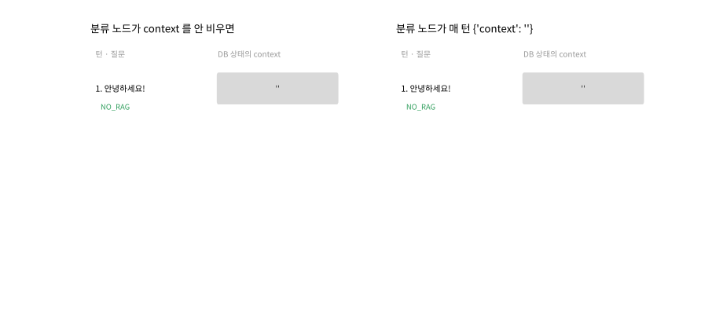
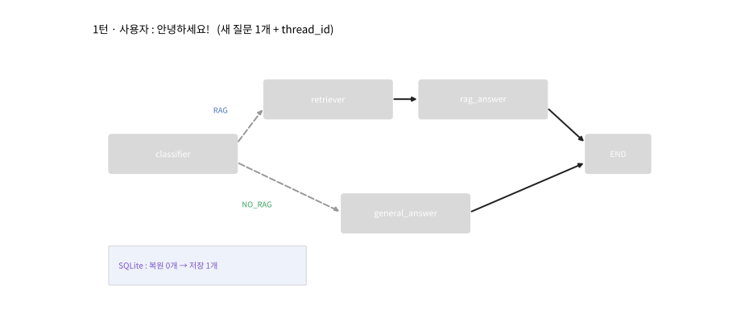

# Day 055 · 2026-11-25 (수)

`LLM (초거대언어모델)` · 13주차

> **한 줄 요약** — 지금까지는 대화 기록을 코드가 `inputs = final_state` 로 들고 다녔다. 오늘은 **체크포인터**(`AsyncSqliteSaver`)를 `compile(checkpointer=…)` 에 붙여, **새 질문 하나 + 대화방 번호(`thread_id`)** 만 넣으면 LangGraph 가 DB 에서 기록을 꺼내 합쳐 주게 했다. 실행해 보니 체크포인트는 한 턴에 (입력 + 시작 + 노드 수)개가 남고, 프로그램을 다시 켜도 같은 `thread_id` 면 대화가 이어졌으며, 노드에서 오류가 나면 `ainvoke(None, config)` 로 그 노드부터 다시 할 수 있었다. 다만 '자동 병합' 은 **리듀서가 있는 `messages` 만** 덧붙이는 것이라 `context` 같은 항목은 앞 턴 값이 그대로 남았다. MySQL 판(`AIOMySQLSaver`)은 MariaDB 서버를 직접 띄워 돌려 보니 필기의 '에러 방지 패치' 없이는 첫 저장에서 `TypeError` 가 났고, 마지막으로 **조건부 분기 + 비동기 + 체크포인팅**을 합친 `실습8` 을 끝까지 완성했다.

📂 실습 노트북
- [`lecture/langgraph_checkpoint_sqlite.ipynb`](./lecture/langgraph_checkpoint_sqlite.ipynb) — 용어 · 저장 · 복원 · thread_id · 오류 · 리듀서 없는 항목 · 이어 가기 · RAG 챗봇에 적용 · 수업 기록 · `chroma_db_multi` 구조 (교재 p.130~137, 필기 `LangGraph_실습6`)
- [`lecture/langgraph_checkpoint_mysql.ipynb`](./lecture/langgraph_checkpoint_mysql.ipynb) — aiomysql 패치 재현 · `.env` 접속 정보 · `AIOMySQLSaver` 실행 · SQLite vs MySQL (필기 `LangGraph_실습7`)
- [`lecture/langgraph_rag_router_async_checkpoint.ipynb`](./lecture/langgraph_rag_router_async_checkpoint.ipynb) — 조건부 분기 + 비동기 + 체크포인팅 RAG 챗봇 완성 (필기 `LangGraph_실습8`)

📊 데이터 → [`lecture/faq_manual.csv`](./lecture/faq_manual.csv) (FAQ 10개) · [`lecture/chroma_db_multi/`](./lecture/chroma_db_multi/) (수업 벡터 저장소 · OpenAI 임베딩 1536차원)
🖼️ 그림 → [`lecture/images/`](./lecture/images/) — 🎬 **시뮬레이션 애니메이션(GIF) 5개** (실제로 체크포인터를 돌린 기록)
📖 교재 → `AI Agent` 교재 **p.130~137** (LangGraph 에이전트 기능 업데이트 — 체크포인팅 : 용어 · 쓰임 · AsyncSqliteSaver · 구현 예시 / 고급 기능 적용 실습 — 체크포인팅 핵심 변화 포인트 3가지) — 다음은 p.138 실습 · p.139 PydanticAI Agent 로 LLM 출력 구조화
📝 필기 → [`LangGraph_실습6.ipynb`](./lecture/LangGraph_실습6.ipynb) (SQLite 체크포인터 · 실행본) · [`LangGraph_실습7.ipynb`](./lecture/LangGraph_실습7.ipynb) (MySQL 체크포인터 · 비밀번호만 가림) · [`LangGraph_실습8.ipynb`](./lecture/LangGraph_실습8.ipynb) (분기 + 비동기 + 체크포인팅 — 검색 노드에서 멈춤)

⚙️ **설치 · 실행** — `pip install langgraph-checkpoint-sqlite aiosqlite` (MySQL 판 : `langgraph-checkpoint-mysql aiomysql` + MySQL 서버 · `CREATE DATABASE langgraph_db`) → 같은 폴더에 `faq_manual.csv` · `.env`(`OPENAI_API_KEY` · `MYSQL_*`) → 맨 위부터 실행 (**키가 없으면 `# 🧪` 로컬 임베딩 · 가짜 LLM 으로 끝까지 실행**)

> **출력 표시** — `# 📼` 수업 출력 옮김 · `# ⏳` 키가 필요해 비어 있는 셀 · `# 🧪` 로컬 임베딩 · 가짜 LLM 으로 실제 실행 · 표시 없음 = 실제 실행 (MySQL 노트는 MariaDB 10.11 로 실제 실행)

---

## 1. 체크포인팅 — 용어 (교재 p.130~133)

| 용어 | 뜻 | 비유 |
|---|---|---|
| 체크포인트 | 한 단계가 끝난 직후의 상태 그 자체 (결과물) | 저장 파일 |
| 체크포인팅 | 상태를 저장하고 불러와 이어 가는 과정 (행위) | 저장하기 / 불러오기 |
| 체크포인터 | 어디에 · 어떻게 저장할지 아는 도구 — `AsyncSqliteSaver` · `AIOMySQLSaver` … | 메모리 카드 |
| `thread_id` | 체크포인트를 묶는 대화방 번호 | 세이브 슬롯 |

```python
async with AsyncSqliteSaver.from_conn_string('multi_agent.sqlite') as memory:     # 블록이 끝나면 연결이 닫힌다
    agent = graph.compile(checkpointer=memory)                                     # 외부 기억 장치 장착
    config = {'configurable': {'thread_id': 'user-8888'}}
    final_state = await agent.ainvoke({'messages': [HumanMessage(새 질문)]}, config=config)
```



🎬 노드 2개짜리 그래프를 3턴 실행한 뒤 `aget_state_history` 로 꺼낸 실제 체크포인트 12개. 한 턴마다 입력(주황) · 시작 · 노드 a 직후 · 노드 b 직후(파랑) 4개가 쌓인다.

---

## 2. 핵심 변화 포인트 3가지 (교재 p.135~137 · 필기 `실습6`)



🎬 왼쪽 : 기존에는 코드가 대화 전체(`inputs`)를 매번 들고 가서 넘겼다. 오른쪽 : 체크포인팅은 새 질문과 `thread_id` 만 넘기고, LangGraph 가 SQLite 에서 앞 기록을 복원해 합친다(3턴째 : 복원 4 + 새 질문 1 = 5개).

| 포인트 | 기존 | 체크포인팅 |
|---|---|---|
| 1 메인 루프 | `inputs['messages'].append(질문)` · `inputs = final_state` | `{'messages': [질문]}` + `config` |
| 2 프롬프트 · 노드 | `MessagesPlaceholder('chat_history')` · `state.messages[:-1]` | 그대로 — DB 가 복원한 기록이 이 길로 LLM 에 들어감 |
| 3 컴파일 | `graph.compile()` | `async with AsyncSqliteSaver… as memory: graph.compile(checkpointer=memory)` |



🎬 같은 DB 파일이라도 `thread_id` 가 다르면 기록이 섞이지 않는다(user-8888 은 6개, user-9999 는 2개).

| 확인한 것 | 결과 |
|---|---|
| config 없이 `ainvoke` | `ValueError: Checkpointer requires … thread_id …` |
| `async with` 블록 밖에서 `ainvoke` | `ValueError: no active connection` |
| 다시 연결 (프로그램을 다시 켠 것처럼) | 같은 thread_id 면 파일의 기록에 이어서 계속 |
| 노드 `b` 에서 오류 → `aget_state` | `next == ('b',)` · 노드 a 결과는 저장돼 있음 → **`ainvoke(None, config)`** 로 b 부터 이어서 성공 |

---

## 3. 📝 '자동 병합' 은 리듀서가 있는 항목만



🎬 분류 → (검색) → 답변 그래프를 체크포인터로 4턴 돌렸다. 왼쪽처럼 분류 노드가 `context` 를 비우지 않으면 4턴 '고마워요'(검색 안 함) 뒤에도 3턴의 환불 매뉴얼이 DB 상태에 **그대로 남는다**(빨강). 오른쪽처럼 분류 노드가 매 턴 `{'context': ''}` 를 돌려주면 깨끗하다.

- 체크포인터는 상태 **전체**를 복원한다. `messages`(`add_messages`)는 덧붙고, 리듀서 없는 `context` · `rephrased_query` · `needs_rag` 는 **앞 턴 값을 들고 시작**한다

---

## 4. MySQL 체크포인터 (필기 `실습7`)

```python
async with AIOMySQLSaver.from_conn_string(DB_URI) as memory:
    await memory.setup()                     # 테이블 생성 (DB 는 미리 CREATE DATABASE)
    multi_agent = graph.compile(checkpointer=memory)
```

| 확인 (MariaDB 10.11 로 실제 실행) | 결과 |
|---|---|
| 필기의 '에러 방지 처리' 셀이 하는 일 | `aiomysql 0.3.2` 가 PyMySQL 에서 가져오는 `escape_bytes_prefixed` 가 새 PyMySQL 에서는 **문자열 `'DO NOT IMPORT THIS!!!'`** → bytes(체크포인트)를 저장할 때 `TypeError: 'str' object is not callable` |
| 패치 후 | bytes 를 `X'636865…'` 16진수 리터럴로 → 2턴 대화 · 기록 복원 정상 |
| 테이블 | `checkpoints` · `checkpoint_blobs` · `checkpoint_writes` · `checkpoint_migrations` |
| SQLite 와 코드 차이 | `from_conn_string(DB_URI)` · `setup()` 뿐 — 그래프 · 노드 · `ainvoke(…, config)` 는 같다 |

---

## 5. 조건부 분기 + 비동기 + 체크포인팅 (필기 `실습8` 완성)



🎬 한 대화방에서 4턴 : '안녕하세요!' · '고마워요' 는 `classifier → general_answer`, '환불하고 싶어요' · '그거 전액 받으려면?' 은 `classifier → retriever → rag_answer`. 매 턴 새 질문 하나만 넣었고 SQLite 의 messages 는 2개씩 늘었다.

| 노드 | 하는 일 |
|---|---|
| `classifier_node` | 대화 기록 + 질문 → `RAG` / `NO_RAG` (후속 질문도 RAG) · 📝 `context` 비우기 |
| `retriever_node` | 기록이 있으면 질문 재구성 → Chroma 검색 (필기가 멈춘 곳) |
| `rag_answer_node` / `general_answer_node` | 매뉴얼 기반 답변 / 일반 대화 답변 — 둘 다 `chat_history` 를 받음 |

---

## 🔁 복습

**필기 · 교재에서 고친 부분**
- [x] `실습8` 검색 노드 중간에서 멈춤 → 검색 · 답변 노드 2개 · 라우팅 함수 · 조건부 그래프 · 체크포인터 실행까지 완성
- [x] `실습8` 분류 결과 `decision.strip().upper() == "RAG"` → 따옴표 · 마침표에 약함(Day 052) → 앞뒤 기호를 떼는 `parse_decision`
- [x] `실습8` 분류 노드가 `context` 를 그대로 둠 → 체크포인터가 앞 턴 매뉴얼을 들고 와 남음 → 매 턴 `context: ''`
- [x] `실습8` 오타 `이전 대화 매락` → 맥락 · `블리언` → 불리언 · 재구성 프롬프트 조사 빠짐('모호한 질문**을**')
- [x] `실습7` `mysql_password` 를 코드에 쓰고 `print(DB_URI)` 로 **비밀번호가 출력·저장됨** → `.env` + 출력 시 `****` · `quote_plus` 는 import 만 하고 안 씀 → 비밀번호를 `quote_plus` 로 감쌈 (올린 원본도 비밀번호만 가림)
- [x] `실습7` `setup()` 은 테이블만 만든다 → `langgraph_db` 데이터베이스는 미리 `CREATE DATABASE` 필요
- [x] `실습6` `thread_id='user-8888'` 고정 + DB 파일 유지 → 노트를 다시 실행하면 **지난 대화에 이어짐** (새 대화는 thread_id 를 바꾸거나 파일 삭제) · 기록이 계속 쌓여 프롬프트가 길어짐
- [x] 교재 p.131 ② '특정 노드가 실행된 직후의 상태' → 노드 직후 + **입력 시점 · 시작** 체크포인트도 저장됨 (한 턴 = 노드 수 + 2) · '해당한다..' 마침표 중복
- [x] 교재 p.132 ② '오류가 나면 마지막 체크포인트로 되돌아가 다시 시도' → 자동이 아니다 · 코드에서 `ainvoke(None, config)` 를 불러야 이어 감
- [x] 교재 p.135 '과거 기록을 새 질문과 병합(자동 누적)' → **리듀서가 있는 `messages` 만** 누적 · 다른 항목은 앞 턴 값 유지

**직접 해본 것**
- 노드 2개 그래프로 `aget_state` · `aget_state_history` · thread 분리 · config 없음 · 블록 밖 · 다시 연결 · 오류 후 이어 가기 실험
- 정리 환경에 MariaDB 를 설치 · 실행해 `AIOMySQLSaver` 를 패치 있음 / 없음으로 실제 실행
- 업로드된 `chroma_db_multi` 를 SQLite 로 열어 세그먼트 · 폴더 구조 확인, 저장된 OpenAI 벡터로 이웃 검색
- `실습8` 을 완성해 한 대화방 4턴 실행 (`astream` + `config`)
- `FuncAnimation` 으로 보따리 vs 방 번호 / 체크포인트 목록 / thread 분리 / 남는 context / 분기 + 체크포인트 애니메이션

**막혔던 부분 / 질문**
- [ ] 대화가 길어질 때 `trim_messages` 나 요약으로 최근 기록만 LLM 에 넘기기 (DB 에는 전부 남기고)
- [ ] `aget_state_history` 의 예전 `checkpoint_id` 를 config 에 넣어 **과거 시점으로 되돌려** 다시 실행 (time travel)
- [ ] 사용자마다 `thread_id` 를 어떻게 만들까 — 로그인 id + 대화방 id?
- [ ] 체크포인트 DB 에 대화 원문이 그대로 남는다 — 보존 기간 · 삭제 정책
- [ ] 다음 시간 : PydanticAI Agent 로 LLM 출력을 정해진 구조로 받기 (교재 p.139~)

📂 [수업 자료 폴더](./lecture/) · [복습 자료 폴더](./review/)

---

## 🔗 참고 링크

- [LangGraph Persistence (체크포인터 · thread · 상태 기록)](https://docs.langchain.com/oss/python/langgraph/persistence)
- [langgraph-checkpoint-sqlite (PyPI)](https://pypi.org/project/langgraph-checkpoint-sqlite/) · [langgraph-checkpoint-mysql (PyPI)](https://pypi.org/project/langgraph-checkpoint-mysql/)
- [aiomysql](https://github.com/aio-libs/aiomysql) · [PyMySQL](https://github.com/PyMySQL/PyMySQL)
- 이전 : [Day 054 — 비동기 처리 · 멀티 에이전트 비동기 업그레이드](../2026-11-24/README.md)
