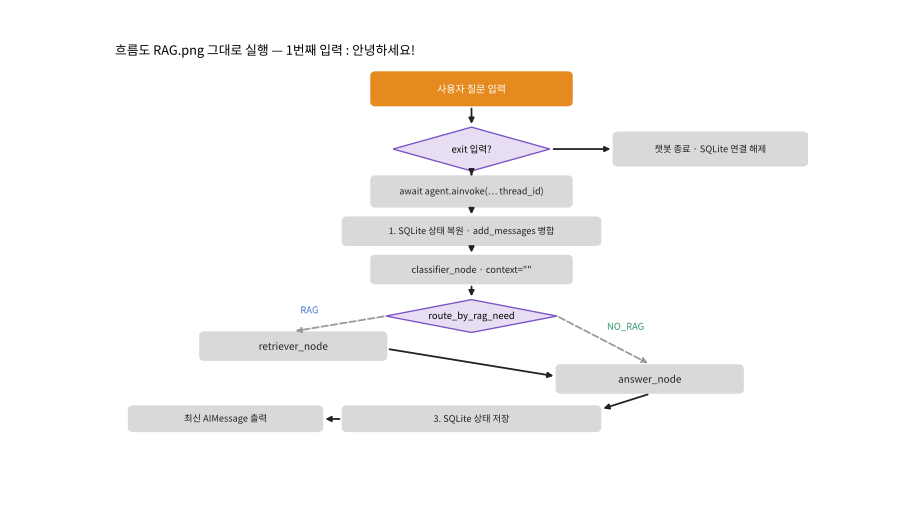
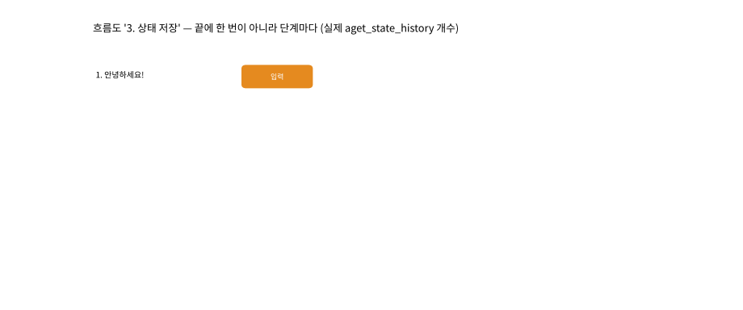
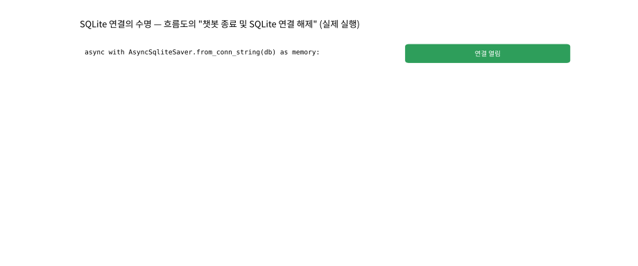
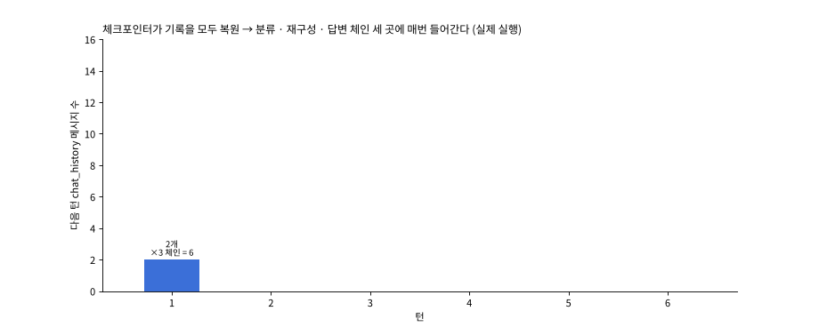
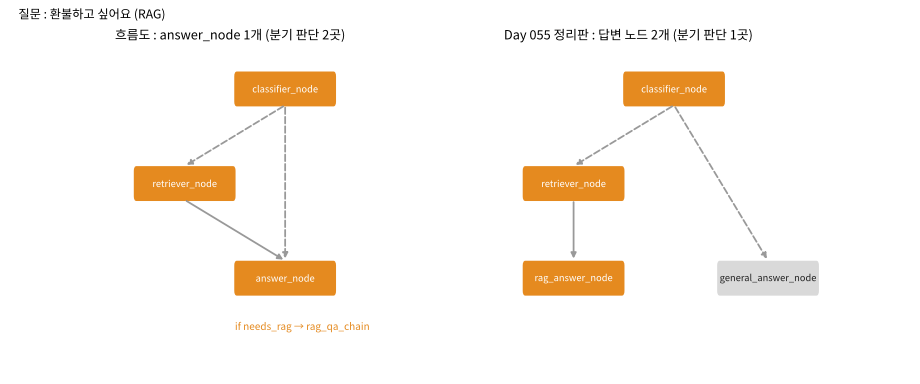

# Day 056 · 2026-11-26 (목)

`LLM (초거대언어모델)` · 13주차

> **한 줄 요약** — 오늘은 어제(Day 055) 필기 `실습8` 을 마무리하는 날이었고, 필기 노트북 3개는 **어제 것과 바이트 단위로 같았다**. 대신 수업에서 받은 흐름도 `RAG.png` 를 코드로 그대로 옮겼다: `exit` 까지 도는 입력 루프 → 체크포인터가 `thread_id` 로 기록 복원 → `classifier_node`(context 비우기) → `route_by_rag_need` → (`retriever_node`) → **하나의 `answer_node`** 안에서 RAG / 일반 체인 선택. 실행해 보니 흐름도에 두 번 그려진 `answer_node` 는 노드 하나였고, '3. 상태 저장' 은 끝에 한 번이 아니라 **노드마다**(한 턴 4~5개) 일어났다. `exit` 로 `async with` 를 나가면 연결이 닫히고 같은 `thread_id` 로 다시 연결하면 대화 8개가 그대로 돌아왔다. 마지막으로 어제의 '답변 노드 2개' 판과 비교했다.

📂 실습 노트북
- [`lecture/langgraph_rag_flowchart_single_answer.ipynb`](./lecture/langgraph_rag_flowchart_single_answer.ipynb) — 흐름도 구현 : 상태 · 노드 → `exit` 루프 · 턴마다 체크포인트 → 연결 해제 · 다시 연결 → 기록 길이 → 답변 노드 1개 vs 2개 (교재 p.138)
- 필기 `실습6_1` · `실습7` · `실습8` 의 정리 노트는 Day 055 와 같다 → [Day 055 수업 자료](../2026-11-25/lecture/) (SQLite 체크포인터 · MySQL 체크포인터 · 분기 + 비동기 + 체크포인팅 완성)

📊 데이터 → [`lecture/faq_manual.csv`](./lecture/faq_manual.csv) (FAQ 10개)
🖼️ 그림 → [`lecture/RAG.png`](./lecture/RAG.png) (수업 흐름도) · [`lecture/images/`](./lecture/images/) — 🎬 **시뮬레이션 애니메이션(GIF) 5개** (정리 노트를 실제로 실행한 출력)
📖 교재 → `AI Agent` 교재 **p.138** (실습 — 멀티 에이전트 RAG 시스템 업그레이드 : 체크포인팅 기능 구현) — 다음은 p.139 PydanticAI Agent 로 LLM 출력 구조화 ([Day 057](../2026-11-27/README.md))
📝 필기 → [`LangGraph_실습6_1.ipynb`](./lecture/LangGraph_실습6_1.ipynb) · [`LangGraph_실습7.ipynb`](./lecture/LangGraph_실습7.ipynb) (비밀번호만 `****` 로 가림) · [`LangGraph_실습8.ipynb`](./lecture/LangGraph_실습8.ipynb) — 셋 다 Day 055 와 같은 파일

⚙️ **설치 · 실행** — `pip install langgraph langgraph-checkpoint-sqlite aiosqlite langchain-openai langchain-chroma python-dotenv` → 같은 폴더에 `faq_manual.csv` · `.env`(`OPENAI_API_KEY`) → 맨 위부터 실행 (**키가 없으면 `# 🧪` 로컬 임베딩 · 가짜 LLM 으로 끝까지 실행**)

> **출력 표시** — `# ⏳` 키가 필요해 비어 있는 셀 · `# 🧪` 로컬 임베딩 · 가짜 LLM 으로 실제 실행 · 표시 없음 = 실제 실행

---

## 1. 흐름도 → 코드

| 흐름도 단계 | 코드 |
|---|---|
| 입력 · `exit` | `async with AsyncSqliteSaver.from_conn_string(…) as memory:` 안의 `while` — `exit` 면 `break` → 블록이 끝나며 연결 해제 |
| 1. 상태 복원 | `await agent.ainvoke({'messages': [HumanMessage(질문)]}, config={'configurable': {'thread_id': 'user-8888'}})` |
| 2. 워크플로우 | `classifier_node`(`needs_rag` · `context=''`) → `route_by_rag_need` → RAG : `retriever_node` → `answer_node` / NO_RAG : `answer_node` |
| `answer_node` | `rag_qa_chain if state.needs_rag else general_qa_chain` |
| 3. 상태 저장 | 노드가 끝날 때마다 자동 |
| 출력 | `final_state['messages'][-1].content` |

```python
def route_by_rag_need(state: AgentState) -> Literal['retriever_node', 'answer_node']:
    return 'retriever_node' if state.needs_rag else 'answer_node'

graph.add_conditional_edges('classifier_node', route_by_rag_need)   # Literal 로 갈 곳을 알려 줘 그림에도 두 갈래가 보임
graph.add_edge('retriever_node', 'answer_node')
graph.add_edge('answer_node', END)
```



🎬 흐름도 모양 그대로 4턴을 진행했다. '안녕하세요!' · '고마워요' 는 `classifier → answer`, '환불하고 싶어요' · '그거 전액 받으려면?' 은 `classifier → retriever → answer`(FAQ-002). 오른쪽 숫자는 실제 실행에서 나온 messages 수와 그 턴의 체크포인트 수다.

---

## 2. 📝 흐름도에서 짚을 점



🎬 턴마다 `aget_state_history` 로 센 체크포인트. 입력 · 시작 · 거친 노드마다 하나씩 쌓여 NO_RAG 턴은 4개, RAG 턴은 5개다. 중간 노드에서 실패해도 그 앞까지는 저장돼 있다.

| 흐름도 표현 | 실제 실행 |
|---|---|
| `[Node 3] answer_node` 상자 **두 개** | 이름이 같으면 **노드 하나** — 두 길(`retriever → answer` · `classifier -.-> answer`)이 같은 노드로 들어온다 |
| '3. 상태 저장 (최종 AgentState 영속화)' | 끝에 한 번이 아니라 **노드마다** 저장 (한 턴 4~5개) |
| '`add_messages` 리듀서: 과거 대화 + 새 HumanMessage 병합' | 맞다 — messages 2 → 4 → 6 → 8 |
| Node 1 '상태 갱신: needs_rag, `context=""`' | 맞다 — 마지막 NO_RAG 턴 뒤 `context` 는 `''` (비우지 않으면 앞 턴 매뉴얼이 남는 것은 Day 055 에서 확인) |
| 'SQLite 연결 해제' | `async with` 블록이 끝나면 닫힘 — 그 뒤 같은 `agent` 로 `ainvoke` 하면 `ValueError: no active connection` |



🎬 `async with` 안에서 4턴 → `exit` 로 블록을 나가면 연결이 닫혀 `no active connection` → 같은 파일 · 같은 `thread_id` 로 다시 연결하면 messages 8개 · `context ''` 가 그대로 복원된다 (노트북 출력에서는 `needs_rag False` 도 확인).

---

## 3. 📝 대화가 길어지면 — 프롬프트에 들어가는 기록



🎬 같은 대화방에서 6턴. 체크포인터가 기록을 **모두** 복원하므로 다음 턴 `chat_history` 는 2개 · 46자 → 12개 · 277자로 늘고, RAG 턴에는 분류 · 재구성 · 답변 체인 세 곳에 매번 들어간다.

- 긴 대화에서는 노드에서 `state.messages[:-1][-6:]` 처럼 최근 몇 턴만 넘기거나 `trim_messages` 를 쓰자 (DB 에는 전부 남는다)

---

## 4. 답변 노드 1개(흐름도) vs 2개(Day 055 정리판)



🎬 같은 질문이 두 그래프에서 가는 길. 왼쪽(흐름도)은 어느 질문이든 `answer_node` 로 모이고 안의 `if` 가 체인을 고른다. 오른쪽(Day 055)은 라우터가 `rag_answer_node` / `general_answer_node` 를 골라 그림만 봐도 어떤 답변을 했는지 보인다.

| | 흐름도 (`answer_node` 1개) | Day 055 정리판 (2개) |
|---|---|---|
| 노드 수 | 3 | 4 |
| 분기 판단 | 라우터 + `answer_node` 안의 `if` (두 곳) | 라우터 한 곳 |
| 그림 · `stream` 에 보이는 것 | 어느 답변 체인을 썼는지 안 보임 | 노드 이름으로 보임 |
| 장점 | 그래프가 단순 · 답변 후처리를 한 곳에 | 한 노드 = 한 일 · 따로 시험하기 쉬움 |

둘 다 같은 답을 낸다. 다만 분기 판단을 두 곳에 두면 한쪽만 고쳤을 때 어긋날 수 있다.

---

## 🔁 복습

**필기 · 흐름도 · 교재에서 고친 부분**
- [x] 흐름도 `[Node 3] answer_node` 가 두 번 그려짐 → 실제로는 노드 하나 (두 길이 같은 노드로 들어감)
- [x] 흐름도 '3. 상태 저장 (최종 AgentState 영속화)' → 끝에 한 번이 아니라 노드가 끝날 때마다 저장 (NO_RAG 턴 4개 · RAG 턴 5개)
- [x] 흐름도 `answer_node` 안에서 `needs_rag` 로 체인 선택 → 분기 판단이 라우터와 노드 두 곳에 있음 → 하나로 모으려면 답변 노드를 2개로 (Day 055 정리판)
- [x] 체크포인터가 기록을 모두 복원 → `chat_history` 가 턴마다 2개씩 늘어 체인 세 곳에 들어감 → 최근 몇 턴만 넘기기
- [x] 오늘 필기 3개는 Day 055 와 같은 파일 → 정리 노트는 Day 055 폴더 · `실습7` 은 올린 원본도 DB 비밀번호만 `****` 로 가림

**직접 해본 것**
- 흐름도대로 `classifier → (retriever) → answer` 그래프 · `Literal` 라우터 · `exit` 루프를 만들어 4턴 실행
- 턴마다 `aget_state_history` 로 체크포인트 수 세기 · `exit` 뒤 연결 해제 오류와 다시 연결 확인
- 6턴 동안 `chat_history` 개수 · 글자 수 측정
- 같은 질문을 답변 노드 1개 / 2개 그래프에 넣어 Mermaid 그림과 경로 비교
- `FuncAnimation` 으로 흐름도 4턴 / 노드별 저장 / 1개 vs 2개 / 기록 길이 / 연결 수명 애니메이션

**막혔던 부분 / 질문**
- [ ] 흐름도처럼 `input()` 루프를 쓰면 노트북 대신 웹(FastAPI · Streamlit)에서는 어떻게 바꿀까 — 요청마다 `thread_id` 를 받기
- [ ] `trim_messages` 로 토큰 기준으로 자르기 vs 오래된 대화를 요약해 두기
- [ ] 다음 시간 : PydanticAI Agent 로 LLM 출력을 정해진 구조로 받기 (교재 p.139~)

📂 [수업 자료 폴더](./lecture/) · [복습 자료 폴더](./review/)

---

## 🔗 참고 링크

- [LangGraph Persistence (체크포인터 · thread · 상태 기록)](https://docs.langchain.com/oss/python/langgraph/persistence)
- [LangGraph Graph API — 조건부 엣지](https://docs.langchain.com/oss/python/langgraph/graph-api)
- [langgraph-checkpoint-sqlite (PyPI)](https://pypi.org/project/langgraph-checkpoint-sqlite/)
- 이전 : [Day 055 — 체크포인팅 · AsyncSqliteSaver · MySQL · 분기 + 비동기 + 체크포인팅](../2026-11-25/README.md)
- 다음 : [Day 057 — PydanticAI Agent](../2026-11-27/README.md)
