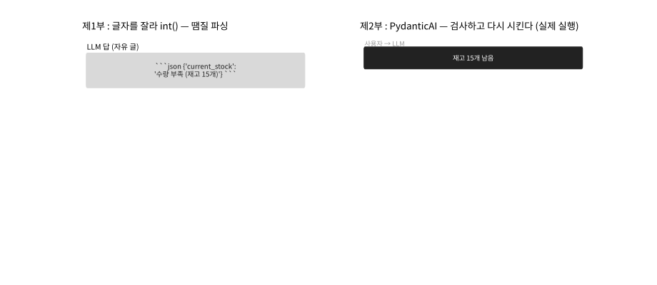
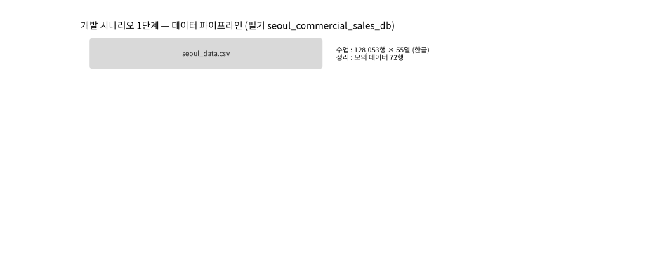
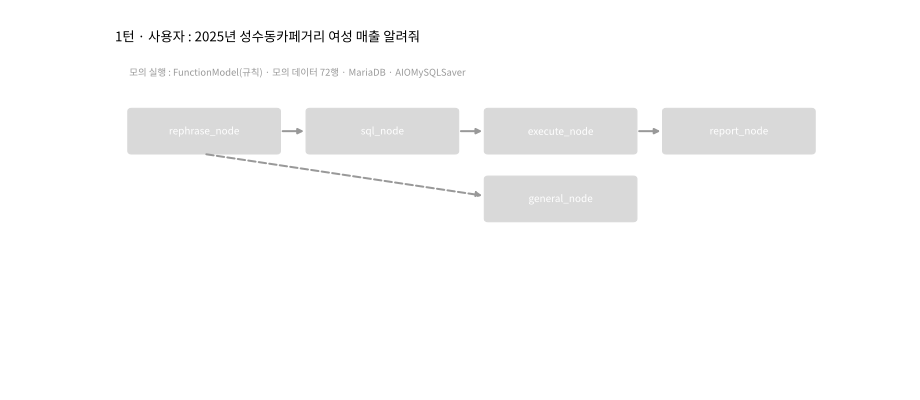
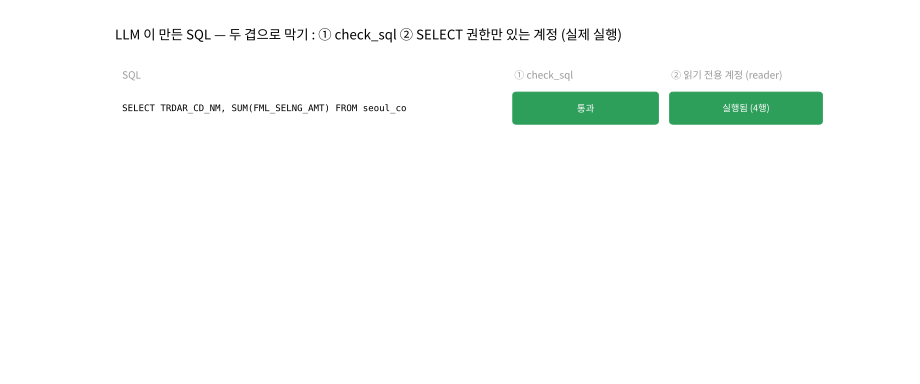

# Day 057 · 2026-11-27 (금)

`LLM (초거대언어모델)` · 13주차

> **한 줄 요약** — LLM 의 자유로운 글을 코드로 잘라 쓰면 숫자 자리에 '수량 부족 (재고 15개)' 가 와서 `int()` 가 터진다. **PydanticAI `Agent(output_type=BaseModel)`** 은 LLM 답을 Pydantic 으로 검사하고 틀리면 오류를 돌려줘 **다시 쓰게** 해서, 다음 노드가 `int` 를 믿고 계산할 수 있게 한다(재시도를 넘으면 예외 — '보장' 은 아니다). 이어서 서울시 상권 분석 멀티 에이전트를 시작했다 — 1단계는 추정매출 CSV(128,053행)의 한글 컬럼 55개를 영문으로 바꿔 MySQL 에 넣고, 2단계는 PydanticAI Agent 를 LangGraph 노드로 써서 **질문 재구성 → SQL 생성 → 실행 → 보고서**. 필기는 노드 함수가 비어 있어 끝까지 완성했고, 실행해 보니 LLM 이 만든 SQL 을 root 로 그대로 돌리는 위험 · 교재 예시 질문(2024년)이 데이터 기간(2025~2026)에 없다는 점 · 수업 출력에 찍힌 **gpt-5-nano 지원 종료(2026-12-11)** 경고를 확인했다.

📂 실습 노트북
- [`lecture/pydantic_ai_structured_output.ipynb`](./lecture/pydantic_ai_structured_output.ipynb) — 실패 시나리오 · `output_type` · 검사 → 재시도 · 노드 안에서 (교재 p.139~144, 필기 `pydantic_agent`)
- [`lecture/seoul_commercial_db_pipeline.ipynb`](./lecture/seoul_commercial_db_pipeline.ipynb) — 컬럼 매핑 · 양방향 검사 · `to_sql` (교재 p.145~147, 필기 `seoul_commercial_sales_db`)
- [`lecture/seoul_commercial_analysis_agent.ipynb`](./lecture/seoul_commercial_analysis_agent.ipynb) — 4단계 분석 에이전트 완성 · SQL 안전장치 · 4턴 실행 (교재 p.148~149, 필기 `data_analysis_agent`)

📊 데이터 → [`lecture/download.txt`](./lecture/download.txt) (한글 → 영문 컬럼 매핑 55개) · 수업의 `seoul_data.csv`(서울시 상권분석서비스 추정매출 · 2025년 1분기 ~ 2026년 2분기 · 128,053행)는 받지 못해 같은 컬럼의 **🧪 모의 데이터 72행**으로 실행
🖼️ 그림 → [`lecture/images/`](./lecture/images/) — 🎬 **시뮬레이션 애니메이션(GIF) 5개** (실제 실행 기록)
📖 교재 → `AI Agent` 교재 **p.139~149** (PydanticAI Agent 를 이용한 LLM 출력 구조화 — 예시 · 실패 / 성공 시나리오 · 핵심 로직 · 실습 / 25-2. 서울시 상권 분석 및 보고서 작성 멀티 에이전트 — 개발 시나리오 1단계 데이터 파이프라인 · 2단계 핵심 로직) — 다음은 p.150 개발 시나리오 3단계(바이브 코딩 웹 APP)
📝 필기 → [`pydantic_agent.ipynb`](./lecture/pydantic_agent.ipynb) (실행본) · [`seoul_commercial_sales_db.ipynb`](./lecture/seoul_commercial_sales_db.ipynb) (실행본 · 비밀번호만 가림) · [`data_analysis_agent.ipynb`](./lecture/data_analysis_agent.ipynb) (노드 주석에서 멈춤 · 비밀번호만 가림)

⚙️ **설치 · 실행** — `pip install "pydantic-ai-slim[openai]" langgraph langgraph-checkpoint-mysql aiomysql pandas sqlalchemy pymysql python-dotenv` → MySQL `CREATE DATABASE langgraph_db` → `.env` 에 `OPENAI_API_KEY` · `MYSQL_*` · `MYSQL_RO_*` → 파이프라인 노트 → 분석 노트 (**키가 없으면 `# 🧪` 가짜 모델로 끝까지 실행**)

> ⚠️ **gpt-5-nano 는 2026-12-11 에 지원이 끝난다** (수업 출력의 PydanticAI 경고 · OpenAI 지원 종료 목록에서 확인). 이 과정 노트북들의 `gpt-5-nano` 는 그 뒤에 모델 이름을 바꿔야 실행된다.

> **출력 표시** — `# 📼` 수업 출력 옮김 · `# ⏳` 키가 필요해 비어 있는 셀 · `# 🧪` 가짜 모델(FunctionModel) · 모의 데이터로 실제 실행 · 표시 없음 = 실제 실행 (MySQL 은 MariaDB 10.11)

---

## 1. LLM 출력 구조화 — PydanticAI `Agent` (교재 p.139~144)



🎬 왼쪽 : LLM 의 자유 글을 `split` · `replace` · `json.loads` 로 땜질해도 숫자 자리의 '수량 부족 (재고 15개)' 때문에 `int()` 에서 `ValueError`. 오른쪽 : PydanticAI 에 첫 답을 일부러 틀리게 준 실제 실행 — `int_parsing` 오류를 LLM 에 돌려보내고, 두 번째 답 `15` 가 통과해 `InventoryAnalysis(current_stock=15)` 가 나왔다.

```python
class InventoryAnalysis(BaseModel):
    item_name: str = Field(description='자재 품목 명칭')
    current_stock: int = Field(description='현재 재고 (숫자만)')

agent = Agent('openai:gpt-5-nano', output_type=InventoryAnalysis, system_prompt='…')
result = await agent.run('…재고는 현재 15개…')
result.output.current_stock      # int — 다음 노드가 바로 100 - 15 = 85 계산
```

| 확인 (🧪 `FunctionModel`) | 결과 |
|---|---|
| 첫 답 `'수량 부족 (재고 15개)'` → 두 번째 답 `15` | 검사 실패를 돌려줘 재시도 → 성공 · LLM 요청 2번 |
| 계속 틀린 답 | `UnexpectedModelBehavior: Exceeded maximum output retries (1)` → 노드에서 처리해야 함 |
| `'15'` (숫자로 읽히는 글자) | int 15 로 바꿔 받음 · 재시도 없음 |
| 📼 수업 (진짜 gpt-5-nano) | 한 번에 `current_stock=15` · 발주 85개 |

---

## 2. 서울시 상권 분석 1단계 — 데이터 파이프라인 (교재 p.145~147)


🎬 `download.txt` 의 한글 → 영문 매핑 55개(코드 · 이름 7 + 금액 24 + 건수 24). 영문은 서울시 상권분석 Open API 의 항목 이름 꼴이다. `STDR_YYQU_CD = 20262` 는 2026년 2분기.



🎬 `read_csv` → `rename` → 검사 → `to_sql(if_exists='replace')` → MySQL. 결과 테이블은 `BIGINT` · `TEXT` 열에 인덱스가 없다.

| 확인 | 결과 |
|---|---|
| 필기의 매핑 검사 | 한글 그대로 남은 열만 잡음 — CSV 에서 열이 **빠지면** 통과해 버림 → 반대 방향 검사 추가 |
| `to_sql` | 테이블을 지우고 새로 만듦 · 인덱스 없음 → 자주 거르는 `STDR_YYQU_CD` · `TRDAR_CD_NM` 에 인덱스 권장 |
| 교재 p.146 'API 수집 자동화 · `.py`' | 필기는 내려받은 CSV 를 노트북에서 읽음 |

---

## 3. 서울시 상권 분석 2단계 — 4단계 분석 에이전트 (교재 p.148~149)

```
rephrase_node (RephraseResult) ─ 데이터 질문 ─→ sql_node (SQLResult) → execute_node (aiomysql) → report_node (ReportResult)
                               └ 아니면 ─────→ general_node                       (AIOMySQLSaver · thread_id)
```



🎬 한 대화방 4턴의 실제 실행(🧪 규칙 모델 · 모의 데이터). 2턴은 교재 p.148 예시 그대로 — '그럼 거기와 흑리단길 … **2024년도** 여성 매출액은?' 이 '2024년도 성수동카페거리와 흑리단길 상권의 여성 매출액을 비교해 주세요' 로 재구성됐지만, 데이터가 2025~2026년뿐이라 **0행**. 3턴 '2026년으로 다시' 는 2행, 4턴 '고마워요' 는 `general_node`.



🎬 LLM 이 만든 SQL 을 두 겹으로 막는다 — ① 실행 전 검사(SELECT 한 문장만) ② SELECT 권한만 있는 계정. 검사를 건너뛴 `DELETE` 도 계정 권한에서 `1142 DELETE command denied`.

| 노드 | 하는 일 | 📝 정리본에서 더한 것 |
|---|---|---|
| `rephrase_node` | 대화 기록 + 질문 → 구체적 질문 · 데이터 조회 여부 | 매 턴 `sql_*` · `final_report` 비우기 (체크포인터) |
| `sql_node` | `SHOW CREATE TABLE` 스키마 → SQL | 영문 열 이름의 **한글 뜻**(`column_mapping`)도 프롬프트에 |
| `execute_node` | aiomysql 로 실행 · `Decimal` → int/float | **SELECT 검사 · 읽기 전용 계정** · 연결 닫기 · 실패를 `[{'error': …}]` 로 |
| `report_node` | 질문 + 결과 → 제목 · 본문 · 결론 | 결과가 비면 '데이터 없음' (숫자를 지어내지 않게) |
| `general_node` | 데이터가 필요 없는 질문 | — |

---

## 🔁 복습

**필기 · 교재에서 고친 부분**
- [x] `data_analysis_agent` 노드 5개가 주석뿐 → 교재 4단계대로 노드 · 라우팅 · 그래프 · `AIOMySQLSaver` 실행까지 완성
- [x] `data_analysis_agent` LLM 이 만든 SQL 을 **root 계정으로 그대로 실행** → 실행 전 SELECT 검사 + SELECT 권한만 있는 계정
- [x] `data_analysis_agent` 도구 함수가 DB 연결을 닫지 않음 → `finally: conn.close()`
- [x] `data_analysis_agent` 상태 `sql_result: list[dict]` 에 오류 **글자**가 들어갈 수 있음 → `[{'error': …}]` · 상태의 `final_report: ReportResult` → 체크포인터가 `Deserializing unregistered type` 경고(앞으로 차단) → dict 로 저장 권장
- [x] `data_analysis_agent` · `seoul_commercial_sales_db` 비밀번호를 코드에 쓰고 `print(DB_URI)` 로 출력 → `.env` (올린 원본은 비밀번호만 `****`)
- [x] `seoul_commercial_sales_db` 매핑 검사가 한쪽 방향뿐 → 빠진 열도 검사
- [x] `pydantic_agent` 성공을 `error_message='없음 (…성공)'` 으로 알림 → `status` 항목을 따로 · 주석 오타 `컴스텀` → 커스텀 · `APK key` → API key
- [x] 교재 p.141~142 'PydanticAI 가 형식을 **강제 · 보장**' → 검사하고 다시 시키는 것 · 재시도를 넘으면 `UnexpectedModelBehavior`
- [x] 교재 p.148 ② '**SQLite** 쿼리 자동 생성' → 필기 · 데이터는 **MySQL** · ③ '`asyncio.to_thread` 로 실행' → aiomysql 은 원래 비동기라 필요 없음
- [x] 교재 p.148 예시 '**2024년도** 여성 매출액' → 수업 데이터는 2025년 1분기 ~ 2026년 2분기라 결과 0행
- [x] 교재 p.146 'API 를 활용한 수집 자동화' → 필기는 CSV 파일 사용
- [x] 수업 출력 경고 : `gpt-5-nano` **2026-12-11 지원 종료** (OpenAI 목록에서 확인) — 이후 모델 이름 변경 필요

**직접 해본 것**
- PydanticAI `FunctionModel` 로 첫 답을 틀리게 해 검사 오류 → 재시도 → 성공의 메시지 흐름 확인, 재시도 초과 · 글자 숫자 · `TestModel` 실험
- 같은 55개 컬럼의 모의 데이터를 만들어 MariaDB 에 `to_sql` · 자료형 · 인덱스 확인
- 분석 에이전트 완성 · 읽기 전용 계정을 만들어 `DROP` · `DELETE` 차단 확인 · 교재 예시 질문으로 4턴 실행
- `FuncAnimation` 으로 파싱 vs PydanticAI / 컬럼 매핑 / 파이프라인 / 분석 4턴 / SQL 안전장치 애니메이션

**막혔던 부분 / 질문**
- [ ] 진짜 gpt-5-nano(또는 후속 모델)가 만든 SQL 의 정확도 — 분기 코드 범위 · 상권 이름 오타 · `GROUP BY` (⏳ 셀)
- [ ] 상권 이름이 사용자 표현과 다를 때(성수 카페거리 · 흑리단길?) — `LIKE` 검색 또는 이름 목록을 먼저 조회하는 노드
- [ ] SQL 이 틀려 오류가 나면 오류 메시지를 넣어 SQL 노드로 되돌아가는 반복(조건부 엣지 + `recursion_limit`)
- [ ] 다음 시간 : 개발 시나리오 3단계 — 바이브 코딩으로 웹 APP(`app.py`) (교재 p.150~)

📂 [수업 자료 폴더](./lecture/) · [복습 자료 폴더](./review/)

---

## 🔗 참고 링크

- [Pydantic AI — Agents · Output](https://ai.pydantic.dev/) · [OpenAI 지원 종료 목록 (Deprecations)](https://developers.openai.com/api/docs/deprecations) · [GPT-5 Nano 지원 종료일 2026-12-11](https://aiengineerguide.com/tools/model-retirements/gpt-5-nano/)
- [서울 열린데이터광장](https://data.seoul.go.kr/) · [pandas `DataFrame.to_sql`](https://pandas.pydata.org/docs/reference/api/pandas.DataFrame.to_sql.html)
- [LangGraph Persistence](https://docs.langchain.com/oss/python/langgraph/persistence) · [langgraph-checkpoint-mysql (PyPI)](https://pypi.org/project/langgraph-checkpoint-mysql/)
- 이전 : [Day 055 — 체크포인팅](../2026-11-25/README.md)
